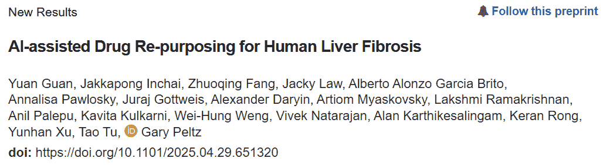
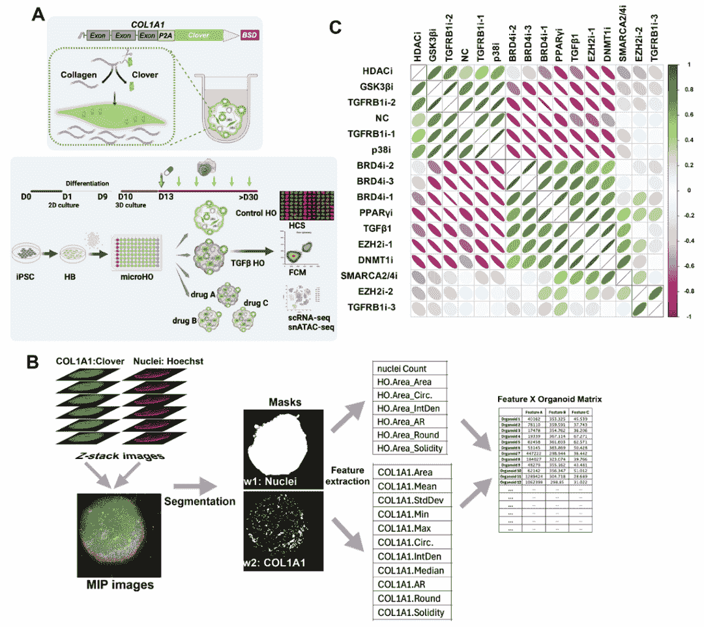
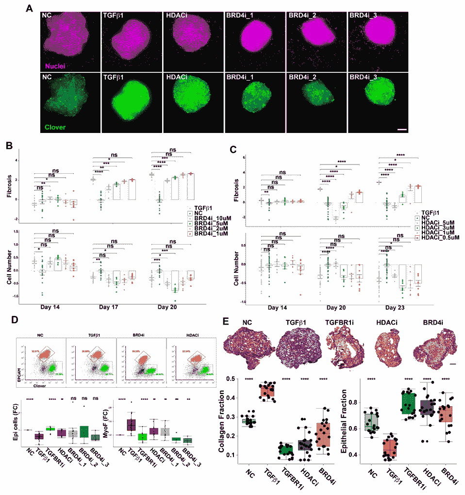
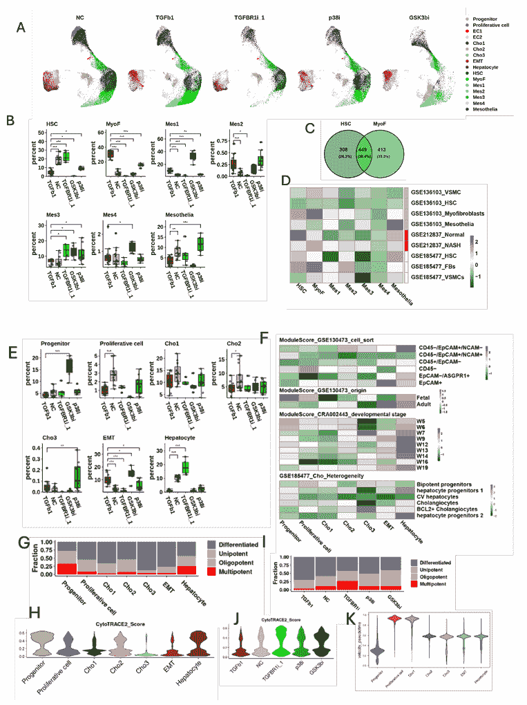
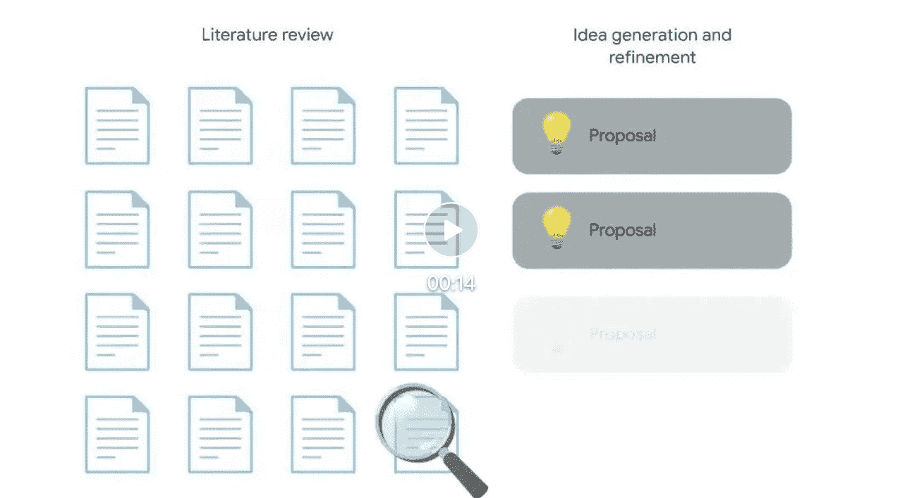

# 直接推荐肝纤维化治疗药物？谷歌AI co-scientist医学验证实例出炉

> 来源：[https://v11enp9ok1h.feishu.cn/docx/IHdIdYS6mopfcqxpgMUcgqC7nde](https://v11enp9ok1h.feishu.cn/docx/IHdIdYS6mopfcqxpgMUcgqC7nde)

曾记否？2025 年 2 月份 Google 推出了用于科学研究的多智能体 AI 系统——AI co-scientist。

AI co-scientist 是基于 Gemini 2.0 构建的，能够模拟科学方法背后的推理过程，可以发现新的、原创的知识，并根据先前的证据和特定的研究目标，制定出明显新颖的研究假设和提案。

最近，斯坦福大学（Stanford University）的研究人员与 Google DeepMind、Google  Research 等合作，探索了 AI co-scientist 在肝脏纤维化疾病方面的应用，并提出的了新的治疗方案与药物。

相关研究以「AI-assisted Drug Re-purposing for Human Liver Fibrosis」为题，于 2025 年 5 月 4 日发布在了 bioRxiv 预印平台。

论文链接：https://www.biorxiv.org/content/10.1101/2025.04.29.651320v1

肝纤维化是一种影响全球数百万人的恶性疾病，由于现有的动物模型和体外模型质量较差，治疗方案非常有限。

为了应对这一挑战，Google 的研究团队与斯坦福大学的 Gary Peltz 博士合作，探索如何让 AI co-scientist 帮助寻找这种复杂疾病的新治疗途径。

具体来说，他们委托 AI co-scientist 针对肝纤维化中导致肌成纤维细胞形成的表观遗传学改变提出新的假设，提出新的治疗方法，并设计实验方案进行验证。

研究人员利用一个多参数图像分析工作流程，对在微孔板（即 microHO）中培养的多谱系人肝类器官的抗纤维化疗效和药物毒性进行连续评估，并评估了 14 种药物的疗效。

值得注意的是，在三种 AI co-scientist 推荐的靶向表观基因组修饰因子的药物中，有两种表现出显著的抗纤维化活性。

对五种药物的抗纤维化作用分析表明，其中两种抑制了 TGFb 诱导的细胞内信号传导，三种药物改变了 TGFb 诱导的间充质细胞分化。由于这五种抗纤维化药物均能减轻 TGFb 诱导的染色质结构变化，因此表观基因组变化在肝纤维化的发病机制中发挥着重要作用。

图示：用 TGFRB1、p38 或 GSK3b 抑制剂处理的 microHO 中的细胞变化的特征。（来源：论文）

AI co-scientist 推荐的药物中，其中一款是 FDA 批准的抗癌药物伏立诺他（Vorinostat），它能将 TGFb 诱导的染色质结构变化降低 91%，并促进 microHO 中肝实质细胞的再生。

研究人员表示，AI co-scientist 可能发现了一种潜在的新一代肝纤维化治疗方法，同时还能促进肝脏再生。

研究人员在论文里表示，AI co-scientist 能够分析涵盖特定领域的海量科学文献，识别隐藏的联系，并提出可能催生新疗法的全新假设。值得注意的是，AI co-scientist 还能指导用于验证假设的研究步骤。

不过，由于生物医学研究的内在复杂性，AI 生成的假设仍然需要人类科学家进行严格的实验验证。

这些人工智能工具的目的是增强（而非取代）人类的科学推理能力；它们的使用将提升研究人员的发现能力，同时使他们能够对发现过程进行智力监督。

尽管如此，这项仍然是人工智能应用的一个重要里程碑，它表明人工智能赋能的科学可以显著加速众多生物医学领域的发展。

「我们早在二月份就预览过这项工作，但非常高兴看到全面的实验验证结果支持了共同科学家提出的假设。」研究人员在推文里表示，「值得注意的是，这项工作是使用去年的旧版本系统完成的。我们在最新的 Gemini 2.5 模型上取得了显著进展。更多进展即将公布！」

鉴于 Gemini 2.5 模型的强大能力，我们可以期待一下接下来的研究进展。

相关内容：

https://x.com/vivnat/status/1920357328957604187

https://research.google/blog/accelerating-scientific-breakthroughs-with-an-ai-co-scientist/