# tokenizer：如何打造一个全能视觉翻译器

> 来源：[https://v11enp9ok1h.feishu.cn/docx/SoOEdpA7IoKp8kxdZ8fcDhinnRE](https://v11enp9ok1h.feishu.cn/docx/SoOEdpA7IoKp8kxdZ8fcDhinnRE)

# 字节—`UniTok`

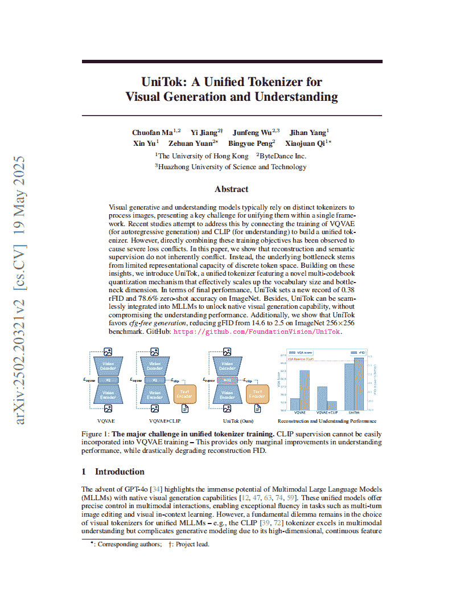

[2502.20321v2.pdf](https://internal-api-drive-stream.feishu.cn/space/api/box/stream/download/all/DBcFbHMxyouFToxC3hzcYNVjnod)

本代码库实现了 `UniTok`，这是一个统一的可视化分词器，非常适合生成和理解任务。它兼容自回归生成模型（例如 `LlamaGen`）、多模态理解模型（例如 `LLaVA`）以及统一的 `MLLM`（例如 `Chameleon` 和 `Liquid`）。

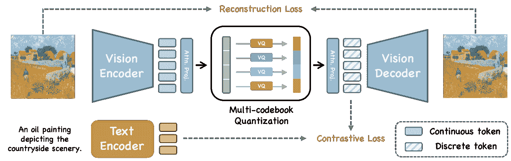

[在 `UniTok`](https://github.com/FoundationVision/Liquid/) 的基础上，我们使用 `Liquid` 框架构建了一个能够进行多模态生成和理解的 `MLLM`，这在统一自回归 `MLLM` 中树立了新的最高水平。

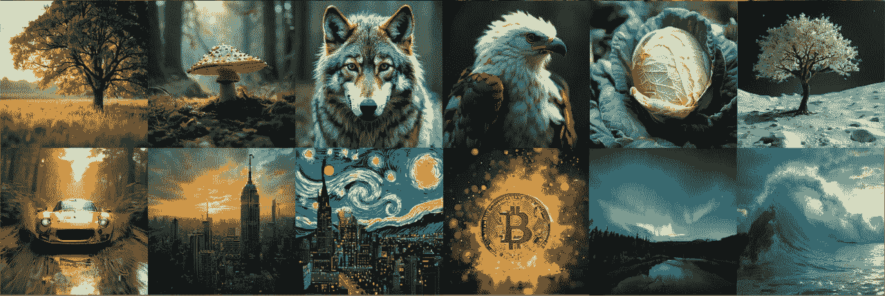

## 用法

### 要求

+ `Python` ≥ 3.10

+ `PyTorch` ≥ 2.3.1

### 安装

```
git clone https://github.com/FoundationVision/UniTok.git
cd UniTok
pip install -r requirements.txt
```

### 推理

请下载[检查点](https://huggingface.co/FoundationVision/unitok_tokenizer)并填写`ckpt_path`。

```
python inference.py \
    --ckpt_path /path/to/unitok_tokenizer.pth \
    --src_img /path/to/test_img --rec_img /path/to/rec_img
```

### 训练

+ [我们在`DataComp-1B`](https://github.com/mlfoundations/datacomp)上训练 `UniTok` 。请按照[说明](https://github.com/mlfoundations/datacomp?tab=readme-ov-file#downloading-datacomp-1b)下载并准备数据。

+ 下载用于损失计算的[模型](https://huggingface.co/FoundationVision/unitok_external)并将其放在 `./external` 下。

+ 下载[`ImageNet` 验证集](https://www.image-net.org/)以进行零样本准确度评估。

+ [下载 `ImageNet` 256$\times$256参考批次](https://huggingface.co/datasets/FoundationVision/imagenet_reference_batch)以进行 `FID` 评估。

配置`nnodes`, `nproc_per_node`, `node_rank`, `master_addr`, `master_port`并`launch.sh`运行：

```
bash launch.sh \
    --output_dir &#x27;/path/to/save/checkpoints/&#x27; \
    --train_data &#x27;/path/to/datacomp/shards/{00000000..00140146}.tar&#x27; \
    --imagenet_val &#x27;/path/to/imagenet_val/&#x27; \
    --fid_eval_src &#x27;/path/to/imagenet_reference_batch&#x27; \
    --fid_eval_dst &#x27;/path/to/save/imagenet_reconstructed_batch&#x27;
```

注：更多超参数配置请查阅`utils/config.py`。

## 1.1 方法详解：如何打造一个全能视觉翻译器

**统一的训练目标**

首先，为了让这个翻译器同时具备生成和理解的能力，研究人员给它设定了两个训练目标，让它在训练时同时学习：

1. 重建细节（`VQVAE-based Loss`）：这部分是为了保证翻译器能准确地记住图片的细节，以便能高质量地重建（画出）图片。这个损失包含了好几个部分：

- 像素级别的重建误差，看生成的图片和原图像素差多少。

- 感知损失，用 `LPIPS` 指标衡量，更关注人眼看起来像不像。

- 判别器损失，引入一个判别器来判断生成的图片够不够真实，提升保真度。

- 向量量化损失，让编码器的输出尽量靠近“字典”里已有的词汇。

总的重建损失是这几项加权求和：

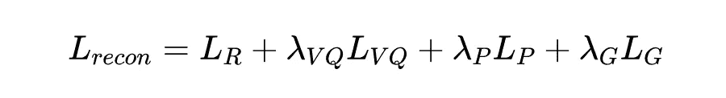

## 1.2 揪出性能瓶颈：量化过程是关键

研究人员发现，虽然想法很好，但光是把这两个目标加起来训练，理解能力还是比不过专门的`CLIP`，效果不太行。于是他们深入分析了从 `CLIP` 到这种统一 tokenizer 的过程中，到底是什么影响了性能（见下图 3 的分析过程）：

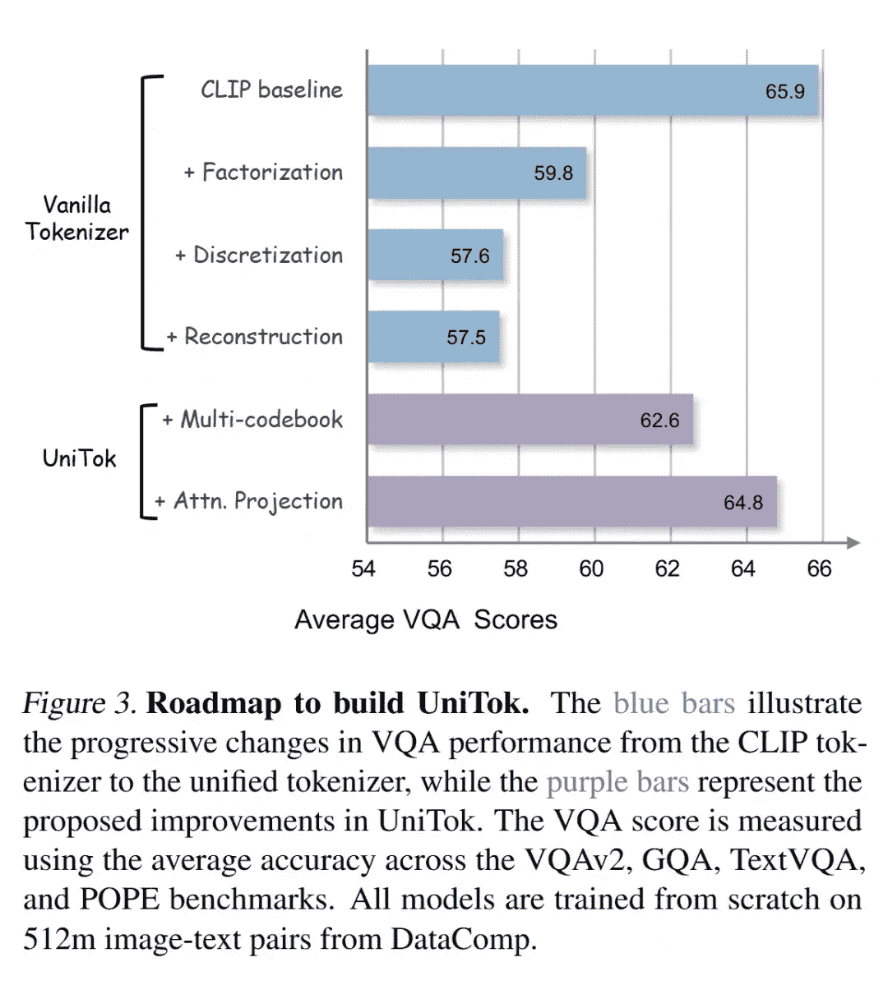

> Token 分解（Factorization）：现在的 VQ 类 tokenizer 通常会先把高维的视觉特征（比如 768 维）压缩到一个很低的维度（比如 16 维），再去查字典找对应的离散 token。

> 这个过程叫“分解”。他们发现，即使只是在 `CLIP` 模型里加上这个简单的线性压缩再解压的操作（还没加量化和重建），模型在下游问答任务（`VQA`）上的性能就会大幅下降。这说明这种简单的压缩方式损失了太多重要信息。

> 离散化（Discretization）：在分解的基础上，再把压缩后的低维特征强制映射到“字典”（`codebook`）里最接近的那个离散 token 上，这就是离散化。视觉 tokenizer 的字典通常比语言模型小得多（比如只有 4k 到 16k 个词）。

> 研究发现，把连续特征硬塞进这么小的离散空间，又会造成明显的信息损失，导致 `VQA` 性能再次下降。

结论：研究人员因此认为，所谓的“损失冲突”只是表面现象，真正限制统一 tokenizer 性能的根本原因，是离散 token 本身的表达能力太有限了，装不下那么多信息。

## 1.3 核心技术：提升 Token 表达力

为了打破这个瓶颈，研究人员提出了两个关键技术：

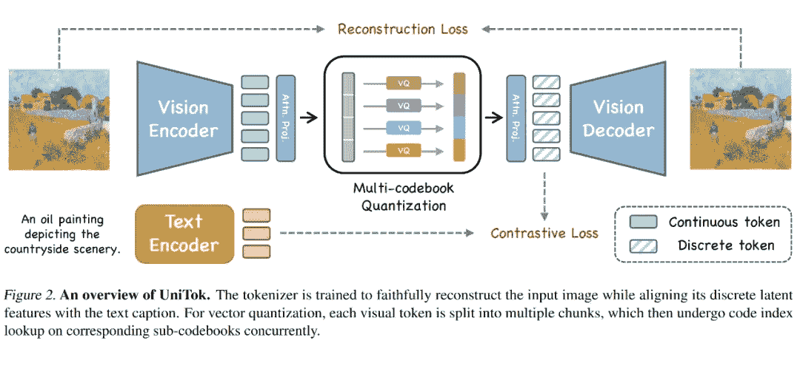

多码本量化（`Multi-codebook` Quantization, `MCQ`）：

+ **想法**：既然一个字典不够用，那就用多个小字典！具体来说，他们把一个低维的视觉特征向量（比如 64 维）切成小块（比如切成 8 块，每块 8 维）。

+ **操作**：然后，每一小块都用一个独立的子字典去进行量化（查字典找最近的词），得到量化后的块。

+ **合并**：最后把所有量化后的子块拼起来，得到最终的离散表示。

公式表示为：

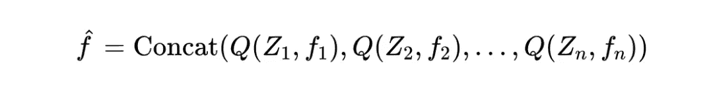

**好处**：这样做的好处是，虽然每个子字典可能不大（比如 4096 个词），但组合起来能表达的可能性就指数级增长了（比如 8 个 4k 的子字典，理论词汇量达到，远超单个大字典）。

这极大地提升了离散 token 的表达空间，同时因为每个子字典规模可控，又避免了训练单个超大字典的优化难题。而且，潜在的编码维度也随着子字典数量增加了（比如 8 个 8 维子块，总维度 64 维）。

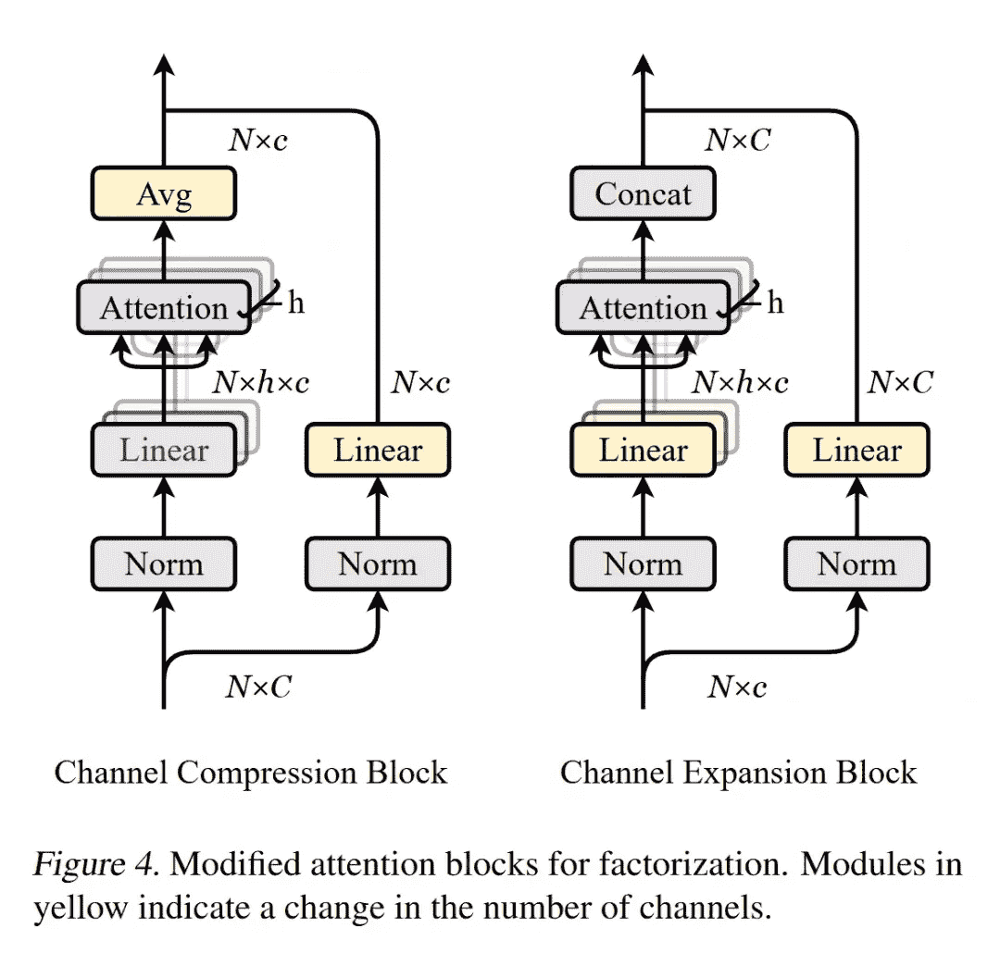

注意力分解（Attention Factorization）：

+ **问题**：前面提到，用简单的线性层做 token 分解（高维压缩到低维）会损失很多信息。

+ **改进**：研究人员建议使用多头注意力（`Multi-Head Attention`）模块来替代简单的线性层进行分解（具体结构见图 4，包含一个通道压缩块和一个通道扩展块）。

+ **效果**：尽管这个改动很简单，但实验发现它能有效地保留原始 token 中的语义信息，提升分解后特征的表达能力。特别地，为了能用于自回归生成任务，这里的注意力模块使用的是因果注意力（`causal attention`）。

## 1.4 将 `UniTok` 融入统一 `MLLM`

最后，研究人员展示了如何将训练好的 `UniTok` 应用到一个统一的多模态大语言模型（`MLLM`）中。

+ 他们采用了类似 `Liquid` 的框架，用一个通用的“预测下一个 token”的目标来处理视觉和文本序列。

+ **关键点**：他们没有让 `MLLM` 从头学习视觉码本，而是重用了 `UniTok` 训练好的码本 `embedding`，通过一个 `MLP` 投影层将其映射到 `MLLM` 的 token 空间。

+ **处理多码本输出**：`UniTok` 会把一张图编码成   个 `code`（ 是子码本数量）。为了简化 `MLLM` 的输入，他们把每   个连续的 `code` 合并成一个单一的视觉 token 输入 `MLLM`。

+ **预测多码本输出**：在 `MLLM` 需要预测视觉 token 时，模型会自回归地一次性预测出下一个位置对应的    个 `code`。这里借鉴了 `RQ-Transformer` 和 `VILA-U` 的做法，使用了一个深度 `Transformer` 头（`depth transformer head`）来实现。

通过这些方法，`UniTok` 成功地作为一个强大的、统一的视觉接口，被集成到 `MLLM` 中，兼顾了生成和理解的需求。

## 1.5 实验结论

`UniTok` 相比于已有的 tokenizer 有这明显的优势，在重建质量和 probding 做分类的任务上都有更好的表现。

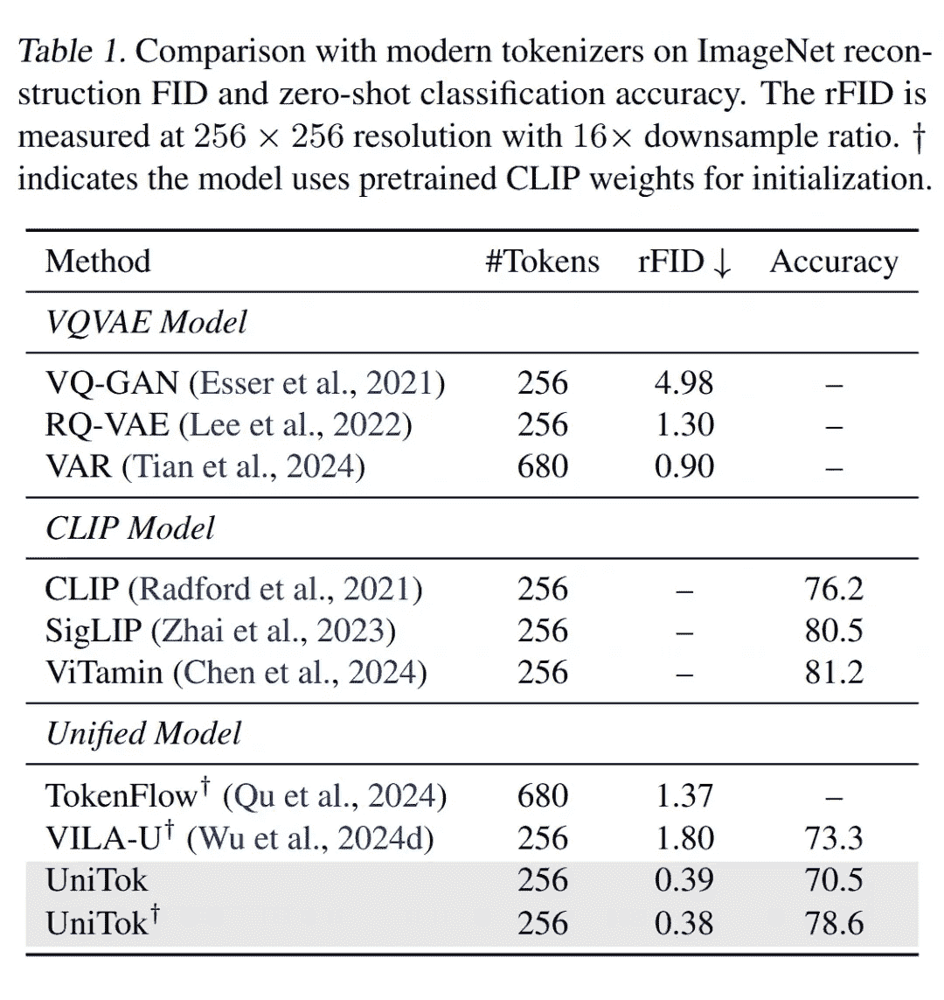

> `UniTok` 在多个视觉问答（`VQA`）基准测试中，明显优于其他统一模型，如 `Chameleon` 和 `VILA-U`，在准确率和其他评分上都取得了更好的成绩。它缩小了与使用连续视觉标记器的模型之间的性能差距。

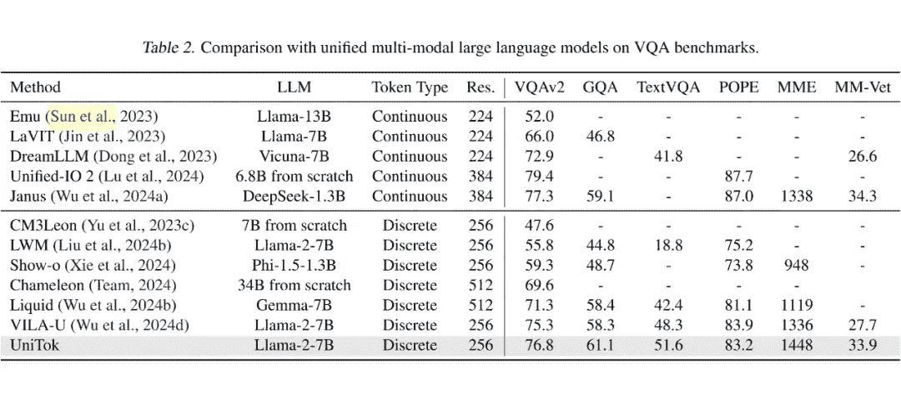

> `UniTok` 在文本到图像生成任务中表现优异，超越了包括扩散模型在内的其他模型，尤其在像 `GenAI-Bench` 这样的复杂基准测试上表现出色。即使在较低分辨率下，`UniTok` 生成的图像也具有高质量、细节丰富的特点，且能够理解抽象概念，如“梵高画风”或“比特币”，并灵活地将这些概念结合生成创意图像。

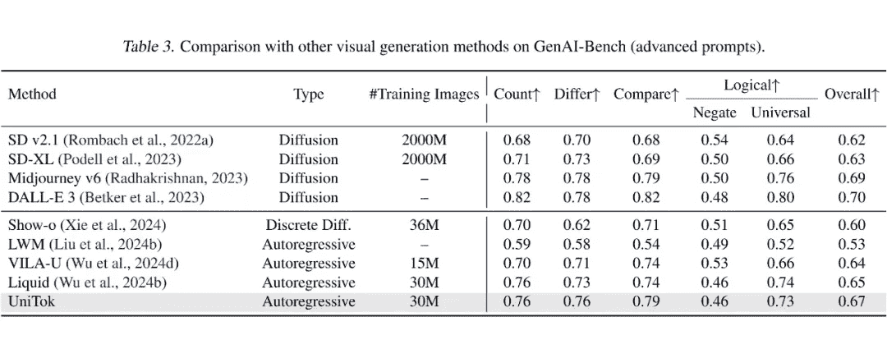

# CMU - `D-DiT`

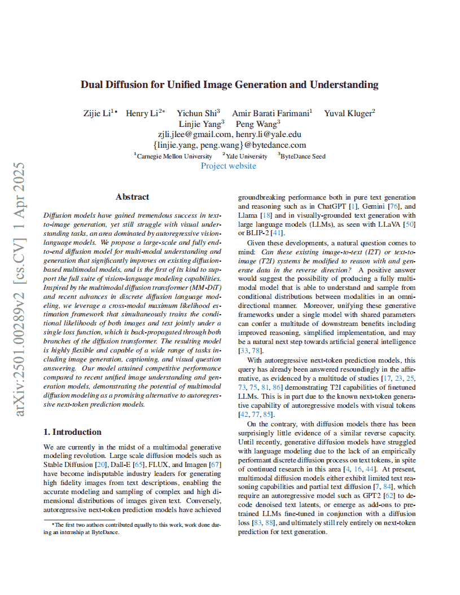

[2501.00289v2.pdf](https://internal-api-drive-stream.feishu.cn/space/api/box/stream/download/all/VMUibP98yovGZsxrKvJcCanSn9g)

当前的多模态生成模型领域存在明显的分化：

+ **扩散模型**（如 `Stable Diffusion`）在文本到图像生成中表现卓越，但几乎没有处理视觉问答案例的能力，因为传统扩散模型不擅长处理文本任务。

+ **自回归模型**（如 `LLaVA`、`BLIP-2`）则在视觉问答和文本生成中表现出色，但图像生成能力有限。

这篇文章的核心动机是探索能否构建一个统一的端到端扩散模型，兼顾视觉理解和生成任务，打破两种模型的壁垒，实现更灵活的多模态交互。

## 2.1 主要贡献

**第一个全端到端的多模态扩散模型**：

+ 基于 `MM-DiT` 架构（多模态扩散变换器），同时支持图像生成、图像描述、视觉问答等任务。

+ 在扩散模型中首次实现了完全双向的模态交互（图像 ⇄ 文本），无需依赖自回归模型。

**混合扩散策略**：

+ 图像分支采用连续潜在空间扩散（类似传统扩散模型）。

+ 文本分支采用离散掩码标记扩散（通过最大似然估计处理文本生成）。

+ 两种策略通过单一损失函数联合训练，实现参数共享。

**快速适应能力**：

+ 模型可继承预训练扩散模型权重（如 `Stable Diffusion 3`）。

+ 初始训练仅需 250 亿文本 Token 即可生成有意义的文本，显著降低计算成本。

**任务扩展性**：

+ 在传统文本生成图像的基础上，新增可控文本填充能力，支持更复杂的视觉问答场景。

+ 性能优于现有混合模型（如结合扩散 + 自回归的 `Unidiffuser` 等）。

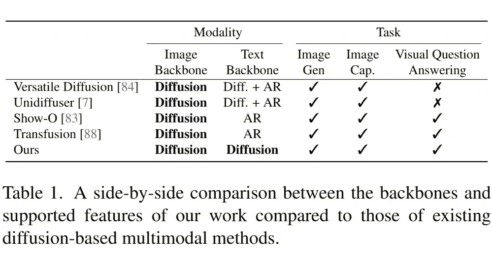

## 2.2 双重扩散 `Transformer`（`D-DiT`）方法详解

**模型架构**

`D-DiT` 的核心是一个基于 `Transformer` 的架构，分成两个分支，就像两条腿一样分工合作：

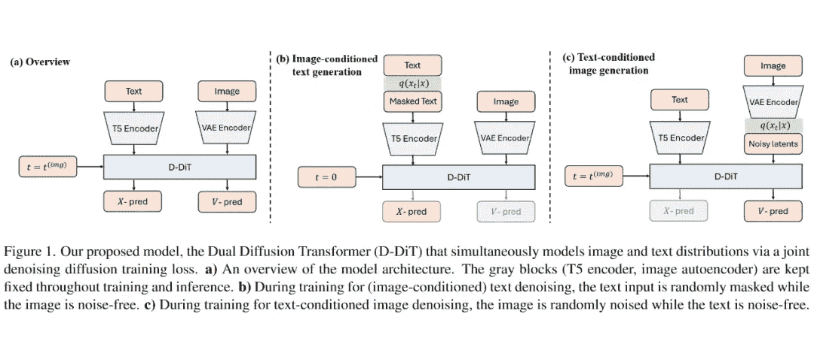

> **图像分支**：负责处理图像的“词汇”（token），输出的是一个速度场，也就是告诉模型如何从带噪声的图像一步步恢复出清晰的图片。这个速度场的预测是基于文本条件的，记作：

>

> 这里   是带噪声的图像，  是时间步，  是条件文本。

>

> **文本分支**：负责处理文本的“词汇”，输出的是原始文本的预测，也就是从被打乱（比如部分被遮盖）的文本中猜出原本的内容。这个预测是基于图像条件的，记作：

>

> 这里   是被打乱的文本，  是条件图像。

这两个分支不是各干各的，而是在每个注意力层里互相交流，通过 `Transformer` 的注意力机制让图像和文本的信息充分融合。

+ **时间步的处理**：模型用一个标量时间步嵌入（`timestep embedding`）来调整每一层的特征图，通过一种叫做 `AdaLN`（自适应层归一化）的方法。图像生成时，直接输入时间步；文本生成时不用显式输入，因为文本被遮盖的比例本身就暗示了时间信息。

+ **额外的文本编码器**：在文本分支上加了一个双向注意力的文本编码器，专门处理文本输入。这个编码器不能用 `causal mask`，不然会干扰文本扩散的过程。

+ **降低计算成本**：为了不让高分辨率图像拖慢速度，研究人员把图像从像素空间编码到一个压缩的潜空间（`latent space`），用的是带判别器损失和 `KL` 正则化的变分自编码器（`VAE`）。

## 2.3 训练方法

`D-DiT` 的训练目标是同时学会图像和文本的条件分布，用的是一种联合去噪策略，把连续扩散（`continuous diffusion`）和离散扩散（`discrete diffusion`）结合起来。

### 2.3.1 图像训练：流匹配损失

> **过程**：先通过一个正向过程给图像加噪声，公式是：

>

> 这里   和   是随时间变化的标量， 是噪声。

> **目标**：让模型学会预测速度场，也就是从带噪图像和条件文本中恢复原始图像。

> **损失函数**：用的是一种流匹配损失，写成：

> 简单说，就是让模型预测的速度场尽量接近真实的速度场，用平方误差衡量。

### 2.3.2 文本训练：掩码扩散损失

> **过程**：文本的正向过程是逐渐把原始 token 替换成掩码（mask），公式是：

>

> 这里   是掩码状态，  控制损坏程度， `CAT` 表示类别分布。

> **目标**：让模型从被掩码的文本和条件图像中预测出原始文本。

> **损失函数**：用的是一个基于掩码扩散的损失，写成：

>

> 这里   是时间步采样点数， 是具体时间步，损失衡量预测文本和真实文本的对数相似度，再除以时间步做标准化。

> **采样细节**：时间步   用对偶采样（`antithetic sampling`），在   区间均匀分成   个点（ 是个小数，避免数值问题）；图像的   则从对数正态分布中采样。

### 2.3.3 联合损失

> 训练时，条件样本（比如给图像去噪时的文本，或给文本去噪时的图像）保持干净，不加噪声。

> 总损失是两个单模态损失的加权和：

>

> 是个超参数，调节文本损失的比重。

## 2.4 推理方法：三种玩法

`D-DiT` 提供了三种推理方式，灵活应对不同的视觉-语言任务：

> **文本到图像生成**：

> **目标**：从文本条件   生成图像  。

> **方法**：用分类器自由引导（`CFG`）技术，通过调整速度场预测来采样：

>

> 这里   是引导强度的超参数，  是空文本的嵌入表示。

> **直白点说**：模型根据文本提示，结合一点“无条件”预测，逐步把噪声变成清晰图片。

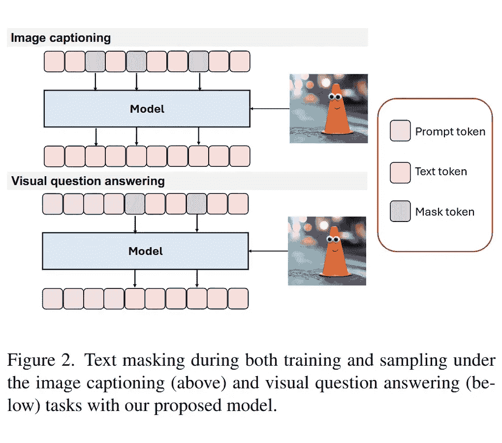

> **图像到文本生成**：

> **目标**：从图像条件    生成文本  。


> 方法：用祖先采样（ancestral sampling），从后验分布中逐步抽样，预测。

> 直白点说：从被掩码的文本开始，参考图像信息，一步步填回完整文本。

> 图像到文本填充：

> 目标：在有图像和部分文本（比如问题）的情况下，生成答案。

> 方法：把问题初始化为带掩码的状态，利用文本扩散模型的填充能力，从条件分布中采样。问题部分的 `token` 在采样时保持固定。

> 直白点说：比如视觉问答任务，给一张图和问题“天上有彩虹吗？”，模型填出答案“是的，有彩虹”。

## 训练策略

> 阶段一基础训练：该阶段的目标是使 `D-DiT` 适应文本生成任务。模型在约 30M 图像的 Datacomp-1b 数据集上训练，使用了联合扩散损失，并进行了 60K 次迭代。文本最大长度被截断为 64，图像分辨率设置为 256，批大小为 512。

> 阶段二高质量数据强化：此阶段使用了 ShareGPT4V 和 OpenImages 数据集，这些数据集提供了丰富的文本描述。模型在这些数据集上训练了 200K 次迭代，文本长度设置为 256，图像分辨率为 256，批大小为 512。此外，还对更高质量的图像数据集（包括 LAION-1024 和 Midjourney 图像）进行了可选的高分辨率模型微调。

> 阶段三视觉指令微调：此阶段，模型使用了 LLaVA-Pretrain558K、LLaVA-v1.5-mix-665K 以及 TextVQA 和 VizWiz 等视觉指令微调数据集。训练目标是促使模型生成联合文本-图像条件文本，并训练了 50K 次迭代，模型被训练以根据任务特定的指令提示（如“用一个单词或短语回答问题”或“简洁地描述图像”）来回答问题。

### 2.5 实验结果

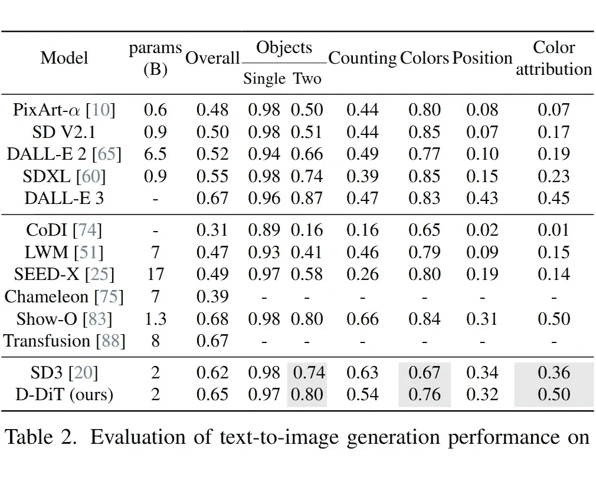

+   在 GenEval 专业作图测试中，和原版 Stable Diffusion3 保持相同水平，色彩准确率还提升 8%（可能因为视觉理解训练帮助模型更好把握描述细节）。

+   生成梵高风格图像时，新模型笔触更细腻（实验中的美学评分从 4.2 提升到 4.7）。

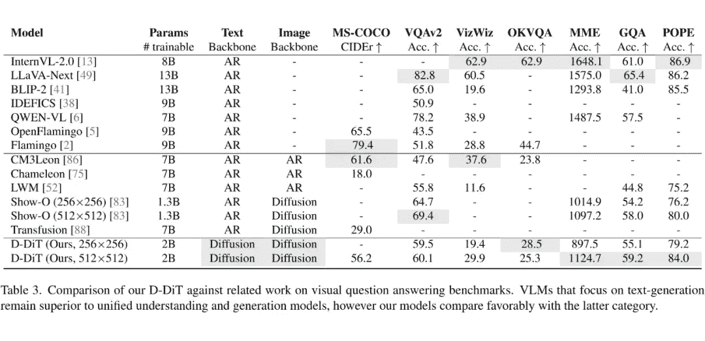

+   在经典视觉问答 VQAv2 中，512 分辨率版模型准确率达 60.1%，超过了部分自回归模型（如 BLIP-2 的 41%）。

+   2B 参数的模型在生成质量和计算开销之间取得完美平衡。当参数量翻倍时，答题准确率仅提升 1.7%，但耗能却增加 3 倍。

+   图像分辨率提高会明显提升视觉问答能力（从 256 到 512 分辨率时，MME 评分提升 25%），但文本生成质量几乎不变。
