# AI 推理场景的痛点和解决方案

> 来源：[https://v11enp9ok1h.feishu.cn/docx/SeHNdFUhZoAUYJxjZ2kcOdxPnUd](https://v11enp9ok1h.feishu.cn/docx/SeHNdFUhZoAUYJxjZ2kcOdxPnUd)

简介：一个典型的推理场景面临的问题可以概括为限流、负载均衡、异步化、数据管理、索引增强 5 个场景。通过云数据库 `Tair` 丰富的数据结构可以支撑这些场景，解决相关问题，本文我们会针对每个场景逐一说明。

## 推理场景面临的问题

> 目前 AI 热度极高，各种大模型满天飞，催生出很多 AI 推理的服务。通常我们自己部署一个实验性质的推理服务需要部署推理引擎并加载大模型，就能直接通过 `curl` 来访问，最多再部署一个 `webui` 就可以通过图形化界面来发起请求。

而如果是要做一个面向公众的推理服务产品则会复杂很多，要面临更多产品化的问题，需要保证产品的稳定、高效以及高质量的结果，这需要在推理引擎外围做很多工作，一个典型的推理服务会遇到下面几方面问题。

### 接入层调度

1. 用户请求速率和推理服务计算速率不匹配，过多的请求堆积在推理引擎上导致服务器过载，推理延时增加，最终大量请求出现超时和失败。

1. 推理服务器间负载不均，一些服务器超载，而另一些服务器资源空闲，整体吞吐较低。

1. 推理请求处理时间长、耗时不确定，导致接入服务需要一直等待 `http` 请求返回，超时时间很难设置，存在连接异常断开导致请求失败的问题。

1. 只能采用一问一答模式，不能实现人机的双向交互。

### 用户数据的管理

1. 需要管理用户信息，根据用户需求定制 `prompt`，让问答结果更符合用户期望。

1. 多轮对话场景需要存储历史对话信息。

### 结果的准确性

1. 大模型训练数据有限，无法接触到私域数据，通过 `RAG` 模式可以以较低的成本获得更准确的结果，需要引入一个可扩展的向量数据库。

## 推理场景问题的解决方案

上面提到的推理场景问题可以概括为限流、负载均衡、异步化、数据管理、索引增强 5 个场景，通过云数据库 `Tair` 丰富的数据结构可以支撑这些场景，解决相关问题，下面我们针对每个场景来逐一说明。

### 2.1 限流

要解决前后端速率不匹配，避免推理服务过载，保证推理服务的吞吐和 `SLO`，最好的办法是对接入请求进行限流。在传统服务中我们可以使用 `Tair` `Incr` 接口+过期时间来完成固定窗口的限流功能，伪代码如下。

```
ret = jedis.incr(KEY);
if (ret == 1) {
    // 设置过期时间
    jedis.expire(KEY, EXPIRE_TIME);
}
if (ret <= LIMIT_COUNT) {
    return true; 
} else {
    return false; 
}
```

这是一种比较简单的限流实现，能限制一个用户在固定`EXPIRE_TIME`时间内的请求数量为`LIMIT_COUNT`，缺点是限流不够平滑，可能用户在限流窗口的第一秒内就把流量额度用完了，剩余时间内都无法请求。另一个缺点是这种方式需要用户不断地重试，可以想象一下一个人机对话机器人需要用户不停地重试请求，但服务端一直返回“系统忙，请重试”的体验是多么差。

稍微改进一下，使用令牌桶的限流逻辑可以解决限流不平滑，需要用户不断重试的问题，伪代码如下。

```
// 请求端阻塞方式获取令牌
jedis.blpop(TIMEOUT, KEY);

// 令牌生成端，定期向队列中投放令牌
if (jedis.llen(KEY) < MAX_COUNT) {
  jedis.rpush(KEY, value, ...);
}
```

这段逻辑让请求端等待`TIMEOUT` 时间，如果还是无法获取令牌则返回失败，避免了用户反复重试。如果投放令牌的时间间隔设置较小，限流也可以变大很平滑。

但这种限流方式没有考虑每个请求间的差异，不同的推理请求对服务器资源消耗差异很大，通常以生成的 `TOKEN` 数来评估资源的消耗比较合理，业务还可能有其他自定义的限流逻辑。为了实现复杂的限流逻辑，通过简单的 `Tair` 接口很难满足业务灵活的限流需求，所以业务会引入单独的限流服务，通过`Tair` 来解耦接入服务和限流服务，用 `Tair` 完成消息通知。

简化后的推理服务框架如下图，用户请求进入无状态的接入服务，接入服务通过 `Tair` 将限流请求转发到限流服务上，限流服务通过判断`uid` 信息、推理服务器负载，令牌状态等信息，结合业务逻辑和策略，让请求直接返回失败或进入排队队列，在排队成功或超时后将限流结果告知接入服务，接入服务通过限流的结果决定是否将请求转发到推理服务。

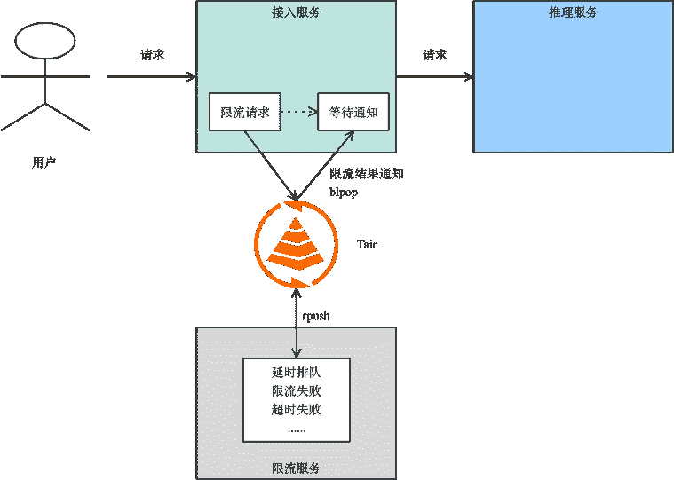

这里通过独立的限流服务可以根据产品需求来定制限流策略，完成任意复杂的限流逻辑。将 `Tair` 作为消息队列解耦了接入服务和推理服务，并完成了限流结果的实时推送。

### 2.2 负载均衡

为了满足逐步扩大的业务量，后台会部署很多服务器来提供请求，需要有一个策略来路由用户的请求到服务器上。常见场景下会使用 `LVS`、`Nginx` 等 4 层、7 层负载均衡服务来分发请求。

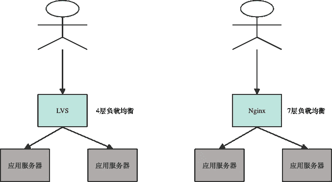

> 负载均衡的调用通常采用轮训调度（`Round Robin`）的方式或加权轮训的方式来分发请求，这些调度算法没有考虑请求的差异，也没有动态考虑服务器负载的差异。但在传统应用场景下，因为每个用户请求对服务器的资源消耗相差不大，而且请求执行速度快，消耗资源少，在请求数量足够的情况下，每个服务器的负载会相近，整体负载呈现均衡状态。

但在推理场景下，不同的请求对推理服务器的资源消耗差异很大，请求执行时间长，消耗资源高，如果采用轮询调度的方案必然会导致部分推理服务器过载、部分推理服务器资源闲置，无法使整体吞吐最大，也没法保证 `SLO`。

> 传统的负载均衡服务也有基于应用服务器连接数、负载等指标来动态调度的算法，但在推理场景这些算法的效果也不好。因为应用服务器的连接数不能代表负载，而负载指标是由负载均衡服务定期刷新的，没法保存实时更新。其次多个负载均衡服务器的状态同步也需要时间，多个负载均衡服务器将请求同时调度到一个负载很低的推理服务器上就可能导致这台机器超载。

总体而言，因为单个推理请求的资源消耗太大，个体差异太大，少量的调度失衡就可能导致负载相差很大，所以传统的负载均衡服务无法满足推理请求的调度要求。

目前对推理请求的调度有 2 类方案：

+   一种是基于代价估算的方案，由一个调度器来评估每条推理请求的代价，这里通过一个小模型来快速估算该请求推理结果的 `TOKEN` 数量，然后在全局维度根据估算的代价来分发请求。该方案的优点是在分发请求时能考虑 `kvcache` 的亲和性，例如将多轮对话分发到同一台推理服务器上，复用之前的 `kvcache`，减少重复计算。但缺点是调度逻辑比较复杂，调度器需要考虑服务器负载、请求估算代价、`kvcache` 亲和性等指标，而且全局的调度器是一个孤点，可能存在性能瓶颈，也需要考虑高可用相关的问题。当估算模型出现偏差时还会导致负载不均。

+   另一种方案是基于拉取的模型，如下图，接入服务并不直接将请求转发给推理服务，而是将请求放入 `Tair` 的 `stream` 结构中，当推理服务空闲时，主动去 `Tair` 拉取请求，这保证了所有的推理服务都能在最佳负载运行。该方案的优点是实现起来比较简单，能够保证推理服务器在最佳负载下运行，同时推理服务器间负载均衡，整体吞吐很高。缺点是很难保持 `kvcache` 的亲和性，后续优化手段有限。

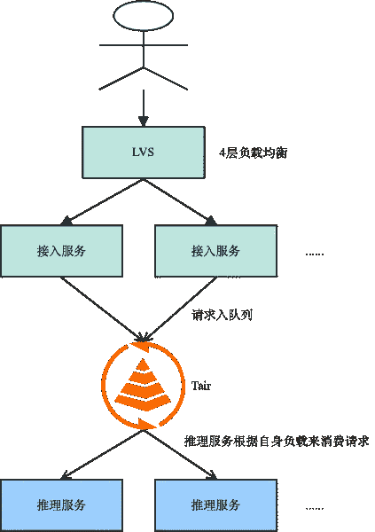

### 2.3 请求异步化

在复杂的模型推理场景中，由于推理耗时较长，推理时间无法确定等原因，接入服务同步等待结果会导致`HTTP` 连接过多，连接异常断开导致请求失败等问题，使整体性能下降、失败率提升。

另一方面同步请求方式由用户发起提问，服务端推理完毕后返回答案，交互形式固定为一问一答模式。如果服务端能够合理判断用户的需求，主动发起对话，能够提升交互的体验。例如当用户询问北京景点后，他可能是想去北京旅游，那么他可能也关心北京酒店的情况。异步化让架构更灵活，简化后期扩展新业务的逻辑。

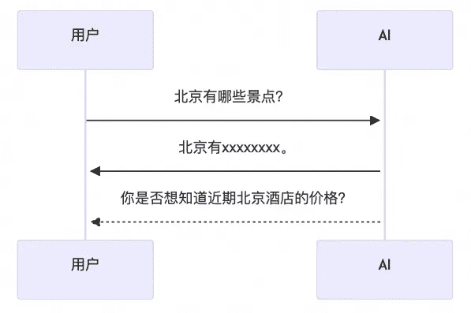

此时可以引入`Tair`作为消息队列，将推理结果写入 `Tair stream` 结构中，接入服务在请求提交成功后就能返回用户请求提交成功的状态，并流式返回推理结果，避免用户长时间等待。另一方面解耦了接入服务和推理服务的强绑定关系，其他服务组件也能向 `Tair stream` 结构写入数据，完成对用户的主动交互。

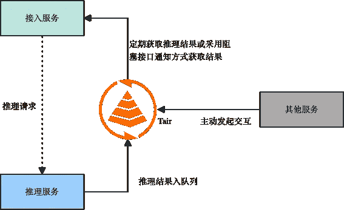

通过异步化改造可以获得如下好处：

+   流式返回结果给用户，提升体验。

+   解耦组件间的直接关联，方便后续业务逻辑的扩展。

+   避免请求发起端盲等结果返回，提升效率。

### 2.4 用户数据的管理

#### 用户信息管理

基于用户注册信息、用户历史对话信息能够为用户生成标签，这些标签作为用户请求时的系统 `prompt` 一起提交到推理引擎能够返回定制化的结果，做到千人千面，让结果更符合用户预期。

使用 `Tair hash` 结构能够以树的格式来存储用户的属性，支持点查和批量查询。

#### 历史消息管理

在多轮对话场景，需要存储之前的对话信息并作为`prompt` 来影响新的请求，这让对话保持连续性。产品化上也需要保存一段时间内的历史对话内容，让用户能够查询之前的对话。

对话信息的保存非常灵活，可以有多种实现。例如通过 `zset` 结构保存历史对话，使用对话的时间戳作为 `score`，方便对话信息的排序，最早对话的删除以及按时间来查看历史对话。

如果服务本身已经通过 `stream` 结构完成了异步化改造，那么推理的请求和结果已经全部存储在 `stream` 中了，不需要再额外存储，`stream` 支持设置队列的大小，能够自动完成最早对话消息的删除。

#### Session 管理

不同的对话有不同的上下文信息，可以使用 `Tair hash` 来存储 `session` 信息，进行快速切换。

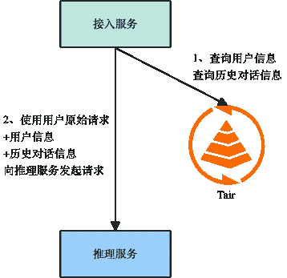

### 2.5 RAG（检索增强生成）

使用`RAG`（`Retrieval-Augmented Generation`，检索增强生成）能够有效解决传统大型语言模型（`LLM`）在实际应用中的局限性，包括：

+   **知识过时：**`LLM`的训练数据通常截止于某个时间点，无法实时更新。

+   **幻觉问题：**`LLM`可能会生成与事实不符的内容。

+   **缺乏领域专业性：**通用模型在垂直领域（如法律、医学）的表现往往不足。

+   **推理能力弱：**`LLM`在处理复杂推理任务时表现不佳。

相比于`Fine-tuning`（微调），`RAG` 可以有更低的成本和更高的数据时效性。

> `Tair` 向量引擎是`Tair`自研的扩展数据结构，提供高性能、实时，集存储、检索于一体的向量数据库服务。支持`HNSW` 算法和暴力搜索，具备横向扩容和分布式全局索引的能力。能够解决 `RAG` 中数据索引的问题。

例如需要实现一个 `Tair` 接入 `FAQ` 的问答机器人，可以采用如下方案。

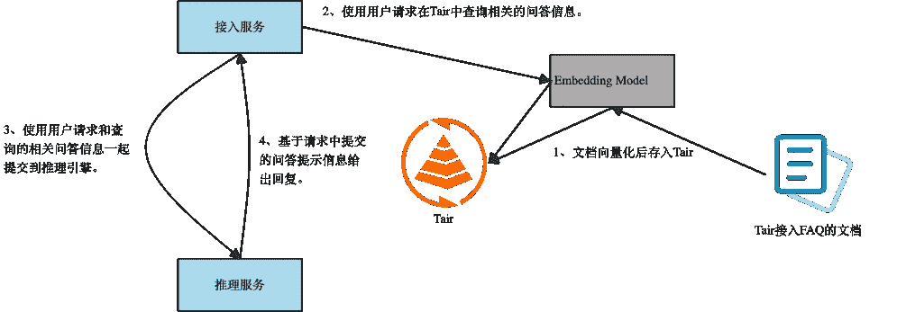

使用 `Tair` 作为 `RAG` 方案的向量数据库有以下好处

+   推理服务本身已经依赖了 `Tair`，不需要再额外引入一个单独的向量数据库组件。

+   `Tair` 向量数据库支持横向扩容，满足不断增长的业务规模。

### 2.6 场景汇总

将所有的场景串联起来，一个典型的推理服务流程如下。

1. 用户发起请求到接入服务服务器。

1. 接入服务异步请求限流服务，并在 `request uuid` 上等待 `Tair` 通知。

1. 限流服务在排队完成或超时后通过 `Tair` 将限流结果通知给接入服务。

1. 接入服务通过 `Tair` 查询到用户信息、历史对话信息，作为请求 `prompt`。

1. 接入服务通过 `Tair` 向量检索拿到相关信息，也作为请求的 `prompt`。

1. 接入服务将请求写入 `Tair stream` 队列。

1. 空闲的推理服务从 `Tair stream` 拉取到推理请求。

1. 推理服务将推理结果写入 `Tair stream` 队列。

1. 接入服务通过 `Tair` 异步获取到推理结果。

1. 返回用户结果。

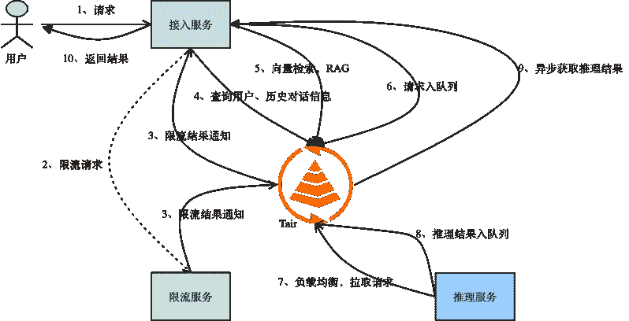

## 推理场景的产品选型

> 上面提到的推理场景依赖的主要能力包括消息队列、半结构化数据存储、向量检索能力。有很多数据库、中间件产品具备这些能力，为什么要选用 `Tair`，我们主要从效率、可扩展性、灵活性和数据持久化几个方面来对比一下 `Tair`、社区 Redis 及 `Kafka` 间的区别。

### 3.1 效率

`Tair` 采用内存数据结构，多线程模型，能够保证亚毫秒级的稳定时延，性能约为同规格社区 Redis 版的3倍，确保推理场景中间环节的高效稳定。

> 在推理场景中请求和推理结果是放入消息队列来达到异步化、负载均衡的目的。推理服务是一个在线的准实时服务，对延时和吞吐有较高的要求，对容量需求不大，因为不会存在请求或结果在队列中堆积很久的情况。

所以推理场景更适合内存型消息队列产品，例如在同样的资源下，`Tair` 比 `Kafka` 有更低的延时和更高的吞吐，这也意味着在同样吞吐的情况下使用 `Tair` 作为消息队列有更低的成本。

### 3.2 可扩展性

`Tair` 支持水平扩展，能够无缝处理不断增长的数据量和查询。同时支持无损扩缩容，降低扩容过程中对线上业务的影响。

`Tair`重新设计了扩缩容过程中数据搬迁的流程，对比社区 Redis `slot migration` 有很多优化。

### 3.3 灵活性

`Tair` 支持多种数据结构，同时满足推理服务在各个场景的需求，通过一个产品就能具备消息队列、半结构化数据存储、向量检索的能力，简化了业务逻辑，降低了成本。

+   通过 `stream` 结构，能解决推理请求负载均衡和推理结果异步化的问题。

+   通过 `list` 结构的阻塞接口能完成令牌桶模型的限流功能，支持消息的点对点通知，解决请求排队和限流结果通知的问题。

+   通过 `hash`、`stream` 结构能存储用户信息、历史对话信息，能快速的点查和批量读取。

+   通过 `vector` 向量检索引擎，能够完成 `RAG` 功能，提升推理结果的准确性。

### 3.4 数据的持久化

消息队列最关键的问题是如何保存数据的持久化，保证消息至少被消费一次。

社区 Redis `aof` 采用异步落盘方案，宕机时可能丢失部分数据。Redis 主备间也采用异步同步，`HA` 切换时可能丢失部分数据，所以无法保证消息至少被消费一次。

> 社区 `Kafka` 通过配置`producer.type`来控制刷磁盘方式，有`sync`和`async`方式，`sync` 模式会对性能有一定影响，`async`方式会丢失 `pagecache` 中还没刷盘的数据。`Kafka` 通过配置 `request.required.acks` 来控制消息的生产，`acks` 的默认值为 `1`，即主备间为异步同步，`HA` 切换时可能丢失数据。所以 `Kafka` 通过修改默认配置可以保证消息至少被消费一次，但吞吐会下降，延时会上升，实测高负载下 `acks = -1` 采用全同步模式会让延时提升数倍。

`Tair` 有多种存储引擎，其中持久内存版使用非易失性内存，数据写入即完成持久化，确保宕机时数据不丢失。同时 `Tair` 支持半同步功能，开启该功能对读请求没有影响，写请求会保证 `log` 同步到备节点再返回，写请求的 `RT` 会上升，但平均 `RT` 能保持亚毫秒级，并且通过多线程框架，实例吞吐不会下降。

[`Tair` 在消息队列上的优](https://mp.weixin.qq.com/s?spm=a2c6h.13046898.publish-article.3.2dbf6ffaFKRHcF&__biz=MzIzOTU0NTQ0MA==&mid=2247508287&idx=1&sn=c88c17f38cc303b927a45ecd67aafd5c&scene=21#wechat_redirect)化可以参考之前的文章《Redis消息队列发展历程》。

## Tair 面临的挑战和优化

目前推理服务的规模都很大，通常使用 `Tair` 128-256 分片的集群，客户端发起大量的 `block` 类型请求导致 `Tair` 集群的连接数非常多，大量的连接导致内存消耗高，同时大分片集群的流量也很高。大量的连接、高内存占用、高带宽给 `Tair` 带来了挑战。

### 4.1 连接数超限

当客户端发起普通请求时，无论客户端到 `proxy` 有多少连接，`proxy` 都能进行连接聚合，使 `proxy` 到每个 `db` 的连接数为一个固定的常数。而当客户端使用 `block` 类型请求时，`proxy` 到 `db` 的连接无法聚合，`proxy` 会为该客户端连接创建一批私有连接（`private` 连接），此时如果客户端每个连接都随机访问所有 `key`，则最终客户端到 `proxy` 有多少连接，`proxy` 到每个 `db` 就会有多少连接。

因为这个机制导致 `db` 上连接数超限，而且该连接模型下通过横向扩容也无法降低每个 `db` 上的连接数。只能用户侧做改造，降低客户端连接数，或将客户端连接分组，一组连接只访问部分 `slot`。

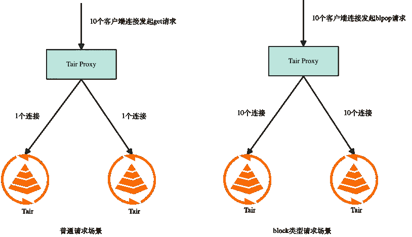


通过分析对于 `block` 类型的请求，会限制单个请求的 `key` 在同一个 `slot`，意味着客户端一次请求只会访问一个 `db`，此时对于该客户端连接上绑定的 `proxy` 到其他 `db` 的 `private` 连接是空闲的，而这些 `private` 连接经过部分属性转化是能够被其他客户端连接使用的。这意味着可以为每个 `db` 建立一个连接池，当某个客户端连接要访问该 `db` 时从池中拿出一个空闲连接，经过少量的属性转换就能绑定到自身，在请求完成后再归还到连接池中让其他客户端连接复用该连接。

该模型下每个 `db` 的最大连接数为访问该 `db` 的最大并发数，例如下图中如果 `10` 个客户端连接不断以 `ping pong` 模式发送请求，一共有 2 个 `db`，则每个 `db` 上平均并发请求数为 5，`proxy` 到 `db` 的连接数可以收敛到 5，让 `db` 连接数和客户端连接数脱钩。

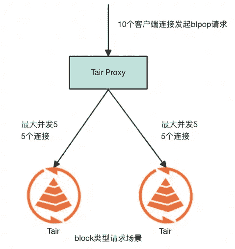

优化前后 `private` 连接场景下 `db` 连接数对比如下：

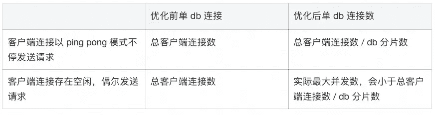

新模型下 `db` 的连接和 `db` 分片数相关，如果 `db` 上连接数较高可以通过水平扩容来降低每个 `db` 的负载，通过横向扩容能够降低 `db` 的连接数。

实测通过 1000 个客户端连接以 `ping pong` 模式不断发起 `blpop` 请求访问随机 `key` 的场景下 `db` 上的连接数如下。

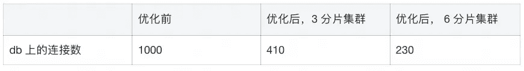

## 4.2 Proxy 内存超限

`Proxy` 到 `db` 的每个连接对象都会维护一个 `hash table`，它的作用是在 `db` 返回 `response` 后通过发送顺序或 `packet id` 等信息找到对应的 `request`。该 `hash table` 的初始化槽位是 16k，这样能降低 `request hash` 冲突的概率，避免频繁的 `rehash` 带来的性能抖动，此时单个 `hash table` 消耗的内存为 128KB，当 `proxy` 到 `db` 的连接数为常数时总体内存消耗并不大。

而当客户端大量使用 `block` 请求时情况发生了变化，此时 `proxy` 到 `db` 的连接数受客户端连接数、请求模型影响，`proxy` 到 `db` 的连接数可能达到万级别，`hash table` 占用的总内存达到 GB 级别，超过 `proxy` 的资源上限，带来了稳定性风险。

需要优化 `proxy` 的内存消耗，同时避免性能损失。`proxy` 到 `db` 的连接可以简单分为 2 种类型，一种是共享连接（`shared` 连接），所有客户端连接的普通请求会聚合后在同一个 `shared` 连接发送，所以 `shared` 连接数是一个常数。另一种是 `private` 连接，这种连接在一个时刻被单个客户端连接独占，只会转发该客户端连接的请求。

这里数量多、占用内存高的是 `private` 连接，是优化的主要目标。通过分析可以看到 `private` 连接只会转发单一个客户端连接的请求，其请求队列深度是远小于 `shared` 连接的，在 `block` 请求场景下，队列深度为 1，所以降低 `private` 连接 `hash table` 的初始槽数为 16，能够显著降低内存消耗，对性能的影响也很小。

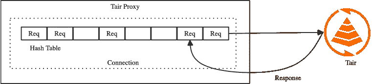

该特性上线后使推理业务 Tair 实例的 `proxy` 内存下降了 20 倍以上。

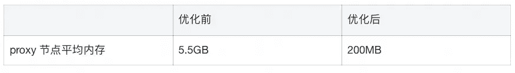

## 4.3 带宽超限

目前 Tair 集群版架构如下图，客户端流量会通过 `AliLB`、`proxy` 后到达 `db` 节点，其中 `proxy`、`db` 都能通过横向扩容来增加带宽上限，但 `AliLB` 受限于架构限制，目前为 2.5GB，这对一些大流量场景带来了影响。

对于该问题有一些解决方案，例如使用 `NGLB` 模式让客户端和 `proxy` 直接通信，只有新连接的首包过 `AliLB`。使用 `FPGA AliLB`，能够获得更高的带宽上限。但这些方案也存在一些弊端和限制，比如 `NGLB` 模式下部分客户端存在流量黑洞问题，`FPGA AliLB` 只有部分区域可用。我们也调研过 `LB` 的新产品形态例如 `NLB`，但因为费用、兼容性等方面原因很难快速落地。

最终决定采用多 `AliLB` 的方案来突破带宽瓶颈，该方案在 Tair 实例域名下绑定多个 `AliLB` 地址，客户端在建连时通过 `DNS` 随机选择一个 `AliLB` 地址，通过增加 `AliLB` 数量来提升带宽上限。该方案需要客户端能够随机选取选取 `vip` 地址，如果客户端存在 `dns` 绑定的行为可能导致 `AliLB` 负载不均。另一方面多 `AliLB` 让 `HA` 切换、可用区切换、扩缩容等流程变得更加复杂，给 Tair 管控带来了挑战。

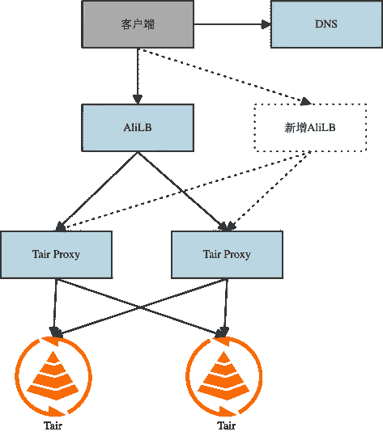

## 总结

在推理场景的工程实现中，我们面临诸多挑战，如限流、负载均衡、异步处理等。这些问题需要借助消息队列、半结构化数据存储及向量索引等功能来解决。Tair 不仅具备这些功能，还在性能、扩展性和数据持久化方面展现出显著优势，非常适合推理场景的需求。通过使用 Tair，可以以较低的成本高效应对这些挑战，提升系统的稳定性和响应速度。
