#  LLM 模型评测教程及方案详解

> 来源：[https://v11enp9ok1h.feishu.cn/docx/XWSWdqSdNovVvXxBBxTcTzdVnHb](https://v11enp9ok1h.feishu.cn/docx/XWSWdqSdNovVvXxBBxTcTzdVnHb)

# 模型评测简介

> 「模型评测」提供通过向导式的评测任务提交方式进行 LLM 模型评测。腾讯云 TI 平台支持两种评测方式，分别为主观评测和客观评测。

**主观评测：**提供待评测模型推理后人工打分的功能，基于人工来评判模型效果；

**客观评测：**全程无**需人工参与**，TI 平台将基于内置的开源评测集或者是用户自定义上传的开源评测集以及内置的指标（如pass@1、ROUG、F1等），提供自动评测的功能。平台内置开源数据集来帮助用户快速开启大模型评测体验；客观评测也支持在训练过程中对训出的模型效果进行轻量体验，对 checkpoint 模型进行服务部署，用户可在对话框内和大模型进行问答，初步查看模型效果。

## 一、轻量体验

### 前提条件

已完成[任务式建模](https://cloud.tencent.com/document/product/851/74150)的任务创建，已完成 CheckPoint 的输出。

### 操作步骤

1.  登录 [TI-ONE 控制台](https://console.cloud.tencent.com/tione/v2)，在左侧导航栏中选择**训练工坊**** > ****任务式建模**，进入任务列表页面。

1.  在任务页面单击训练的**任务名称**，进入任务详情页面。

1.  单击 **CheckPoint** **Tab页，选择要进行初**步体验模型效果的 CheckPoint 卡片。

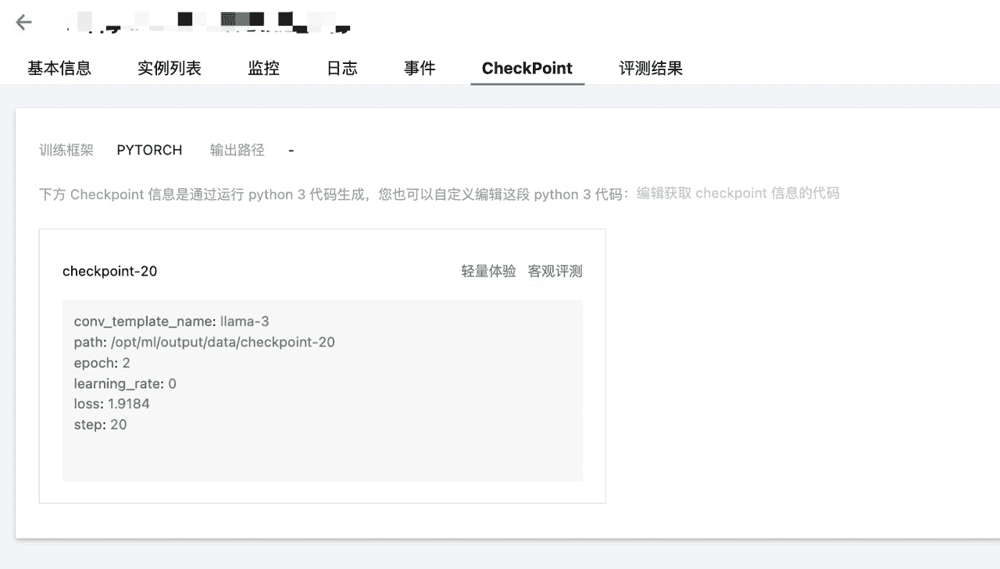

1.  单击**轻量体验**按钮，拉起弹窗，您选择所需的资源，可从您训练使用的资源组中选择。

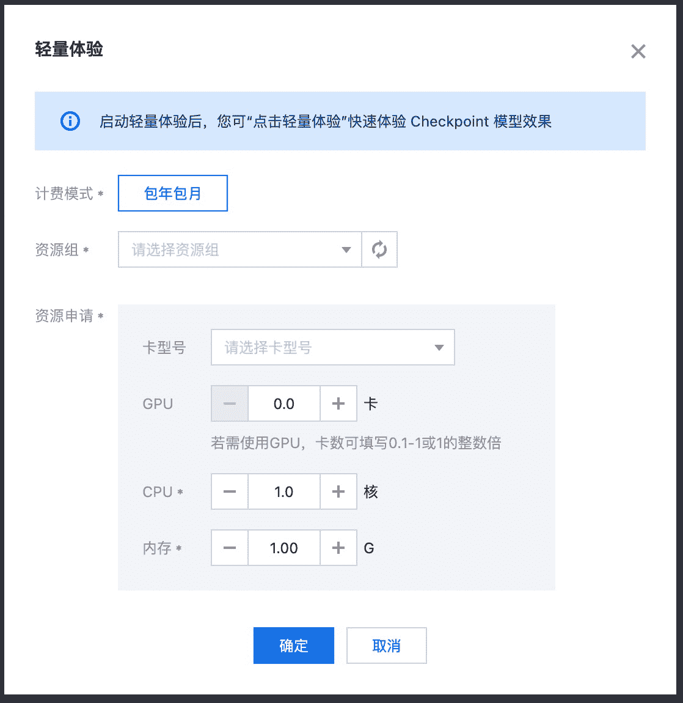

1.  **轻量体验经历**创建中、启动中、就绪中的状态后，您可单击轻量体验，拉起弹窗体验模型效果。

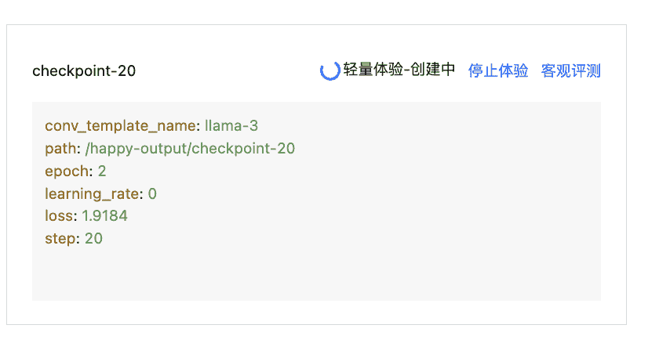

1.  弹窗内，您可进行发送问题，进行对话体验模型效果。

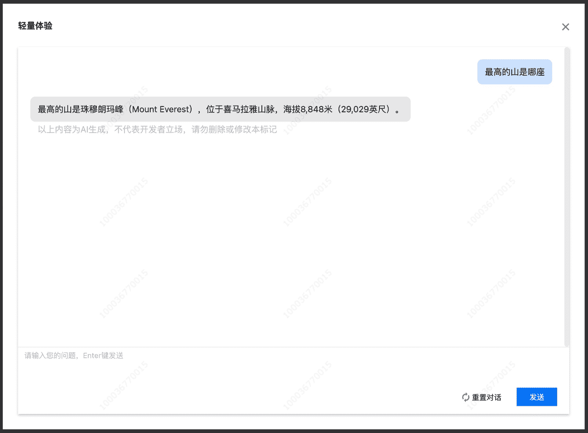

## 二、客观评测

### 使用平台内置的开源评测集

#### 平台内置的开源评测集

### 自定义上传开源评测集

#### 平台支持用户自定义上传的评测集

[支持自定义](https://cloud.tencent.com/document/product/851/117033)上传开源评测集，支持的开源评测集详见评测集要求。

> 和直接使用平台内置的开源评测集不同的是，准备好评测集后，创建任务时需要填写评测集在 CFS 中的路径。为方便任务的创建，在准备评测集阶段，您需要在开发机中挂载您的 CFS 文件系统，以获得评测时所需填写的路径。CFS 文件系统使用如下：

1.  请您准备好 [CFS 文件系统](https://console.cloud.tencent.com/cfs/fs/create?rid=1)。您可以挂载您的 CFS 文件系统并启动开发机。假设已经准备好 CFS，且/data1 代表本地挂载的 CFS 根路径。

1.  您可以根据自己需要，为希望用于评测的客观数据集创建本地对应的客观数据集文件夹。

---

例如，我们可以将需要的数据集放置于 /data1/test_data 目录下：

```
cd /data1
mkdir -p test_data/agieval
mkdir -p test_data/arc-c
mkdir -p test_data/arc-e
mkdir -p test_data/bbh
mkdir -p test_data/c-eval
mkdir -p test_data/cmmlu
mkdir -p test_data/gsm8k
mkdir -p test_data/hellaswag
mkdir -p test_data/humaneval
mkdir -p test_data/math
mkdir -p test_data/mbpp
mkdir -p test_data/mmlu
mkdir -p test_data/tydiqa
mkdir -p test_data/xsum
```

1.  下载并解压 opencompass 客观数据集。

```
cd /data1
# 下载OpenCompass数据集压缩包
wget https://github.com/open-compass/opencompass/releases/download/0.2.2.rc1/OpenCompassData-complete-20240207.zip OpenCompassData-complete-20240207.zip
# 解压压缩包
unzip OpenCompassData-complete-20240207.zip
# 此时，会因解压而多出目录 data，里面包含了OpenCompass相关的数据集
```

1.  将解压后的 opencompass 客观数据集拷贝到本地客观数据集文件夹。

```
cd /data1
# AGIEval 将评测目录 AGIEval/data/v1/ 下的所有文件
cp -r data/AGIEval/data/v1/* test_data/agieval


# ARC-c 将评测目录 ARC/ARC-c/ 下的 ARC-Challenge-Test.jsonl
cp data/ARC/ARC-c/ARC-Challenge-Test.jsonl test_data/arc-c


# ARC-e 将评测目录 ARC/ARC-e/ 下的 ARC-Easy-Test.jsonl
cp data/ARC/ARC-e/ARC-Easy-Test.jsonl test_data/arc-e


# BBH 依赖目录 BBH/ 下的所有文件
cp -r data/BBH/* test_data/bbh


# C-Eval 依赖 ceval/formal_ceval/ 下的所有目录
cp -r data/ceval/formal_ceval/* test_data/c-eval


# CMMLU 依赖 cmmlu/ 下的所有文件
cp -r data/cmmlu/* test_data/cmmlu


# GSM8K 依赖 gsm8k/ 下的 test.jsonl 和 train.jsonl
cp data/gsm8k/test.jsonl test_data/gsm8k
cp data/gsm8k/train.jsonl test_data/gsm8k


# Hellaswag 依赖 hellaswag/ 下的 hellaswag.jsonl
cp data/hellaswag/hellaswag.jsonl test_data/hellaswag


# HumanEval 依赖 humaneval/ 下的 human-eval-v2-20210705.jsonl
cp data/humaneval/human-eval-v2-20210705.jsonl test_data/humaneval


# MATH 依赖 math/ 下的 math.json
cp data/math/math.json test_data/math


# MBPP 依赖 mbpp/ 下的 mbpp.jsonl
cp data/mbpp/mbpp.jsonl test_data/mbpp


# MMLU 依赖 mmlu/ 下的所有文件
cp -r data/mmlu/* test_data/mmlu


# TyDiQA 依赖 tydiqa/ 下的 dev 目录
cp -r data/tydiqa/dev test_data/tydiqa


# Xsum 依赖 Xsum/ 下的 dev.jsonl
cp data/Xsum/dev.jsonl test_data/xsum
```

1.  在评测时，请对应填写您 CFS 实例上的数据集，例如 /test_data/xsum。

### 使用客观评测的具体方式及步骤

#### 方式一：从 任务式建模的 CheckPoint 处新建客观评测

**前提条件：**已完成[任务式建模](https://cloud.tencent.com/document/product/851/74150)的任务创建，已完成 CheckPoint 的输出。

1.  登录 [TI-ONE 控制台](https://console.cloud.tencent.com/tione/v2)，在左侧导航栏中选择**训练工坊**** > ****任务式建模**，进入任务列表页面。

1.  在任务页面单击训练的**任务名称**，进入任务详情页面。

1.  单击 **CheckPoint**** Tab页，选择要进**行初步体验模型效果的 CheckPoint 卡片。

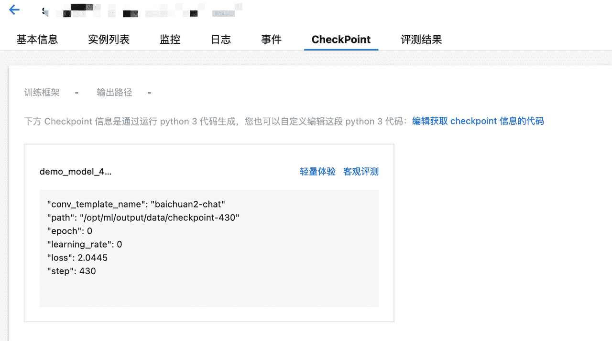

1.  单击**客观评测**按钮，拉起弹窗，填写任务名称、选择评测集，选择所需的资源，支持按量计费和包年包月。

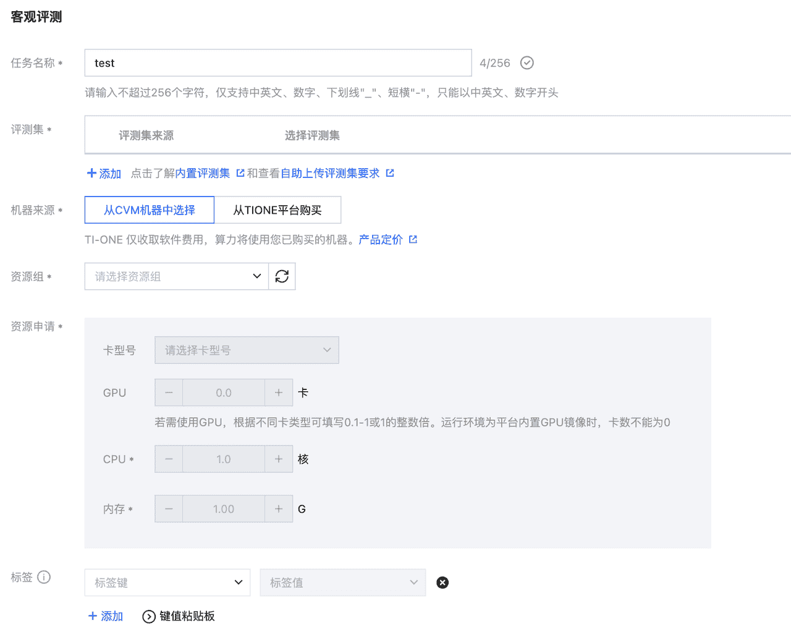

选择评测集时，可根据来源选择使用的评测集。

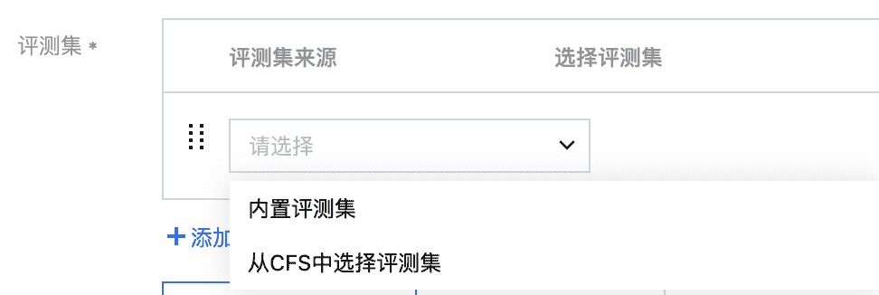

1.  填好信息单击**新建**，会进入客观评测-推理中的状态，请您耐心等待。

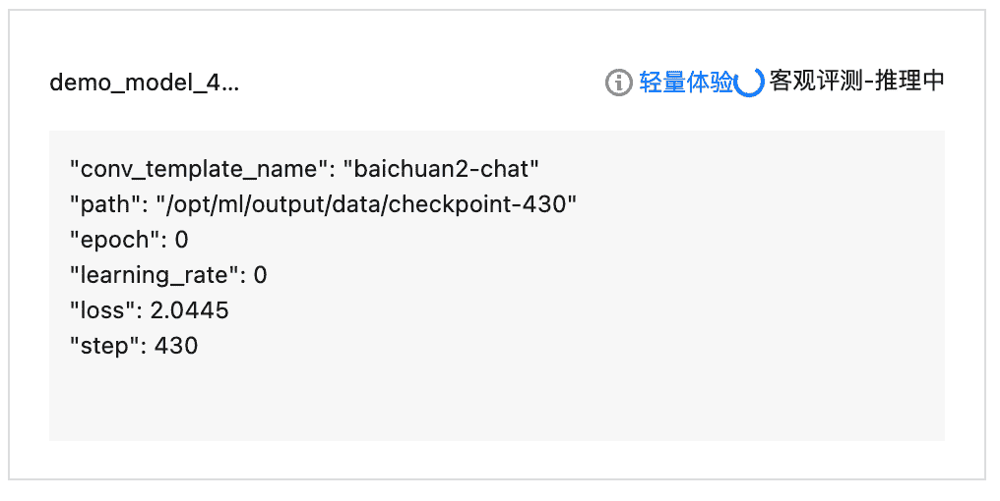

1.  客观评测完成后，可单击**查看客观评测结果**。

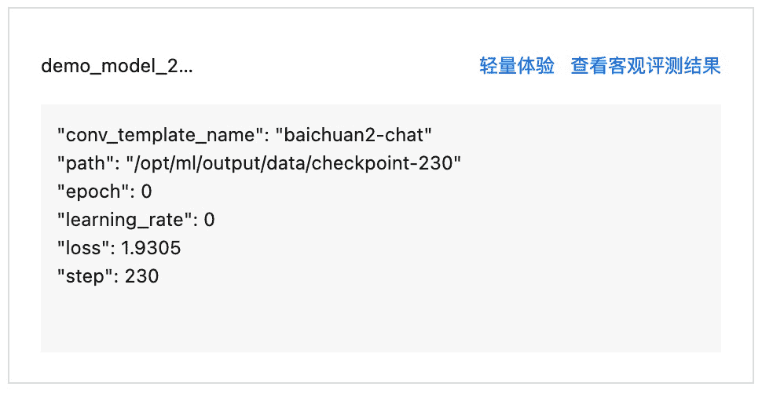

1.  单击**查看客观评测结果**，跳转到**评测结果 **Tab 页，查看具体评测结果。

### 方式二：从客观评测 Tab 页处新建客观评测

1.  登录 [TI-ONE 控制台](https://console.cloud.tencent.com/tione/v2)，在左侧导航栏中选择**模型服务 > 模型评测**，单击**客观评测** Tab页，进入任务列表页面。

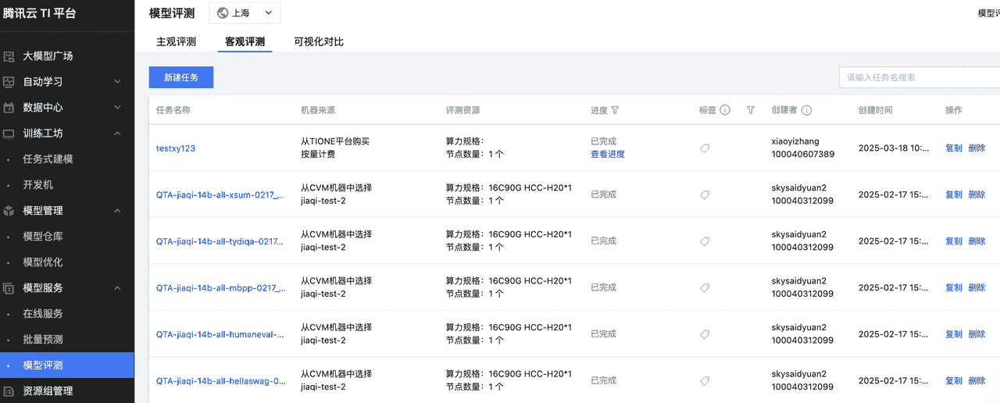

1.  单击**新建任务**，拉起新建页面。

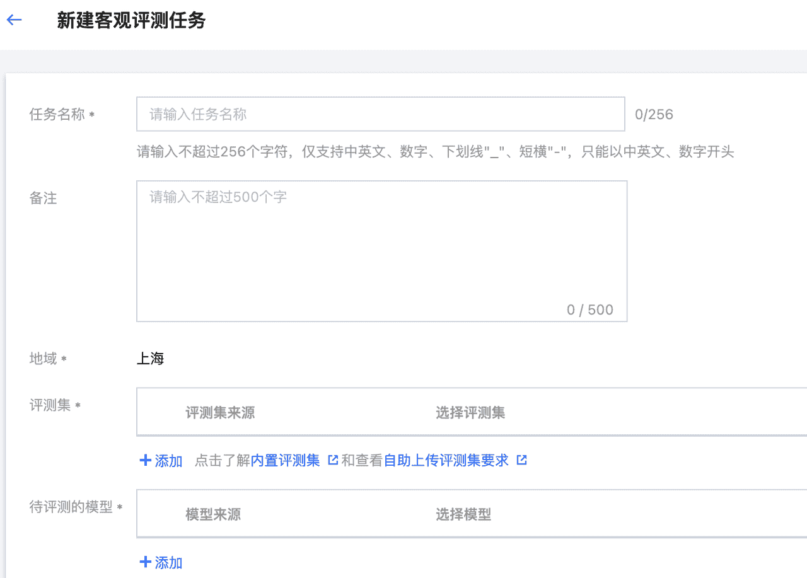

所需填写的信息如下：

1.  填写对应信息，新建好客观评测任务后，会在任务列表页展示：任务名称、机器来源、评测资源、进度、标签、创建者、创建时间、操作（停止、重启、删除、复制）。

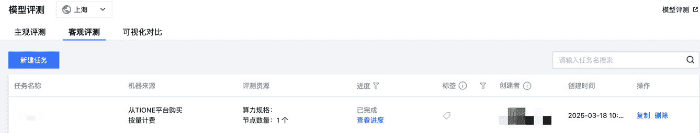

在评测过程中，可进行进度查看，点击查看进度，获得当前进度展示：

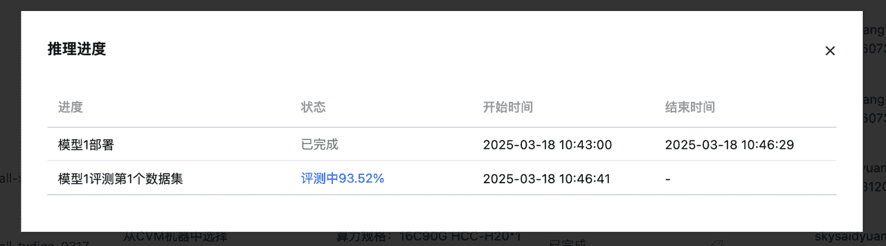

**备注：**

> 评测中能看到具体的进度百分比，具体计算公式：评测数据总条数=模型数*评测数据条数，进度N%=已评测数据条数/评测数据总条数（120）%。

> 当用户鼠标悬停在列表页的评测进度“评测中N%”时，能够展示已评测时长和预计剩余时长。预计剩余时长是按照已评测数据的条数的时长等比计算的，这是预估时长，可能会有一定的误差。

1.  您可单击**任务名称**，进入任务详情，查看基本信息、评测结果、日志。

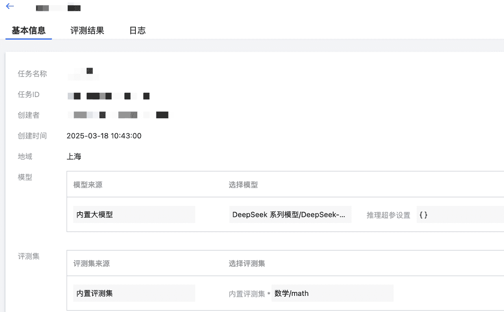

1.  模型推理输出 Tab 页，您可查看进度和评测结果。

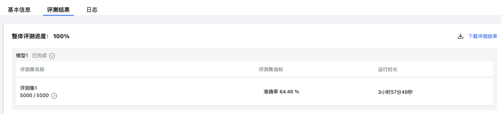

1.  日志 Tab 页，您可查看推理日志和接口调用日志。

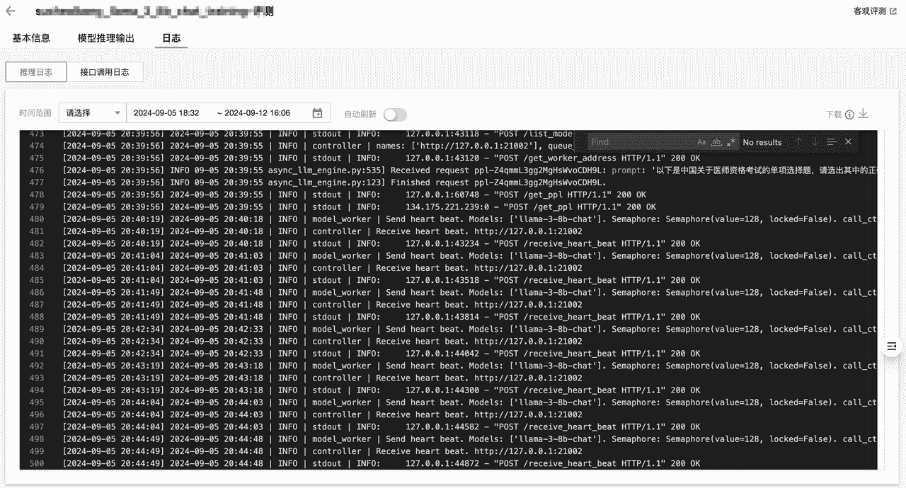

### 说明

#### 部分评测集的 system prompt

为提高模型回答质量，以及便于解析模型给出的回答，我们在评测如下客观评测集时，会相应地添加 system prompt：

[AGIEval](https://hub.opencompass.org.cn/dataset-detail/AGIEval)

[ARC-c](https://hub.opencompass.org.cn/dataset-detail/ARC-c)

[ARC-e](https://hub.opencompass.org.cn/dataset-detail/ARC-e)

[C-Eval](https://hub.opencompass.org.cn/dataset-detail/C-Eval)

[CMMLU](https://hub.opencompass.org.cn/dataset-detail/CMMLU)

[Hellaswag](https://hub.opencompass.org.cn/dataset-detail/Hellaswag)

[MMLU](https://hub.opencompass.org.cn/dataset-detail/MMLU)

我们会根据问题的语言相应地添加，如下表：

## 三、主观评测

### 前提条件

#### 自定义评测集准备

详见[评测集格式要求](https://cloud.tencent.com/document/product/851/117033)。

准备好评测集后，创建任务时需要填写评测集在CFS中的路径。为方便任务的创建，在准备评测集阶段，您需要在开发机中挂载您的 CFS 文件系统，以获得评测时所需填写的路径。CFS文件系统使用如下：

1.  请您准备好 [CFS 文件系统](https://console.cloud.tencent.com/cfs/fs/create?rid=1)。您可以在挂载您的 CFS 文件系统并启动 开发机。假设已经准备好 CFS，且/data1 代表本地挂载的 CFS 根路径。

1.  您可以根据自己需要，为希望用于评测的主观数据集创建本地对应的主观数据集文件夹。

1.  例如，我们可以将需要的主观数据集 test.csv 放置于 /data1/test_data 目录下：

```
cd /data1
mkdir -p test_data
cp userdata/test.csv test_data
```

1.  在评测时，请对应填写您 CFS 实例上的数据集所在的目录，例如/data1/test_data。

### 操作步骤

1.  登录[TI-ONE 控制台](https://console.cloud.tencent.com/tione/v2)，在左侧导航栏中选择**模型服务 > 模型评测**，单击**主观评测** Tab 页，进入任务列表页面。

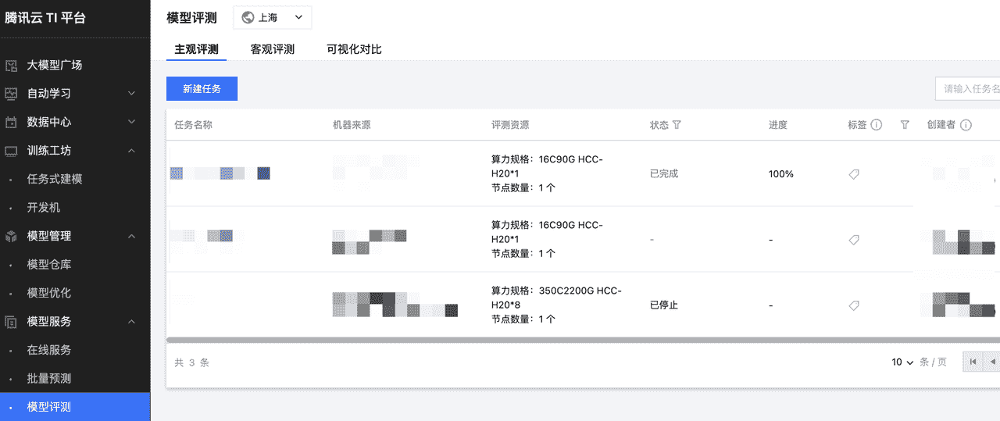

1.  单击新建任务，拉起新建页面。

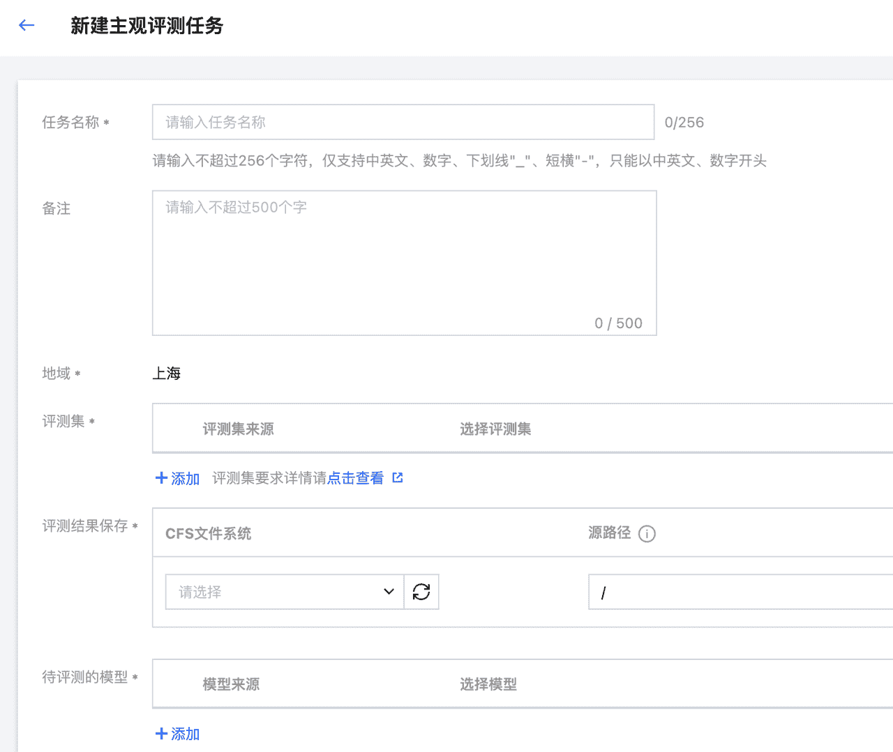

所需填写的信息如下：

1.  填写对应信息，新建好主观评测任务后，会在任务列表页展示：任务名称、机器来源、评测资源、状态、进度、标签、创建者、创建时间、操作（停止、重启、删除、复制）。

1.  单击**推理进度**，您可下载查看当前进度下的评测结果集。

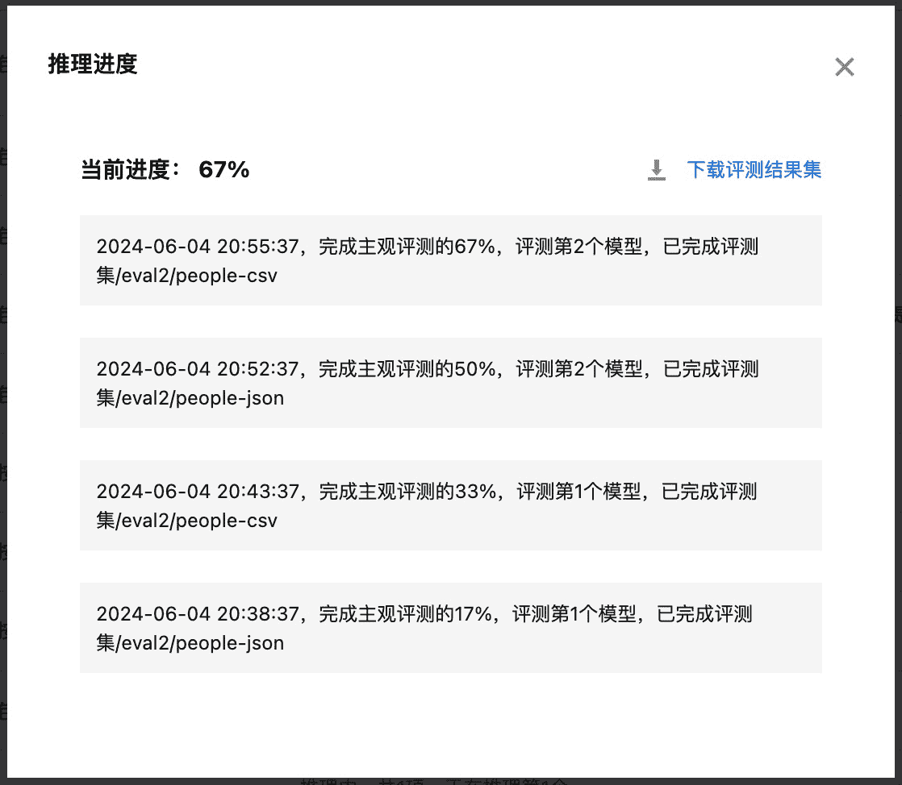

1.  主观评测任务完成后，您可单击任务名称，进入任务详情，查看基本信息、进行人工标注、查看评测结果和日志。

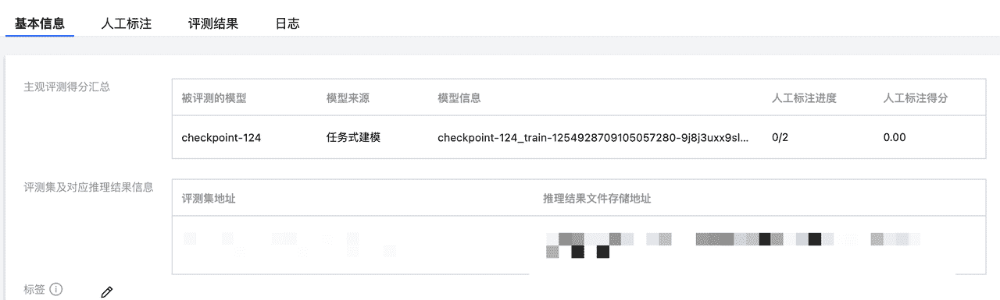