# 微信原生 H5（微信公众号）

> 来源：[https://v11enp9ok1h.feishu.cn/docx/B8YbdoWW4oEcZDxJQT7cnitqnCh](https://v11enp9ok1h.feishu.cn/docx/B8YbdoWW4oEcZDxJQT7cnitqnCh)

## 本文档以接入微信原生 H5 的操作流程为例，描述通过微信 HTML5 方式接入人脸核身的完整操作流程。

## 接入说明

1.  主体行业要求
微信原生 H5 有明确的主体行业要求，在控制台申请 RuleId 时需上传对应的行业资质。所以在接入微信原生 H5 前，请确认公众号的主体和类目是否符合范围，并准备好对应的资质文件，详情可查阅 微信原生H5（微信公众号）资质文件列表。

1.  审核时间

微信原 H5有主体行业限制，资质审核需要3-5个工作日，请预留好上线时间。

1.  活体检测模式

微信原生 H5 支持一闪活体检测（眨眼 + 光线）、随机双动作检测。

1.  [公众号管理](https://open.faceid.qq.com/view/auth.html)员授权
微信原生 H5 需要公众号管理员授权，打开二维码，将该权限授权给人脸核身第三方平台。

1.  认证页面流程

微信原生 H5 用户进行人脸核身流程：

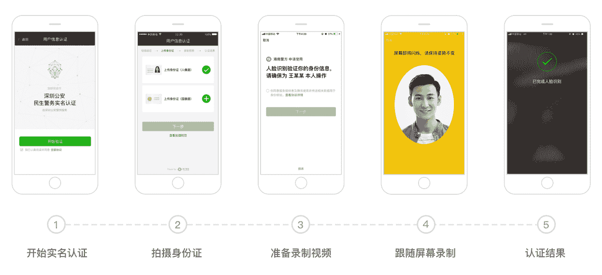

## 准备事项

结合您的实际业务场景，确认以下事项：

**确认接入方式**：选择微信原生 H5 模式，微信原生 H5 的接入方式有行业限制，且资质文件中主体与需要接入公众号主体一致，详细行业类目和资质材料请查阅  微信原生H5（微信公众号）资质文件列表。

**确认人脸比对库源**[：是需要](https://cloud.tencent.com/document/product/1007/31005)人脸核身跟权威库比对还是跟上传照片比对，两个详细价格可参阅 计费概述。

登录官网控制台 [创建 API 密钥](https://console.cloud.tencent.com/cam/capi)（SecretId 和 SecretKey）。

[确认微信公](https://open.faceid.qq.com/view/auth.html)众号已权限授权给人脸核身：微信原生 H5 模式需要公众号管理员授权，步骤如下：

打开二维码，公众号管理员扫码后，确定授权。

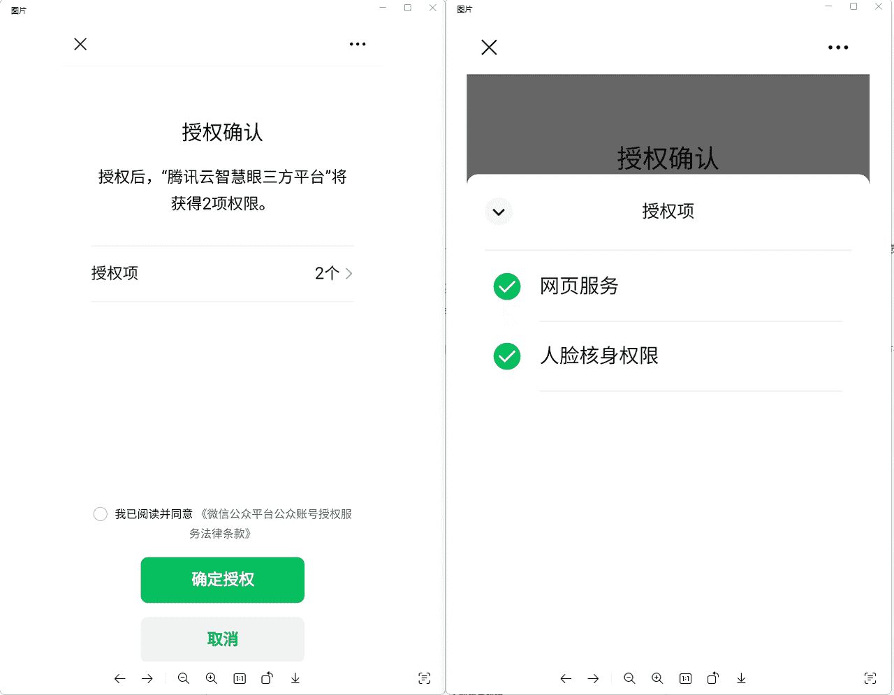

## 接入时序图

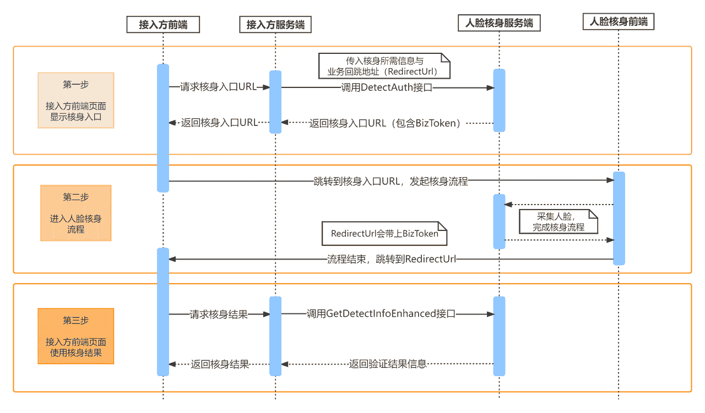

## 操作步骤

### 步骤1：创建 RuleId

RuleId 用于调用配置的业务流程，创建步骤如下：

1.  登录腾讯云人脸核身控制台，在 [自助接入](https://console.cloud.tencent.com/faceid/access) 页面，单击**创建业务流程**。

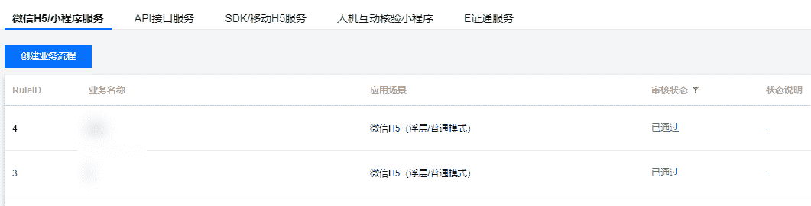

1.  选择应用场景：**微信原生 H5****，并根**据**需求填写相关信息**，填写完成后单击[下一步。](https://cloud.tencent.com/document/product/1007/103604)微信原生 H5 需要上传对应的 资质文件，我们会在3 - 5个工作日完成审核。

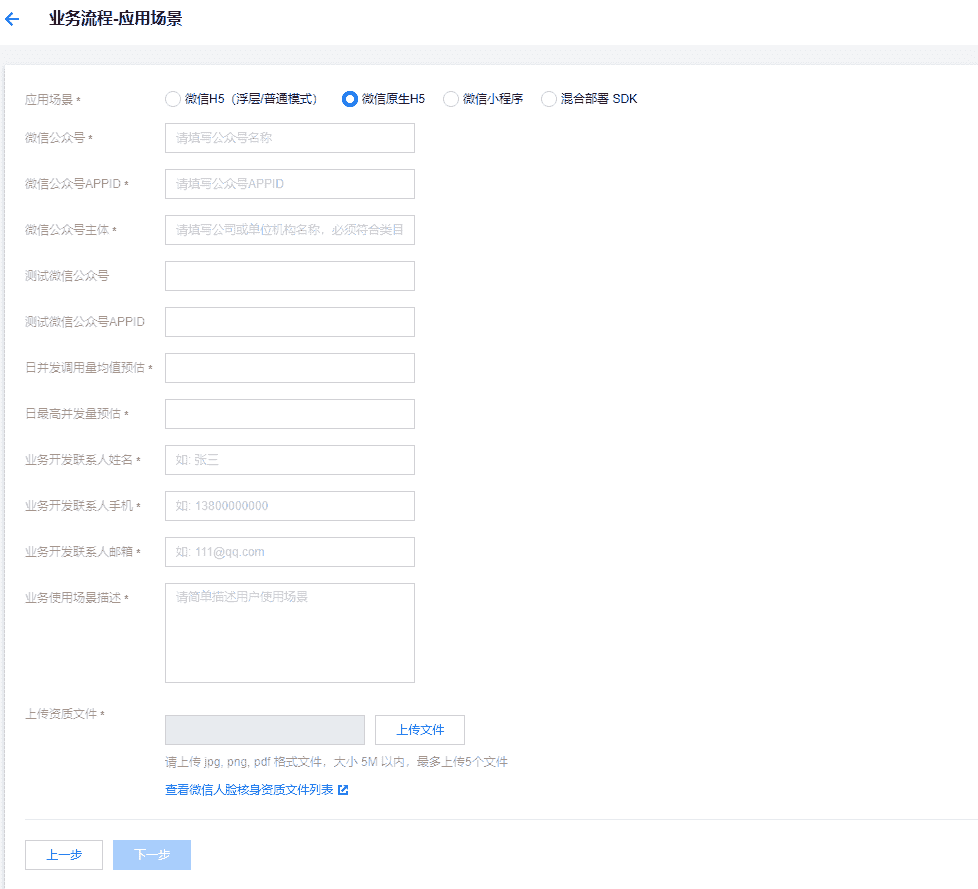

1.  选择应用类型：选择**增强版人脸核身**，然后单击**下一步**。

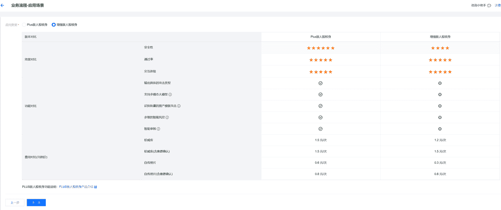

1.  进入接入配置，根据您业务的实际场景填写页面标题、业**务名称**、业务描述信息、业务联系方式后单击下一步。

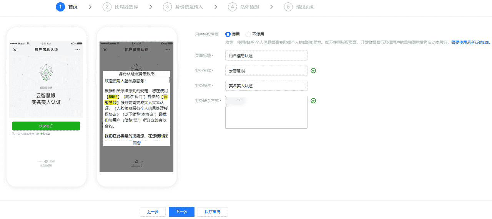

1.  **选择人脸比对**库**源。人脸核身支**持两种方式：跟权威库比对和跟上传照片比对。

+   其中**跟权威库比对**的收费价格为：增强版人脸核身（权威库）- 微信的价格。

+   **跟上传照片比对**的收费价格为：增强版人脸核身（自传照片）- 微信的价格。OCR 不再单独收费。

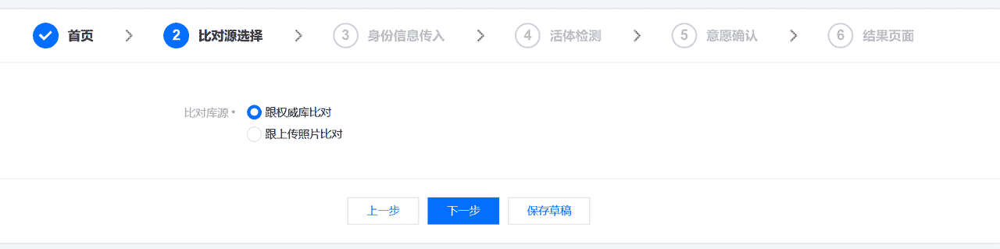

1.  **配置身份证 OCR 功**能，如果不需**要则勾**选“不需要用户在验证时上传”，然后单击下一步。

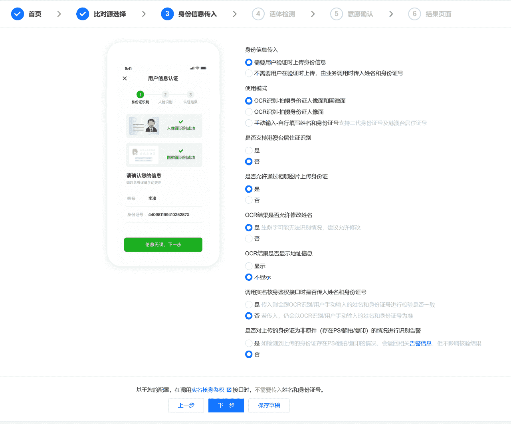

1.  配置活体检测方式，勾选后单击**下一步**。

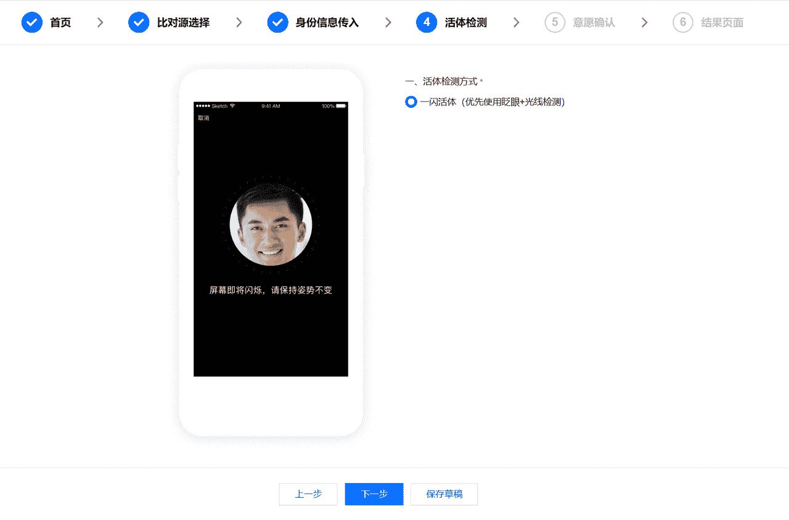

1.  **配置意**愿页面，根据您的业务情况勾选：是否增加用**户意愿确**认流程，然后单击下一步。请注意，增强版人脸核身默认是不增加意愿确认流程的，如配置了增加意愿确认，则将按意愿核身价格计费

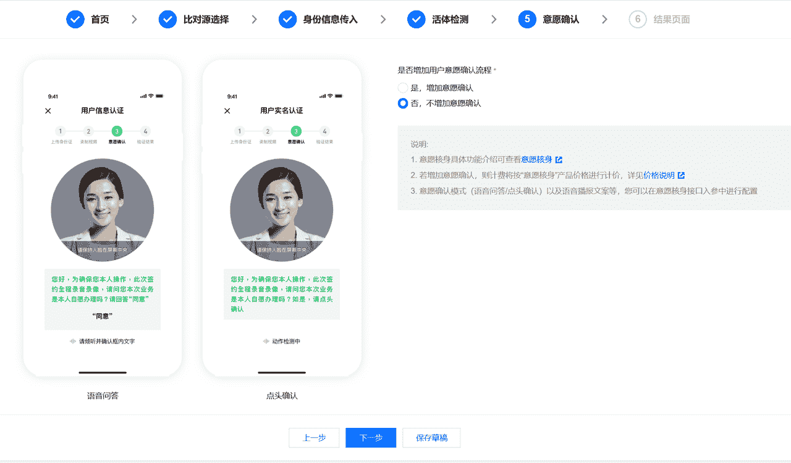

1.  配置结果页的文案描述，然后单击**下一步**。

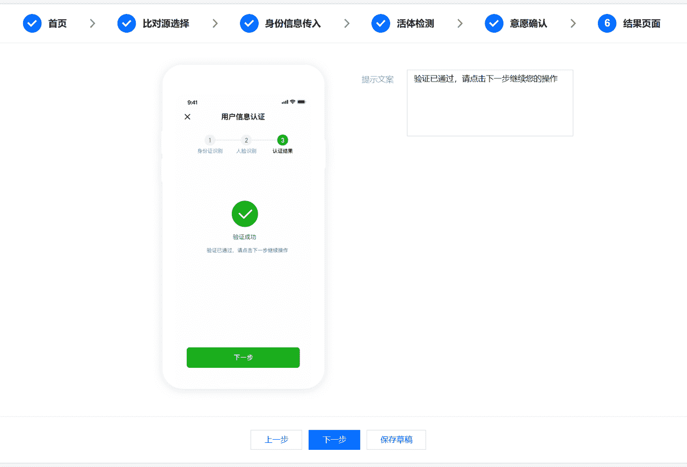

1.  **业务信息填写完**成后，确认您的配置信息和计费信息，然后单击确认并提交审核。

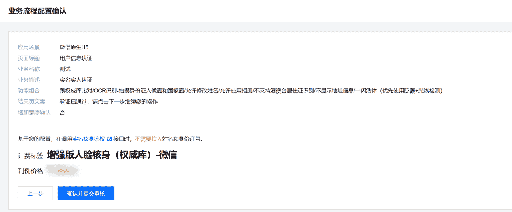

1.  流程审核通过后，系统会自动创建流程并分配业务 ID（RuleId）。

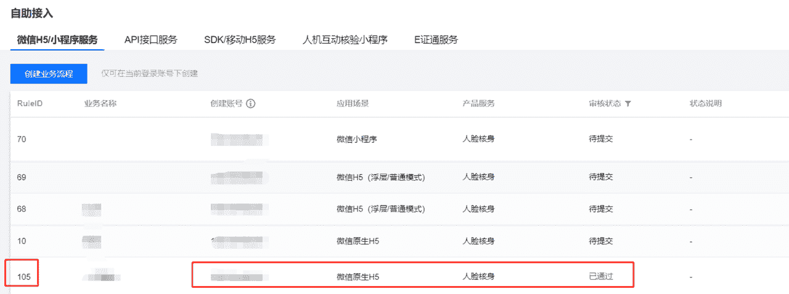

### **步骤2：获取 BizToken**

完成 [RuleId 创](https://cloud.tencent.com/document/product/1007/31816)建后，需[获取 ](https://cloud.tencent.com/document/product/1007/49539#spas1)BizToken，用于调用您配置的人脸核身验证的流程。

调用 实名核身鉴权接口，传入 步骤1 生成的 RuleId，和认证结束后重定向的回调链接地址 RedirectUrl，得到核验流程唯一密钥（BizToken）和用于发起核身流程的 URL。

[在线调试](https://console.cloud.tencent.com/api/explorer?Product=faceid&Version=2018-03-01&Action=DetectAuth&SignVersion=)

> **注意：**

> BizToken 是仅一次核身流程的标识，有效时间为7,200秒；用户完成核身后，开发者可用该标识获取验证结果信息，结果信息仅保留3天。

> 如果输入参数 RedirectUrl 为空，则用户完成核验后默认跳转腾讯云人脸核身产品介绍页。

### 步骤3： 跳转人脸核身 URL 完成核验

[您在前](https://cloud.tencent.com/document/product/1007/49539#spas2)端通过地址跳转方式重定向至 步骤2 中获取的核身入口 URL，用户进入核身流程，完成身份证拍摄识别、录制视频等操作完成身份核验。

### 步骤4： 查询核验结果信息

用户完成人脸核身后，页面会跳转到 RedirectUrl 上，地址中会带上此次验[证流程使用的 Biz](https://cloud.tencent.com/document/product/1007/41957)T[oken，您在服务端](https://console.cloud.tencent.com/faceid/dataStatistic)即可凭借 BizToken 参数调用 获取实名核身结果信息 接口去获取本次核身的详细信息。获取到用户验证过程数据，包括文本信息、识别分数、照片和视频。也可以通过访问 腾讯云人脸核身控制台 查看服务调用情况。