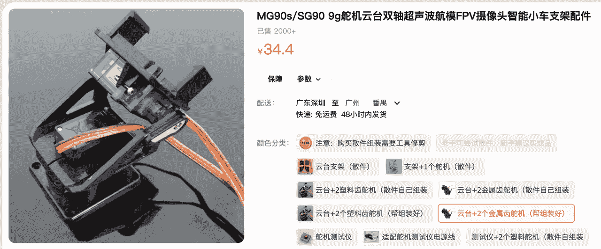
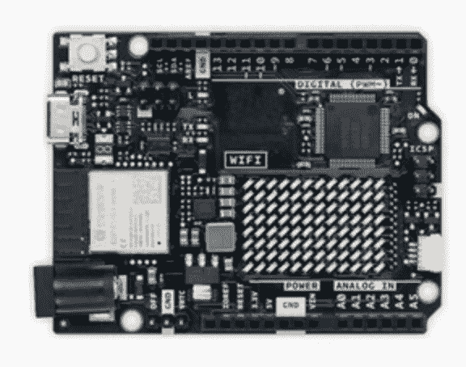
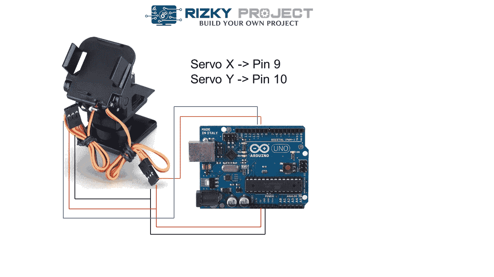
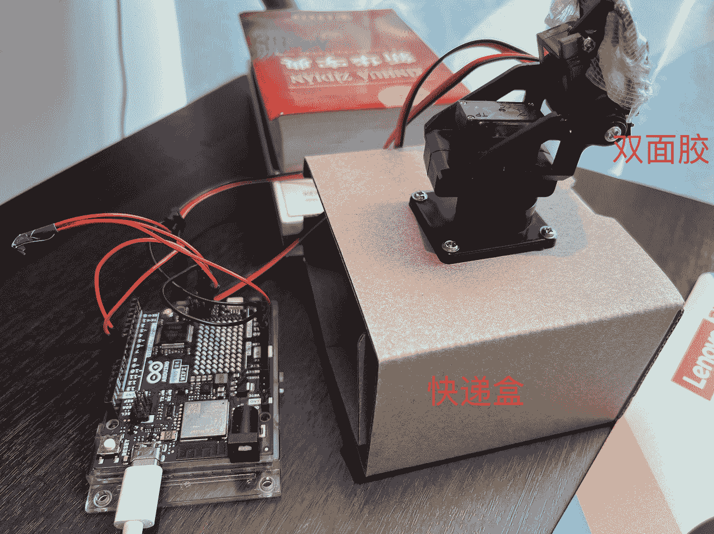
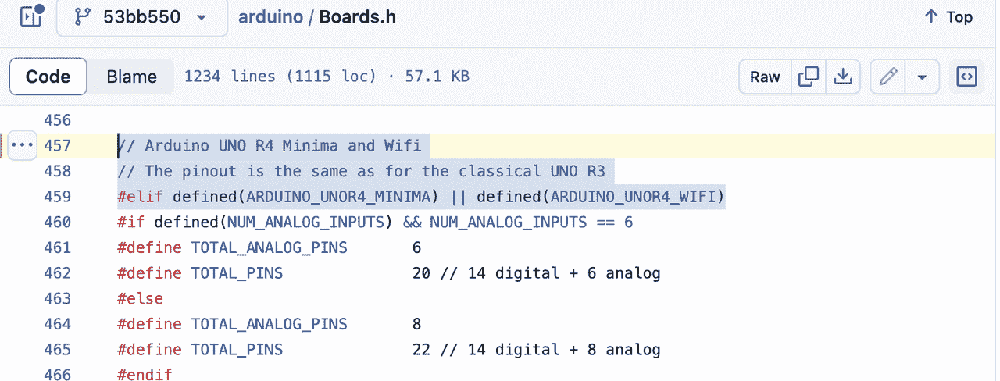
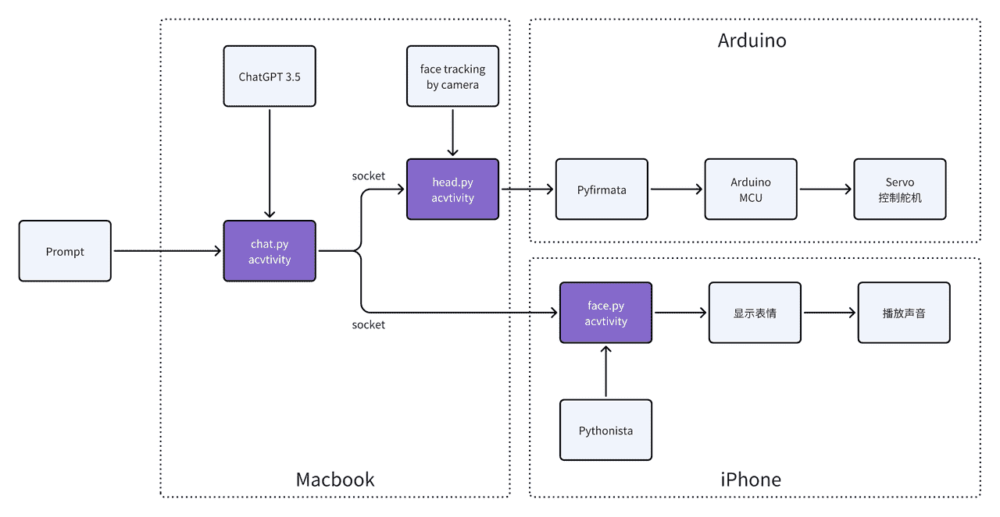

# Jake：GPT对话机器人制作指引

> 来源：[https://v11enp9ok1h.feishu.cn/docx/NRtWd4RyvodWtfx0HcYcDJxpnhf](https://v11enp9ok1h.feishu.cn/docx/NRtWd4RyvodWtfx0HcYcDJxpnhf)
> <https://v11enp9ok1h.feishu.cn/sync/PaIIdslbxsIJUIbkTfPcsMCFnph>
> 制作过程及代码
> 作者：Jake
> 上一篇效果：[邬嘉文：GPT具身对话机器人](https://v11enp9ok1h.feishu.cn/wiki/U1xrwCT88iNfnakFAyecf3qsn9d?from=from_copylink)

## 基础要求

+ 学习Python、Arduino IDE安装部署。
+ 通过Google查找报错信息及解决方案。
+ 充值大语言模型API，获取API KEY。
+ 有一个科学的环境。

## 硬件方案

### 参考案例

Headshot Tracking || `OpenCV` | Arduino

Github仓库

核心代码：Python通过`pyfirmata`和Arduino通讯

`https://github.com/rizkydermawan1992/Face-Detection/blob/main/facetracking.py`

### 硬件购置

舵机

+ 淘宝关键字：9g 舵机 云台
+ 扭矩：1.6kg·cm（4.8V）
+ 优点：便宜
+ 缺点：有点不够力



MCU控制主板

+ Arduino R4 WIFI



板子比较

| | Arduino UNO R4 | Arduino UNO R3 | 国产 Arduino | ESP32 |
| --- | --- | --- | --- | --- |
| 优点 | 支持TypeC连接，安卓手机可直接供电 | 兼容性更好，升级`Firmata`容易 | 适合硬件玩家，便宜 | 适合硬件玩家，便宜 |
| 缺点 | `Firmata`升级有兼容性问题，需要改源码 | USB接口比较老款，需要转接线 | - | - |
| 价格 | 200 | 150 | 100 | 30 |

Tips：有经验玩家自行选购舵机和MCU。

### 杜邦线

+ 公对公*6条


### 硬件组装

舵机接线

+ 3条杜邦线接在一起，如左图。（末端贴纸是Arduino赠送的）
+ 按右图方式接线，让Arduino提供5V电源和PWM控制。




### 云台组装

+ 云台有两片竖起胶片，剪掉，换上强力双面胶，把手机粘住。
+ 快递盒子做底座，板子可以推到盒子内。
+ 字典在旁边压着，防止盒子翻车。-_-||



## 环境搭建

### Arduino

1. 安装Arduino IDE
1. `File->Examples->Firmata->StandardFirmata`，写入板子，报错，Google解决方案。
1. R4太新，`Board.h`文件未覆盖，根据Google指引添加R4到`Board.h`就好，重新写入`StandardFirmata`。



### Python

1. 安装`python`，`3.10`兼容性较好。
1. `pip install pygame, openai, socket, pyfirmata`

+ 根据`python`运行报错信息，补充安装缺少的库。
+ `pyfirmata`负责Python和Arduino通讯

### Pythonista

1. iPhone上运行Python IDE，售价68 rmb。

## 程序运行

### Github

+ 代码是基于macbook+iPhone开发。
+ 项目工程由Claude 3 Opus输出。
+ 假如修改环境机需求，可以将原代码和需求特性放入到prompt，让Claude重写代码。
+ 3个程序需同时运行。

[GitHub - garmanwu/GPT-Embodiment-Robot: GPT-driven Chat Robot](https://github.com/garmanwu/GPT-Embodiment-Robot)

| Activicity | 进程作用 | 硬件平台 |
| --- | --- | --- |
| `chat.py` | 核心进程，实现聊天对话，发出语音、表情、头部动作（舵机转向）指令。 | Macbook |
| `face.py` | 播放声音和显示表情，底层由Pythonista提供运行环境。 | iPhone |
| `head.py` | 闲时机器人面向用户，有eye contact功能，接收指令后会配合表情做头部动作。 | Arduino |



### `head.py`

+ 打开macbook的终端窗口，通过`cd`指令到达项目目录。
+ 输入`python3 head.py`

```python
import cv2
from cvzone.FaceDetectionModule import FaceDetector
import pyfirmata
import numpy as np
import socket
import json
import threading
import time

cap = cv2.VideoCapture(0)
ws, hs = 1280, 720
cap.set(3, ws)
cap.set(4, hs)

if not cap.isOpened():
    print("Camera couldn't Access!!!")
    exit()

port = "/dev/cu.usbmodemF412FA64031C2"  # 改为自己设备的串口号
board = pyfirmata.Arduino(port)
servo_pinX = board.get_pin('d:9:s')  # pin 9 Arduino
servo_pinY = board.get_pin('d:10:s')  # pin 10 Arduino

detector = FaceDetector()
servoPos = [90, 90]  # initial servo position 默认舵机位置
last_data_time = 0

def listen_socket():
    global servoPos, last_data_time
    s = socket.socket()
    s.bind(('127.0.0.1', 7892))
    s.listen(1)
    while True:
        conn, addr = s.accept()
        data = conn.recv(1024).decode()
        print(f"Received data: {data}")
        try:
            jsonData = json.loads(data)
            servoX = jsonData.get('servoX', servoPos[0])
            servoY = jsonData.get('servoY', servoPos[1])
            # 限制舵机转动范围
            servoX = max(0, min(180, servoX))
            servoY = max(0, min(180, servoY))
            servoPos[0] = servoX
            servoPos[1] = servoY
            # 立即控制舵机转动
            servo_pinX.write(servoPos[0])
            servo_pinY.write(servoPos[1])
            # 记录接收到数据的时间
            last_data_time = time.time()
        except json.JSONDecodeError:
            print("Invalid JSON data received")
        conn.close()

threading.Thread(target=listen_socket, daemon=True).start()

while True:
    success, img = cap.read()
    # 如果距离上次接收到数据已经超过5秒,则进行视觉跟踪
    if time.time() - last_data_time > 5:
        img, bboxs = detector.findFaces(img, draw=False)

        if bboxs:
            fx, fy = bboxs[0]["center"][0], bboxs[0]["center"][1]
            pos = [fx, fy]
            servoX = np.interp(fx, [0, ws], [180, 0])
            servoY = np.interp(fy, [0, hs], [0, 180])

            # 限制舵机转动范围
            servoX = max(0, min(180, servoX))
            servoY = max(0, min(180, servoY))

            servoPos[0] = servoX
            servoPos[1] = servoY

            cv2.circle(img, (fx, fy), 80, (0, 0, 255), 2)
            cv2.putText(img, str(pos), (fx + 15, fy - 15), cv2.FONT_HERSHEY_PLAIN, 2, (255, 0, 0), 2)
            cv2.line(img, (0, fy), (ws, fy), (0, 0, 0), 2)  # x line
            cv2.line(img, (fx, hs), (fx, 0), (0, 0, 0), 2)  # y line
            cv2.circle(img, (fx, fy), 15, (0, 0, 255), cv2.FILLED)
            cv2.putText(img, "TARGET LOCKED", (850, 50), cv2.FONT_HERSHEY_PLAIN, 3, (255, 0, 255), 3)

        else:
            cv2.putText(img, "NO TARGET", (880, 50), cv2.FONT_HERSHEY_PLAIN, 3, (0, 0, 255), 3)
            cv2.circle(img, (640, 360), 80, (0, 0, 255), 2)
            cv2.circle(img, (640, 360), 15, (0, 0, 255), cv2.FILLED)
            cv2.line(img, (0, 360), (ws, 360), (0, 0, 0), 2)  # x line
            cv2.line(img, (640, hs), (640, 0), (0, 0, 0), 2)  # y line
        servo_pinX.write(servoPos[0])
        servo_pinY.write(servoPos[1])
    else:
        # 如果距离上次接收到数据不足5秒,则显示等待信息
        cv2.putText(img, "Waiting for data...", (50, 50), cv2.FONT_HERSHEY_PLAIN, 2, (255, 0, 0), 2)
    cv2.putText(img, f'Servo X: {int(servoPos[0])} deg', (50, 100), cv2.FONT_HERSHEY_PLAIN, 2, (255, 0, 0), 2)
    cv2.putText(img, f'Servo Y: {int(servoPos[1])} deg', (50, 150), cv2.FONT_HERSHEY_PLAIN, 2, (255, 0, 0), 2)

    cv2.imshow("Image", img)
    cv2.waitKey(1) # 假如觉得舵机太抖，尝试改一下更新频率，单位为毫秒。
```

### `face.py`

+ Macbook和iPhone在同一个局域网。
+ iPhone屏幕关闭时间设置5分钟。
+ 在iPhone上安装Pythonista，运行`face.py`。
+ 假如提示ip地址占用，杀掉进程，重启Pythonista。


## 代码实现

### 接收端代码

```python
import socket
import threading
from scene import *
import struct
import os
import sound
import time

PORT = 12345
text_to_display = ""
audio_file_path = ""

def receive_data():
    global text_to_display, audio_file_path
    with socket.socket(socket.AF_INET, socket.SOCK_STREAM) as s:
        s.bind(('0.0.0.0', PORT))
        s.listen(1)  # 只允许一个连接在队列中等待
        while True:
            conn, addr = s.accept()
            with conn:
                data = b""
                while True:
                    chunk = conn.recv(1024)
                    if not chunk:
                        break
                    data += chunk
                kaomoji_len = struct.unpack('!I', data[:4])[0]
                kaomoji_data = data[4:4+kaomoji_len]
                audio_len = struct.unpack('!I', data[4+kaomoji_len:8+kaomoji_len])[0]
                audio_data = data[8+kaomoji_len:8+kaomoji_len+audio_len]
                text_to_display = kaomoji_data.decode()
                # Create a new uniquely named audio file in the Documents directory
                timestamp = int(time.time())
                documents_dir = os.path.expanduser('~/Documents')
                audio_file_path = os.path.join(documents_dir, f"received_audio_{timestamp}.mp3")
                # Save audio data to the new file
                with open(audio_file_path, "wb") as f:
                    f.write(audio_data)
                # Stop the currently playing audio if any
                sound.stop_all_effects()
                # Play the new audio file
                sound.play_effect(audio_file_path)
            conn.close()  # 确保连接关闭
            time.sleep(0.1)  # 给一点时间让连接完全关闭

class MyScene(Scene):
    def setup(self):
        self.background_color = 'black'

    def draw(self):
        # Font configuration
        font_name = 'Helvetica'
        font_size = 120 #设备表情大小
        # Create a text image
        text_img, sz = render_text(text_to_display, font_name, font_size)
        # Calculate the position to center the text
        x = (self.size.w - sz.w) / 2
        y = (self.size.h - sz.h) / 2
        # Draw the text image at the center of the screen
        image(text_img, x, y)
    def touch_began(self, touch):
        self.view.close()
        # Clean up all audio files when the scene is closed
        documents_dir = os.path.expanduser('~/Documents')
        for filename in os.listdir(documents_dir):
            if filename.startswith("received_audio_"):
                file_path = os.path.join(documents_dir, filename)
                os.remove(file_path)

receive_thread = threading.Thread(target=receive_data)
receive_thread.daemon = True
receive_thread.start()

run(MyScene(), orientation=LANDSCAPE, frame_interval=1, show_fps=False)
```

### chat.py

+ Macbook新建终端窗口，通过`cd`指令到达项目目录，输入`python3 chat.py`。
+ 国内大模型（`kimi`，`GLM`）目前json格式返回不是很稳定。这里使用`OPENAI API`。

```python
import json
import socket
from openai import OpenAI
import pygame
import struct

OPEN_API_KEY = '填写API KEY' #

client = OpenAI(api_key=OPEN_API_KEY)

def send_to_iphone(kaomoji, audio_file):
    HOST = '192.168.1.115'
    PORT = 12345 #这里改iPhone IP地址。
    try:
        with socket.socket(socket.AF_INET, socket.SOCK_STREAM) as s:
            s.connect((HOST, PORT))
            kaomoji_data = kaomoji.encode()
            kaomoji_len = len(kaomoji_data)
            with open(audio_file, 'rb') as f:
                audio_data = f.read()
            audio_len = len(audio_data)
            data = struct.pack(f'!I{kaomoji_len}sI{audio_len}s', kaomoji_len, kaomoji_data, audio_len, audio_data)
            s.sendall(data)
    except:
        print("iPhone连接失败,请检查IP地址和端口号。")

def play_audio(file_path):
    pygame.mixer.init()
    pygame.mixer.music.load(file_path)
    pygame.mixer.music.play()
    while pygame.mixer.music.get_busy():
        pygame.time.delay(100)
    pygame.mixer.quit()

while True:
    prompt = input("请输入对话内容,输入quit退出: ")
    if prompt.lower() == 'quit':
        break

    response = client.chat.completions.create(
        model="gpt-3.5-turbo-0125",
        response_format={"type": "json_object"},
        messages=[
            {"role": "system", "content": "假设你是一个可以和人类对话的具身机器人,反应内容包括响应内容,以及对应的kaomoji表情和头部动作(双轴舵机转动参数)。以json格式返回，响应内容定义为response，表情定义为kaomoji，kaomoji表情要反映响应内容情感。与表情对应的头部动作水平角度（无需单位）为servoX，范围是10~170，面向正前方是90。与表情对应的头部动作垂直角度（无需单位）为servoY，范围是10~170，水平面是90。"},
            {"role": "user", "content": prompt},
        ]
    )

    result = json.loads(response.choices[0].message.content)
    print(response.choices[0].message.content)

    # 将response内容转为实时语音
    speech_response = client.audio.speech.create(
        model="tts-1",
        voice="alloy",
        input=result['response'],
    )

    speech_response.stream_to_file("output.mp3")
    send_to_iphone(result['kaomoji'], "output.mp3")

    with socket.socket(socket.AF_INET, socket.SOCK_STREAM) as s:
        s.connect(('127.0.0.1', 7892))
        data = json.dumps({"servoX": result['servoX'], "servoY": result['servoY']}).encode()
        s.sendall(data)
```

## Troubleshooting

+ 在整个搭建过程中，因环境差异遇到大量错误信息，请多问`GPT`和`GOOGLE`。
+ 更多参考：[手把手教会你做"机器人男友"搭建指引](https://bytedance.larkoffice.com/docx/JD4OdFwYSodu0mxPPrOcttKSnKe?from=from_copylink)
+ 查询后，问题仍未解决，可在群里请教大神。
+ 我是小白用户，不一定能解答你遇到的问题-_-||
+ 不要放弃。
