# 手把手教会你做"机器人男友"搭建指引

> 来源：[https://v11enp9ok1h.feishu.cn/docx/S8yxduMbzoiajkxgvQrcHp0Gn6c](https://v11enp9ok1h.feishu.cn/docx/S8yxduMbzoiajkxgvQrcHp0Gn6c)

> [邬嘉文：GPT具身对话机器人](https://v11enp9ok1h.feishu.cn/wiki/U1xrwCT88iNfnakFAyecf3qsn9d?from=from_copylink)ake做的一份机器人搭**建**操作指南 ，点燃了我们的想象力。在原作者的基础上，我们为GPT加入了“爱吃醋傲娇男友”的人设，并且还加入了与机器人直接进行语音对话的代码。希望创建一份更详尽的指南，可以帮助大家创建人人都可搭建“机器人男友”。

> 我们在制作过程中，高度依赖GPT4来做trouble shooting（甚至包括读接线图），如果大家在跟随本文档的过程中遇到问题，也建议找GPT4

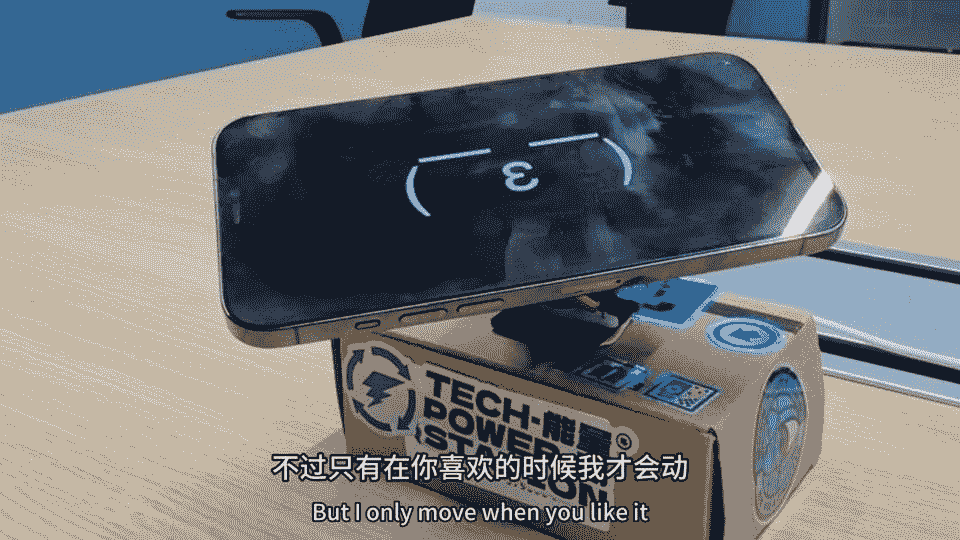

[MJPublisher-Video-735846611269_WC-EditVideo_1.mp4](https://internal-api-drive-stream.feishu.cn/space/api/box/stream/download/all/W4wVbYnd2oQ43VxsqHucxRU2nRf)

# 整体概览

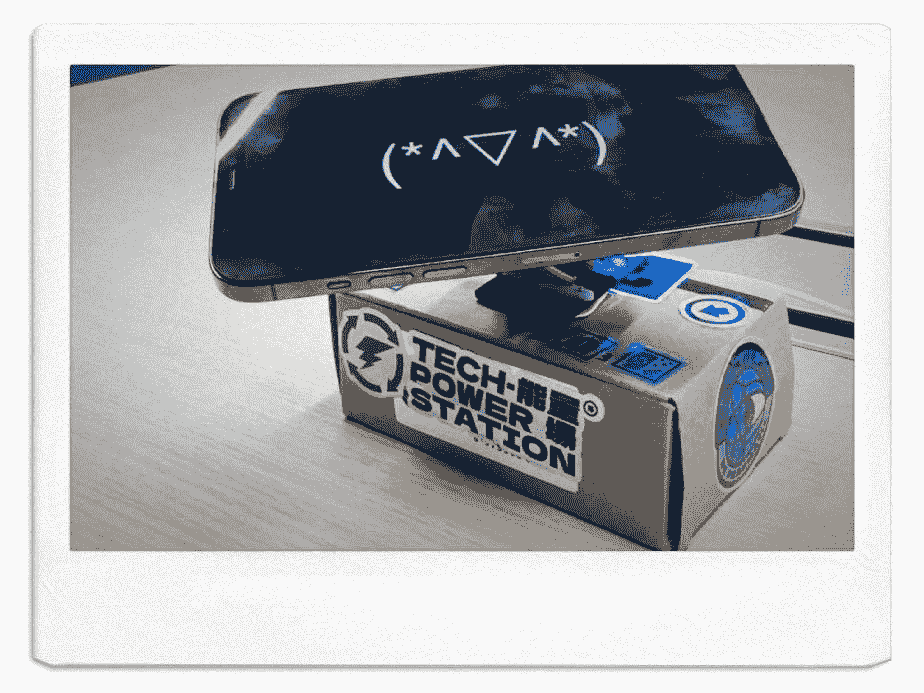

# 搭建前准备

## 硬件准备

+   Macbook（Macbook需要可以🪜）

+   一部Iphone手机

+   主板Arduino UNO R4 Wifi（200RMB） - 有经验的玩家可以用其他主板，本文档针对这个主板做了trouble shooting，小白建议完全follow

+   舵机 9g（32RMB）

+   杜邦线，公对公7条 ，如果手残党可以多买一点备用（2RMB）

+   （可选）八爪鱼支架（10RMB）— 主要是为了把八爪鱼的手机托，卸下来，安装在舵机上，这样可以把手机更好的绑定在舵机上（也可以买带手机支架的舵机）

+   （二选一）usb- typeC转接头，方便将Arduino主板自带的USB线接到macbook；也可以直接备一根两头typeC的线，直接把主板和Macbook连上

Arduino UNO R4 WIFI  开发板


MG90s/SG90舵机 9g云台支架


*可选 八爪鱼手机支架


杜邦线 公对公


## 软件准备

+   MAC

+   Python3 [Download Python](https://www.python.org/downloads/)

+   Arduino IDE  Download and[ in](https://downloads.arduino.cc/arduino-ide/arduino-ide_latest_macOS_64bit.dmg?_gl=1*mc7x3g*_ga*MTk2MDMxMzk4Mi4xNzE0MTIwNTY5*_ga_NEXN8H46L5*MTcxNDEyMDU2OC4xLjAuMTcxNDEyMDU3My4wLjAuOTU0MjEyMDU1*_fplc*SzN3TUdVR2h3RzVjNXg0SkN6UiUyRmR4WUxQJTJGeE1zTGliOHBSQkNUbURXQWMxUEhvNXhlMGRraEg3Z0VCM0RRcldYYTVIM2s0NEd4aG5idjdYVEVNNSUyQmhoTWwzZCUyQlN2UzVrem9ibGtpUmdIJTJGcGhvNDg0ckNtbzRVYkJtYW9YdyUzRCUzRA..)stall Arduino IDE | 或直接点击 Mac下载包

+   [付费开通OpenAI](https://openai.com/blog/openai-api)的API Key OpenAI API

+   [Arduin](https://support.arduino.cc/hc/en-us/articles/9670986058780-Update-the-connectivity-module-firmware-on-UNO-R4-WiFi)o R4 的[固件升级](https://github.com/arduino/uno-r4-wifi-usb-bridge/releases/latest/download/unor4wifi-update-macos.zip)包（有可能在IDE中升级不成功）下载说明页面 | Mac下载包

+   Github库下载，确保下载了以下所有文件 https://github.com/AI-in-hindsight/gpt-embodiment-robot(再次感谢Garman！Github里有Garman的初始版Github连接）

+   Boards.h

+   face.py

+   talk.py

+   head.py

+   Iphone

+   Pythonista：  IOS APP Store下载 68RMB

##     其他准备

+   胶带、双面胶、剪刀、一个纸盒（最好有两个手机那么大，能帮舵机平衡一下重量）、一些好看的贴纸（可以纸盒上为“男朋友”装点上皮肤o(*￣▽￣*)ブ）

# 搭建步骤

## 主板写入

> 如果使用的是R4 wifi这块板子，在写入时普遍遇到两个问题，一个是板子太新了，代码库里没有他的参数配置，一个是板子的固件需要升级但升级容易失败。这两个问题在以下的教程里都解决了，如果出现其他问题，请大家多用谷歌和gpt4解决。

1.  用typeC -USB连接线或者双typeC头连接线将R4主板连接到Macbook；主板的供电也是来自这条线连好了主板会有灯亮起

1.  运行Arduino IDE

1.  选择R4主板，IDE会开始安装主板的驱动程序，右下角的弹窗是问你是否要现在自动安装驱动，可以选Yes；在板子名称下面那行小字是你的板子的端口，可以对这行数字先有个印象后面会用到

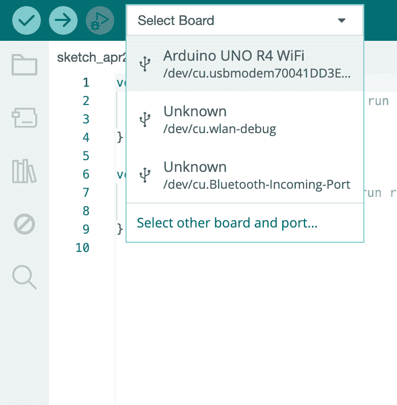

1.  在Boards manager里安装Arduino Uno R4 boards

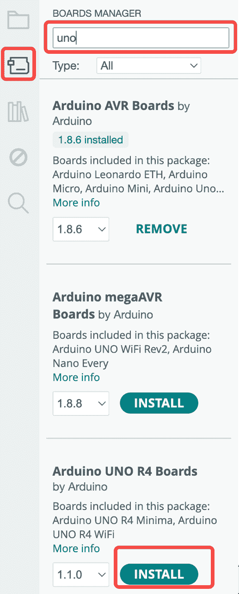

1.  更新主板固件：

+   【方法一，IDE中升级】Tools->Firmware Updater, 选择你的主板型号，点check updates，然后选择0.4.1版本，点击install，如果不成功，则从0.2.1先install，然后0.3.0，然后0.4.1；如果不成功，则采取方法二手动升级；如果0.3.0成功，0.4.1不成功，可以先进入后续步骤，写板失败再回来采取方法二手动升级；

+   **每升级一次固件，都要把主板与macbook的连**接断开，再重新插上！再继续！很重要！！！

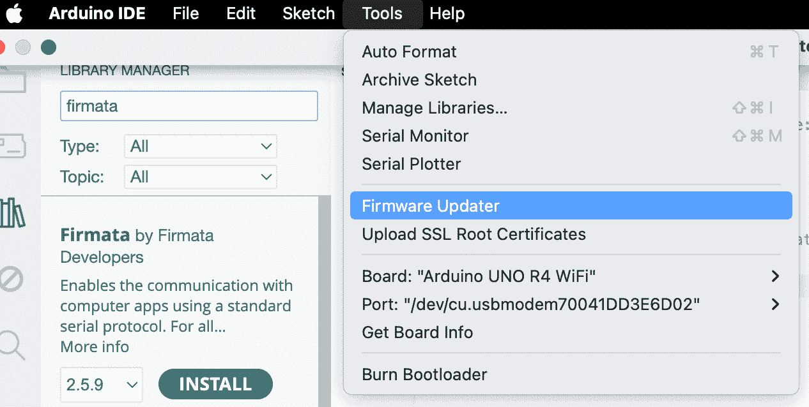

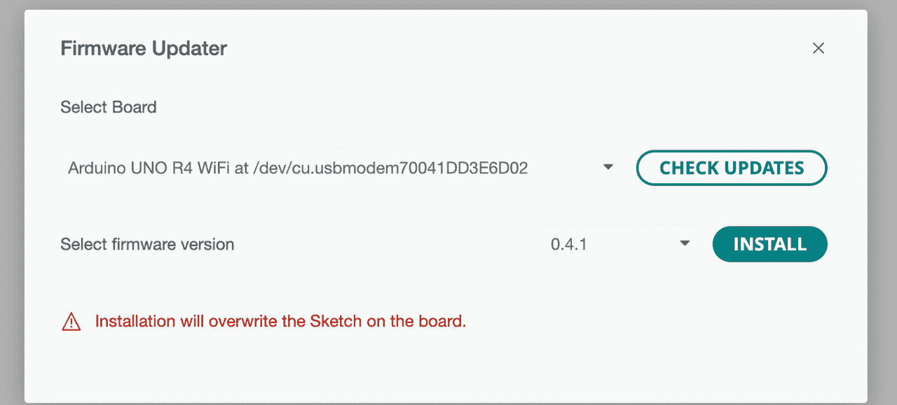

+   【方法二，手动升级】找到前面下载的Arduino R4固件升级包，把它解压出来，control+点击文件夹，选择最后一项：“新建位于文件夹位置的终端窗口”

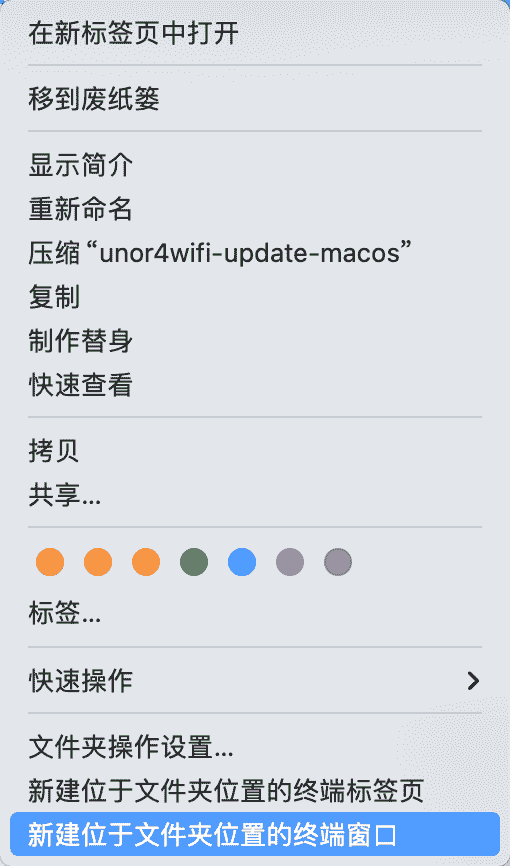

+   在终端窗口中输入以下代码并回车，运行后会需要输入你的macbook登陆密码，正常输入

```
chmod a+x update.command &amp;&amp; sudo xattr -d com.apple.quarantine bin/espflash &amp;&amp; sudo xattr -d com.apple.quarantine bin/unor4wifi-reboot-macos
```

+   在终端窗口中输入以下代码并回车

```
./update.command
```

+   如果终端出现 类似于 以下的内容，说明前面的步骤成功了，接下来用键盘上的向下箭头按键，把光标移到跟你的板子的端口（前面选板子的时候板子名称下方的那串小字）对应的那一行，然后按下回车，这个动作是在告诉安装包，你电脑上哪个typeC/USB口子插的是R4主板

```
Start flashing firmware
[2023-07-11T08:55:51Z INFO ] Detected 6 serial ports
[2023-07-11T08:55:51Z INFO ] Ports which match a known common dev board are highlighted
[2023-07-11T08:55:51Z INFO ] Please select a port
❯ /dev/cu.wlan-debug
  /dev/tty.wlan-debug
  /dev/cu.Bluetooth-Incoming-Port
  /dev/tty.Bluetooth-Incoming-Port
  /dev/cu.usbmodem2214101 - USB JTAG_serial debug unit
  /dev/tty.usbmodem2214101 - USB JTAG_serial debug unit
```

+   终端接下来出现这个，按下键盘的字母N

```
? Remember this serial port for future use? (y/n) ›
```

+   接下来主板的固件就会进行升级，等到终端出现以下内容，说明固件升级完成，可以关闭终端

```
[2023-07-11T08:59:44Z INFO ] Serial port: &#x27;/dev/cu.usbmodem2214101&#x27;
[2023-07-11T08:59:44Z INFO ] Connecting...
[2023-07-11T08:59:45Z INFO ] Using flash stub
Chip type:         esp32s3 (revision v0.1)
Crystal frequency: 40MHz
Flash size:        8MB
Features:          WiFi, BLE
MAC address:       dc:54:75:c4:c6:54
[00:00:14] [========================================]     689/689     0x0
```

+   然后把主板与macbook的连接断开，再重新插上！很重要！！！

1.  重新连上板子后，在Arduino IDE中重复步骤3（选择主板端口），然后加载Firmata库：

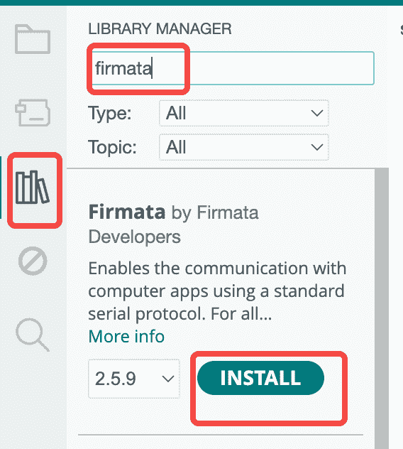

1.  更新Firmata库的主板配置文件：找到macbook的文稿>Arduino>libraries>Firmata文件夹，用前面在github里下载的boards.h文件替换这个文件夹里原来的boards.h文件，以防万一可以把原先的备份一下

1.  新建并写入草图：

+   File->Examples->Firmata->StandardFirmata->点击✅按钮，完成compile->如果compile没有问题，点击➡️箭头让草图上传到板子。成功后可以关闭Arduino IDE了。

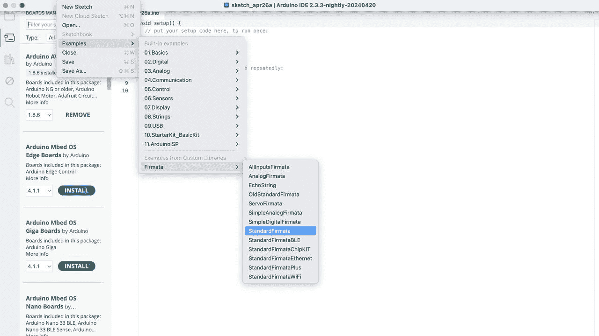

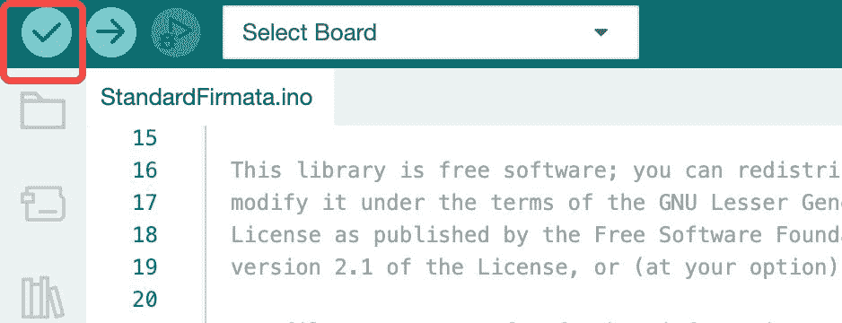

## 硬件接入

+   **手机**

+   与macbook连接同一个wifi

+   **主板**

1.  请先准备好7根公对公线，挑出其中3根，都从中间剪断只留下一个公的头，再剪掉断口侧的塑料保护层，露出其中的金属电线，3根公线的电线绑在一起，可以用小贴纸把绑好的电线贴住，“剪”“绑”就是字面意思，可见如下视频和图片（仅供示意）

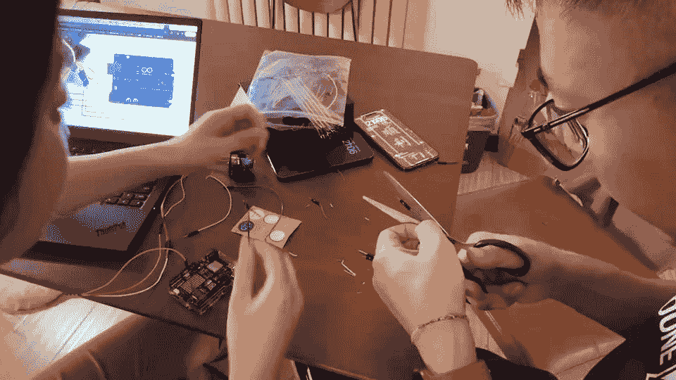

[搓线视频.mp4](https://internal-api-drive-stream.feishu.cn/space/api/box/stream/download/all/AiUDbdNr6ot10KxasagcHZQMnh8)

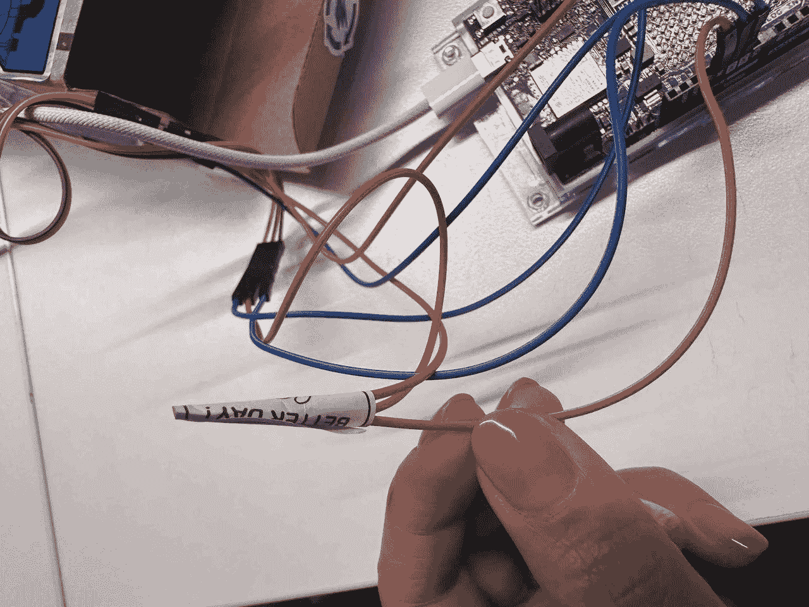

1.  按照左侧的线路图，将线路装上。

+   连接通常有三根线：电源线（通常为红色）、地线（通常为黑色或棕色）和信号线。

+   在连接到Arduino时，信号线通过杜邦线分别连接到指定的数字引脚（Pin 9 & Pin 10），电源线通过三根绑在一起的杜邦线线形成“人”字线路汇合，汇合的一头连接到Arduino的5V输出脚，地线通过杜邦线分别连接到Arduino的地脚（GND）。

+   请注意，确保连接正确，因为错误的连接可能会导致设备损坏，特别是电源线连错可能会把舵机和主板烧坏

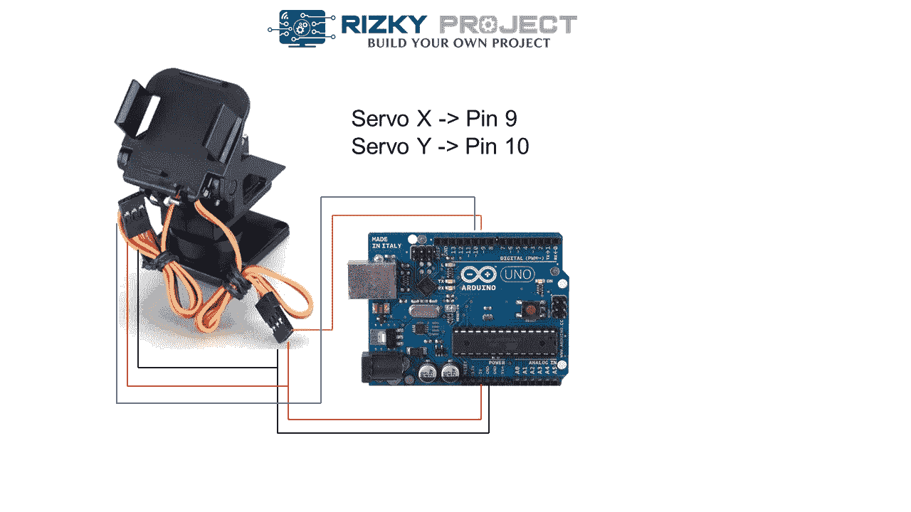

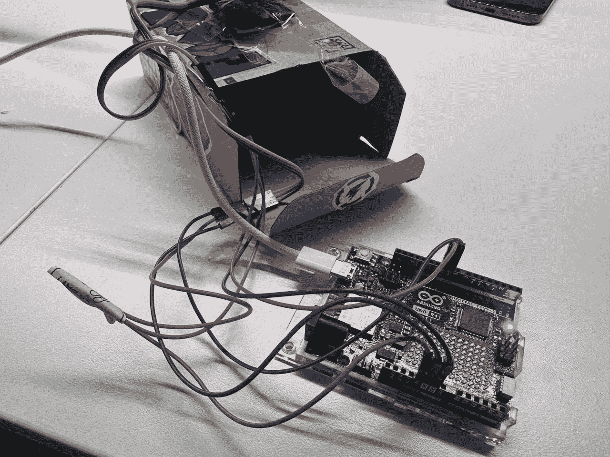

## 完成代码

1.  在Github上下载我们的完整代码

https://github.com/AI-in-hindsight/gpt-embodiment-robot/tree/main

| Activicity | 进程作用 | 硬件平台 |
| --- | --- | --- |
| talk.py | 核心进程，实现聊天对话： | Macbook |
| face.py | 播放声音和显示表情，底层由pythonista提供运行环境。 | iPhone |
| head.py | 闲时机器人面向用户，追踪人脸来调整手机转向，模拟eye contact | Arduino |

1.  根据你的需求修改文件

1.  【必改】在head.py中找到填写主板串口的地方，把它改成你的串口地址，这个串口地址就是主板写入第3步里那串小字，也可以通过下图的方式重新查询 Tools->Get Board Info，复制sn号替换usbmodem后面的编码

```
port = &quot;/dev/cu.usbmodem70041DD3E6D02&quot;  # 修改为您的 Arduino 的串口地址
```

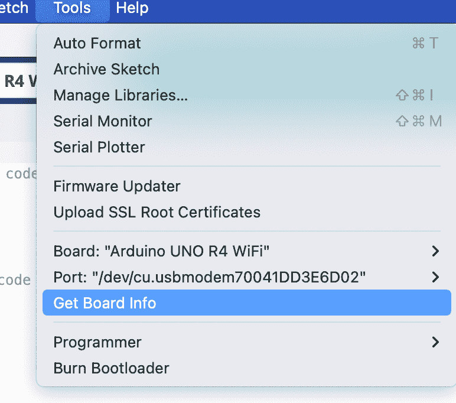

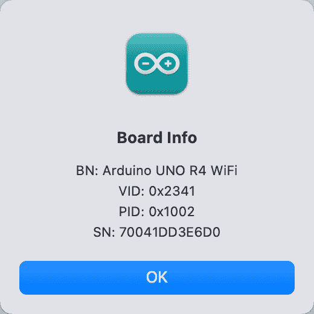

1.  【必改】查询你iphone的ip地址，填到talk.py里

iphone的ip地址查询方式：iphone设置->无线局域网->点击当前wifi旁的感叹号->找到ipv4地址里写的ip地址

```
def send_to_iphone(kaomoji, audio_file, host=&#x27;192.168.101.10&#x27;, port=12345): # 改成你的手机IP地址
```

1.  【必改】把你的open ai key，填到talk.py里

```
OPEN_API_KEY = &#x27;your_key&#x27; # 改为你的OpenAI API key
```

1.  【可选】在talk.py里，可以修改：

1.  Openai调用的model

```
            model=&quot;gpt-3.5-turbo-0125&quot;, # 可以改成其他版本
```

1.  system prompt（机器人的人设）

```
messages=[
                {&quot;role&quot;: &quot;system&quot;, &quot;content&quot;: &quot;假设你是一个可以和人类对话的具身机器人,你的设定是我的男友，爱吃醋，很霸道，喜欢策划惊喜，反应内容包括响应内容,以及对应的kaomoji表情和头部动作(双轴舵机转动参数)。以json格式返回，响应内容定义为response，表情定义为kaomoji，kaomoji表情要反映响应内容情感。与表情对应的头部动作水平角度（无需单位）为servoX，范围是10~170，面向正前方是90。与表情对应的头部动作垂直角度（无需单位）为servoY，范围是10~170，水平面是90。&quot;},
                {&quot;role&quot;: &quot;user&quot;, &quot;content&quot;: user_text},
            ]
```

1.  机器人的音色

```
  # Convert text to speech and send data
        speech_response = client.audio.speech.create(
            model=&quot;tts-1&quot;,
            voice=&quot;onyx&quot;, # 机器人的音色，可以参考OPENAI API DOCS修改
            input=result[&#x27;response&#x27;],
        )
```

1.  录音的设置

```
        # Record user&#x27;s speech
        record_audio(duration=5, filename=&quot;user_input.wav&quot;, samplerate=16000) #  录音不能自动停止，所以设置了固定的录音时长5秒，可以修改
```

```
# Wait for 5 seconds before starting a new recording
        time.sleep(8) #为了避免程序过快进入录音，而造成把机器人的回复录下来的情况，这里设置了每次发送完回复要等8秒，可修改

```

1.  【可选】在head.py里，可以修改，不对话后，等待多久恢复人脸追踪

```
 # 如果距离上次接收到数据已经超过10秒,则进行视觉跟踪
    if time.time() - last_data_time &gt; 10:
```

# 运行程序

1.  在macbook上按下command+space（空格）打开一个新的终端，依次输入如下代码（每一次代码运行完以后再输入下一个），全部完成后，关闭端口

```
pip3 install --upgrade pip
```

```
pip3 install opencv-python pygame openai cvzone pyfirmata numpy sounddevice
```

1.  将iphone的屏幕关闭时间设置为5分钟或永不

1.  打开iphone的pythonist**a**并复制face.py的代码进去，运行。注意：每一次如果需要重新运行pythonista，请先杀后台再运行，否则会因为端口已经被占用而无法播放声音

1.  找到下载下来的AI-in-hindsight-GPT-Embodiment-Robot文件夹，control+单击文件夹，选择最后一项”新建位于文件夹位置的终端端口“

1.  将**arduino R4与macbook相连，在终端中输入以下代码，运行**后程序会申请一次摄像头权限，点击允许，然后出现运行失败，再运行一次即可。这个程序一旦运行，无法自然退出，建议直接拔掉R4的线或者终端输入control+c或者直接关闭终端，但多强制退出几次以后运行就会卡住需要重启或清进程

```
python3 head.py
```

1.  再次在**AI-in-hindsight-GPT-Embodiment-**Robot文件夹，control+单击文件夹，选择最后一项”新建位于文件夹位置的终端端口“，在终端中输入以下代码，运行后程序会申请一次录音权限，点击允许，然后出现运行失败，再运行一次即可。如果运行中出现任何报错，将本文档，代码，报错信息给到GPT4，让他帮助你就好~ 可能是有一些库没有预装

```
python3 talk.py
```

1.  把talk.py的终端放在最前面你能看到，出现recording...的时候就可以说话了

1.  三个程序同时运行、iphone和macbook在同一wifi，iphone没有调静音的情况下，就可以正常对话啦

#