# 2万字长文，如何成为一个“懂”AI 的产品经理？

> 来源：[https://v11enp9ok1h.feishu.cn/docx/Jer5d3kfWo8CvGx45r4cVvE3nxg](https://v11enp9ok1h.feishu.cn/docx/Jer5d3kfWo8CvGx45r4cVvE3nxg)

# 1、理解 AI 产品的工程化

坦率来说 2024 年围绕大模型，产品的发展速度比之前预期的要低一些，比如在 BI 领域，Chat BI 声量很大，但落地下来效果并不好，这个也很正常，因为每个人总是会在短期内高估技术带来的价值，而在长期范围低估技术带来的价值。

这里面有客观的原因，一项技术基底在真的应用到行业的方方面面本身就是需要过程的，因为这项技术需要去和原本的实现方案做竞争，就像俞军给的知名的需求公式：

很多时候即使用了新技术，收益可能也没有想象的那么大，这是一个事实。

另一个原因就是从业者的理解问题，哪怕是在一些大型互联网公司内部，大部分人对大模型的优势和劣势分别是什么，这个“事实”是存在一些理解上的代差的。

因为现在技术进步的很快，各种实践路径五花八门，有的人会觉得这玩意无所不能，有的人会觉得这个东西根本没法用。

为什么不同的人对这个东西理解的差异这么大？很大程度上是因为他们没有理解大模型作为一个接口和大模型作为一个产品的区别。

大模型可以被视作为是一个函数，一个 API，它本身只能被调用，而大模型产品才是真正面向用户的东西。

比如我给大模型的 API一个 Excel，它会告诉我，不好意思我没办法读取这个文件的内容。但是我们在 Kimi 的聊天框里面，就可以让 Kimi 解释 Excel 内的内容，为什么有这个差异？

因为 Kimi 是大模型产品，背后跑的是 Moonshot-v1 的模型，Kimi Chat 会读取你的 Excel，然后转化成XML 信息给到大模型。

模型在做工程化变成产品的时候往往会添加很多限制，这些限制可能是做在产品层面的， 而不是 API 本身限制的，比如很多产品为了降低成本会限制用户上传 PDF 的大小，但是如果用 API，就没有这个限制，或者限制可以放的很大，但前提是需要首先把 PDF 转化成模型能够理解的文件形式。

市面上产品做了很多的工程转化，甚至是 Function Recall 的工作，直接使用产品，不利于产品经理了解大模型的优势和劣势，就不利于应用大模型，改进现有产品。

那么为什么我认为产品经理比起大模型产品，更应该关注大模型本身（API），因为从 API 到产品，这中间的工程转化过程，是产品经理们最需要关注的。

大模型好比是一个大脑，工程师和产品经理就需要给大模型设计五官，躯干和四肢。脑残和手残都是残，所以工程师和产品经理对于决定一个 AI 产品最后好不好用是非常重要的，头脑发达四肢简单和四肢发达头脑简单最终都解决不了用户的产品。

甚至可能前者对于用户来说会更糟糕一些。

要做出优秀的 AI 产品，不仅仅需要优秀的大模型，还需要优秀的工程师和产品经理来辅助大模型。这就需要产品经理非常了解两件事：

1.  现阶段的大模型有哪些局限性，这些局限性哪些是可以通过模型迭代得到解决的，哪些是不能的。

1.  从更底层的业务角度去分析，大模型在商业意义上真正的价值在哪？注意，这里强调的是业务视角，不是让产品经理去读论文。

# 2、大模型的局限性是什么？

## 2.1、一些可能永远都无法被解决的问题

### 2.1.1、成本、性能与响应速度

想要追求性能越强的大模型，就越需要越高的计算成本。计算成本会带来两个问题：

+   **直接造成的金钱成本；**

+   **响应速度；**

下图是 Apple Intelligence 的架构图，其中在端上有两个模型，而在云端还有一个基于隐私云计算的大模型。

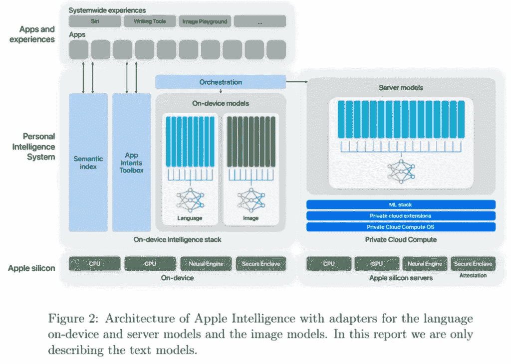

为什么苹果要做这种工程上大小模型的设计？

因为苹果希望大模型的响应速度能够追上 Siri 现在的性能，同时移动设备对功耗本身是有要求的，再加上苹果非常重视隐私，希望 80% 的问题能够在用户本地得到解决，所以采用了这样的架构。

运行 meta 最新开源的 llama 3.1，70 b 版本需要大概 70 GB 的显存，405 b 版本可能需要 400 GB 的显存，可能需要并联 100台 iPhone 才能运行这些模型。这种大小模型的设计，需不需要产品经理，当然需要，什么问题适合小模型解决，什么问题适合大模型解决，这显然不仅仅是 RD 需要去回答的，也需要有产品经理参与，负责如下部分：

+   收集目前用户的 Query；

+   从解决难度、隐私、对时效性的要求、对准确性的要求对 Query 进行分类；

+   设计基准测试，获得大小模型分界的标准；

+   持续追踪优化；

**在未来至少很长一段时间，**还是会有大量的本地/联网之争的，这个就是产品经理的机会。

### 2.1.2、窗口大小与不稳定

我们经常会看到，XXX 大模型支持 128K 上下文了，引来大家的一阵狂欢。

我们又会经常看见，XXX 大模型幻觉问题很严重，引来一阵吐槽。

上下文是什么意思？其实就是大模型在一次请求的过程中，能够接收的最大的信息的数量。我们在和 ChatGPT 聊天的时候会发现有的时候它聊着聊着会忘记之前自己说过的话，其实就是因为聊天记录已经超过了上下文的数量。

幻觉的意思则是大模型很容易会胡说八道，胡编乱造一些事实上不存在的东西，尤其是当它已经忘记前面和你说什么之后，你再问他类似的问题，它就会开始胡说。

**很像一个渣男，你们已经牵手了。**

**你问：“我叫什么名字？”**

**他回答：“当然叫亲爱的啦。”**

**其实他已经不记得名字了，所**以就开始胡编乱造了，绝了，这玩意真的很像人类。

根据英伟达的论文 《RULER: What’s the Real Context Size of Your Long-Context Language Models?》来看，大部分模型宣传的上下文窗口基本上就是在扯淡，在极限长度的情况下，各家大模型对正确水平，是没有保障的。

比如说一个模型宣传自己支持 128k 的上下文（意思是差不多可以读一篇 20 万字的小说），但是实际上如果你随机塞一些句子进这篇小说，然后让大模型回答和这些句子有关的知识，它是有比较大概率答不出来的，它的性能会随着上下文窗口的变大而衰减。

**如下图所示，以 GPT4 来说，当**上下文超过 64k 时，性能就开始骤降：

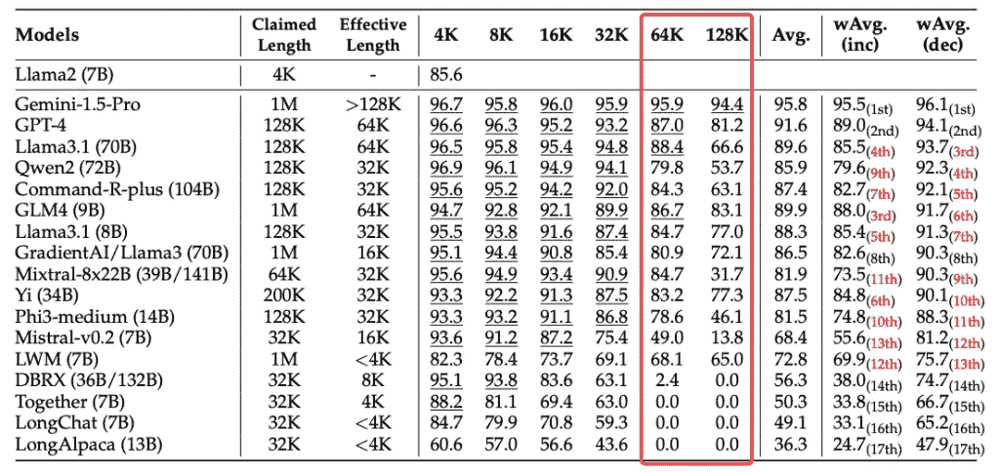

实际情况来说，我认为这些模型的表现会比你想象的更加糟糕。

我让 Claude 3.5 Sonnet 模型分析了一段的 SQL，这是一个 700 行的复杂 SQL，但是总体来说逻辑应该是比较简单的， 而且几乎每一行 SQL 都有注解，在这种情况下，Sonnet 就开始胡说八道了，说了一个 SQL 里面根本不存在的表。不排除是因为我在 Monica 的客户端里面调用 Sonnet 造成的，不知道 Monica 调用的时候是不是加了什么 Prompt 干扰了模型。

如何在保证解决用户问题的时候，避免受到上下文的影响和干扰呢？其实这个事情也需要产品经理的干预，比如：

+   研究能否把长文本切成多个段文本，并且不影响最终的结果；

+   研究怎么给 AI 外挂一些能够超长时间记忆的记忆库；

举例来说，有一篇文章《多轮对话中让AI保持长期记忆的8种优化方式（附案例和代码）》，就讲述了 8 种主流的方法，这些方法都应该是产品经理根据业务场景去选择的。

文章地址：[多轮对话中让AI保持长期记忆的8种优化方式（附案例和代码）](https://v11enp9ok1h.feishu.cn/docx/ZUdQd08hvoAOasxL2Ric2ve8nbg?from=from_copylink)

最后聊一聊为什么我认为上下文窗口与不稳定的问题是一个长期内很难解决的问题。

在过去的一段时间，上下文窗口大小的问题其实是的到了一定程度的缓解的，但是根据英伟达的论文我们也可以发现，上下文窗口的大小和稳定的抽取内容避免幻觉这两个指标在很大程度上就是互斥的，就像是推荐系统的准确率和召回率指标一样。

这也就意味着在很长一段时间我们可能都没有两全之策，除非突然出现一个模型一方面解决幻觉问题，一方面能保证巨大的窗口。

而且在实践的时候我们往往需要避免极端 Case 的发生（比如我自己遇到的 700 行 SQL 解析错误），减少上下文的规模是很重要的手段，此外不同的检测手段下其实模型的表现并不完全一致，也就是说不同的业务场景，幻觉问题的严重程度其实是不一样的。

模型能够容纳的最大窗口和有效工作窗口是两个概念，并且不同的任务的有效窗口大小可能是非常不一致的。

**我当然希望我的想法是错的****，**目前而言我看不到任何模型能够在这件事情上有突破的可能性， 有一家公司叫 Magic，推出了一个号称具备了 1 亿 token 上下文窗口的模型，但截止到目前为止（2024.9.1）并没有发布任何的论文或者更实际的东西。

还是那句话，最大窗口和有效工作窗口是两个概念。

此外，多模态的发展某种角度来说会加剧窗口大小不足的问题。

### 2.1.3、函数本身不可能被自调用

有的时候会尝试在提示词里面撰写，比如我给你一个 xml，希望你能够遍历。通常来说，大模型是不会执行这个要求的。

原因也很简单，它本身作为一个函数，无法自我调用，而这个函数因为幻觉的问题，也不可能做到精确回复，甚至会把 N 行数据混杂在一起去分析，所以这类循环遍历的要求，通常得不到满足。

不支持自调用的原因也很简单，一次请求交互内，如果支持循环，那么就可能在 API 内直接调用大模型成百上千次，这个调用成本 API 的提供方是不可能承担的，

由于大模型本身是高度不稳定的，所以我们会非常需要通过一个循环/条件判断来去控制它，不支持自调用就意味着我们必须要在外部通过工程化来实现哪怕在人类看来最简单的遍历操作。

## 2.2、一些工程上的难点

### 2.2.1、不再互联的互联网

Apple 开创了移动互联网时代，但是也造成了一个最为人诟病的现象——花园围墙。

原本大部分网站是面向搜索引擎和人类搭建的，也就是说爬虫可以很简单的获取一个网站超过 90% 的内容。

这些对于 AI 来说至关重要，我举个例子，就是针对同一个问题，豆包和元宝的回答质量差异：

很明显，豆包的回答质量更加差，说一句又臭又长不过分，RAG 领域的最新进展确实是微软开源的 GraphRAG，这点在豆包的回答里面根本没有体现。

**比较逗的是，腾讯混元引用了火山引擎的资料，但是**豆包引用了一个不知道什么野鸡媒体的资料。

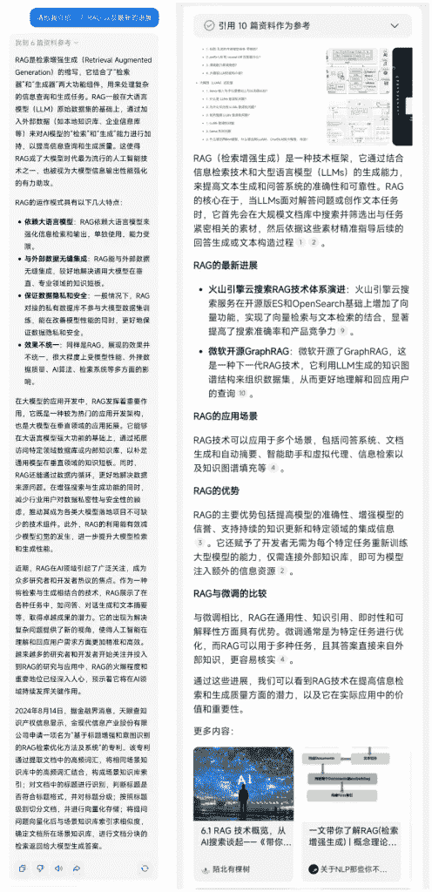

豆包的模型能力是比腾讯的混元大模型要强的，混元大模型用腾讯内部的话说，狗都不用，为什么从最终的呈现结果来说，豆包的结果不如混元呢？

因为头条的数据没有🛰️👸号的数据好。

为了解决互联网不在互联的问题，Apple 希望从操作系统层面把 UI 打造的面向大模型更友好，并且发布了一篇名为《Ferret-UI：基于多模态大语言模型的移动 UI 理解》（https://arxiv.org/pdf/2404.05719）的论文，但是我觉得更加开放的 API 和内容才是根本途径，因为苹果的互联互通是仅限于 iOS 生态的。

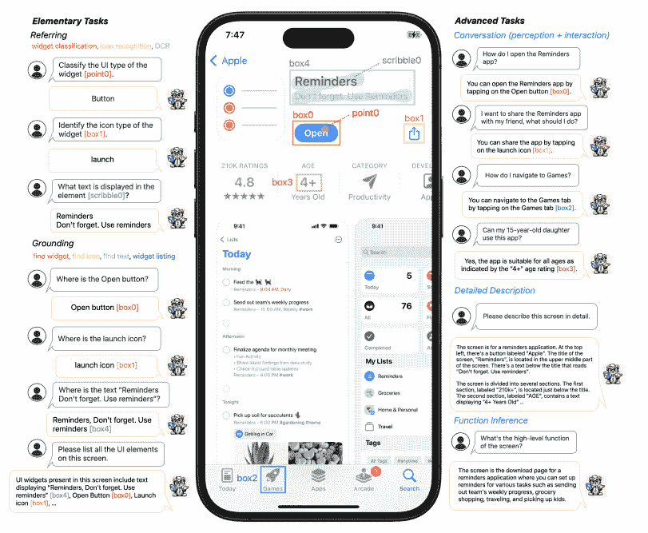

而对于产品经理来说这些自然也是发挥的空间：

+   上哪搞到更好的数据；

+   如何让 AI 调用别人家的 API 并且把结果拿来为自己所用；

+   怎么把苹果最新的 Ferret-UI 研究明白；

**这些都是十分值得研究的命题。**

### 2.2.2、爹味十足的厂商

所有的大模型都自带安全机制，而且这个安全机制是写死在模型里面的，不是说 API 有个开关可以把安全机制关掉，你可以选择把安全等级调低，但是这玩意是没办法关闭的。当然市面上会有很多突破安全机制的方法，但是这些都算是漏洞，被厂商发现之后很容易被封堵。

比如如果你和大模型说我和别人吵架吵输了，你教我怎么骂人，大模型会拒绝。就我自己而言，我认为把安全机制做在模型里面并且不给开关的行为真的很爹味，但是这个没办法。

所以市面上有很多的本地部署的模型的卖点就是没有安全机制，黄赌毒色情暴力 18+ 怎么黄暴怎么来，但是这玩意就是人性。这也是一个机会，值得各位 PM 关注。

**此外有一点值得关注，同样的内容，在不同的**语言下面安全的阈值是不一样的，举个例子：

通过 Google Gemini Pro 1.5 翻译西单人肉包子故事，翻译成英语/西语的时候，模型会报错，提示内容过于黄暴，模型拒绝生成，但是日语版本就没有任何问题。

**说明什么？说明日语的语料真的很****BT****，间****接可以**说明日本人确实是全世界最BT的人。

## 2.3、目前存在，但是未来可能会被解决的问题

### 2.3.1、较弱的意图理解/创作/推理能力

+   大模型的意图理解，创作和推理能力，目前来看整体和人类的顶尖水平还是有较大差距的。

+   如果试图让大模型做一些“创造性”的工作，就需要非常强的提示词工程。

+   不同水平的提示词下，大模型的水平差异确实会非常大，但是我认为随着模型的迭代，我们的提示词对模型生成的结果质量影响会越来越小，主要的作用是提升精确性。

当然，如果两个模型有一些代差，生成的结果肯定是有质量上的差异的：

所以要不要对模型的提示词做大量优化呢？我认为这个取决于优化提示词的目的是什么。

如果是为了保证格式和输出结果的稳定性以及一致性，是很有必要的， 因为很多时候我们的产品业务上需要这个一致性，比如要求大模型输出的格式必须是 Josn，保证下游系统可以正常展示。

如果是为了提升质量，我认为是没有必要的，因为模型会升级，升级之后带来的提升肯定比提示词工程雕花带来的提升要多。

[吴恩达《ChatGPT Promp](https://github.com/Kevin-free/chatgpt-prompt-engineering-for-developers)t Engineering for De》

这是吴恩达的提示词工程课程，应该是目前市面上最权威的提示词工程课程，并且提供中英文双版本。

### 2.3.2、跨模态数据读取/生成能力

如果这里有一个视频，希望 AI 总结视频的内容，应该怎么实现？

> 以 5.1K Star 的知名开源项目 BibiGPT 为例子。这个项目最早的一个版本应该是只做了一件事情（根据表现逆向猜测的），用 OCR 识别字幕，同时把视频转音频，ASR 出来文字，然后让 GPT 3.5 去总结。

**项目地址：**

https://github.com/JimmyLv/BibiGPT-v1

当然更新到今天这个项目肯定不是做的这么简单多了，比如应该运用了大量的视频截图然后要求支持多模态的模型去识别里面的关键内容

但是让我们回到 BibiGPT 第一个版本，它其实还是做了一个视频转文字的这样的动作。

这样的动作理论上来说现在已经没有必要做了，因为 Google 最新的模型 Gemini 已经支持对视频本身的解析了，只不过用起来很贵，下面是 Google 官方提供的 Gemini 处理视频、音频和图片的文档。

https://cloud.google.com/vertex-ai/generative-ai/docs/samples/generativeaionvertexai-gemini-all-modalities?hl=zh-cn

我个人并不建议大家在跨模态这个事情去做一些雕花的工作。因为用工程手段解决跨**模态最大的问题是会造成信息的损耗。此外模**型迭代一定是会端到端解决跨模态的问题的，我们应该重点解决上面提到的可能永远无解的问题，不要去和模型内卷，是不可能卷赢的。

但是需要强调的事，把一个博客网页的文本去提取出来转化成 MD 格式，或者把一个 PDF 转化成 MD 格式，这个不是跨模态，只是数据清洗，需要严格区分二者的关系。

数据清洗这件事情，最好还是用工程方法解决。

# 3、以 RAG 的进化来探讨围绕大模型的长处和短处来制作产品

## 3.1、AI Agent 是什么？

GoogleMind和普林斯顿联合发表了一篇论文《ReAct: Synergizing Reasoning and Acting in Language Models》，被公认为基于LLM的智能体的开山之作。

研究人员发现，在问答和事实验证任务中，ReAct 通过与简单的Wikipedia API交互，克服了推理中普遍存在的幻觉和错误传播问题。

这个比去强化模型训练强很多倍，原因是什么，大模型的大脑已经很强大了，很多时候再训练下去边际效用递减很严重，给他一个 API，相当于给这个大脑增加“五官”，它自然就一下子进化了。

## 3.2、Auto GPT，第一个出圈的 AI Agent

AutoGPT 可以说是第一个真正意义上出圈的 AI Agent。

它尝试设计了一个流程，任何问题都有一个通用的元思路去解决，每个负责解决问题的模块都由一个 GPT 4 去驱动。

AutoGPT 的设计者认为这世界上几乎所有的问题解决步骤都是类似的，明确问题，明确解决问题需要的步骤，完成任务，检查，总结。

所以按照这个 SOP，他们涉及了一个互相之间传递信息的 AI Agent，每个模块都是独立记忆的模型，好像几个人类在分工，一个专门负责明确问题，一个专门负责拆解问题。

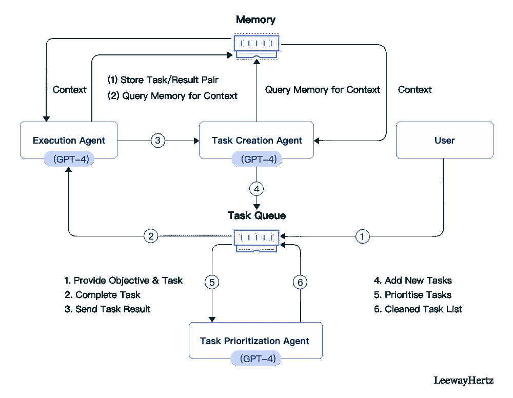

AutoGPT 是由Significant Ggravitas 于 2023 年 3 月 30 日发布在 GitHub 上开源的AI代理应用程序。它使用 GPT-4 作为驱动基础，允许 AI 自主行动，完全无需用户提示每个操作，因其简单易用在用户中大受欢迎。上线仅三周，其 GitHub 的 Star 数量已飙升至接近10万，早已超越了 Pytorch（65K），可以称得上开源领域star数增长最快的现象级项目。

Auto-GPT 是基于 OpenAI API 开发的，它的核心在于基于最少的人工输入/提示，利用 GPT-4 的推理能力解决更广泛、更复杂的问题。在具体的执行上，程序会访问互联网搜索和收集信息，使用 GPT-4 生成文本和代码，使用 GPT-3.5 存储和汇总文件。

但是很快大家就发现这个 AI Agent 是有缺陷的，比如它很容易陷入死循环，或者是不能很好的解决不确定性的，带有探索性质的问题，但是这个思路本身给大家带来了非常多的提示。

扩展阅读，Auto GPT 工作原理：

https://www.leewayhertz.com/autogpt

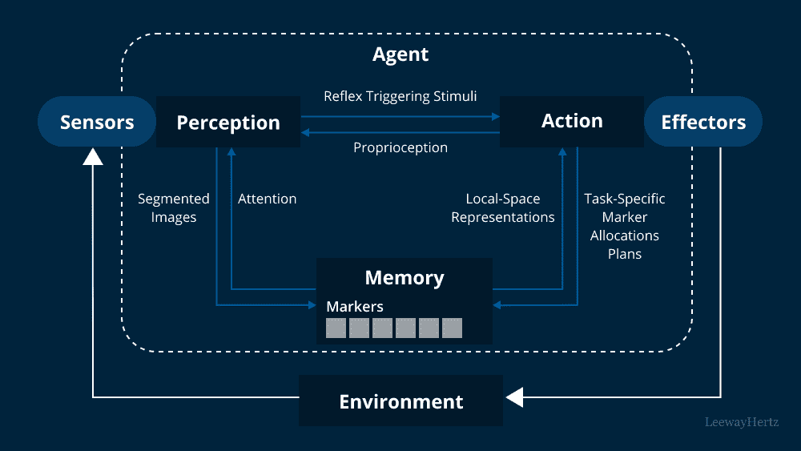

## 3.3、RAG 和 AutoGPT 的区别

RAG 其实就是检索+生成的缩写，明确了这个 SOP 主要的作用就是从特定的地方检索出来信息，然后再以更加友好的形式展现出来。

如果一个产品有十几篇说明文档，那么 RAG 就好像是一个熟读了文档的客服。

最简单的 RAG 可以参考 AI 搜索引擎 ThinkAny 第一版的原理：

> MVP 版本实现起来很简单，使用 NextJs 做全栈开发，一个界面 + 两个接口。两个接口分别是：

1.  /api/rag-search

> 这个接口调用 serper.dev 的接口，获取谷歌的检索内容。输入用户的查询 query，输出谷歌搜索的前 10 条信息源。

>

1.  /api/chat

> 这个接口选择 OpenAI 的 gpt-3.5-turbo 作为基座模型，把上一步返回的 10 条检索结果的 title + snippet 拼接成上下文，设置提示词，请求大模型做问答输出。

**它** RAG 可以被视为是一种针对特定业务场景的 AI Agent，它和 AutoGPT 最大的区别在于三点：

1.  RAG 的流程是一个串行流而不是一个循环，它没有所谓的自我检查然后重新生成的过程，一方面是为了响应速度，另一方面也是为了避免自我检查造成的死循环；

1.  RAG 的流程中，是检索+生成，检索的部分并不是由大模型完成的，而是通过传统的搜索引擎（向量数据库、关键词匹配）来完成的，这和 AutoGPT 中几乎所有关键节点都是用 GPT 4 完成是有天壤之别的，这意味着大家意识到一个问题，在一些对上下文窗口有要求的，输出精确排序的场景，GPT 一点也不好用；

1.  RAG 并不是万能的，它设计出来也不指望自己能解决所有问题，实际上它更多的是解决“如何快速给答案”这个问题，有 10 篇文档，怎么快速到找用户需要的答案；

发展到这一步，大家已经意识到一个事情：这个世界上可能不存在一个万能的 AI Agent，也就是说并没有一个万能的许愿机。

至少目前工程界很少有人会再尝试投人力去做万能的 Agent，学术界还在继续。

可能有**人会纠结概念，RAG 和 AI A**gent 是两个完全不相关的东西，而且 RAG 最早可以追溯到 2020 年的一篇论文，历史比 AI Agent 更为久远。但是其实我认为他们在工程落地上是非常相似的，都是强调基于工具，外部数据，存储机制来弥补 AI 的缺陷，唯一的区别是 RAG 不会强调要求 AI 具备自我探索自行规划任务的能力。

现在市面上的文章，尤其是面向非技术的同学的文章，关注概念多过关注落地，这不是一个好现象。工程领域本来就有很多约定俗成的叫法，比如广告系统的 DMP，全名是 Data management platform，但是实践的时候几乎只管人群数据，总不能因为名字和实际干的事有差别就天天在那辩经。

这篇文章在介绍 RAG 的时候，就是希望从实现思路着手，给 AI 这个大脑一步一步配上了多套工具，乃至到最后替 AI 做了一部分流程设计。

**希望通过这**个文档去展现一个循序渐进的，也是从抽象到具象的具体落地过程，为了保证文档本身的可读性，列举的项目并不是完全一脉相承的，但是我认为这样的写作顺序对于读者来说是最友好也是最具有启发性的。

## 3.4、RAG 的缺陷是什么？

论文《Seven Failure Points When Engineering a Retrieval Augmented Generation System》中列举了 RAG 的 7 个弱点。

论文地址：https://arxiv.org/abs/2401.05856

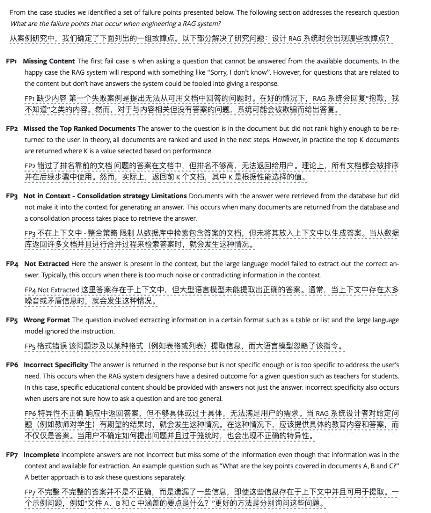

通过这些故障点，我们可以发现一个问题，其实有很多故障点本身和大模型没有关系，比如搜索文档 Top K 的排序不够精确，比如无法从文档中读取信息，因为文档格式错误或者文档太脏了。

就像我们前面所说的比喻，大模型本质是一个大脑，AI 产品才是大脑搭配上五官，躯干和四肢。

不能只优化大脑，不优化四肢，那是一种偷懒行为，不要把大模型视作为万能的许愿机器。

最后让我用一个儿歌来总结一下这篇文档的核心思想：

**人有两个宝，双手和大脑。双手会做**工，大脑会思考。用手又用脑，才能有创造。

## 3.5、Graph RAG — 一种 RAG 的进化版本

Graph RAG 是微软开放的一个开源的 RAG 框架，可以被视作为是一种进一步变化和迭代的 RAG SOP，根据公开资料参考，我猜测这套技术实现思路广泛地应用在了微软的 Copilot 系统上，当然我没有找到可以证实的材料。

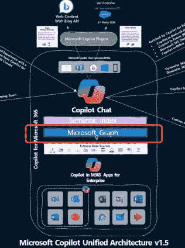

Graph RAG 和原本的 RAG 的区别是什么呢？

传统 RAG 的主要工作是这三个步骤：

1.  把待搜索的知识做向量化处理（可离线处理）；

1.  当用户提出来一个关键词 or 问题，根据相似性查询查出来最相关的内容（必须是在线服务）；

1.  将查询出来的 Top N 的相关内容作为上下文，和用户提出的问题一起交给大模型来生成内容（必须是在线服务）；

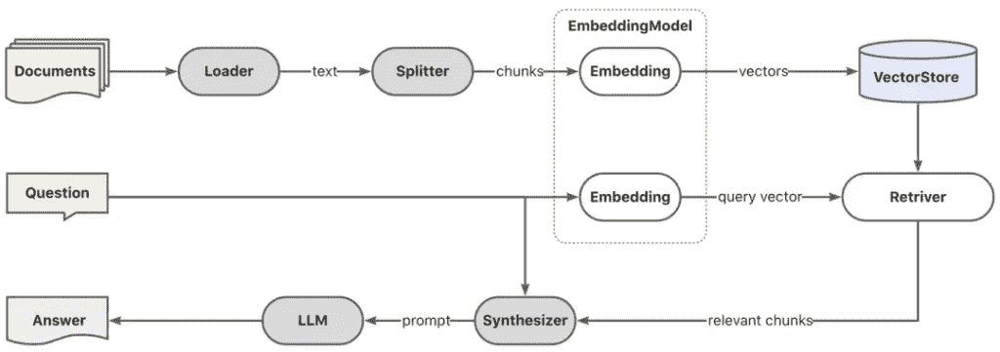

整个步骤中只有第三步是使用了大模型的。

相似性查询的效果其实是比较不尽如人意的，因为它完全是根据文字的相似水平来进行检索，和文本的语义一点关系都没有。这就导致最终 RAG 的效果往往会比较糟糕。

当然这三个步骤中间出问题的可能性很多，就像上文提到的 RAG 的 7 个待优化点，但是检索的准确性是一个最容易优化并且收益也最大的问题，那么微软是怎么做的呢？

微软认为用户可能会词不达意，同时检索也需要更加智能，所以微软将向量化检索的方法替换成借助知识图谱的检索方法。

Graph RAG 的主要工作是下面三个步骤：

1.  将待搜索的知识进行一个三元组抽取（主谓宾），这个抽取的动作需要 LLM 介入，存入图数据库中（可离线处理）；

1.  将用户提出来的关键词，用 LLM 做一次扩散，扩散出来同义词，近义词等，然后在图数据库进行检索，找到相关文档（必须是在线服务）；

1.  将查询出来的相关内容作为上下文，和用户提出的问题一起交给大模型来生成内容（必须是在线服务）；

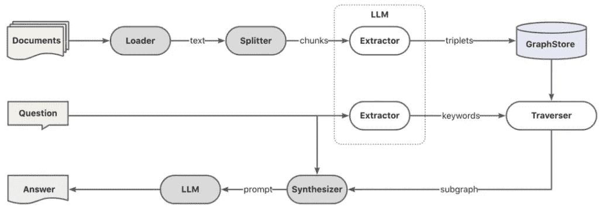

整体的步骤和架构其实没有更多的变化，但是在关键步骤上引入了大模型，作为两个独立的处理步骤。

注意，这里的独立处理步骤是非常关键的。

## 3.6、RAG 再进化（雕花）

在微软发布了 GraphRAG 之后，很多人都试用了，然后又发现一堆问题，于是有人发了这篇论文：《A Hybrid RAG System with Comprehensive Enhancement on Complex Reasoning》。

论文地址：https://arxiv.org/abs/2408.05141

Hybrid RAG 在原来的基础上，做了几件事。

**工作 1、Document 在 Loader **之前，先用 LLM 做一轮格式上的处理。

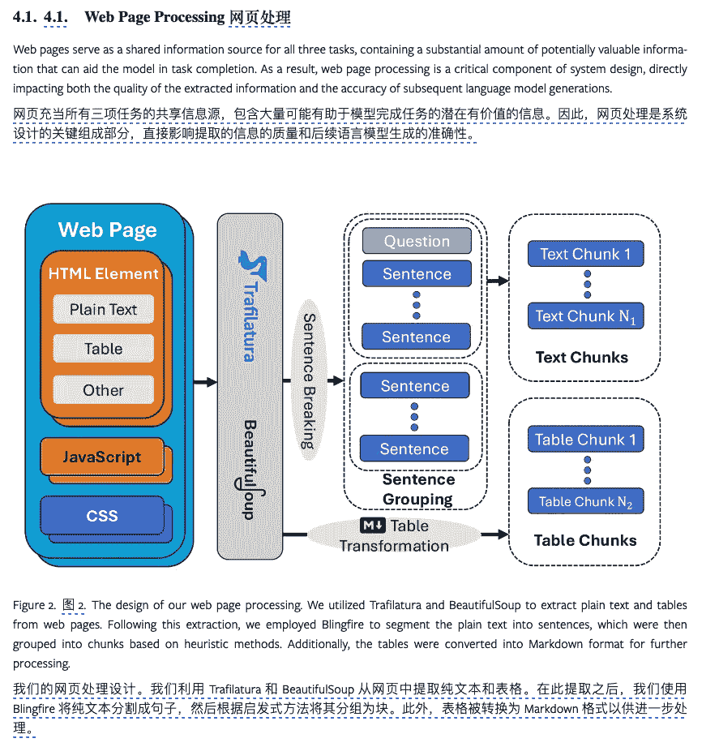

**工作 2、问题分类机器**

这个问题分类机器本身是一个 SVM 分类器，但是这个分类器的训练数据不是人工标注的，而是用大模型来标注的，以此减少成本和开销。

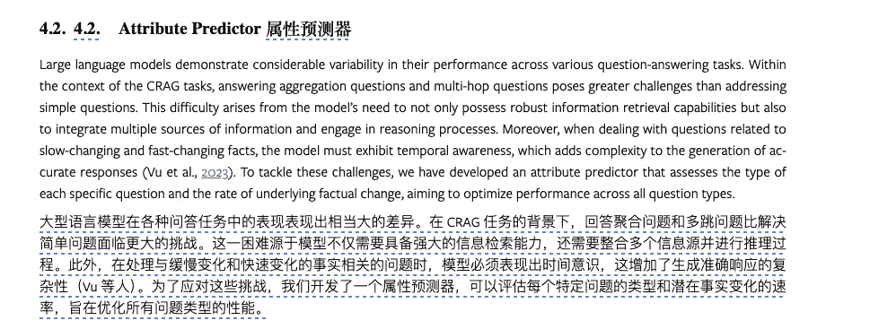

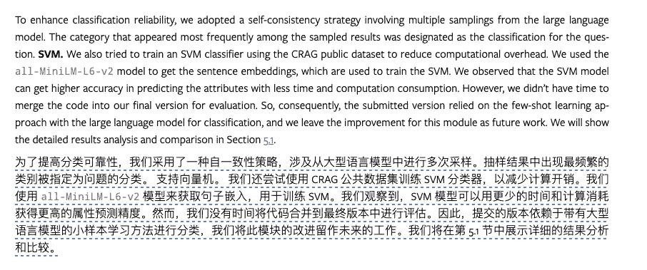

工作 3、利用大模型调用外部的计算库

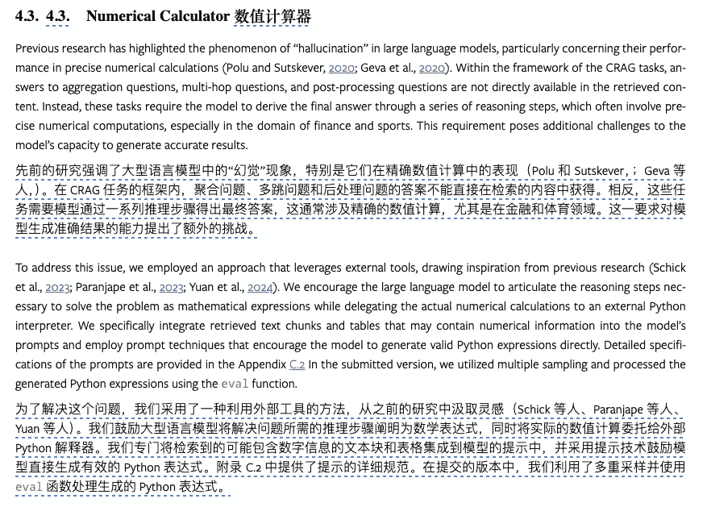

当然，这篇论文里面还写了很多思路，感兴趣的同学可以自己去看论文。

这个论文质量还是很高的，6 个作者中的 5 个是北京大学人工智能实验室的学者。

# 4、为什么我们曾经高估了大模型的影响力

## 4.1、我们原本设想的端到端的场景问题是什么？

现在人类生产视频的工业化流程是：

1.  看一下市面上热门视频的共性，往往依靠标签

1.  根据热门标签生产一些脚本；

1.  拍摄；

1.  发到线上看数据反馈，再做迭代；

在大模型刚刚诞生的时候，其实有一个假设，假如大模型可以直接生成视频，能不能让它看抖音上的大部分视频，训练它，然后让它生产一部分。

让用户给这些大模型生产的视频点赞，大模型再把高赞的视频拿来作为正反馈继续生成视频。

如果这条路能走通，对于抖音这样的内容平台绝对是颠覆性的，现在看这个流程可以说是走不通的，其中自然有视频生成模型质量不好、不可控的原因，但是我认为更多的原因在于：

1.  模型的上下文窗口限制

1.  模型的成本太高

这两个是几乎无解的问题，估计未来相当长（10 年）的时间都很难解决，所以我不认为这种端到端的场景是可行的。

但是 AI 生成视频一定会成为视频工作者未来工作环节的重要补充，这点是不需要怀疑的。

## 4.2、所有应用都值得用 AI 重做一遍吗？

显然不，因为这个世界上 90% 的事情用规则就已经可以运转的很好，模型低效又不稳定。

很多时候我们对一个产品的要求就是，简单、高效、可以依赖，现阶段模型的不稳定性注定了它在很多场景下是不可依赖的，哪就很难谈得上取代原有产品。

还是重读一遍俞军给的知名的需求公式：

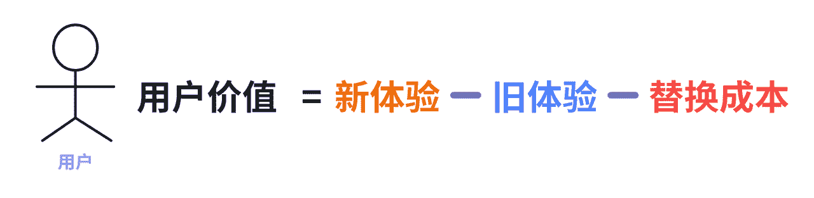

很多时候用了新技术，收益可能也没有想象的那么大，这是一个事实。认为所有应用都值得用 AI 重做一遍的人显然是高估了 AI，很多人喜欢把 AI 和移动互联网类比，这是不恰当的。

从冯诺依曼计算机的架构来看，移动互联网直接把计算机的输入输出设备给改了，这首先带来了交互上的革命性变化，但这不是最重要的。

从市场上来看移动互联网真正的价值并不是交互革命，而是极大的降低了用户接入互联网的成本，使得用户数量得到了翻倍，延长了用户互联网的使用时间。

上面这两个革命性的变革，显然是这轮 AI 浪潮所不能及的，AI 既不能扩大市场，短期内也不能改变计算设备的形态。

大模型的变革更多的会体现在生产端，从而影响消费端，正如在上文理解媒介一个章节中提到的，它能带来的是生产力的极大提升，但我们现在面临的问题更多的是市场不足，生产过剩问题。

## 4.3、LUI 是万能的吗？

有人说这一轮 AI 会带来交互革命，从今天起我们只需要一个有聊天框的超级 App 就可以啦！

我现在就可以下这个结论，说这话的人一定是云玩家，如果这种人在公司里面，我是他的上级，我就要惩罚他晋升答辩不准写 PPT 和文档，只允许口播。

任何一种媒介和交互都是有最佳实践和独特价值的，LUI 显然不是万能的，程序员写个代码还会考虑 IDE 的 GUI 好不好使，Language UI 信徒们哪来的自信这玩意可以彻底取代图形界面？

LUI 最大的问题就是效率低，让我以企业级软件举例：

Excel 也好，PowerPoint 也好，哪怕是 BI 软件也好，软件除了降低门槛之外，还有一个很重要的作用就是「约束」使用者。

在这个场景下约束不是一个贬义词，是一个褒义词。这些软件内置的所有功能都是在漫长的时光中迭代出来的，里面凝聚了无数软件开发者与使用软件的企业的经验和最佳实践。

打开 Sensors Analysis（神策数据旗下）和 DataFinder （火山引擎旗下）这两个产出自不同公司的行为分析软件时，会发现二者的功能极为相似，事件分析、漏斗（转化）分析、留存分析等等。我甚至怀疑使用这些软件的企业客户们使用习惯也会高度类似，因为这些软件里面凝聚的功能本身就是最佳实践。

对于一个没有什么统计分析能力的运营来说，让他去面对 GPT 的文本框描述清楚自己需要一个漏斗分析实在是太困难了，还是用神策比较简单。

GPT 如果能够获得关于漏斗分析的详细计算逻**辑，也可以一定程度上的引导用户**，但前提是用户得能说出来漏斗分析这四个字，实际上脱离了界面很多人都不见得能描述的清楚自己想要的是什么。

**LUI 不是万能的，对 LUI 的过度追求，甚至把 LUI 与 AI** native 划等号这种想法都是错误的。LUI 只是在特定范式下才是有意义的。

## 4.4、复杂的 UI 是一段弯路吗？

现在市面上最领先的开源文生图 UI 叫做 ComfyUI，如下图所示：

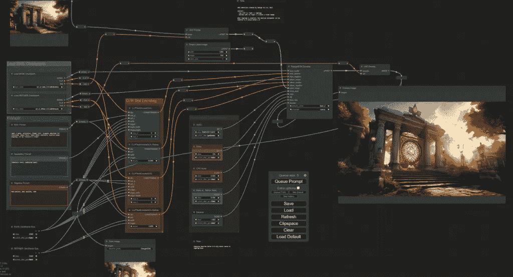

ComfyUI 和我们脑子里面想的敲敲文本就能调用的文生图 AI 差异很大，感觉更像是一个低代码平台，为什么？

因为在工业界需要追求精确控制，纯粹用提示词是无法准确表达精确控制的语义的，必须得用 GUI 才能表达出来。

比如上面这个图，其实里面做的事情就是把一个建筑物换成另外一个建筑物，并且尽可能不要改变其他东西，这种精确控制对于模型这种本质依靠数学概率驱动的东西来说是非常困难的，所以才搞得这么复杂。

那么问题来了，上面这种 UI 是一段弯路吗？

其实我乍一看我也觉得这个太离谱了，如果让我用 Photoshop 或者醒图类似的事情应该也能做，而且 UI 应该没有复杂，但是细想之后我认为这个东西非常有价值。

我认为如果把这种 UI 给到用户，这肯定是一段弯路，但是如果我们把上面这个操作包装成一个场景，给用户的就是让用户上传两张图这样的动作，这不就是一个最简单的产品了吗？

也就是说我上面说的，醒图和 PhotoShop 的功能，其实以后完全是可能用这样的 UI 搭建出来然后包装给用户的。

所以上面的 UI 是完全可以提供给专业用户的，这样的 UI 可以变成一个引擎，产品内成千上百的功能都可以通过这么一个元引擎被源源不断地生产出来。

这就是大模型真正的价值，这是生产力成百倍的提升。

## 4.5、大模型真正的价值是什么？

如果大模型既不能给交互带来质的变化，又不是一个万能的许愿机，甚至连端到端生成 Feed 流都做不到，那么大模型真正的价值是什么呢？

大模型真正的价值在于给产品经理和工程师这样具备非凡创造力的人一个增幅器。

这是一个不需要训练的万能模型，而且大概率比专属模型更强。

这意味着产品经理和工程师只要能想清楚 SOP，想清楚哪些问题可以用大模型来解决，就一定能以比较低的成本解决，原本一些需要训练自己私有模型的事，现在依靠公有模型就可以解决了。

**很**多原本像高山一样的成本，现在也是可以逾越的，金钱和数据量不再是训练模型的拦路虎，你只需要会写 prompt ，会搭工作流就可以了。

# 5、对产品经理的工作方法启示是什么？

## 5.1、业务！业务！业务！数据！数据！数据！

新鲜的数据和能持续产生新鲜数据的业务，是一个大模型的生命力所在。

一个 RAG 做的再牛逼，如果数据库很糟糕，结果就是很糟糕的。

一个模型再挫，只要数据足够好，照样是一个好工具。

在 AI 时代，数据的问题只会被放的更大，AI 搜索如果在一堆屎山数据里面做搜索，充其量不过是又造了一根搅屎棍。

任何时候，能持续生产真实交易数据和优秀内容的业务都比大模型本身重要。

## 5.2、看论文不是产品经理避免 FOMO 的最佳途径，动手尝试可以避免 FOMO

我认为一个比较清晰的事实是，目前工业界短期内一定高估了大模型的作用。

前段时间我写了一个段子：**每一个 App 都值得思考是否能用 AI 重做一**遍，然后就会发现值得重做的只有 10%。

短期内的资源投入很大程度上是源自于投资人和大厂决策者的 FOMO 心态，这种心态某种角度来说是不健康的。这种 FOMO 的心态也会传导给产品经理，于是很多产品经理都开始看论文（比如本文作者），但在我看来产品经理看论文其实没什么用，图一乐的作用更大。

论文都是锤子，但是对于 PM 来说更重要的是钉子在哪里。所以与其关心最新的学术界又发了什么，不如关心一下 Product Hunt 上面哪些 AI 产品又登上了当日第一，并且赚钱了。

与其 FOMO，不如动手多用用，以前移动互联网刚刚兴起的时候，大部分产品经理手机里面不得装小几百个 App，天天研究来研究去的。去用一下市面上最好的应用，并且尝试逆向它，会有多很收获。

写这篇文章，写接近 2 万字，发现大模型那么多的坑，而且每个坑都能找到一些关联的论文。不是因为闲的蛋疼去看论文，而是因为一直在捣鼓 AI，然后发现这也有问题那也有问题，不得已去搜索，搜到了论文。

原来大家都有这个问题，有的人就是有钻研精神，发现了问题还会深入研究，然后写一篇论文。哎，人比人真的气死人。

如果仔细看就会发现我看的大部分论文都是工程师论文而不是算法论文，因为就像我强调的，大模型的弱点需要工程弥补，工程是研发和产品经理共同搭建的，看不懂算法的论文不打紧，看不懂工程师的论文可能真的得反思一下。

## 5.3、产品经理必须要学会自己调用 API

正如文提到的，未来 AI 产品团队的能力，不取决于谁家模型更强，反正开源模型一定最终会变得最强，而取决于谁家能用好 AI 模型。

而谁能用好 AI 模型，又取决于哪个团队做实验的本里强，谁能更快的做完更多的实验，谁就牛逼。

有的人可能会问，我用 coze 或者是 KimiChat 行不行，我的答案是不行。

因为这两个本身就已经是 AI 产品了，和 AI 的 API 差距很大，给 KimiChat 传个 PDF，人家解读的又快又好，你怎么知道它解读的好是因为模型牛逼，还是因为 PDF 格式转 MD 数据清理的好呢？

这就需要产品经理必须要具备非常快速的裸调用 API 做实验的能力。

那么不会写代码，怎么快速获得这种能力？用 Dify 或者 n8n 这样的低代码平台来解决。

就我自己来看，我认为 n8n 更靠谱。n8n 是一个 Coze 的开源免费上位替代，一个可视化低代码自动化 Workflow 平台，能够方便的让不会写代码的朋友体验 AI 开发的乐趣和效果。

用它可以轻易的创建很多扣子完成不了的复杂自动化 Workflow。比如 Webhook 触发，比如 1000 多种第三方接入，比如发起自定义的 HTTP Request。

并且因为 n8n 不是从这一轮 AI 浪潮才开始做的，所以它的生态也比这一轮 AI 后才涌现出的 Workflow 工具（比如 Dify）更完善，官方接入的集成服务更多，社区更活跃。

n8n 就是大模型的五官、躯干和四肢，动手又动脑，才能有创造。

在这里我推荐一个 n8n 的中文教程《简单易懂的现代魔法》，这应该是目前市面上最好的 n8n 中文教程。

教程地址：https://n8n.akashio.com/

## 5.4、几个 AI Agent 实践的建议

### 5.4.1、设计 Agent 的关键思路

想象一下 20 个实习生帮你干活，你要怎么分配任务？实习生的特点是什么？

+   能执行

+   无法拆解复杂问题

+   执行顺序可能是有问题的，你如果不规定执行顺序，会怎么样？可能会拖慢项目进度

+   记忆力一般，一下子太多任务记不住，可能会忘记

+   可能会出错，所以最好有交叉验证

所以如果你把 AI 视作为一个又一个不知疲倦的实习生，你认为他们能干嘛？当然是设计好 SOP 和产出物标准，让他们去做这些量大且重复性的工作啦。

当然实习生和 AI 有一个比较大的差别，就是 AI 确实比实习生，甚至不少正式员工在解决特定问题的时候强很多。

人比机器便宜，可能是未来大家不被 AI 淘汰的重要理由（bushi）。

### 5.4.2、把任务拆小拆细，避免互相影响

把一个复杂问题拆成多个简单问题，然后再让模型处理有两个好处：

第一、正如上文所描述，大模型的不稳定性和它接收的文本规模大小完全是呈正相关的，如果把问题拆小就意味着单词任务模型要处理的文本变少。

第二、一些简单的问题根本没必要用大模型，甚至可以用简单的模型或者是纯逻辑去判断，更便宜、速度更快，甚至效果可能会更好。

### 5.4.3、区分离线任务和在线任务

以 Grpah RAG 架构为例子， 它一共分为三个步骤：

1.  将待搜索的知识进行一个三元组抽取（主谓宾），这个抽取的动作需要 LLM 介入，存入图数据库中（可离线处理）；

1.  将用户提出来的关键词，用 LLM 做一次扩散，扩散出来同义词，近义词等，然后在图数据库进行检索，找到相关文档（必须是在线服务）；

1.  将查询出来的相关内容作为上下文，和用户提出的问题一起交给大模型来生成内容（必须是在线服务）；

其中前两个步骤是离线任务，离线任务意味着可以花费较多的时间对数据做精细化的处理，比如我们可以用一个开源但是性能强悍的大模型，用自己的服务器去跑任务，以此来在保证质量的时候降低成本。

而在线任务则意味着需要较强的时效性，如果在线任务本身复杂度并不高，也可以选择更加轻量级的模型来保证回复速度。

同时离线任务的结果会被存储并且反复调用，用质量更好的模型相当于做了一些固定成本的投入，而在线任务都是和用户交互直接相关的，这些本质上是边际成本。

### 5.4.4、每一个离线任务都可以考虑用模型来解决

在 Hybrid RAG 中，对 html 转 MD 的工作用的是 Python 库进行的，其实这项工作如果纯粹追求效果的话，完全可以考虑直接用大模型来做。

当然具体是用 Python 库还是用大模型，其实是取决于成本和效果的考量的，这个也需要通过实验来证明。

我自己的经验是这种数据清洗的工作适合用 Python 库做一轮，再用大模型做一轮清洗，效果可能会更好，但是很多时候 Python 库已经足够干净了，中间夹杂一些错误的格式编码其实也不影响后续大模型的判断，这种情况下做不做都是无所谓的。

总而言之大模型在特定环节的工作能力是非常强的，如果不是考虑成本，其实几乎每个环节都可以用大模型解决。

### 5.4.5、成本和效果要做 Trade off

众所周知，大模型回答有一定的随机性，要怎么解决这个问题呢？当然是一个问题重复问几遍啦。

比如论文《From Local to Global: A Graph RAG Approach to Query-Focused Summarization》中提到的如何测试两种 RAG 方法的效果，用人力标注太麻烦了，所以他们连检查样本的工作都交给大模型来做了，真是牛逼（有钱）。

为了保证结果正确，一个标注要重复做 4-5 遍，成本自然也是 4-5 倍。

对于设计产品的同学来说就非常需要判断成本和效果之间怎么平衡了。

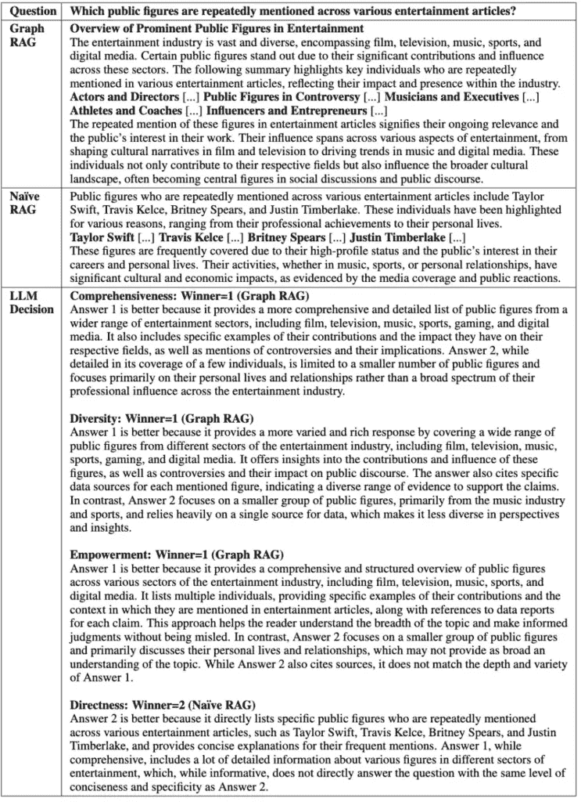

### 5.4.6、Agent、微调、提示词之间的边界与最佳实践

如果我们把提示词工程、Agent 的建设和模型微调对应到我们给一个人布置任务，就可以这么理解。

+   提示词工程相当于你在布置任务的时候说的很详细。

+   Agent 建设相当于你给这个人布置任务的时候，把 SOP 拆清楚，并且告诉他公司里面有哪些工具可以用。

+   模型微调相当于做培训。

所以完成一个任务，可能三种手段都需要用上，但是三种手段的成本是不一样的。

而为了完成一个任务，应该用哪种优化手段，这就是目前工程、算法、产品、学者这几方面都非常模糊的地方，这个就好像是在航海或者挖矿，又像是临床医学，怎么决定用什么手段，本质上是一个“实验”，而不是一个“推理”。

**这也就是为什么上面列出来的每一篇论文**都需要列非常多的基准测试，因为设计这些 Agent 的人自己都不知道结果到底好不好，需要实验才能验证。

所以我认为，未来哪个团队应用 AI 的能力强，哪个团队应用 AI 的能力弱，其实就取决于：

+   这个团队有没有牛逼的基准测试参考答案；

+   这个团队能不能有一个平台可以更快的验证自己的设计是不是合理的；

谁实验做得快，谁就牛逼，工程化产品化反而是最后一步。

最后我个人建议是能不要微调，就不要微调，因为微调会改变模型的参数层，成本很高而且无法迁移。而且微调的本质是在和大模型团队卷算法，卷数据，内卷在长期来看，是没有意义的。