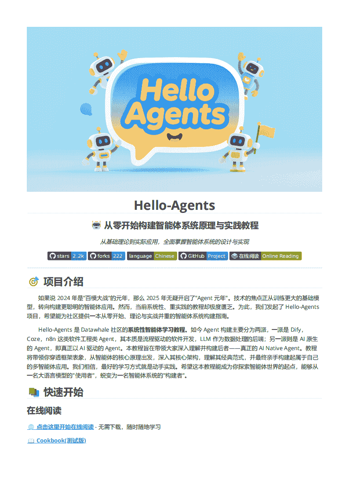
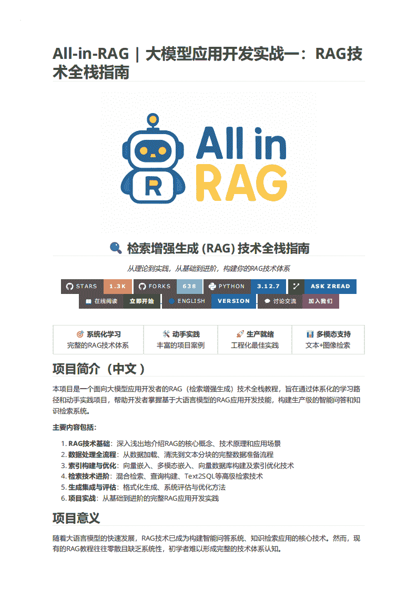

# 一站式AI产品经理入门指南

> 来源：[https://v11enp9ok1h.feishu.cn/docx/Dz1OdTo85okPU6xcqKCcBll1nse](https://v11enp9ok1h.feishu.cn/docx/Dz1OdTo85okPU6xcqKCcBll1nse)

<https://v11enp9ok1h.feishu.cn/sync/PaIIdslbxsIJUIbkTfPcsMCFnph>

<https://v11enp9ok1h.feishu.cn/sync/QAtcd4XGlsvJh2bx68Mc3QpRnSc>

## 🧭 快速导航

[一站式`LLM`底层技术原理入门指南 ](https://v11enp9ok1h.feishu.cn/wiki/Af76wZbh4i4YvtkOkDvc56D2nZc?from=from_copylink)

[真实AI产品经理转行案例！](https://v11enp9ok1h.feishu.cn/wiki/CqhswLkIki4pSTkjQOuc3VBEnSf)

[《`MetaGPT`智能体开发入门》教程](https://v11enp9ok1h.feishu.cn/wiki/OWDEwvcHtingfCkfUCCcFoVfnMd)

[智谱  `AI`技术文档](https://v11enp9ok1h.feishu.cn/wiki/QpWrw9QNEijBODkLkIScc2RLnVc)

[1.0 `LLM`](https://v11enp9ok1h.feishu.cn/wiki/NMTIwXXvliZCNZkMa5Dc1gCDnwc)

[1.2  `AI Agents` (智能体)](https://v11enp9ok1h.feishu.cn/wiki/QY7WwsQDmicKbNkQFaac6vpEnbd)

[1.3 大模型（`LLM`）部署](https://v11enp9ok1h.feishu.cn/wiki/IJ8swgmCEiYVUokhjrjch2QEnzf)

[1.4  【`RAG`实践】](https://v11enp9ok1h.feishu.cn/wiki/LV0PwkBqNioeR4kK8QIcSkSJnCN)

[1.5【`prompt`】提示词工程](https://v11enp9ok1h.feishu.cn/wiki/NaaQwuOfIik5PDk7VBfcQ2XjnZc)

[1.5【`prompt`】提示词工程](https://v11enp9ok1h.feishu.cn/wiki/NaaQwuOfIik5PDk7VBfcQ2XjnZc)

[1.6  推荐系统【专栏】](https://v11enp9ok1h.feishu.cn/wiki/XjmewOFb4ilBtekU5uBcP6ulnHe)

[1.7智能客服专栏](https://v11enp9ok1h.feishu.cn/wiki/Q9dIwhqrJi2ZPXkZ1iVcvfdJndg)

[1.8详解：`DeepSeek`深度推理模型](https://v11enp9ok1h.feishu.cn/wiki/U9NlwPvSNifANlkDgvIc9EpQnog)

[1.9智能座舱](https://v11enp9ok1h.feishu.cn/wiki/MSV5w7v8PijmsikfLmzcx4jtnWb)

[1.10模型详解](https://v11enp9ok1h.feishu.cn/wiki/SBUkwYasUiTB2Zkl2xPcsdwUnPe)

[1.11 从零开始的大语言模型教程](https://v11enp9ok1h.feishu.cn/wiki/B6HqwX5qFi9256kVXzMcAiyDnme)

## 🧭 必看系列

<https://ask.feishu.cn/shared-space/7330809570845048833>

[一站式`AI Agents` 入门指南.pdf](https://internal-api-drive-stream.feishu.cn/space/api/box/stream/download/all/QuZkbwy9poGwMyxiJkhc9hKNnIh)

[`RAG`技术全栈指南.pdf](https://internal-api-drive-stream.feishu.cn/space/api/box/stream/download/all/BCIObjfPpo74NWx4yKQcBlpBnlc)

<https://v11enp9ok1h.feishu.cn/share/base/view/shrcnqNQU4m7olA89jApTh0hVRd?iframeFrom=docx&ccm_open=iframe>

<https://v11enp9ok1h.feishu.cn/sync/TmkedyCwRsd4L6bv4fFcuV8wnob>

### AI Agent（智能体）

[《`MetaGPT`智能体开发入门》教程](https://v11enp9ok1h.feishu.cn/wiki/OWDEwvcHtingfCkfUCCcFoVfnMd)

[从零开始搞懂 `AI Agent`](https://v11enp9ok1h.feishu.cn/wiki/DAmjwDkEbih04EkI7pqcQO9IniP)

[1. 从案例入门](https://v11enp9ok1h.feishu.cn/wiki/PqSmwHad0i0ht6k72ygcNrB5nJc)

[2. 进阶`Agent`案例拆解](https://v11enp9ok1h.feishu.cn/wiki/PSoqwPYckiNwZfkJRdWczB8hnGh)

[`Coze` / 扣子 教程](https://v11enp9ok1h.feishu.cn/wiki/DVuUwXMFBi3GgWkT4ekc1IeNnUb)

[案例库](https://v11enp9ok1h.feishu.cn/wiki/TWNaw8E1KiVzXxkN7e4cWVtOnWc)

[`coze-ai-assistant`](https://v11enp9ok1h.feishu.cn/wiki/HJiNwyoYBijGkbkn1KNcttLHnPg)

[工作流与`Agent`实战指南](https://v11enp9ok1h.feishu.cn/wiki/GGW4wQIe1i2KMnk6plnc9ErFnzh)

### 人工智能基础

[基础](https://v11enp9ok1h.feishu.cn/wiki/HwYJwzG2AiuyQIkoqYqcXFVXn8c)

[机器学习.pdf](https://v11enp9ok1h.feishu.cn/wiki/OV1gwMoNYiUacbkFzoUcH8zQnid)

[动手学深度学习](https://v11enp9ok1h.feishu.cn/wiki/KfqfwGfq0il3EOkAyfqcXy8FnVh)

[`NLP` 教程](https://v11enp9ok1h.feishu.cn/wiki/ObYPwNySsi1ZG8kyM0HcVnranLg)

[`Deploy` 知识库共建](https://v11enp9ok1h.feishu.cn/wiki/LV2wwNo2yiKyaekyewjc3z4Knne)

[`Deploy` 知识库共建](https://v11enp9ok1h.feishu.cn/wiki/LV2wwNo2yiKyaekyewjc3z4Knne)

[`LLM101n-CN`（共建中）](https://v11enp9ok1h.feishu.cn/wiki/Ht8bwH6GYiFR1QkPVCVck1hUnid)

[吴恩达`DeepLearning.AI`课程系列](https://v11enp9ok1h.feishu.cn/wiki/Or5awLfh3iE5GekJncIc4rfmnTd)

### 项目案例拆解

[`mcp`](https://v11enp9ok1h.feishu.cn/wiki/SV75wswpziUUvMkwZxrc7qeRnle)

[`Agent`优秀案例](https://v11enp9ok1h.feishu.cn/wiki/O3zQw5ujGiqYpJkIFlXcC78QnPg)

[`AI`智能客服](https://v11enp9ok1h.feishu.cn/wiki/XlnDw1GkAi7iYIkDqS6cRKeIn8f)

[智能驾驶 （汇总）](https://v11enp9ok1h.feishu.cn/wiki/FfhQwGlqyi7Q58kZpf4c1y0nnUK)

### 机器学习

[1-机器学习简介.pdf](https://v11enp9ok1h.feishu.cn/wiki/KMPtw1tUxi7qzxk15D6cmMVLnMd)

[2-线性模型.pdf](https://v11enp9ok1h.feishu.cn/wiki/YaRwwnrioiPHPbkxCvfcBdDKnpf)

[3-K近邻与双线性模型.pdf](https://v11enp9ok1h.feishu.cn/wiki/UI6fwp8hAiOpgEkqPm0cWKJ3nHb)

[4-人工神经网络.pdf](https://v11enp9ok1h.feishu.cn/wiki/UWF5w8va7ieQ7dkBTTqcE0sanYf)

[5-支持向量机.pdf](https://v11enp9ok1h.feishu.cn/wiki/HwXfwxiYSiPlmqkIEdUcUnmsnwb)

[6-树模型基础.pdf](https://v11enp9ok1h.feishu.cn/wiki/EyXswLFLOipMXMkuS7hcglbFnlc)

[7-集成学习.pdf](https://v11enp9ok1h.feishu.cn/wiki/VnjXwMU1fiqWG4khniwc4T0BnFg)

[8-概率图模型.pdf](https://v11enp9ok1h.feishu.cn/wiki/UHKmwkURHinGCkkBM8scxsZ8n2d)

[9-无监督学习.pdf](https://v11enp9ok1h.feishu.cn/wiki/EAuhwGY0Wi4M00k1BGocIfGenDd)

[10-学习理论与模型选择.pdf](https://v11enp9ok1h.feishu.cn/wiki/RiDDwH8nBi07Okky9BJcJD0dn3d)

[你想学的`LLM`入门知识](https://v11enp9ok1h.feishu.cn/wiki/R8xYwnRVpinatfkWxfNcBjCrn4g)

[你想学的`LLM`基础知识](https://v11enp9ok1h.feishu.cn/wiki/OSsbwGecKiOj7TkDu9kcoDfHnOQ)

[你想学的`LLM`进阶知识](https://v11enp9ok1h.feishu.cn/wiki/L2hRw7yNeiq53BkbGelc3QOOn4e)

[你想学的`LLM`应用实践](https://v11enp9ok1h.feishu.cn/wiki/T2AIw9NAaiEOmIkT17hcb3lRnje)

### 大模型本地部署教程

[基于`COW`框架的`ChatBot`实现步骤](https://v11enp9ok1h.feishu.cn/wiki/MaH1wC0VTi6S78k4tpDcDCx2nRd?from=from_copylink)

[`GPT`平替方法](https://v11enp9ok1h.feishu.cn/wiki/BrcSwceI9iS0lekk2tdcvPSRnCb?from=from_copylink)

[本地部署大模型以及搭建个人知识库](https://v11enp9ok1h.feishu.cn/wiki/SzmYwWr7CisXeektvZmcQmnBnmd?from=from_copylink)

[适合小白的`Llama3`部署和微调教程](https://v11enp9ok1h.feishu.cn/wiki/AECiwivlvi53GYkTryxcCz2HnGg?from=from_copylink)

### 从零开始的大语言模型原理与实践教程

[1.11 从零开始的大语言模型教程](https://v11enp9ok1h.feishu.cn/wiki/B6HqwX5qFi9256kVXzMcAiyDnme)

[第一章 `NLP` 基础概念](https://v11enp9ok1h.feishu.cn/wiki/IhOLwxd0qiFg6wk0SAUcSvZTn5e)

[第二章 `Transformer` 架构](https://v11enp9ok1h.feishu.cn/wiki/GJMvw6ovCiblaqkku0NcU7yGnNg)

[第三章 预训练语言模型](https://v11enp9ok1h.feishu.cn/wiki/Kla5whSsZinEnTkBcuEcq9Isngc)

[第四章 大语言模型](https://v11enp9ok1h.feishu.cn/wiki/XD1jwCzGPiqoogkJnxUcU0VCn6o)

[第五章 动手搭建大模型](https://v11enp9ok1h.feishu.cn/wiki/Qe6QwzaZFiueJQkfl2ocxpg0nBb)

[第六章 大模型训练流程实践](https://v11enp9ok1h.feishu.cn/wiki/VCvVwTH3eiShXYkaNencXcrmnp4)

[大模型应用](https://v11enp9ok1h.feishu.cn/wiki/YzqYw4mFZiS839k2ZFjccjr5nye)

### `NLP` 教程

[1.1 文本预处理](https://v11enp9ok1h.feishu.cn/wiki/QlOkwKjxEiE1CtkA6WgcXPZPn1c)

[1.2文本表示方法](https://v11enp9ok1h.feishu.cn/wiki/UO4EwwvtDiLJZRkHXR7cenTcnyg)

[1.3 文本分类](https://v11enp9ok1h.feishu.cn/wiki/ITR4wWCh7ib84TkRqvnciSzcnNe)

[1.4 语言学基础](https://v11enp9ok1h.feishu.cn/wiki/QFvzwwNV1i91xNkiKEScdeUenJe)

[2.1 情感分析](https://v11enp9ok1h.feishu.cn/wiki/EKFywOduTipCizk7q4ncddSlnde)

[2.2 命名实体识别（`NER`）](https://v11enp9ok1h.feishu.cn/wiki/Qsh3wInecibWS1k4oSKcDkRCnFe)

[2.3 关系抽取](https://v11enp9ok1h.feishu.cn/wiki/KqQzwy1JDiHFKak89A6cvGh2nIf)

[2.4 `NLP` 文本相似度计算](https://v11enp9ok1h.feishu.cn/wiki/EeuewUhvHiNXIVkKe62cwnZLnCe)

[3.1 循环神经网络（`RNN`）](https://v11enp9ok1h.feishu.cn/wiki/TNFiwYHCTiXQpWkVzYucA2AonHE)

[3.2 注意力机制](https://v11enp9ok1h.feishu.cn/wiki/YeQIwku0Si9XJck9JKZcYMZonXg)

[3.3 `Transformer` 架构](https://v11enp9ok1h.feishu.cn/wiki/OB8BwHF82iQ1GgkgfEccIG86n7b)

[3.4 序列到序列模型](https://v11enp9ok1h.feishu.cn/wiki/GIOcwNvdfitcXEkzQfNcoTnjnOd)

[4.1 预训练模型](https://v11enp9ok1h.feishu.cn/wiki/NcXDwfLAziMNrmksPZrcPiqGnKb)

[4.2 `BERT`系列模型](https://v11enp9ok1h.feishu.cn/wiki/PCgLwJEfcid2bsksfracaVdAnmg)

[4.3 生成式预训练模型](https://v11enp9ok1h.feishu.cn/wiki/HGEcw1tymilAvFkKWRGcsqi1n1b)

[4.4 多模态预训练模型](https://v11enp9ok1h.feishu.cn/wiki/ZpIew4aBTivQbXkRbMZcWMt4nW7)

[一站式`AI Agents` 入门指南.pdf](https://internal-api-drive-stream.feishu.cn/space/api/box/stream/download/all/EZqabB2R2oWgKIxDAmbcFU8inoe)

[`RAG`技术全栈指南.pdf](https://internal-api-drive-stream.feishu.cn/space/api/box/stream/download/all/Fnyhb8ItNoShMyxOT4lcCsdhnZc)

### 📑产品沉思录

<https://v11enp9ok1h.feishu.cn/share/base/view/shrcnOyiyd5op126AoBBil6b0Ih?iframeFrom=docx&ccm_open=iframe>

### 📑资料合集

---

## 🔜|AI产品经理｜落地实用方法论

[`AI产品经理｜落地实用方法论`](https://v11enp9ok1h.feishu.cn/wiki/FeMiwcPTwiCWgjk5EHvc6ALZnAg)

<https://v11enp9ok1h.feishu.cn/share/base/view/shrcnIPMjUdf5LqHikcXsNB3dac?iframeFrom=docx&ccm_open=iframe>

## 🔜|AI产品理解

<https://v11enp9ok1h.feishu.cn/share/base/view/shrcn9QhJiqf3HaXXWYvSaesTsc?iframeFrom=docx&ccm_open=iframe>

## 🔜|AI产品思维

<https://v11enp9ok1h.feishu.cn/share/base/view/shrcn2k9lEOaU976LS83CSEea1f?iframeFrom=docx&ccm_open=iframe>

---

## ☎️ AI行业报告 ｜产业图谱 ｜产品架构图 （2024年最新）

> [AI行业报告（持续更新ing）](https://v11enp9ok1h.feishu.cn/wiki/QuT3ws0gBiuXPjkTrkKc7yZsng7)

<https://v11enp9ok1h.feishu.cn/share/base/view/shrcnd2EQn0jZhePbh0OXfDPhdf?iframeFrom=docx&ccm_open=iframe>

<https://v11enp9ok1h.feishu.cn/sync/Ipw1d27gNsv3OAbo3N7cks4ZnJf>
