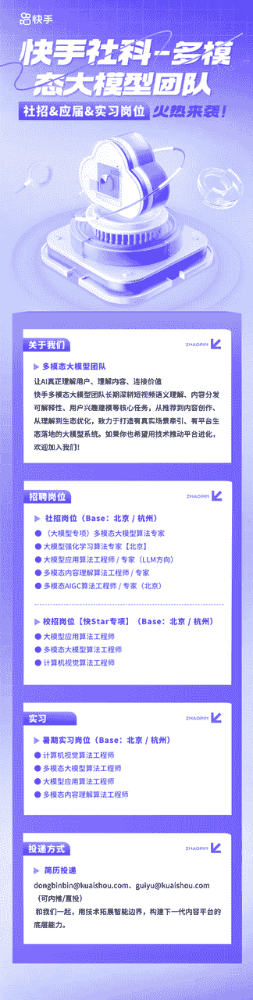
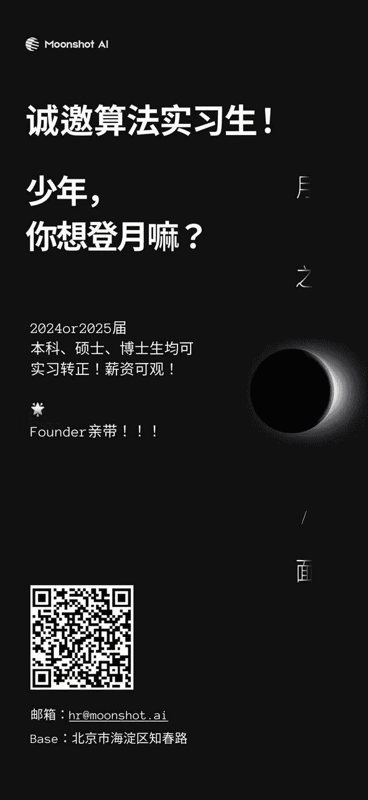

# 最近招聘信息-持续更新中

> 来源：[https://v11enp9ok1h.feishu.cn/docx/XSS8dJ7QUof2UExd5y8cTMAfnIc](https://v11enp9ok1h.feishu.cn/docx/XSS8dJ7QUof2UExd5y8cTMAfnIc)

## 特看科技 - AI产品经理

### 岗位要求
- 负责AI视频工具方向产品工作，对生成式AI产品有一定研究，熟悉`Transformer`和`Diffusion`模型的优先。
- 英文好，有海外产品经验优先，有内容工具或SaaS产品经验优先
- 2年以上产品岗位经验，职级根据经验能力制定，对标阿里P6-P8区间

特看科技专注于AI视频和直播应用，将视频和直播领域的AIGC技术，结合海量短视频商业数据，应用在广告和营销的短视频和直播场景。特看科技在国内市场目前已服务欧莱雅、宝洁、雅诗兰黛等头部品牌集团，海外市场服务了安克创新、Posee，Y.O.U等头部出海品牌。特看也是TikTok 官方广告创意合作伙伴。

### 你能得到什么
不管你是厌倦了大厂内卷的产品专家，还是初出茅庐的新人，只要你对生成式AI的商业化应用充满热情，欢迎找我们聊聊。

特看可以提供：
- 确定性的商业化应用场景，已有大量品牌客户
- 初创公司充沛的早期期权池
- 强大的工程师团队，将新技术快速落地应用
- 最高可到合伙人级别

### 加分项
有以下行业经验：电子商务·企业服务·人工智能·海外产品

欢迎推荐或自荐简历至qingshen@tabcut.com，或飞书与我 联系

## 程序向技术美术
1. 熟练使用`UE`中的蓝图系统，能使用蓝图驱动场景中的动态效果。
2. 熟悉`OSC`协议，可以应用`OSC`协议的数据到`UE`中。
3. 熟悉`C++`的编程，对图形效果编程有了解。
4. 熟悉`UE`的各个子系统的应用。

1. 有音游类游戏开发经验优先。
2. 互动游戏，互动视觉开发优先。

薪资：15-25k

联系方式 🛰️：`AI-Beliver001`

## 腾娱互动社招-2D美术AI提效工具产品经理

### 岗位地点
深圳

### 岗位职责
1. 负责2D美术AI提效工具的需求沟通及落地，与游戏美术团队密切沟通，搜集需求
2. 对接AI工具开发团队，评估AI工具的功能设计方案并提出修改意见
3. 测试AI工具`demo`并提出可优化方向，推动版本迭代，确保最终版本能满足美术需求
4. 跟进`SD`模型及相关插件的更新迭代，积极利用新工具探索新的设计工作流

### 能力要求
1. 本科及以上学历，美术/设计或相关专业
2. 熟练使用`Stable Diffusion`及`ComfyUI`工作流半年及以上，精通`Lora`训练及`ControlNet`等插件使用，有AI作品案例，写实风格优先考虑
3. 了解游戏美术工作流，如概念设计和宣发素材，有游戏美术相关经验优先考虑
4. 责任心强，积极主动有热情，乐于挑战新事物，具备良好的沟通和团队合作能力

### 简历投递
有意向者，可将简历及作品集发送至：chaomeiling@tencent.com

# 联想2024校园招聘-算法工程师

我们正在招聘一位大算法工程师，职责包括参与大模型技术研究、微调以及基于大模型的智能体开发等工作。你将负责处理大模型相关的数据工程，涵盖预训练数据、微调数据以及行业数据挖掘。此外，你将负责大模型的实际应用，包括推理优化、部署、智能体以及领域大模型等方面。

## 岗位职责
1. 从事数据分析、机器学习、深度学习、生成式AI、自然语言处理、推荐算法、知识图谱、智能语音、图形图像等方向算法研发工作，落地产品；
2. 结合业务场景和需求进行算法定制，提升算法模型可靠性，同时完成相关的开发工作。

## 任职要求
1. 毕业时间为2023年9月至2024年8月的海内外应届毕业生，计算机、人工智能、自动化、数学、统计、图像、信号与信息处理、模式识别、数学、物理学等相关专业；
2. 熟悉生成式AI，机器学习（`ML`）、计算机视觉(`CV`)、计算机图形学(`CG`)、语音交互、图像识别与理解、空间计算等AI领域中的一种，具有相关研究和开发经验优先。
3. 对模型底层结构和模型演进趋势有深入了解和洞察，如`Transformer`，`MOE`，多模态，混合式AI等。
4. 熟悉大模型常用训练框架和推理架构， 熟悉大模型调优方法并具备实际工程实践者优先，如`PEFT`，`RLHF`等。
5. 大模型应用技术有深入了解，熟悉大模型应用开发框架，可以针对具体业务场景设计技术方案，如`RAG`，`Agent`，`langchain`等。
6. 具备扎实的算法和数据结构基础，对机器学习和深度学习的基本算法原理有了解或掌握，具有较强`Python`开发经验。

## 工作地点
天津

## 简历投递
`gaohe1@lenovo.com` 或飞书

## 中国移动设计院招聘需求（代招）

### 办公地点
北京海淀中关村

### 需求一
#### AI算法工程师
- 数量：1名
- 学历：本科及以上
- 资历：5年及以上

#### 要求
1. 对系统全局调优和预测性维护有一定建模基础
2. 具有机器学习、深度学习相关项目实践经验，熟悉至少一种算法
3. 熟悉相关深度学习框架如`Tensorflow`，能够快速实现研究及设想
4. 负责AI在智能数据中心、智能网络领域应用研发

### 需求二
#### 大模型开发工程师
- 数量：1名
- 学历：本科及以上
- 资历：5年及以上

#### 岗位要求
1. 参与大模型技术研究、大模型微调、大模型智能体研发、基于大模型的应用研发等工作；
2. 大模型相关的数据工程，包括预训练数据、微调数据、行业数据挖掘等；
3. 大模型相关的落地实现：如推理优化、部署、`AI-Agent`、工具学习、领域大模型等；

#### 技能要求
1. 了解大模型基本原理，包括不限于模型架构、模型预训练及微调、模型部署及推理；
2. 熟悉`LLM`相关技术，如`Transformer`, `prompt tuning`, `RLHF`, `langchain`,`Agent`,`MOE`,`RAG`等；
3. 熟悉算法和数据结构，熟悉常用的编程语言，有较好的`Python`开发经验，编程基础扎实；
4. 了解或掌握机器学习、深度学习基本算法原理，熟悉`AI`建模流程，在`NLP`领域有开发经验优先；
5. 了解熟悉大模型常用训练框架、推理架构；了解分布式计算、并行计算。

### 联络方式
飞书与 联系

要求做过数据分析的，比如预测、分类、异常检测、联合优化等。不要`NLP`和`CV`图像方向的。

# AI stylist

我们正在寻找会使用`StableDiffusion`，对 AI 设计充满热情渴望学习成长的伙伴中！需要熟练使用`SD Web UI`，根据需求测试并搭配`Check Point`，`Prompt`，`LoRA`，`ControlNet` 等来达成目标。

## 岗位职责
- 负责 AI 风格的开发和调试工作，参与项目的整体风格和审美定义；
- 根据产品需求完成风格渲染的研发、测试、配置和维护；
- 熟练使用`StableDiffusion Web UI`等 AI 框架进行风格研发；
- 负责 AI 模型（如 `LoRA`，`Prompt`/`Prompt Sentence`）的训练、参数调整以及性能优化；
- 编写高质量的渲染记录文档，进行配置和模型训练质量控制；
- 为团队提供技术支持和指导，解决技术难题。

## 任职要求
- 具有至少半年的`StableDiffusion Web UI`使用经验，知道如何安装对应插件和 models 并使用；
- 英文水平需要能看懂 `Web UI`，`Hugging Face` 上的英文文档；
- 能根据需求去完成对应的渲染测试，包括但不局限于 `t2i`，`i2i` 以及视频渲染；
- 能熟练的根据不同的 `check point`，`prompt` 和 `LoRA` 来结合 `CFG`（和 `i2i` 的 `DS` 指）和`ControlNet` 来达到测试需求；
- 能够独立进行模型训练和参数调优；
- 拥有良好的记录和沟通习惯，结构清晰，命名规范，逻辑性强，能够对团队进行技术指导；
- 思路清晰、积极主动、认真踏实、良好的沟通能力和团队合作精神，有敏捷研发经验优先。

## 加分项目
- 有模型训练经验者优先；
- 对`Tagger`训练，`CV`领域的常用目标的分类、检测、分割等模型和训练方式有应用经验
- 有优质开源项目者优先（请提供开源作品地址）；
- 有优秀个人作品者优先（请提供上架作品链接）；
- 能够熟练用英文沟通者优先。

## 面试流程
初面→测试→终面

## 薪资待遇
面谈

## 联络方式
🛰️添加 Anthony’s ID — `BNL5009`

## 海葵音乐 - AI项目助理（武汉）
欢迎对AI音乐感兴趣的同学投递简历到邮箱：`zhangyr@hikoon.com`

### 工作内容
1. 研究探索AI在音乐行业的应用
2. 使用AI工具完成指定内容创作
3. 协助参与歌曲制作宣推
4. 完成歌曲合同、请款、发行
5. 企业内AI工作流培训和知识库运营

### 要求
1. 本科以上学历
2. 学习能力强，熟悉`AIGC`工具，专长于以下任一领域优先：图片、人声、视频
3. 音乐爱好者或音乐人，对市场音乐感兴趣
4. 性格细心、踏实、责任感强

发布时间：4/19

## 医疗大模型——算法工程师/产品经理（杭州）

杭州智诊科技有限公司（简称：智诊科技），是由国际化人工智能专家与临床医学专家团队创办的创新企业，专注于新一代人工智能技术和临床医学的交叉领域，旨在通过建立一套创新的新一代人工智能多模态应用系统解决临床医学的智能诊断与咨询。总部 https://www.diagens.com/

欢迎推荐或自荐简历至 `hr@wisediag.com`，或飞书与我联系

### LLM应用算法工程师(25k-60k)

#### 岗位职责
1. 负责跨语言领域`embedding`模型训练，如`SimCSE`通过对比学习方式进行无监督+有监督训练
2. 负责构建知识检索增强模块，保证相关知识信息召回工作
3. 基于`Chat GLM`系列模型进行`LLM-as-Agent`的落地应用
4. 负责搭建智能体协同决策系统，从系统层面提供诊断决策支持

#### 任职要求
1. 硕士及以上学历，计算机相关专业毕业，有较强的工程能力
2. 熟悉`Transformer`结构，对`BERT`、`GPT`、`BART`、`T5`等常见的模型有深入的了解，有`ChatGLM`/`Llama`等模型的使用/训练经验者优先
3. 熟悉`LangChain`等`LLM`的应用框架，熟悉`prompt engineering`，能有效借助提示词来充分利用大模型的能力
4. 熟悉知识图谱，对比学习，有信息检索相关实际项目经历
5. 熟悉`AI agent`多智能体协同，有相关领域成熟项目落地，医疗行业优先
6. 熟悉`PyTorch`、`Huggingface`等深度学习工具，熟悉`Python`编程语言和`Linux`开发环境，有扎实的编程功底

### AI产品经理

#### 职责描述
1. 负责基于通用人工智能技术（`AGI`）的智慧医疗诊断产品的规划、研发、发布上市的全过程管理
2. 通过市场调研和分析，开发满足客户需求的产品或服务，为公司制定产品战略
3. 制定并执行产品开发计划和目标，协调项目相关人员，推动产品开发工作的顺利进行
4. 提出产品优化建议，推动产品快速迭代，并协调增长部门实现产品的持续增长

#### 任职要求
1. 本科及以上学历，计算机、信息技术、工程、检验、生物科学、细胞生物学等相关专业优先考虑
2. 具备3年以上产品管理经验，有医疗领域产品管理经验者、有极致产品案例者优先
3. 在产品创新、研发、迭代改进及商业化方面有丰富的项目管理经验
4. 对客户需求具有高度敏感度，熟悉竞品分析、定价策略

## 数字银行——AIGC 产品经理（深圳）
请直接飞书联系

### 任职要求（先看要求，再看职位）
一定需要你是满足以下 3 点的同学，因为相信如果你感兴趣，也一定想和像你一样的同学一起工作。

1. 相信`AIGC`：这是大前提。你应该有过第一次用`chatgpt`时的兴奋，应该记得去年那个AI 疯狂的 3 月份，熬夜看过`gpt4`、`copilot` 的发布会，想过各种办法搞定 plus 账号，现在在翘首以盼`gpt5`
2. 喜欢用：用过各种`AIGC`应用，如`GPT-4`, `new-bing`，`Kimi`，`Perplexity`，`Suno` 等等。看到新的爆款产品，就会第一时间玩一玩
3. 能上手：可以简单的上手，不限于调用 `api` 做个小 `demo`，会写复杂的提示词，做一个简单的`RAG`应用，文生图、视频，微调模型等

### 岗位职责
1. 构建赋能海量用户的大模型工程化产品，帮助某数字银行塑造技术领先性
2. 探索和设计工程化产品，来支持更快的 AI 原生应用构建（类似`Langchain`，`Llamaindex`等等，或者由你亲自来颠覆它们，做一个`Langxx`，`Llamaxx`）
3. 在重点业务场景中深入探索大模型的应用落地，用最新的理念，做出真正能在海量金融业务场景中跑起来的应用（把类似`MetaGPT`，`AutoGen`，`Advanced RAG`真正落地，或者创造自己的 `multi agent` 应用）

## 微软小冰团队招销售总监
欢迎推荐或自荐简历至：`365583570@qq.com`，邮件标题格式：【小冰】姓名+职业履历优势+🛰️号

微软小冰公司是一家全球领先的人工智能高新技术企业，其发展受到了微软前全球执行副总裁陆奇和沈向洋的重要影响和支持，后由微软（亚洲）互联网工程院人工智能小冰团队分拆而成。该公司成立于2020年，继承了微软在人工智能领域的深厚积累，并且在全球范围内开展业务活动，技术产品覆盖中国、日本及印度尼西亚等多个国家。

### 销售总监（工作地点：广州）

#### 工作职责
负责人工智能新赛道业务,小冰-人工智能&数字人产品的售卖的直销团队

1. 销售管理:搭建直销团队，招聘新人、销售培养、客户陪访、业绩跟进、问题答疑、拓客创新等。
2. 团队赋能:为团队提供产品、销售,销售管理及团队文化等培训。
3. 信息同步:准确理解并传达公司的相关政策,定期收集客户反馈并及时同步,加快业务发展。
4. 从数据中发现问题,持续优化策略和计划。
5. 带领销售团队完成业务目标,业绩达成。

#### 任职资格
1. 3年以上销售软件和管理经验,以及至少2年以上直销管理经验,微盟、有赞、飞书等渠道资源与经验优先；
2. 出色的人际沟通能力,极强的目标导向;
3. 超强的执行力、抗压能力和自我管理能力；
4. 有赚钱欲望,明确的结果导向;
5. 具有数字人、短视频、直播业务、`SaaS`、`互联网`相关从业经验者优先立即沟通。

## 阿里大文娱妙鸭团队招AI产品经理
欢迎推荐简历至：`xiaocen.cxc@alibaba-inc.com`

### 工作地点
北京

### 职位要求
- 熟悉图像、视频、文本领域的前沿大模型和应用
- 对算法能力边界有很好的感知
- 有某一场景下的大模型微调和应用的项目经验

## 阿里云智能-客户端（Android）研发专家/高级工程师-通义大模型

### 工作地点
杭州

### 业务介绍
通义千问是阿里推出的一款超大规模预训练语言模型，它基于先进的深度学习技术进行研发，能够理解和生成自然语言文本，并通过不断的迭代和优化，实现精准的智能问答、多轮对话、内容创作、逻辑推理等；同时也可以通过通义生成自己的 `agent` ，实现各种辅助你工作、生活、娱乐的“智能体”；另外通义APP上还有舞蹈生产、智能作画等等有趣的大模型应用；欢迎在各大应用使用下载“通义千问”了解我们。

### 岗位职责
1. 负责通义大模型客户端研发，包括文生文、文生图、图生图、语音对话等多模态交互功能研发；
2. 负责各种C端用户玩法的产品功能研发；
3. 负责产品架构的改进和性能、以及稳定性优化；
4. 了解和引入各种阿里客户端中间件；
5. 学习通义大模型各种能力，参与产品设计和体验改进；

### 职位描述
1. 熟练使用`Java`或`Kotlin`语言，具有良好的面向对象编程思想，对设计模式有一定理解；
2. 熟悉`Android`开发平台框架，有`App`或`SDK`的设计、开发经验，熟练使用`Android`各种控件和特性，掌握`Android`应用的编译、运行原理；
3. 掌握`TCP/IP`、`HTTP`、`HTTPS`、`WebSocket`等基础网络协议，熟悉多线程编程；
4. 熟练使用`git`、`adb`、`linux` 的常用命令；
5. 对技术有激情，喜欢钻研，主动性高，具有良好的沟通能力以及较强的独立工作能力和解决问题的能力。

### 加分项
1. 了解`Android Framework`系统架构，有`Android` 源码分析经验；
2. 有`App`性能优化的经验，包括网络、内存、`CPU`等；
3. 了解移动中间件服务，有消息推送/即时通讯`IM`/数据分析/网络加速/热修复等中间件服务的研发经验；
4. 有`C++`编程经验，可以独立封装`JNI`接口；

### 同时，我们还希望你
1. 学习能力强，对新事物抱有好奇心，并能快速适应新环境；
2. 有良好的沟通能力和团队协同能力；能与他人合作，共同完成目标；
3. 对所在领域有热情，善于独立思考并反思总结。
4. 对大模型领域有一定了解，熟悉大模型领域的相关明星产品。

欢迎推荐简历至：`yicheng.wb@alibaba-inc.com`

## 阿里云智能-产品运营高级专员-大模型服务平台百炼

### 工作地点
杭州

### 职位描述
1. 理解大模型产品功能及特点，挖掘用户场景及价值，推动产品使用渗透，并分析产品使用效果，提升用户活跃及满意度；
2. 针对垂直行业特定场景的客户或人群进行活动策划及定向运营，做高质量用户增长；

# 大模型产品运营

针对公司大模型产品能力，设计有效运营活动或策划线上内容，联合市场公关等团队，提升产品对外传播的效果和影响力。

## 职位要求

1. 计算机相关专业优先；
1. 3年以上toB产品运营经验，做过用户增长或内容运营；
1. 较强的沟通能力，团队协作能力，数据分析能力，结构化思维能力，良好的自我驱动力和学习能力；
1. 有过独立负责大中型复杂项目，推动落地经验的优先；
1. 在大模型/AI运营方面有经验者优先。

## 简历投递

欢迎推荐简历至：yicheng.wb@alibaba-inc.com

# 可触未来-LOOI机器人项目招聘

工作地点：深圳

以超酷的创新受到全世界的关注，吸引了Elon Musk目光的LOOI机器人项目开始招聘新成员啦。如果你也希望参与到最酷的AI硬件原创当中来，不要犹豫，快来加入我们！

算法工程师，嵌入式工程师，产品经理，设计师 岗位招聘开放中！

## 算法工程师

### 职位职责

1. 负责大规模语言模型的设计、训练、优化工作，包括但不限于LLM的微调、多模态模型调优、模型部署调优等。
1. 将研发的大模型应用于实际业务场景，如智能问答、智能化交互、语义理解、文本摘要、Agent等，协助产品团队进行功能迭代与优化。

### 任职要求

1. 计算机科学、人工智能、机器学习等相关专业硕士及以上学历，具有良好的数理基础和编程能力。
1. 精通深度学习理论，特别是自然语言处理和大模型相关技术，如Transformer、BERT、GPT等；熟悉模型训练、调优方法。
1. 至少参与过一项大型语言模型研发项目，具备从模型设计到上线部署的完整项目经历者优先。
1. 熟练使用Python进行编程，掌握Linux环境下的开发与调试；具备优秀的代码编写习惯和文档撰写能力；英语阅读能力强，能快速跟进国际最新科研成果。
1. 具备良好的问题解决能力、创新思维、团队协作精神，以及对AI技术的热情和探索欲望。

## 嵌入式工程师

### 职位职责

1. 基于FreeRTOS,负责产品MCU各外设驱动撰写、架构维护，配合手机软件工程师进行通信、OTA等通讯功能开发、维护。
1. 负责硬件模块的调试。
1. 参与量产中产线测试程序、校准程序等代码开发。

### 任职要求

1. 有主流嵌入式芯片（例如esp32、stm32、AVR等）开发经验。
1. 具有嵌入式软件架构经验。熟悉FreeRTOS等嵌入式系统。
1. 会使用示波器、烙铁、风枪等硬件调试工具，有基础的模拟电路知识。
1. 有一年以上嵌入式开发经验，其中有复杂嵌入式项目开发经验者优先。
1. 对嵌入式和硬件有浓厚兴趣，出于兴趣开发过硬件项目者优先。

## 产品经理

### 职位职责

1. 在深刻理解产品的基础上，定义和设计情感化桌面机器人的软硬件交互方式。
1. 规划项目周期，与工程师和设计师紧密配合，推进产品的功能迭代和上线。
1. 测试、优化产品的软硬件交互体验。

### 任职要求

1. 情感细腻，热爱生活。
1. 本科及以上学历，人机交互、计算机、设计相关专业优先
1. 对软/硬件产品的用户体验有深刻的洞察，追求极致体验，对糟糕的产品容忍度低。
1. 对设计学科与前沿科技有深刻的认知，可以与设计师和工程师无缝沟通。
1. 有项目实操经历，执行力强，擅长按计划推动项目落地。

## UI/交互设计师

### 职位职责

1. 与产品经理及软件工程师紧密配合，进行App UI界面设计工作
1. 桌面机器人表情动画的输出
1. 优化App内的用户体验流

### 任职要求

1. 具备主流设计学院本科及以上学历
1. 具备良好的审美能力，能独当一面地进行视觉设计相关的工作，如UI界面、动效、其它平面素材等
1. 具备良好的逻辑思维能力，对人机交互有深刻的理解，有交互设计相关项目经验
1. 熟练掌握Figma，PS，AE等设计工具

## 你将获得

1. 独当一面的工作权限，主导超酷的AI硬件的设计与开发过程。
1. 高于同行业的薪资；五险一金。
1. 轻松开放的工作氛围，双休、不加班。
1. 与一群优秀的充满创造力的团队成员共事，打造超酷的产品新物种。
1. 高价值的公司期权激励；有机会成为公司合伙人。

## 简历投递

产品岗/设计岗 请投至：grayzhang@tangiblefuturelab.com  
技术岗 请投至：citylark@tangiblefuturelab.com

## 关于我们

可触未来 TangibleFuture 是一家位于深圳的交互创新公司，致力于探索和赋形面向成年人的情感体验及娱乐体验。我们将击穿硬件形态与内容体验的边界，把智能硬件、AI技术、游戏、多媒介叙事等融合创新，创造发生在真实世界的科幻。

# 心跃智能——心理AI项目招聘 实习前端、运营操盘手兼职/合伙人

工作地点：广州番禺/线上

我们是心跃智能，23年初创AI心理科技公司，为心理咨询师提供AI提效工具，产品已上线，现在在疯狂迭代中，产品已验证MVP。目前产品有多端，变现手段多样，线下资源丰富，拥有丰富的咨询师资源和活动举办资源。

## 运营操盘手（可兼职/可合伙）

### 岗位要求

1. 懂一点心理赛道，知道心理咨询师是干什么的
1. 有过成功操盘过📕、抖音、视频号的任意板块经验，具备可复制性
1. 收集相关赛道热点，推动产品增长

### 角色要求

你觉得你行，你就大胆投

## 前端实习生（实习）

### 岗位要求

1. 热爱AI，用过各种 AIGC 应用，看到新的爆款产品，就会第一时间玩一玩
1. 具备Vue 3的开发技能，能够参与开发响应式的移动和Web应用程序。
1. 熟悉Vue.js框架，尤其是最新的Vue 3版本。
1. 对uni-app有一定了解或有相关开发经验。
1. 对AI技术有浓厚兴趣，愿意在项目中实际应用这些知识。
1. 良好的问题解决能力，能够在快节奏的环境中快速学习和适应。

### 角色要求

1. 你觉得你行，你就大胆投
1. 在校大学生

联系方式：741998660@qq.com

# 大模型算法工程师/产品经理（实习）——北京

坐标：北京度小满金融总部  
实习待遇可观，欢迎推荐或自荐简历至 libingbing@duxiaoman.com 🌹

## 算法实习生

### 岗位职责

1. 评测和优化大模型&智能体前沿技术在实际业务场景的效果；
1. 根据智能人机对话业务场景，训练模型实现用户意图识别等功能，迭代优化badcase；
1. 调研大模型前沿技术趋势并保持跟踪，深入理解和实验后将技术应用到实际业务场景；
1. 参与大模型价值观对齐、智能体等前沿技术的探索与论文发表。

### 岗位要求

1. 计算机或相关专业本科以上学历，硕士博士优先；
1. 对大模型新技术感兴趣，具有良好的英文阅读能力，可以快速理解前沿论文和技术文档并评测效果；
1. 熟悉Python等编程语言，熟悉机器学习相关知识，训练过transformer、bert等分类模型，具备扎实的编程功底；
1. 具备NLP、bert系列模型、llama等生成式大模型算法知识，有强化学习、可解释性机器学习经验者优先；
1. 出色的问题解决能力和创新能力，能够解决复杂的技术挑战，发表过顶会、顶刊论文者优先；
1. 尽快到岗，每周实习4天以上，持续时间3个月以上。

### 发展前景

1. 大模型行业持续高速发展，市场空间巨大；
1. 工作氛围积极向上，结果导向，重视效率；
1. 参与顶会论文撰写、发表。

## 产品实习生

### 职责描述

1. 技术与产品调研:深入调研大模型相关技术创新与产品应用，并探索大模型在金融领域的实际应用潜能。
1. 大模型效果评测:针对大模型效果的综合评估，开发、沉淀并持续优化评测方法，确立评测流程及标准化工作，执行评测任务并撰写分析报告，推进大模型优化。
1. 协助算法及产品同学不断提高AI准确性，提升用户体验

### 基本要求

1. 研究生及以上学历，计算机、金融、数据分析等相关专业优先。熟悉大模型及相关NLP技术者优先
1. 有AIGC相关实习经验者优先
1. 代码能力强且有利用大模型解决编程问题的经验，能够熟练的使用python、sql、java 等工具，能独立完成数据分析/处理任务优先
1. 能够尽快到岗，每周5天出勤，实习时间4个月以上

tel & vx：18270045737

# AI产品leader/专家/经理-飞书多个业务都有需求-北上杭深

# 数字化解决方案专家（AI方向）-飞书-北上深

1、为各领域和场景制定飞书的AI解决方案，并推动其商业化落地实施；
1、与业务拓展部门紧密合作，共同推进产品和解决方案的拓展/销售过程，包括方案交流、需求分析、解决方案设计、商务合同签订、项目交付和项目验收等；
1、与产品和研发部门密切合作，促进解决方案的落地实施和产品迭代，包括商务模式、项目进度、产品和服务交付等。

## 职位要求

1. 本科及以上学历，计算机、通信、人工智能等相关专业优先；
1. 具备AI领域To B解决方案或产品设计工作经验；
1. 具备出色的项目管理和组织协调能力，强烈的数字驱动思维和结果导向意识；
1. 牢固掌握生成式人工智能的最新行业动态、应用方向，对生成式人工智能在各领域短、中、长期落地的路径和可行性有深入的理解和自己的见解；
1. 有一定的代码能力优先。

# 猿印教育 - AIGC 图像生成算法工程师/专家

工作地点：北京五道口附近  
简历请发送至：stephen.wang@yyinedu.com

## 岗位职责

1. 面向 AIGC 领域，结合应用场景，开发针对性图像生成解决方案；
1. 负责模型的部署和推理性能优化，确保模型在实际应用中的高效性和稳定性；
1. 持续关注最新的技术发展和业界趋势，积极推动团队技术水平的提升，并将新技术应用到实际项目中。

## 任职要求

1. 计算机相关专业本科及以上学历，具备扎实的计算机基础知识；
1. 熟练掌握 Python 语言，熟悉至少一种主流深度学习框架 (TensorFlow/Pytorch等)；
1. 对深度学习和计算机视觉领域的基础理论和方法有深入理解，熟悉 DDPM，DDIM，Stable Diffusion 原理，了解 Dreambooth，ControlNet 等可控生成技术；
1. 具有强烈的技术兴趣和钻研精神，具备良好的学习能力、沟通能力和团队合作精神。

# 光轮智能实习生招聘

## 一、合成数据传感器仿真研发实习生（北京海淀/上海嘉定）

### 岗位职责

1. 辅助完成虚拟传感器建模相关的工作，保证高真实度的合成数据生产；
1. 与真实传感器对标，完成传感器性能的验收与评测；
1. 落地成熟的数据生成算法技术，构建以数据为中心的算法模型开发范式。

### 岗位要求

1. 物理学、光学相关本科，北大、清华物理、数学博士生优先；
1. 对多视图几何、摄像头模型、相机畸变和标定有深入了解；
1. 理解常见的相机 ISP 模块和特性，理解lidar的工作原理；
1. 较好的C++和Python基础 。

### 加分项

1. 对自动驾驶视觉算法的实战经历；
1. 具备深度学习相关项目经验；
1. 具备Domain Transfer 相关经验；
1. 了解常见渲染引擎（Unreal Engine，Unity等）；
1. 对常见的Lidar的点云特性有深入的了解。

### 实习生专属成长福利

极具竞争力的薪酬福利：400-600元/天，常备水果、零食，定期团建  
Mentor 1对1培养：为每个独特的你提供主导技术研发机会  
高配的技术研发办公设备：人手4090显卡、大规模H800训练集群、高配定制笔记本、自动升降桌、人体工学椅等

### 关于我们

1. 合成数据是大模型发展的必经之路，OpenAI 推出的Sora使用大量合成数据来进行训练获得了物理真实能力，Nvidia成立GEAR Group加大对于合成数据研发，Tesla使用大量合成数据训练自动驾驶算法；
1. 光轮智能致力于为企业落地AI提供合成数据解决方案，结合生成式AI和仿真技术，为行业提供3D、物理真实、可泛化的合成数据；
1. 团队国际首创将生成式AI融入仿真，拥有最多次从0-1的合成数据开发、落地经验，汇聚英伟达（美国）自动驾驶仿真负责人、28岁阿里P8、知乎自动驾驶大V、多次创业者，团队年轻有活力；
1. 成立一年，连续4轮融资，快速拿下头部主机厂、自动驾驶、具身智能公司订单并成功交付；
1. 被北京市政府评选为人工智能数据伙伴，与上海人工智能实验室联合推出并开源自动驾驶3D Occupancy合成数据集 “LightwheelOcc”，应用于CVPR 2024自动驾驶挑战赛。

### 简历投递方式

yufei.gan@lightwheel.ai 并抄送 hr@lightwheel.ai  
邮件与简历命名格式：岗位名称+学校+专业+姓名

## 二、合成数据Python开发实习生（北京海淀/上海嘉定）

### 岗位职责

1. 基于真实数据的合成数据生成，学习并实践人工智能数据使用的新范式
1. 合成数据的管理与优化，自动驾驶和机器人相关的数据适配和需求实现
1. 挖掘前沿机器人和自动驾驶算法的数据需求

### 岗位要求

1. 熟悉使用Python，熟悉计算机视觉的基本知识
1. 熟悉Linux系统和git，了解基本的操作指令
1. 出勤天数至少保证每周4天，实习时间至少4个月
1. 加分项 - 实践动手能力强：ACM，ICPC，NOI/IOI，top coder，Kaggle比赛获奖者优先

### 薪资

200-400元/天

## 三、算法工程师-计算机视觉算法方向（北京海淀/上海嘉定）

### 岗位职责

1. 与工程、产品团队深度合作，落地成熟的数据生成算法技术
1. 构建以数据为中心的算法模型开发范式
1. 负责合成数据的开发、生产、评测等工作

### 岗位要求

1. 清北复交浙大或国内外知名高校研究生以上学历，计算机、电子信息等相关专业。
1. 熟练掌握 Python或C++，熟悉至少一种主流的机器学习框架 (PyTorch、TensorFlow、其他)
1. 有自驾场景下的检测/分类/分割任务的实战经历优先，对 3D 重建、计算机图形学方向有一定的了解优先，有数据合成/数据增强/数据质量/数据清洗等方面的实战经验优先
1. 加分项 - ACMICPC，NOI/IOI，top coder，Kaggle比赛获奖者优先，在顶级学术会议上(CVPR/ICCV/ECCV/NIPS等)发表论文者优

### 薪资

200-400元/天

## 四、合成数据AI云平台开发实习生（北京海淀/上海嘉定）

### 岗位职责

1. 参与目前全国最大规模的智驾合成数据平台设计与开发。
1. 合成数据AI云平台PAAS的开发及运维，主要包括：平台可观测能力建设，平台性能及稳定性提升，DevOps平台，大规模AI任务编排及计算资源调度，MLOps平台等。
1. 合成数据AI云平台SAAS层开发及运维，包括：业务平台开发，业务数据统计等。

### 岗位要求

1. 具备清北复交浙大或国内外知名高校本科以上学历，计算机或相关专业背景，有梦想、有热情、有好奇心
1. 有扎实的编码能力，熟悉Python与Go语言，熟悉java 优先。
1. 熟悉Linux环境，了解计算机网络基础知识，了解MySQL。
1. 有一定云原生相关基础，包括但不限于 container、 kubernetes的基本使用。有自己部署过Kubernetes 或者基于 Operator 二次开发 Kubernetes能力的优先。

### 加分项

1. 熟悉和实际使用过分布式计算、分布式训练相关框架
1. 在 ACM 大赛中获奖经历，表明具备卓越的算法和编程能力
1. 有国内一线云厂商相关实习经验，熟悉云服务的架构和技术栈，有大规模分布式计算平台开发经验
1. 有开源作品或贡献经历，或技术博客撰写爱好，能够分享自己的技术见解和经验

薪资：200-400元/天

# 阶跃星辰招聘

## 大语言模型产品实习生（大模型安全方向）

在这个角色中，你将负责竞品分析，掌握AGI行业的最新动态，并学习竞品在内容安全方面的先进思路和方法。你需要构造安全训练数据，并与算法工程师共同使用SFT、RLHF方法调优模型的安全性。你还将分析日常产品数据，发现其中的风险，并根据发现制定解决方案。此外，你将结合用户产品功能，设计数据标注和内容审核的后台，并协助完成其他业务组交代的工作任务。希望应聘者至少为本科在校生，对AGI有浓厚兴趣，且具有好奇心、责任心、积极主动的工作态度，以及良好的逻辑思维和阅读理解能力。如果你愿意在实习后转正，并能每周实习4天以上，且英语水平良好，将是加分项。

## 大模型安全风控产品经理

该职位要求你负责产品的内容和用户安全，制定并实现衡量产品内容安全风险的指标。你需要根据产品遇到的各种内容风险，制定产品策略和设计产品安全功能，以降低风险水平。你还将负责大语言模型的价值观和人文关怀对齐工作，配合工程师设计模型的优化方案，确保模型对用户有益、诚实且无害。此外，你还需要分析竞品的安全策略和措施，制定符合本产品的安全战略。该职位要求至少5年以上相关经验，熟悉社交产品安全/内容安全/内容审核工作，具有清晰的逻辑思维、良好的沟通表达能力和抗压能力。

## 内容安全运营经理

# 内容安全运营经理

作为内容安全运营经理，你将负责制定大模型输出内容的安全审核标准和数据标注标准，并根据实际审核、标注案例进行优化迭代。你需要结合社会热点事件和重大风险节点，收集内容新风险和行业动态，更新内容安全标准，并推动其在审核、标注执行团队中的实施。此职位要求具有至少5年以上相关工作经验，熟悉热点、关心时事，了解个性化推荐以及机器算法和人工推荐，同时具有出色的沟通和协调能力。有宣传部门、媒体、新闻门户网站或舆情分析相关工作经验者优先。

# 阶跃星辰 算法工程师（NLP/搜广推）

作为`NLP`算法工程师，你将负责对海量文本数据进行建模分析，包括文本语义匹配（`bi-/cross- encoder`）、文本分类等任务。你需要跟踪前沿算法，主动采用新技术、新算法、新思路和新观念，负责`NLP`算法系统的开发和优化。应聘者需要具有计算机、电子或数学等相关专业的硕士及以上学历，熟练掌握机器学习、深度学习的基础理论和方法

`https://www.stepfun.com/`

# 劢微机器人 (Multiway Robotics)

产品为物流机器人&配套软件，目前在招较多岗位，美国岗位可提供`H1B/L`签等，欢迎实习生/全职：

1. 实施工程师/`FAE` -- `alex.zhang@mw-robot.com`，`tel/vx` - 13715452609
2. 定位算法工程师（`SLAM`）（视觉不要） -- `yangyq@mw-robot.com`

总部：深圳

美国`office`：亚特兰大；此外还有德国、日韩`office`

中文网站：`mw-robot.com`

英文网站：`mw-r.com`

# 北京中蓝炬量科技有限公司（初创）

远程线上办公，自由灵活打卡

研发部招两名`LLM-Agent`开发实习生

欢迎大三、大四、研一、研二同学

## 薪资待遇

每月底薪3k-5k+绩效(10%-50%)，每个季度都有涨底薪机会

## 工作时长

一个月20天，每天6小时，远程线上办公，无固定时间，完全自由安排

## 工作内容

研发`AI`驱动的虚拟数字人

## 技术要求

(必)熟悉`Python`开发；

(选)熟悉一些常用开发框架，比如`Flask`、`Gradio`、`Pytorch`、`Huggingface`、`LangChain`、`LlamaIndex`；

(必)了解深度学习、大语言模型底层原理；

(选)了解预训练、微调基本原理和优化；

(选)了解`RAG`、`Agent`基本原理和优化；

(选)有过相关项目经验；

(加分)了解音频、语音模型开发领域；

## 其他要求

对`AI`驱动的开发感兴趣；

实习时长不少于6个月；

大学英语六级450/雅思6.0；

目前就读学校为双一流/海外前200；

简历邮箱：`XylonFu@outlook.com`

# 序智科技 - 算法/后端/前端正式&实习

坐标：北京 中关村附近

序智科技是一家人工智能创业公司，已获得数千万融资，创始人为清华大学计算机博士，获得百度奖学金

基于大模型技术打造数字劳动力(`AI Agent`)平台，构建行为工作流知识的价值共创社区，将互联网平台的“知识创作”进化成”行为创作“，将“行为”转化为资产实现交易，率先在专业领域实现复杂行为及工作流的可复制性和可交易性。

## 后端开发工程师

### 职责

参与公司后端服务的设计、开发和维护，优化后端架构,提升系统性能和稳定性，与前端、产品等团队紧密配合,按时交付高质量的产品功能，编写清晰的技术文档,并进行知识共享

### 任职要求

1. 计算机相关专业本科及以上学历
2. 3年以上后端开发经验,有大型系统开发经验者优先
3. 精通`Java`后端开发语言
4. 使用过`LLM`大模型、了解大模型的`Prompts`、`token`、`context`等概念；熟悉大模型的流式输出所需要的`WebSocket`、`SSE`等协议和技术栈，有流式输出处理经验；
5. 熟悉主流后端框架如`Spring`、`Django`、`Gin`等
6. 熟悉关系型数据库(如`MySQL`)和`NoSQL`数据库(如`Redis`、`MongoDB`)的使用和优化
7. 了解常用的设计模式,具备良好的编程习惯和代码调试能力，了解微服务架构、分布式系统、高并发等相关技术，有云原生开发经验,熟悉`Docker`、`Kubernetes`等技术，有大数据处理经验,熟悉`Hadoop`、`Spark`等生态工具
8. 熟悉大模型编程范式，`langchain`，`llamaindex`等`RAG`项目，性能优化，有前瞻性技术判断者优先

## 前端开发工程师

### 职责

负责公司网站、移动应用等前端产品的开发和维护，与产品、设计、后端等团队紧密合作,实现产品需求，优化前端性能,提升用户体验

### 任职要求

1. 计算机相关专业本科及以上学历
2. 3年以上前端开发经验, 有大型网站或应用开发经历者优先
3. 精通`HTML`、`CSS`、`JavaScript`等前端技术, 熟悉主流前端框架如`React`、`Vue`、`Angular`等
4. 熟悉响应式设计、跨浏览器兼容性、`Web`性能优化等，熟练使用`tailwind`框架优先。
5. 熟练掌握常见打包工具链，如`webpack`、`vite`等
6. 有移动端开发经验优先

## 大模型Agent算法工程师

### 工作职责

（1）训练/微调大模型，支持`Agent`系统。

（2）调用`GPT4 API`进行前沿`Agent`框架设计。

### 硬性要求

（1）对至少2个框架具备源码级别的理解+优化能力，包括但不限于`Langchain`, `XAgent`, `ChatDev`, `DsPy`, `AutoGPT`, `BabyAGI`，`MetaGPT`

（2）熟悉`GPT Function Calling`原理，熟练掌握`Prompt Enginnering`

（3）对预训练 / 微调（尤其是微调）熟练，熟练掌握`huggingface` / `deepspeed`（或其他框架）

### 加分项

对多模态大模型有一定了解，精通低代码平台

欢迎推荐或自荐简历至`tong000tong@126.com`，或飞书与我 联系

# 米可世界

米可世界是一家全球化的在线社交娱乐平台公司，业务覆盖全球范围，旗下有`MICO`、`YoHo`、`TopTop`，`SUGO`等多款海外榜Top视音频游戏社交产品，覆盖全球150多个国家和地区，在中东、东南亚、南亚、北美等地积累了超1亿用户。

## 产品运营

### 职位描述

1. 根据不同国家用户特点，搭建拉新、召回、促活等目标人群的运营体系；
2. 结合细分场景，挖掘业务增长机会点，推动建立流量触点、营销工具、营销权益，提升在场景内的业务转化效率；
3. 洞察用户，对已有流量触点、日常运营活动数据，进度效果监测、归因，寻找到增长迭代机会点。

### 职位要求

1. 本科及以上学历，3年及以上海外互联网运营经验，有海外工具类行业用户增长运营、产品运营经验优先；
2. 逻辑清晰，有敏锐的业务意识，较强的自驱力，以目标结果为导向，有团队协作意识，能够积极推动业务合作落地；
3. 能够独立操盘项目，有较强的策略能力和数据敏感度，逻辑思维能力强，资源整合能力佳；
4. 具有良好的沟通、谈判能力，跨部门共建能力，富有激情、创造性和责任心。

### 加分项

1. 有运营过`discord`、`snapchat`，`reddit`经验

## AI产品

### 职位职责

1. 负责`AIGC`产品建设，参与核心场景产品功能迭代
2. 站在用户角度，理解用户核心使用路径，优化整体体验流程
3. 持续关注和分析竞品动态和用户反馈，深入用户使用场景、挖掘用户需求痛点，辅助推动产品持续创新及优化
4. 辅助推进产品项目落地，保证项目高效运转，产品功能高质量落地，严格把控产品体验

### 职位要求

1. 每周实习不少于 4 天，实习期不少于 6 个月，具体可沟通
2. 本科及以上学历，产品逻辑清晰，对功能体验执着
3. 好奇心强，有良好的学习能力和创新精神，能够快速理解产品形态，有想法、能坚持、能落地
4. 目标感强，有较强的责任心和推动力
5. 有视频、工具产品实习经验者优先
