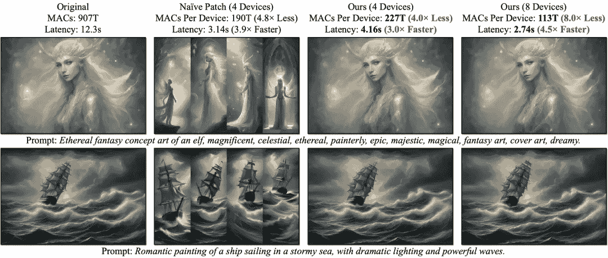
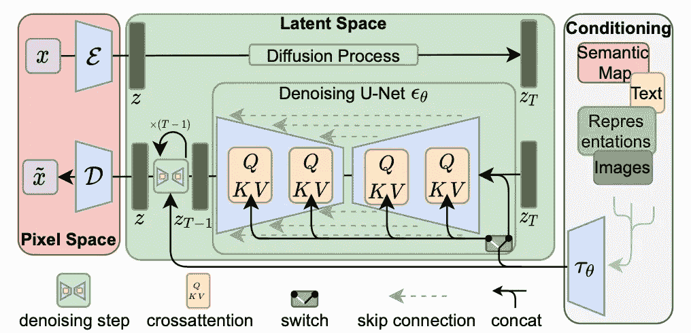
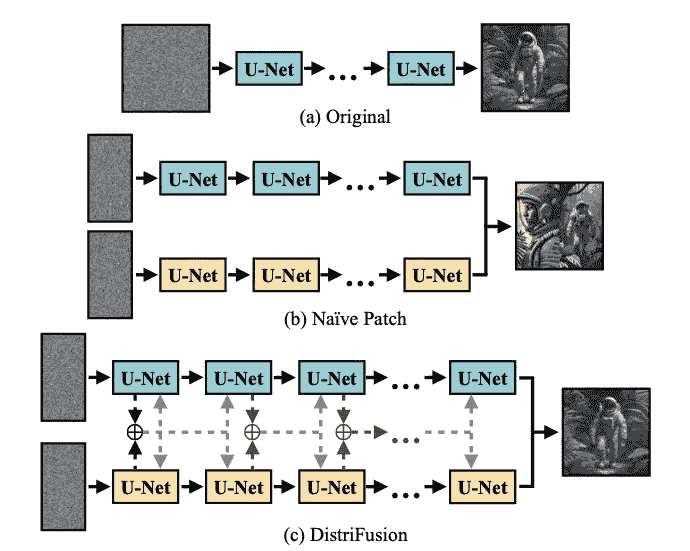
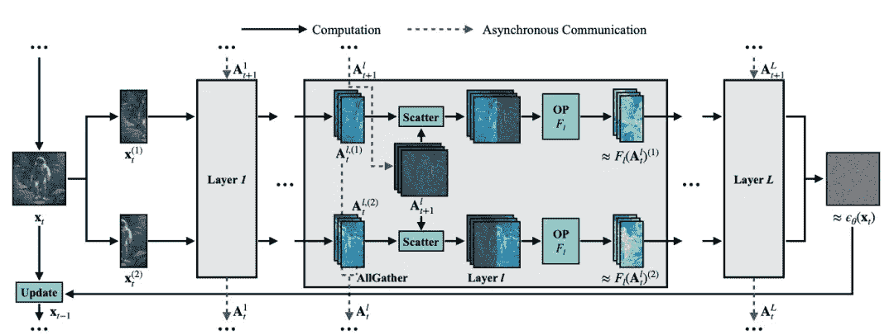
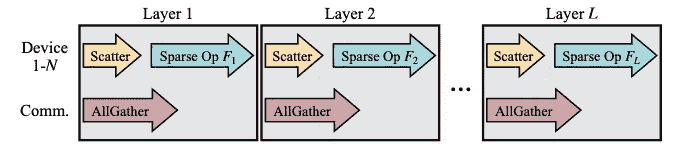
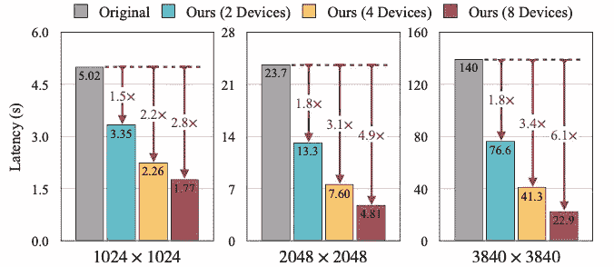
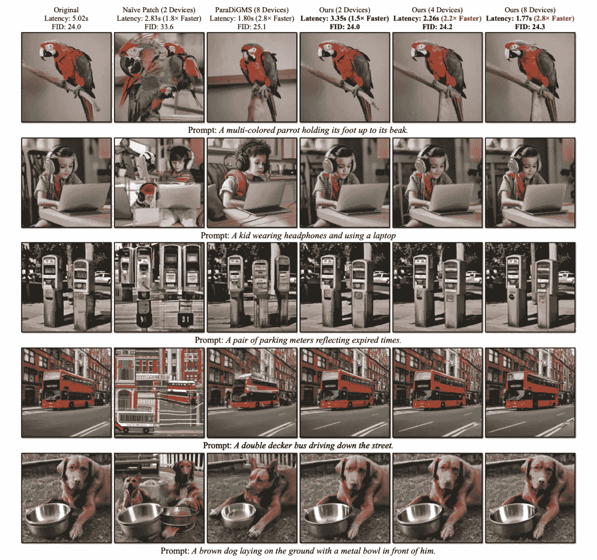

# 韩松团队新作：针对扩散模型的并行推理方法

> 来源：[https://v11enp9ok1h.feishu.cn/docx/YaTQdtM15oXJ3xxALbXc7o1Nn08](https://v11enp9ok1h.feishu.cn/docx/YaTQdtM15oXJ3xxALbXc7o1Nn08)

近期，韩松团队在CVPR2024发布了团队推理加速的新作品，针对扩散模型进行并行推理加速的方法。并 在最高分辨率上达到了最多6.1倍的加速。代码已开源～

GitHub：https://github.com/mit-han-lab/distrifuser

arXiv：https://arxiv.org/abs/2402.19481

# **引言**

随着OpenAI Sora模型的发布，T2V（Text to Video）模型引起了广泛的关注。Sora以连续的视频帧生成，高清的视频分辨率快速变成顶流。无论是文生图模型，还是文生视频模型，分辨率已成为了关注的焦点之一。能否在保持高分辨率的同时，快速无损生成图片是现今扩散模型研究的重点。先来看看并行推理的效果：

在图片中，MACs（Multiply-Accumulate operations）是用来衡量计算成本的一个指标。MACs是浮点运算操作的一种，它包括乘法（Multiply）和累加（Accumulate）两个步骤。在DistriFusion算法中，MACs用来衡量在不同并行策略下，生成高分辨率图像所需的计算资源。通过DistriFusion方法，可以在保持图像质量的同时，显著减少所需的MACs，从而加速图像生成过程。在达到8卡并行时，DistriFusion的MACs只有113T，而时延也只有2.74s。这都远远好于单卡的推理效果。同时这篇论文也实现了一种特殊的并行方式，对输入图片进行patch而不会影响后续的推理结果。

# Stable Diffusion回顾

Stable Diffusion等文生图模型来说，它是一个仅包含prefill（图片生成），而没有类似LLM的后续decoding过程。Stable Diffusion模型，是一种基于深度学习的文本到图像生成模型。其首先，将输入的文本描述通过一个文本编码器转换成一个高维度的特征向量；然后，这个特征向量与一个随机的噪声向量在潜在空间中结合，形成一个潜在表征；接着，通过多个解码器层对这个潜在表征进行逐步解码，将其转换成对应的图像。在这个过程中，模型需要学习如何理解和表达文本描述中的语义信息，并将其映射到图像的像素空间中。

# DistriFusion并行结构简单分析

对SD模型来说，图片生成过程中主要的时间损耗在Denoising U-Net部分。那么下面就一起来看看DistiFusion并行U-Net的结构～

对DistriFusion的并行架构进行分析：a）是不做并行的U-Net结构，b）把噪声切成patch，把两块patch分别放进U-Net中进行Denoising。最后得到的结果其实是两张和Text描述相似的图片，但这并不是期待的效果，最终的目的是通过并行生成一张和a）一致的图片。c）在把输入图片打成patch的情况下。通过U-Net间的数据通信，保持了最终的生成效果能和a）中结果一致。

> ps：这种方法给我一种很强的在做DP（Data Parallel）的感觉，通常的DP方法因为图片数据的强一致性，只能把单张图片作为最小单元做并行。如果强行对一张图片做patch就会得到图2的结果。（你也不想你模型的高清大图变得奇奇怪怪吧。。。）因此这种方法突破了单张图片作为最小DP单元的限制，进一步提高并行度。

# **Diffusion前向过程分析**

为了生成高质量图像，扩散模型通常训练一个噪声预测神经模型（例如，U-Net） 。从纯高斯噪声   开始，它涉及数十到数百个迭代去噪步骤来获得最终的干净图像  ，其中 T 是总步数。具体来说，给定时间步 t 的噪声图像  ，模型   以  、t 和额外的条件  c（例如，文本）作为输入来预测   内的相应噪声  。在每个去噪步骤中，可以从以下方程导出  : 上面的公式里“Update”指的是特定于采样器的函数，通常包括元素级加法和乘法。因此，此过程中的主要延迟来源是通过模型ϵθ的前向传递。例如，Stable Diffusion XL 在生成1024×1024图像的每一步需要6,763 GMACs。随着分辨率的增加，这种计算需求呈二次方以上增长，使得生成单个高分辨率图像的延迟对于实际应用来说变得不切实际。

# DistriFusion U-Net并行trick

## Displaced Patch Parallelism （DPP）

接下来分析这篇论文的解决方案：DistriFusion的关键思想是通过将图像分割成多个patch来实现设备间的并行计算。论文提出了一种新的并行方法，DPP（Displaced Patch Parallelism），它利用扩散模型的顺序特性来重叠通信和计算。计算每层的patch并不依赖于其他patch，通信被掩盖在后续层的计算中。

在这里，只取了一次U-Net中的一个layer做讲解。并且假定DPP=2。在当轮时间步预测作用在目标图片上的噪声时，首先将当次目标图片分割成多patch。在上图中中使用DPP=2。该文中使用的DPP是一种很类似于DP的实现，这种方法需要在每一个设备上保存完整的模型权重。并且每个模型都将独立并行地处理单个patch。对于图上这个特定的layer，首先会使用scatter操作把上一步cache好的结果加载进来，并同时用AllGather汇集本步的数据以用以下一步使用。这里，每一个设备上的输入都具有完整的空间形状。在scatter输出中，只有每个设备在最初获得的patch是需要重新计算的值。这个过程在每一layer重复。最后，所有层的输出被同步在一起，以预测噪声。通过这种方法，每个设备只负责1/N的总计算量，实现了高效的并行化。

> ps：这里又想碎碎念一下，做Scatter+AllGather让设备能在需要的时候获得所有数据，而平时只保存自己的一份。让我想起了ZeRO。只不过它和ZeRO的区别是，这种方法Scatter的是上一步的数据，而AllGather的是为下一步服务的数据。这样为异步操作做了很好的铺垫～

## **异步操作时延掩盖**

从论文所给的图片能看出来，每次Scatter和AllGather可以异步执行，而且每一步Layer的信息已在上一步被cache好，能很好掩盖掉AllGather的通信损耗～

## 异步GroupNorm修正（Corrected asynchronous GroupNorm）

熟悉SD等文生图模型的朋友们都知道，在SD中的Norm方式是GroupNorm，它在空间维度上进行归一化，这个层需要每个设备上有完整的输入进行计算，而不能是以每个设备上各自的patch进行计算。文章发现仅对patch进行Norm或以上一步AllReduce的数据+这一步新的patch做Norm都会降低图像质量。然而，也不能选择在norm前做同步，聚合所层来做归一化会带来极大的开销，会抹平之前的异步操作带来的性能收益。文章通过向上一步数据中引入了修正项来克服图像质量的降低。具体来说，对于每个设备 i 在给定步骤 t，每个GN层可以计算其patch   的组内均值，记为  。当前步骤在设备 i 上的近似全局均值   可以估计为： 之后再估计一下  ，这样就能算方差了（用方差公式）。文章说它们这种方法能和同步之后的结果一样。

> ps：这次ps按照paper中的公式分析了一下，没贴在文章。paper是从上一步整体均值加上一个correction的角度来分析局部均值的合理性的。如果去掉上一步的两个变量  和 这和用patch去估计整体效果是一样的，没有很好的统计信息。文章使用这两个变量，个人在这里的理解是为了估计上一步同设备在同层均值的偏差情况：   通过假定新一层的数据会拥有相同的偏差，来对这一步的均值进行一样的更新。

# **结果展示**

到了上才艺的时候了！先分析一下加速情况：

能看到在8卡的时候，随着分辨率的提高，加速比也在逐渐上升～。再分析一下论文里给的几个例子：

能看出来使用DistriFusion是这几种方法里还原度最高的方法，不必说naive patch的工作，肯定很怪就对了。和竞品比还原度也更好～但是还是要注意到。第一张图片鹦鹉的眼睛，第二张图片小孩的背景，第三张图片亭子下的红色标志，第四张图片中白色的线，和第五张图片中白色的线。DPP=8和Original比都会有一定程度的差异，但是文章开头的效果图做到了完全一致。

# **展望**

本文给大家介绍了一种全新的Diffusion Model并行方式，能继续patch图片进行并行任务。让一张图片的生成时间大幅度下降。是一种很有前景的方法。后续对于工业界来说，如何能在这个基础上做好DPP=8和原始的对齐，以及优化方差计算时的负数是待解决的工作。