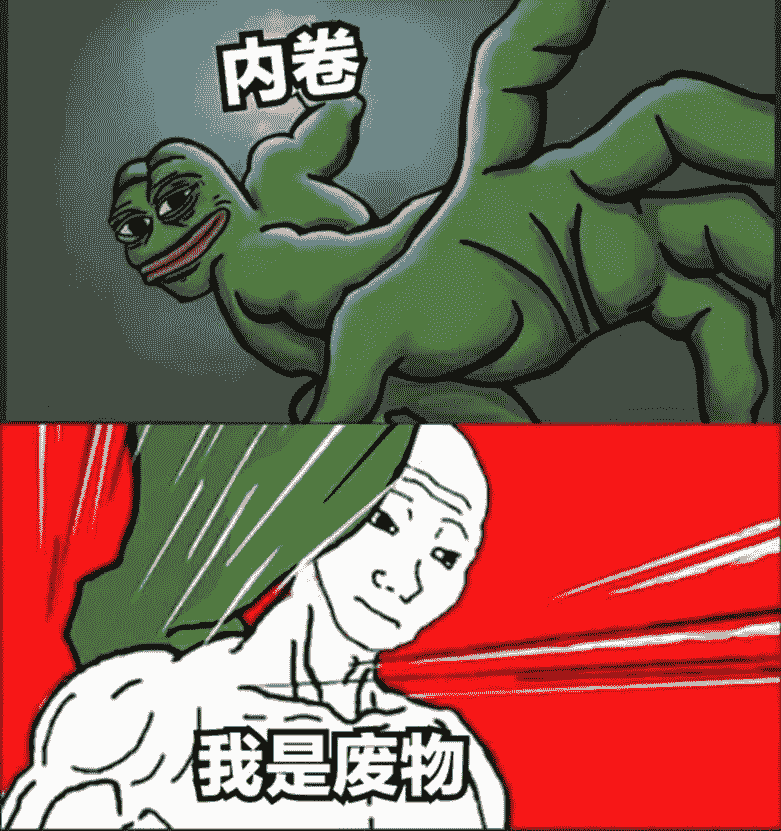
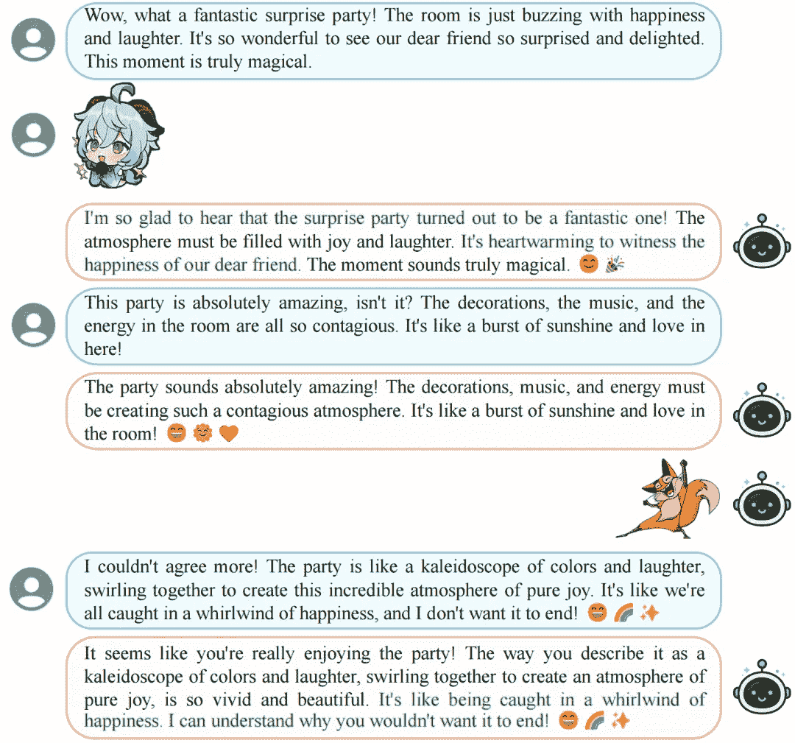
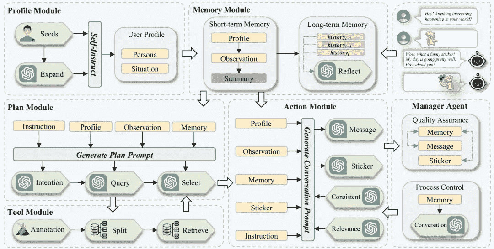
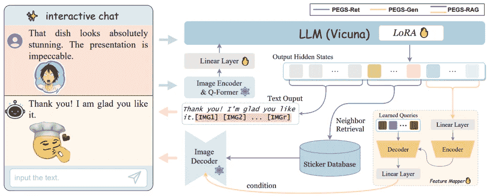
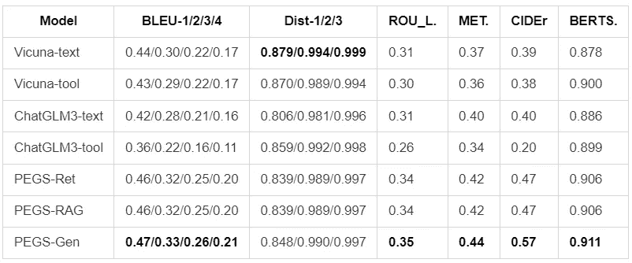
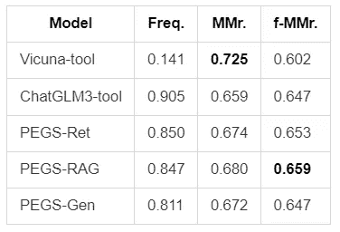
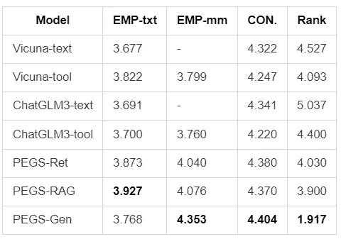
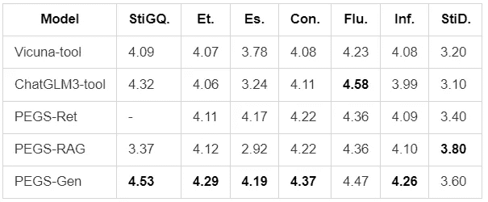

# STICKERCONV：从零开始生成多模态共情回复

> 来源：[https://v11enp9ok1h.feishu.cn/docx/CW3TdsDSwovprNxvbOtcCMbjnvh](https://v11enp9ok1h.feishu.cn/docx/CW3TdsDSwovprNxvbOtcCMbjnvh)

> 作者：王培东，东北大学计算机科学与工程学院本科生

> 作者主页：https://control-derek.github.io/

> 研究兴趣：多模态大模型/多模态对话/大语言模型/共情对话/扩散模型

> 本文关键词：多模态大模型，共情对话，多智能体系统，数据集构造

> 全文约 3700 字，预计阅读时间 10 分钟

**今天分享一篇我们的工作**，这篇工作被 ACL 2024 主会录用。

+   标题：《STICKERCONV: Generating Multimodal Empathetic Responses from Scratch》

+   作者：**张逸**群(1*)，孔繁恒(1*)，王培东(1*)，孙爽(1)，王凌帅(1)，冯时(1@)，王大玲(1)，张一飞(1)，宋凯嵩(1, 2)

+   类型：**Lo**ng Paper, Main Conference

+   单位：(1)东北大学，(2)阿里巴巴集团

+   说明：(*)同等贡献，(@)通信作者

+   论文链接：https://arxiv.org/abs/2402.01679

+   项目仓库：https://github.com/ZhangYiqun018/StickerConv

+   项目主页：https://neu-datamining.github.io/StickerConv/

+   数据集：https://huggingface.co/datasets/NEUDM/StickerConv

## **省流**

1.  我们用多智能体协作构造了**首个**多模态共情对话数据集

1.  我们提出了一个新的多模态大模型**PEGS**📌，接收多模态的输入，生成多**模态输出**

1.  我们提出了一套**新的**多模态共情回复的评价体系

## **背景介绍**

标题里的 **STICKER** 指的是表情包 sticker （如图1），大家可能听过表情包有时候翻译成 meme 。但 meme 通常是用来表达幽默、讽刺、社会评论的图片（如图2），而 sticker 的目的是为了在对话中快速传达情感或反应，比如表达开心、悲伤、惊讶等情绪。虽然 meme 也可以在聊天中用，但它更偏向于作为一个谈资，一个对话中心，而 sticker 是辅助文字聊天的手段。因此本文研究的是 sticker 用于共情对话而不是 meme 。下文所提到的”表情包“均指 sticker 。

表情包在网络聊天中很常见，它们能让对话更有趣、更富有感情。但是，关于如何用表情包来更好地表达**情感的研究**还**不多，主要是因为没有足**够的数据来支持。在本文中，我们介绍了 Agent for StickerConv（Ag**en**t4SC），它使用协作**智**能体交互来真实模**拟**人类使用表情包的**行为，从**而增强多模态共情交流。在此基础上，我们开发了多模态共情对话数据集** STI**CKERCONV，其中包括 12.9K 段对话、5.8K 个不重复的表情包和 2K 个不同的对话场景，其中一段对话示例如图3所示。该数据集是多模态共情生成的基准。进一步，我们提出了 PErceive and Generate Stickers（PEGS）📌， 一种多模态共情回复生成框架（也可以用于其他多模态场景）。还提出了一套基于 大语言模型（LLM） 的综合共情评价指标。我们的实验证明， PEGS  能够有效生成与语境相关并能引起情感共鸣的多模态共情回复，从而有助于开发更细致入微、更引人入胜的共情对话系统。

## **方法**

### Agent for STICKERCONV

面对缺乏多模态共情对话数据集这一**挑战，我**们计划使用大型语言模型（LLM）从零开始制作**共情对话**数据集。但LLM在理**解和表达人类微妙情**感方面存在局限，且难以自发地超越预设指令进行操作。这些限制导致LLM和MLLM在生成多模态共情数据时效果不佳。为克服这些难题，我们开发了 Agent for STICKERCONV（Agent4SC），这是一个基于LLM的多智能体系统，旨在模仿人类的对话模式，并将表情包作为智能体主动调用的工具。如图4所示，Agent4SC 通过多个模块的协同运作和策略性使用表情包，能够生成情感丰富且多样化的多模态共情回复，有效弥补了LLM和MLLM在多模态共情回复生成上的不足。

Agent4SC的模块介绍：

+   角**色模块（Prof**ile Module）：通过SELF-INSTRUCT方法，我们基于多样化的角色种子数据构建了2000个独特的用户画像，这些画像包含丰富的人物特征和情感标签，使 Agent4SC 能够模拟多种不同的用户角色。

+   工具**模块（Tool **Module）：我们利用 **Llava1.5** 对 SER30K 数据集中的表情包进行重新标注，并通过CoT方法结合gpt-3.5-turbo整理表情包的标注信息，形成包含“描述、情感、推荐”的知识条目，并构建了表情包向量数据库，其中信息以<image, knowledge>对的形式存储。Agent4SC 可以通过定义的关键动作“检索”从数据库中调用表情包。

+   计划模块（Plan Module）：包含三个关键动作：“Intention”（基于用户画像与对话历史评估是否使用表情包）、“Query”（如果决**定使用表情包，生**成计划使用的表情包描述，然后向表情包向量数据库请求 Top N 个相似的表情包）、“Select”（基于用户画像和对话历史，从 Top N 个表情包中选择一个最合适的）。确保了 Agent4SC 模仿人类的思考和行动。

+   **记忆模块（Memo**ry Module）：用于存储和检索对话历史及用户画像，保证 Agent4SC 的对话连贯性。

+   动作模块**（Action M**odule）：作为 Agent4SC 与外界的接口，承接计划模块的输出，该模块基于用户画像和对话历史生成共情回复和表情包。

+   管理智能体（Man**agement A**gent）：负责监督和调整 Agent4SC 的行为，确保其性能和质量。

**    通过这些模**块的协同作用，Agent4SC 能够自然流畅地生成共情回**复，并有效利用表情****包，**无需额外指令即可生成情感丰富的多模态共情对话数据。Agent4SC 的开发使我们能够创建 STICKERCONV 数据集，这是首个专为多模态共情对话设计的数据集，为该领域的研究提供了重要基础。

### **PEGS📌**

**    **我们**设计**了一个多模态共情响应生**成**框架 PEGS **(**PErceive and Generate Stickers)，具有感知和生成表情包的能力。图5说明了我们框架的架构。根据不同的图像生成策略，我们基于该框架推导出了三个模型：PEGS-Ret/Gen/RA**G，分**别表示通过检索、生成和检索增**强生**成方法来得到图像回复。从技术上讲，我们利**用来自 EVA-C**LIP 的 **ViT-G/****14，B**LIP-2 的 Q-Former和**线性层来编码图像，使用 Vi**cuna-7B 作为LLM，Stable Diffusion 作为图像解码器。训练时，我们只训练线性层（将视觉输入的语义空间和维度对齐到 LLM 的语义空间和维度上），新加 token（下文的[IMG{r}]）的 embedding 和语言模型输出的线性层（让模型学会新加 token 的表征），LLM 块中新加的 LoRA 层（增强共情对话能力，适配新加 token 的表征），以及解码图像时的 Feature Mapper(其实就是四层的 Encoder-Decoder Transformer，用来将LLM的输出语义空间和维度对齐到相应的目标空间和维度)，其他部分冻结。

**  **对于输入，我们先用 ViT 编码图像，然后通过 Q-Former 和线性层对齐图像模态和文本模态的语义空间，并且对齐维度，这样图像编码得到的特征向量对 LLM 来说是和文本输入的 embedding 等价的，使得LLM得以处理交错的多模态输入。

对于输出，我们在词表中扩充了特殊 token [IMG{r}]，用于提醒模型，使用这些 token 的隐层特征来得到图像。这样把多模态回复的生成统一为对 token 的生成，使得LLM得以生成交错的多模态输出。在 PEGS-Ret 中，我们使用 32 个[IMG{r}]，当模型生成[IMG{r}]时，把这些 token 的隐层特征经过 Feature Mapper 编码后，在表情包向量数据库中检索出一张图片；在 PEGS-Gen 中，我们**同样使用 32 **个[IMG{r}]，同样的把这些 t**oke**n 的隐层特征经过 Feature Mapper 编码，然后使用 Stable Diffusion 进行解码；在 PEGS-RAG 中，我们使用 64 个[IMG{r}]，使用前 32 个 token 的特征编码检索得到一个图像，使用后32个特征 token 的特征编码作为 Stable Diffusion 图像生成的 condition，在检索得到的图像上进行去噪扩散，这种基于参考图像的表情包生成方式更有助于保证表情包质量的同时扩展生成表情包的多样性。这个过程类似纯文本的检索增强，因此我们叫他 PEGS-RAG ，因为它实际上是使用了多模态的 RAG ，截至我们完成这项工作为止，我们是第一个做多模态检索增强的。

### **3.多模态共情回复评价**

**  LLM 能****够像人类一样**进行评分，为文本和表情包输出提供分数，从而实**现全面**的多模态评估系统。我们引入了三个基于 LLM 的指标：（1） 共情：我们通过模型的文本（Empathy-text，EMP-txt）和多模态（Empathy-multimodal，EMP-mm）回复来评估共情。（2）一致性：根据上下文，为文本和表情包回复分配一致性分数，简称 CON。（3）排名：我们将不同模型的响应与同一上下文进行比较，根据质量、共情能力和一致性进行评估。评分使用的 prompt 在我们的项目仓库中以及论文的附录中都可以找到。

## **实验结果**

鉴于缺乏baseline，我们额外训练了两个将表情包作为辅助工具的**LLM：**Vicuna-tool 和 ChatGLM3-tool。此举旨在评估  PEGS 的性能表现。

表 1 报告了文本指标的结果。PEGS 在 Dist-n 上的性能略低于 Vicuna。这可能归因于 PEGS 扩展了 Vicuna 的词汇量以促进表情包的感知和生成，从而在一定程度上影响了 PEGS 的文本多样性。在我们的实验中，工具学习的训练目标包括文本生成和工具调用。这两个目标可能会相互干扰。因此，工具模型的文本性能达不到文本微调模型的性能。PEGS的端到端结构集成了多模态输入和输出，通过统一的训练目标简化任务，并得到了最佳的文本结果。PEGS-Gen 使用更少的特殊 token（32），因此在文本指标上优于 PEGS-Ret 和 PEGS-RAG。这些发现证实了PEGS框架在生成高质量和准确性的文本响应方面的有效性。

表 2 显示了多模态指标的结果，其中 Freq 表示每个模型的贴纸回复的相对频率。尽管 Vicuna-tool 实现了较高的 MMr （72.48），但这一结果主要是由于其较低的频率 （0.141），这可能不能准确代表其多模态交互能力。PEGS 在 f-MMr 方面表现出色，展示了其集成文本和贴纸的端到端结构，在多模态回复生成方面实现了高度一致性。

表 3 列出了基于 LLM 评估的实验结果。相对于基线模型，Vicuna-tool 和 ChatGLM3-tool **这两个工具**学习模型在排名上超越了纯文本模型。这一发现强调了表情包在增强**共情交流方面的关键**作用**。基于LLM的**评估指标表明，PEGS 能够在保持高度一致性的同时，生成富有共情的文本，并通过表情包进一步增强情感的共鸣。此外，表 2 和 PEGS-Gen 的 EMP-mm 指标（4.353） 证实，多模态回复的质量与其增强共情的程度密切相关。

表4呈现了人工评估的详细结**果，涵盖了多**个关键指标：表情包生**成质量**（StiGQ.）、**表情包**共情效果（E**s.）、**文本共情效果**（Et.**）、一致性（**Con.**）、流畅性（Flu.**）、信息量**（Inf.）以及表情包多样性（StiD.）。评估结果显示，PEGS在除流畅性（Flu.）之外的多数指标上显著优于两个基线模型，这有力地证明了PEGS框架的效能。具体来看，PEGS在流畅性指标上的得分略低于ChatGLM3-tool（4.58），可能是因为其较高的信息量（Inf. > 4.09）导致流畅性略有牺牲。根据信息量 （Inf.） 和文本共情效果( Et.)的关系，信息量是影响共情的关键因素。

在表情包多样性方面，**PEGS-RAG **取得了3.8分，表现优异，但在表情包生成质量（StiG**Q.）上得分最低，仅为3.37。这表**明，尽管RAG策略提升了表情包的多样性，但也可能对表情包的生成质量产生了负面影响。（因为用于检索的表征和用于生成的表征可能不是一致的，有时会产生1+1<1的效果。克服这一点可能还需要大量数据的训练。）对StiGQ.、Es.和StiD.的深入分析揭示，多模态回复能够有效增强共情，且这种增强效果与回复的整体质量正相关。

**    综合考虑所**有**人类评估指标，PE**GS-Gen 表现卓越，部分得益于其对特殊token的谨慎使用，以及得益于其端到端结构所赋予的熟练表情包生成能力。这些成果充分展示了 PEGS-Gen 在创造高质量、情感丰富且多样化的多模态回复方面的卓越能力。

## **总结**

**    我们深入研究了**多模态**共情**回复的理论，并推出了 STICKERCONV，这是首个专为多模态共情对话量身打造的数据集。在此基础上，我们构建了A**ge**nt for STIC**K**ERCONV，一**个**基于大型语言模型（**LLM）**的复杂多智能体系统，该系统能够运用表情包来模拟人类般的互动，进而生成多模态共情回复。此外，我们开发了 PErceive and Generate Stickers （PEGS📌），这是一种先进的多模态共情对话框架，它能够精准地感知并生成表情包，显著提升了对话的情感体验。我们还制定了一套全面的基于LLM的多模态共情任务评估指标。我们相信，这一系列成果将为推动多模态共情对话系统领域的研究提供重要的资源和启示。