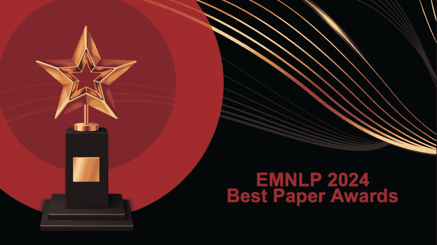
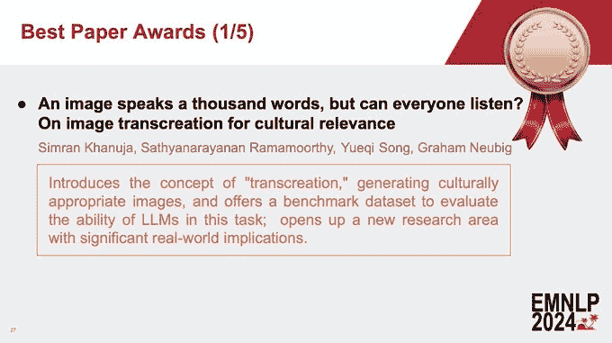
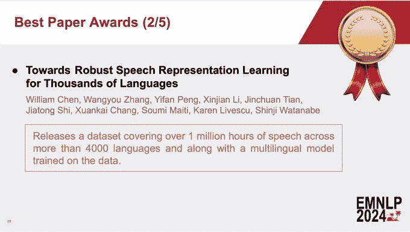
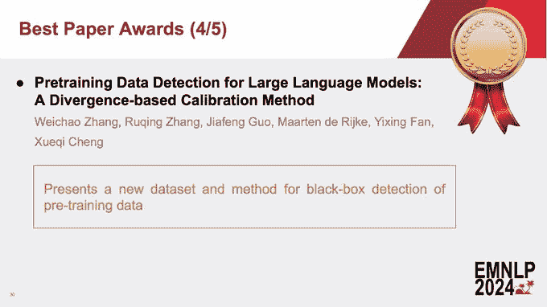
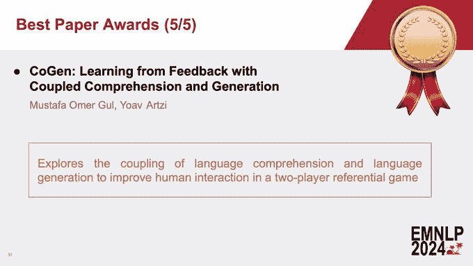

# 最佳论文盘点

> 来源：[https://v11enp9ok1h.feishu.cn/docx/B8V5dczzKo6Ge3xxREyc63bSnle](https://v11enp9ok1h.feishu.cn/docx/B8V5dczzKo6Ge3xxREyc63bSnle)

11 **月 **12 日至 11 月 16 日 EMNLP 2024 在美弗罗里达火热举办中，本届最佳论文也在今天北京时间凌晨发布。本文对获评的五篇最佳论文进行了盘点*。后续我们还会继续陆续发布不同领域的 EMNLP 2024 高引盘点，在机智流👸号后台对话框回复“盘点”，加入顶会论文盘点交流群。

1.  An image speaks a thousand words, but can everyone listen? On image transcreation for cultural relevance

1.  Towards Robust Speech Representation Learning for Thousands of Languages

1.  Backward Lens: Projecting Language Model Gradients into the Vocabulary Space

1.  Pretraining Data Detection for Large Language Models: A Divergence-based Calibration Method

1.  CoGen: Learning from Feedback with Coupled Comprehension and Generation

## An image speaks a thousand words, but can everyone listen? On image transcreation for cultural relevance

[链接]

[主要图片]

**总结**：

**获评理由**：（见下图）

**摘要**：

## Towards Robust Speech Representation Learning for Thousands of Languages

## Backward Lens: Projecting Language Model Gradients into the Vocabulary Space

## Pretraining Data Detection for Large Language Models: A Divergence-based Calibration Method

## CoGen: Learning from Feedback with Coupled Comprehension and Generation

