# 论文集 Top 15 被引盘点

> 来源：[https://v11enp9ok1h.feishu.cn/docx/NrVQdq2U5onLbBxRT5ucgndbnLt](https://v11enp9ok1h.feishu.cn/docx/NrVQdq2U5onLbBxRT5ucgndbnLt)

11 月 12 日至 11 月 16 日 EMNLP 202[4 在美弗罗里达火热举办中，](https://aclanthology.org/events/emnlp-2024/)本文精选了 EMNLP 2024 论文集中被引量最高的15篇论文*。不出意外的是，绝大**多数**工作和LLM相关。后续我们还会继续陆续发布不同领域的 EMNLP 2024 高引盘点，在机智流公众号后台对话框回复“盘点”，加入顶会论文盘点交流群。

*注：引用数据来自谷歌学术，数据统计截止 2024 年 11 月 13 日

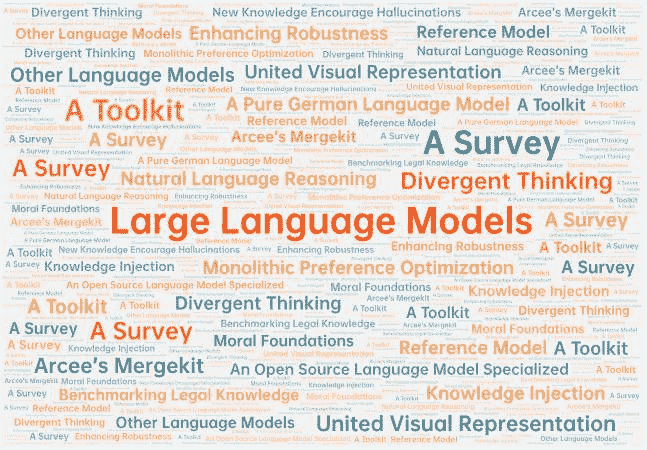

1.  A Survey on In-context Learning（1109次）

1.  Video-LLaVA: Learning United Visual Representation by Alignment Before Projection（258次）

1.  Encouraging Divergent Thinking in Large Language Models through Multi-Agent Debate（215次）

1.  FOLIO: Natural Language Reasoning with First-Order Logic（89次）

1.  Fine-Tuning or Retrieval? Comparing Knowledge Injection in LLMs（82次）

1.  GottBERT: a pure German Language Model（81次）

1.  ORPO: Monolithic Preference Optimization without Reference Model（74次）

1.  Chain-of-Note: Enhancing Robustness in Retrieval-Augmented Language Models（63次）

1.  AnyMAL: An Efficient and Scalable Any-Modality Augmented Language Model（62次）

1.  Prometheus 2: An Open Source Language Model Specialized in Evaluating Other Language Models（61次）

1.  Arcee’s MergeKit: A Toolkit for Merging Large Language Models（49次）

1.  LawBench: Benchmarking Legal Knowledge of Large Language Models（48次）

1.  mPLUG-DocOwl 1.5: Unified Structure Learning for OCR-free Document Understanding（48次）

1.  Moral Foundations of Large Language Models（45次）

1.  Does Fine-Tuning LLMs on New Knowledge Encourage Hallucinations?（42次）

## A Survey on In-context Learning

https://aclanthology.org/2024.emnlp-main.64.pdf

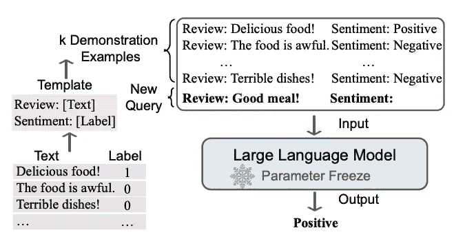

**总结**：这是一篇关于情境学习（In - context Learning）的综述，文中提到情境学习需要包含少量内容的提示语境，并且指出情境学习与人类通过学习的决策过程相似。

With the increasing capabilities of large language models (LLMs), in-context learning (ICL) has emerged as a new paradigm for natural language processing (NLP), where LLMs make predictions based on contexts augmented with a few examples. It has been a significant trend to explore ICL to evaluate and extrapolate the ability of LLMs. In this paper, we aim to survey and summarize the progress and challenges of ICL. We first present a formal definition of ICL and clarify its correlation to related studies. Then, we organize and discuss advanced techniques, including training strategies, prompt designing strategies, and related analysis. Additionally, we explore various ICL application scenarios, such as data engineering and knowledge updating. Finally, we address the challenges of ICL and suggest potential directions for further research. We hope that our work can encourage more research on uncovering how ICL works and improving ICL.

## Video-LLaVA: Learning United Visual Representation by Alignment Before Projection

https://aclanthology.org/2024.emnlp-main.342.pdf

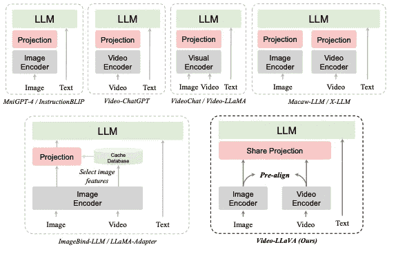

该工作指出大型视觉 - 语言模型（LVLM）提升了视觉 - 语言理解中各项下游任务的性能。现有多数方法将图像和视频编码到不同特征空间再输入大型语言模型，但由于图像和视频缺乏统一标记化（投影前错位），大型语言模型（LLM）难以从几个不佳的投影层中学习多模态交互。

Large Vision-Language Model (LVLM) has enhanced the performance of various downstream tasks in visual-language understanding. Most existing approaches encode images and videos into separate feature spaces, which are then fed as inputs to large language models. However, due to the lack of unified tokenization for images and videos, namely misalignment before projection, it becomes challenging for a Large Language Model (LLM) to learn multi-modal interactions from several poor projection layers. In this work, we unify visual representation into the language feature space to advance the foundational LLM towards a unified LVLM. As a result, we establish a simple but robust LVLM baseline, Video-LLaVA, which learns from a mixed dataset of images and videos, mutually enhancing each other. As a result, Video-LLaVA outperforms Video-ChatGPT by 5.8%, 9.9%, 18.6%, and 10.1% on MSRVTT, MSVD, TGIF, and ActivityNet, respectively. Additionally, our Video-LLaVA also achieves superior performances on a broad range of 9 image benchmarks. Notably, extensive experiments demonstrate that Video-LLaVA mutually benefits images and videos within a unified visual representation, outperforming models designed specifically for images or videos. We aim for this work to provide modest insights into the multi-modal inputs for the LLM.

## Encouraging Divergent Thinking in Large Language Models through Multi-Agent Debate

https://aclanthology.org/2024.emnlp-main.992.pdf

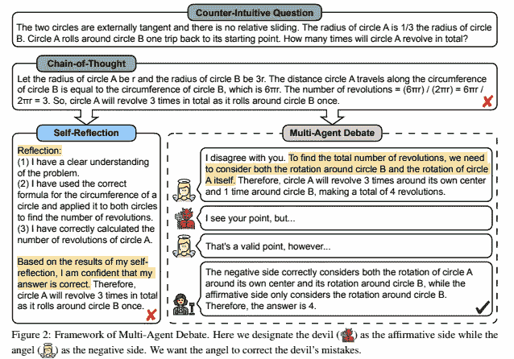

现代大型语言模型（如ChatGPT）在一般语言任务上表现卓越，但在复杂推理任务上仍有困难，这推动了对其认知行为的研究以探索类人解题策略。其中一种代表性策略是自我反思，即让模型利用自身生成的反馈迭代优化解决方案，但研究表明这种反思式方法存在思维退化（DoT）问题。

Modern large language models (LLMs) like ChatGPT have shown remarkable performance on general language tasks but still struggle on complex reasoning tasks, which drives the research on cognitive behaviors of LLMs to explore human-like problem-solving strategies. Along this direction, one representative strategy is self-reflection, which asks an LLM to refine the solution with the feedback generated by itself iteratively. However, our study shows that such reflection-style methods suffer from the Degeneration-of-Thought (DoT) problem: once the LLM has established confidence in its solutions, it is unable to generate novel thoughts later through reflection even if its initial stance is incorrect. To address the DoT problem, we propose a Multi-Agent Debate (MAD) framework, in which multiple agents express their arguments in the state of “tit for tat” and a judge manages the debate process to obtain a final solution. Clearly, our MAD framework encourages divergent thinking in LLMs which would be helpful for tasks that require deep levels of contemplation. Experiment results on two challenging datasets, commonsense machine translation and counterintuitive arithmetic reasoning, demonstrate the effectiveness of our MAD framework. Extensive analyses suggest that the adaptive break of debate and the modest level of “tit for tat” state are required for MAD to obtain good performance. Moreover, we find that LLMs might not be a fair judge if different LLMs are used for agents. Code is available at https://github.com/Skytliang/Multi-Agents-Debate.

## FOLIO: Natural Language Reasoning with First-Order Logic

https://aclanthology.org/2024.emnlp-main.1229.pdf

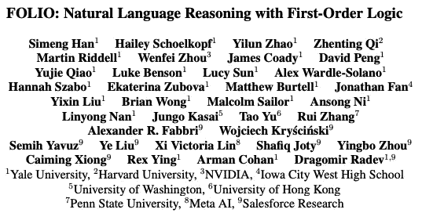

大语言模型（LLMs）在多种自然语言理解任务中表现卓越，但现有基准在衡量模型复杂逻辑推理能力上存在不足。本文提出FOLIO，这是一个人工标注、逻辑复杂多样、用于自然语言（NL）推理且配备一阶逻辑（FOL）标注的数据集，包含1430个示例（唯一结论），每个示例都与487组前提中的一组相匹配用于演绎推理。

Large language models (LLMs) encapsulate a vast amount of factual information within their pre-trained weights, as evidenced by their ability to answer diverse questions across different domains. However, this knowledge is inherently limited, relying heavily on the characteristics of the training data. Consequently, using external datasets to incorporate new information or refine the capabilities of LLMs on previously seen information poses a significant challenge. In this study, we compare two common approaches: unsupervised fine-tuning and retrieval-augmented generation (RAG). We evaluate both approaches on a variety of knowledge-intensive tasks across different topics. Our findings reveal that while unsupervised fine-tuning offers some improvement, RAG consistently outperforms it, both for existing knowledge encountered during training and entirely new knowledge. Moreover, we find that LLMs struggle to learn new factual information through unsupervised fine-tuning, and that exposing them to numerous variations of the same fact during training could alleviate this problem.

## Fine-Tuning or Retrieval? Comparing Knowledge Injection in LLMs

https://aclanthology.org/2024.emnlp-main.15.pdf

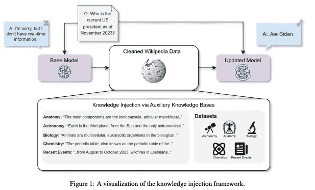

**总结**：本文探讨了向 LLMs 注入知识的方法。背景指出 LLMs 知识存在局限，引出知识注入问题。实验比较了微调（FT）和检索增强生成（RAG）两种方法，通过 MMLU 和时事任务等实验发现，RAG 在多数情况下表现更优，FT 虽有提升但不稳定且在学习新知识方面存在问题，数据增强实验表明重复知识对模型学习新知识有重要意义，未来还需进一步研究知识注入相关问题。

Large language models (LLMs) encapsulate a vast amount of factual information within their pre-trained weights, as evidenced by their ability to answer diverse questions across different domains. However, this knowledge is inherently limited, relying heavily on the characteristics of the training data. Consequently, using external datasets to incorporate new information or refine the capabilities of LLMs on previously seen information poses a significant challenge. In this study, we compare two common approaches: unsupervised fine-tuning and retrieval-augmented generation (RAG). We evaluate both approaches on a variety of knowledge-intensive tasks across different topics. Our findings reveal that while unsupervised fine-tuning offers some improvement, RAG consistently outperforms it, both for existing knowledge encountered during training and entirely new knowledge. Moreover, we find that LLMs struggle to learn new factual information through unsupervised fine-tuning, and that exposing them to numerous variations of the same fact during training could alleviate this problem.

## GottBERT: a pure German Language Model

https://aclanthology.org/2024.emnlp-main.1183.pdf

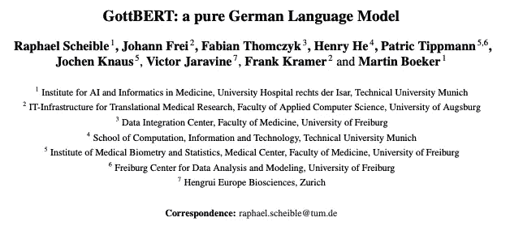

《GottBERT：一个纯德语语言模型》：预训练语言模型推动了自然语言处理（NLP）领域发展，BERT及其优化版RoBERTa影响重大。该领域研究始于英语数据，后有使用多语文本语料库训练的模型，但当前研究表明多语模型不如单语模型，且目前还没有德语单语的RoBERTa模型。

Pre-trained language models have significantly advanced natural language processing (NLP), especially with the introduction of BERT and its optimized version, RoBERTa. While initial research focused on English, single-language models can be advantageous compared to multilingual ones in terms of pre-training effort, overall resource efficiency or downstream task performance. Despite the growing popularity of prompt-based LLMs, more compute-efficient BERT-like models remain highly relevant. In this work, we present the first German singlelanguage RoBERTa model, GottBERT, pretrained exclusively on the German portion of the OSCAR dataset. Additionally, we investigated the impact of filtering the OSCAR corpus. GottBERT was pre-trained using fairseq and standard hyperparameters. We evaluated its performance on two Named Entity Recognition (NER) tasks (Conll 2003 and GermEval 2014) and three text classification tasks (GermEval 2018 fine and coarse, and 10kGNAD) against existing German BERT models and two multilingual models. Performance was measured using the F1 score and accuracy. The GottBERT base and large models showed competitive performance, with GottBERT leading among the base models in 4 of 6 tasks. Contrary to our expectation, the applied filtering did not significantly affect the results. To support the German NLP research community, we are releasing the GottBERT models under the MIT license.

## ORPO: Monolithic Preference Optimization without Reference Model

https://aclanthology.org/2024.emnlp-main.626.pdf

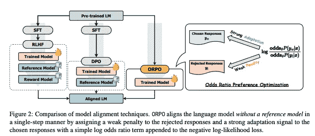

《ORPO：无参考模型的整体偏好优化》：近期语言模型的偏好对齐算法虽成果可期，但监督微调（SFT）对成功收敛仍不可或缺。本文在偏好对齐的背景下重新审视SFT，强调对不被偏好的风格给予小惩罚足以实现偏好对齐。在此基础上，引入一种简单的无参考模型的整体优势比偏好优化算法ORPO。

While recent preference alignment algorithms for language models have demonstrated promising results, supervised fine-tuning (SFT) remains imperative for achieving successful convergence. In this paper, we revisit SFT in the context of preference alignment, emphasizing that a minor penalty for the disfavored style is sufficient for preference alignment. Building on this foundation, we introduce a straightforward reference model-free monolithic odds ratio preference optimization algorithm, ORPO, eliminating the need for an additional preference alignment phase. We demonstrate, both empirically and theoretically, that the odds ratio is a sensible choice for contrasting favored and disfavored styles during SFT across diverse sizes from 125M to 7B. Specifically, finetuning Phi-2 (2.7B), Llama-2 (7B), and Mistral (7B) with ORPO on the UltraFeedback alone surpasses the performance of state-of-the-art language models including Llama-2 Chat and Zephyr with more than 7B and 13B parameters: achieving up to 12.20% on AlpacaEval2.0 (Figure 1), and 7.32 in MT-Bench (Table 2). We release code1 and model checkpoints2 for Mistral-ORPO-α and Mistral-ORPO-β.

## Chain-of-Note: Enhancing Robustness in Retrieval-Augmented Language Models

https://aclanthology.org/2024.emnlp-main.813.pdf

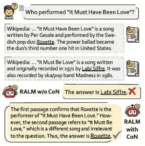

本文提出了 Chain-of-Note（CON）框架，旨在增强检索增强语言模型（RALM）的鲁棒性。针对当前 RALM 框架中信息检索不可靠、易忽略内在知识及大语言模型易产生幻觉等问题，CON 通过为检索文档生成顺序阅读笔记来评估相关性，进而合成最终答案。实验表明，GPT-4 结合 CON 优于 Chain-of-Thought 方法，基于 CON 训练的 RALM 在四个开放域 QA 基准测试中表现出色，显著优于标准微调 RALM。

Retrieval-augmented language model (RALM) represents a significant advancement in mitigating factual hallucination by leveraging external knowledge sources. However, the reliability of the retrieved information is not always guaranteed, and the retrieval of irrelevant data can mislead the response generation. Moreover, standard RALMs frequently neglect their intrinsic knowledge due to the interference from retrieved information. In instances where the retrieved information is irrelevant, RALMs should ideally utilize their intrinsic knowledge or, in the absence of both intrinsic and retrieved knowledge, opt to respond with "unknown" to avoid hallucination. In this paper, we introduces CHAIN-OF-NOTE (CON), a novel approach to improve robustness of RALMs in facing noisy, irrelevant documents and in handling unknown scenarios. The core idea of CON is to generate sequential reading notes for each retrieved document, enabling a thorough evaluation of their relevance to the given question and integrating this information to formulate the final answer. Our experimental results show that GPT-4, when equipped with CON, outperforms the CHAIN-OF-THOUGHT approach. Besides, we utilized GPT-4 to create 10K CON data, subsequently trained on LLaMa-2 7B model. Our experiments across four open-domain QA benchmarks show that fine-tuned RALMs equipped with CON significantly outperform standard fine-tuned RALMs.

## AnyMAL: An Efficient and Scalable Any-Modality Augmented Language Model

https://aclanthology.org/2024.emnlp-industry.98.pdf

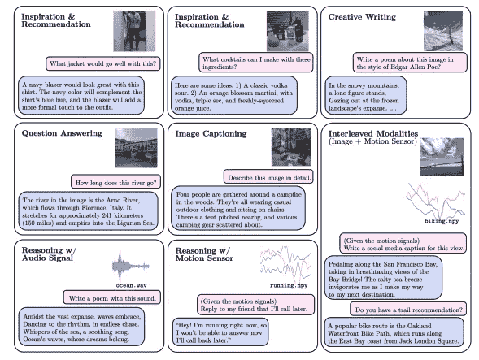

论文提出Any - Modality Augmented Language Model（AnyMAL），这是一个能处理多种输入模态信号（如文本、图像、视频、音频、惯性测量单元运动传感器）并生成文本响应的统一模型。AnyMAL继承了包括Llama - 3（70B）在内的最先进大型语言模型强大的基于文本的推理能力，通过预训练的对齐器模块将特定模态信号转换到联合文本空间，还提供了为有效扩展而实施的优化细节。

We present Any-Modality Augmented Language Model (AnyMAL), a unified model that reasons over diverse input modality signals (i.e. text, image, video, audio, IMU motion sensor), and generates textual responses. AnyMAL inherits the powerful text-based reasoning abilities of the state-of-the-art LLMs including Llama-3 (70B), and converts modality-specific signals to the joint textual space through a pretrained aligner module. In this paper, we provide details on the optimizations implemented to efficiently scale the training pipeline, and present a comprehensive recipe for model and training configurations. We conduct comprehensive empirical analysis comprising both human and automatic evaluations, and demonstrate state-of-the-art performance on various multimodal tasks compared to industry-leading models – albeit with a relatively small number of trainable parameters

## Prometheus 2: An Open Source Language Model Specialized in Evaluating Other Language Models

https://aclanthology.org/2024.emnlp-main.248.pdf

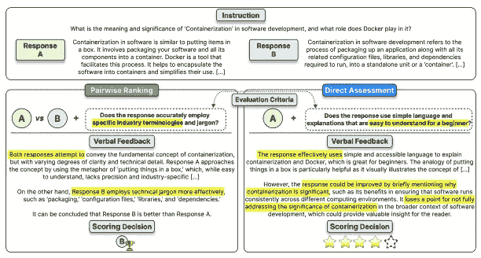

专有语言模型（如GPT - 4）常被用于评估其他语言模型的响应质量，但透明度、可控性和成本方面的担忧促使开发专门用于评估的开源语言模型。不过，现有的开源评估语言模型存在严重缺陷：一是给出的分数与人类评定的分数差异很大，二是缺乏进行直接评估和成对排序（两种最常见形式）的灵活性。

Proprietary LMs such as GPT-4 are often employed to assess the quality of responses from various LMs. However, concerns including transparency, controllability, and affordability strongly motivate the development of opensource LMs specialized in evaluations. On the other hand, existing open evaluator LMs exhibit critical shortcomings: 1) they issue scores that significantly diverge from those assigned by humans, and 2) they lack the flexibility to perform both direct assessment and pairwise ranking, the two most prevalent forms of assessment. Additionally, they often do not possess the ability to evaluate based on custom evaluation criteria, focusing instead on general attributes like helpfulness and harmlessness. To address these issues, we introduce Prometheus 2. Prometheus 2 is more powerful than its predecessor, and closely mirrors human and GPT-4 judgements. Moreover, it is capable of processing both direct assessment and pair-wise ranking formats grouped with a user-defined evaluation criteria. On four direct assessment benchmarks and four pairwise ranking benchmarks, PROMETHEUS 2 scores the highest correlation and agreement with humans and proprietary LM judges among all tested open evaluator LMs. Our models, code, and data are all publicly available.

## Arcee’s MergeKit: A Toolkit for Merging Large Language Models

https://aclanthology.org/2024.emnlp-industry.36.pdf

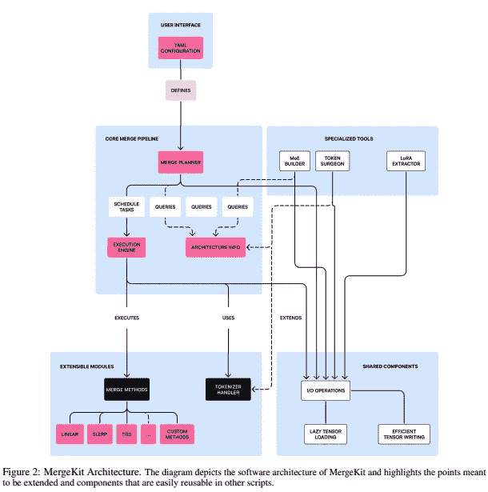

开源语言模型格局迅速扩展，可通过合并参数来整合各模型检查点的能力。迁移学习发展使大量特定任务模型得以开发，它们通常专用于单个任务且无法利用彼此优势。模型合并有助于创建多任务模型而无需额外训练。

The rapid growth of open-source language models provides the opportunity to merge model checkpoints, combining their parameters to improve performance and versatility. Advances in transfer learning have led to numerous taskspecific models, which model merging can integrate into powerful multitask models without additional training. MergeKit is an open-source library designed to support this process with an efficient and extensible framework suitable for any hardware. It has facilitated the merging of thousands of models, contributing to some of the world’s most powerful open-source model checkpoints. The library is accessible at: https://github.com/arcee-ai/mergekit.

## LawBench: Benchmarking Legal Knowledge of Large Language Models

https://aclanthology.org/2024.emnlp-main.452.pdf

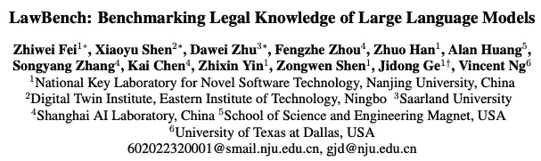

大型语言模型（LLMs）在多个方面能力很强，但应用于高度专业化、安全关键的法律领域时，其法律知识储备量和能否可靠执行法律相关任务尚不明确。为解决这一问题，提出了全面的评估基准LawBench，它精心构建，从三个认知层面（第一个层面为法律知识）精确评估LLMs的法律能力。

We present LawBench, the first evaluation benchmark composed of 20 tasks aimed to assess the ability of Large Language Models (LLMs) to perform Chinese legal-related tasks. LawBench is meticulously crafted to enable precise assessment of LLMs’ legal capabilities from three cognitive levels that correspond to the widely accepted Bloom’s cognitive taxonomy. Using LawBench, we present a comprehensive evaluation of 21 popular LLMs and the first comparative analysis of the empirical results in order to reveal their relative strengths and weaknesses. All data, model predictions and evaluation code are accessible from https://github.com/open-compass/LawBench.

## mPLUG-DocOwl 1.5: Unified Structure Learning for OCR-free Document Understanding

https://aclanthology.org/2024.findings-emnlp.175.pdf

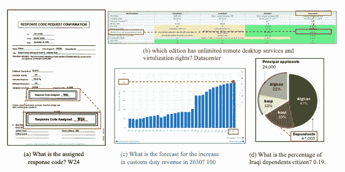

**总结**：结构信息对理解富含文本的图像（如文档、表格和图表）的语义至关重要。现有的用于视觉文档理解的多模态大语言模型（MLLMs）具备文本识别能力，但缺乏对富含文本的文档图像的通用结构理解能力。本研究强调结构信息在视觉文档理解中的重要性，并提出统一结构学习以提升MLLMs的性能。

Structure information is critical for understanding the semantics of text-rich images, such as documents, tables, and charts. Existing Multimodal Large Language Models (MLLMs) for Visual Document Understanding are equipped with text recognition ability but lack general structure understanding abilities for text-rich document images. In this work, we emphasize the importance of structure information in Visual Document Understanding and propose Unified Structure Learning to boost the performance of MLLMs. Based on publicly available text-rich images, we build a comprehensive training set DocStruct4M to support structure-aware parsing tasks and multi-grained text localization tasks across 5 domains: document, webpage, table, chart, and natural image. To better encode structure information, we design a simple and effective vision-to-text module H-Reducer, which can not only maintain the layout information but also reduce the length of visual features by merging horizontal adjacent patches through convolution, enabling the LLM to understand high-resolution images more efficiently. Our model DocOwl 1.5 achieves state-of-the-art performance on 10 visual document understanding benchmarks. All codes, models, and datasets are publicly available at https://github.com/X-PLUG/ mPLUG-DocOwl/tree/main/DocOwl1.5.

## Moral Foundations of Large Language Models

https://aclanthology.org/2024.emnlp-main.982.pdf

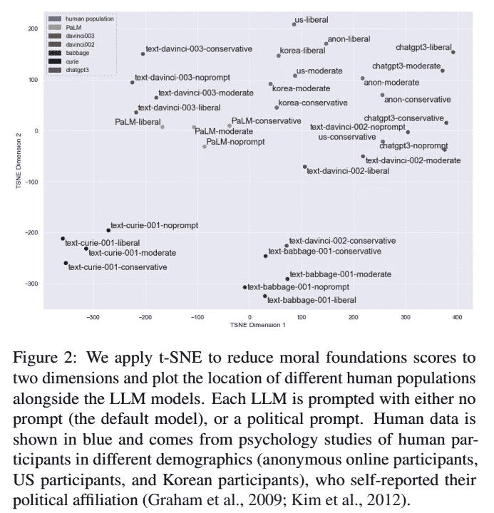

《大型语言模型的道德基础》：道德基础理论（MFT）是一种心理评估工具，能将人类道德推理分解为五个因素。人们做道德决策时对这些因素的重视程度因文化教养和政治意识形态而异。大型语言模型（LLMs）用互联网数据集训练，可能反映数据集中存在的偏差。本文……（未完整提供论文后续内容，总结至此）

Moral foundations theory (MFT) is a social psychological theory that decomposes human moral reasoning into five factors, including care/harm, liberty/oppression, and sanctity/degradation (Graham et al., 2009). People vary in the weight they place on these dimensions when making moral decisions, in part due to their cultural upbringing and political ideology. As large language models (LLMs) are trained on datasets collected from the internet, they may reflect the biases that are present in such corpora. This paper uses MFT as a lens to analyze whether popular LLMs have acquired a bias towards a particular set of moral values. We analyze known LLMs and find they exhibit particular moral foundations, and show how these relate to human moral foundations and political affiliations. We also measure the consistency of these biases, or whether they vary strongly depending on the context of how the model is prompted. Finally, we show that we can adversarially select prompts that encourage the moral to exhibit a particular set of moral foundations, and that this can affect the model’s behavior on downstream tasks. These findings help illustrate the potential risks and unintended consequences of LLMs assuming a particular moral stance.

## Does Fine-Tuning LLMs on New Knowledge Encourage Hallucinations?

https://aclanthology.org/2024.emnlp-main.444.pdf

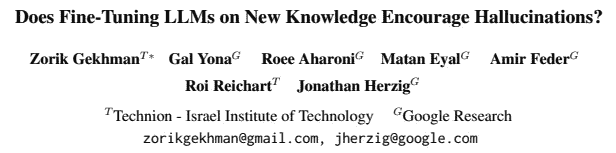

本文研究通过微调向大语言模型引入新知识对其幻觉倾向的影响。提出 SliCK 方法对知识分类，设计实验控制微调数据中未知知识比例，发现模型获取新知识慢且易产生幻觉。分析不同知识类型的影响，表明 MaybeKnown 示例对模型处理知识很重要。还探讨了减轻幻觉的方法，如早停、过滤未知示例、重新标记等。研究强调了微调引入新知识的风险及对模型知识利用的影响。

When large language models are aligned via supervised fine-tuning, they may encounter new factual information that was not acquired through pre-training. It is often conjectured that this can teach the model the behavior of hallucinating factually incorrect responses, as the model is trained to generate facts that are not grounded in its pre-existing knowledge. In this work, we study the impact of such exposure to new knowledge on the capability of the fine-tuned model to utilize its pre-existing knowledge. To this end, we design a controlled setup, focused on closed-book QA, where we vary the proportion of the fine-tuning examples that introduce new knowledge. We demonstrate that large language models struggle to acquire new factual knowledge through fine-tuning, as fine-tuning examples that introduce new knowledge are learned significantly slower than those consistent with the model's knowledge. However, we also find that as the examples with new knowledge are eventually learned, they linearly increase the model's tendency to hallucinate. Taken together, our results highlight the risk in introducing new factual knowledge through fine-tuning, and support the view that large language models mostly acquire factual knowledge through pre-training, whereas fine-tuning teaches them to use it more efficiently.