# 评测领域 Top15 被引盘点

> 来源：[https://v11enp9ok1h.feishu.cn/docx/QWWkdXIPOoeODixWTwGcwKLUnrh](https://v11enp9ok1h.feishu.cn/docx/QWWkdXIPOoeODixWTwGcwKLUnrh)

本文精选了 [EMNLP 2024 论文集](https://aclanthology.org/events/emnlp-2024/)中与评测相**关的**、被引量最高的15篇论文*。研究领域涵盖：一阶逻辑推理能力评估、LLM-as-a-judge、法律知识评测、奖励模型评估、安全风险识别能力评估、文本编辑能力评估、LLM社会能力评测、LLM概念性知识编辑能力评测、开放式医学问答评估、事实核查及校正能力评估、用户期望语言文本生成能力评估等。后续我们还会继续陆续发布不同领域的 EMNLP 2024 高引盘点，在机智流公众号后台对话框回复“盘点”，加入顶会论文盘点交流群。

*注：引用数据来自谷歌学术，数据统计截止 2024 年 11 月 13 日

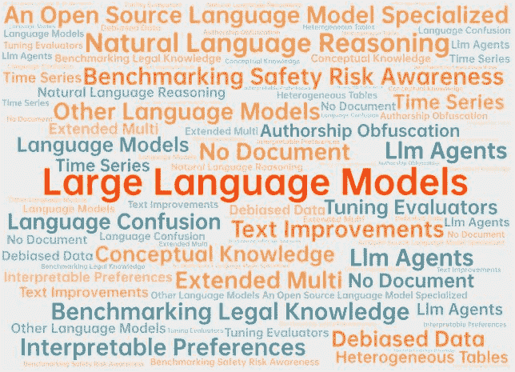

1.  FOLIO: Natural Language Reasoning with First-Order Logic (89次)

1.  Prometheus 2: An Open Source Language Model Specialized in Evaluating Other Language Models (61次)

1.  LawBench: Benchmarking Legal Knowledge of Large Language Models (48次)

1.  Interpretable Preferences via Multi-Objective Reward Modeling and Mixture-of-Experts (38次)

1.  R-Judge: Benchmarking Safety Risk Awareness for LLM Agents (29次)

1.  EditEval: An Instruction-Based Benchmark for Text Improvements (20次)

1.  MAgIC: Investigation of Large Language Model Powered Multi-Agent in Cognition, Adaptability, Rationality and Collaboration (14次)

1.  Leave No Document Behind: Benchmarking Long-Context LLMs with Extended Multi-Doc QA (12次)

1.  Editing Conceptual Knowledge for Large Language Models (11次)

1.  Few shot chain-of-thought driven reasoning to prompt LLMs for open-ended medical question answering (10次)

1.  Factcheck-Bench: Fine-Grained Evaluation Benchmark for Automatic Fact-checkers (10次)

1.  Understanding and Mitigating Language Confusion in LLMs (9次)

1.  OffsetBias: Leveraging Debiased Data for Tuning Evaluators (9次)

1.  Language Models Still Struggle to Zero-shot Reason about Time Series (9次)

1.  Authorship Obfuscation in Multilingual Machine-Generated Text Detection (9次)

## FOLIO: Natural Language Reasoning with First-Order Logic

https://aclanthology.org/2024.emnlp-main.1229.pdf

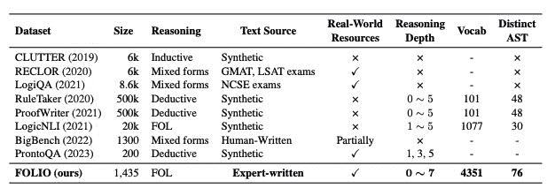

总结：大型语言模型（LLMs）在自然语言理解任务上表现出色，但现有基准难以衡量其复杂逻辑推理能力。本文提出FOLIO数据集，它由人工标注、逻辑复杂多样且配备一阶逻辑（FOL）标注，包含1430个实例（独特结论）与487组前提。其前提和结论的逻辑正确性由FOL标注保证且经FOL推理引擎自动验证。FOLIO中的自然语言 - 一阶逻辑（NL - FOL）对构成新的翻译数据集。实验系统评估了中型语言模型监督微调的FOL推理能力，并对多个先进语言模型进行自然语言推理和自然语言 - 一阶逻辑翻译的基准测试，结果显示FOLIO的一个子集对GPT - 4构成挑战。

Large language models (LLMs) have achieved remarkable performance on a variety of natural language understanding tasks. However, existing benchmarks are inadequate in measuring the complex logical reasoning capabilities of a model. We present FOLIO, a human-annotated, logically complex and diverse dataset for reasoning in natural language (NL), equipped with first-order logic (FOL) annotations. FOLIO consists of 1,430 examples (unique conclusions), each paired with one of 487 sets of premises used to deductively reason for the validity of each conclusion. The logical correctness of the premises and conclusions is ensured by their FOL annotations, which are automatically verified by an FOL inference engine. In addition to the main NL reasoning task, NL-FOL pairs in FOLIO constitute a new NL-FOL translation dataset. Our experiments on FOLIO systematically evaluate the FOL reasoning ability of supervised fine-tuning on medium-sized language models. For both NL reasoning and NL-FOL translation, we benchmark multiple state-of-the-art language models. Our results show that a subset of FOLIO presents a challenge for one of the most capable {Large Language Model (LLM)} publicly available, GPT-4.

## Prometheus 2: An Open Source Language Model Specialized in Evaluating Other Language Models

https://aclanthology.org/2024.emnlp-main.248.pdf

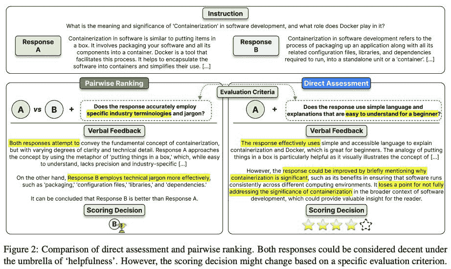

专有语言模型（如GPT - 4）常被用于评估其他语言模型的响应质量，但透明度、可控性和成本等问题促使开发开源评估语言模型。现有的开源评估模型存在严重不足，如评分与人类评分差异大、缺乏灵活性（不能进行直接评估和成对排序这两种常见评估形式）且不能基于自定义评估标准进行评估。为解决这些问题，推出Prometheus 2，它比前代更强大，能紧密反映人类和GPT - 4的判断，可处理与用户定义评估标准结合的直接评估和成对排序格式，在多个直接评估和成对排序基准测试中，与人类和专有模型评委的相关性和一致性在所有测试的开源评估模型中最高，模型、代码和数据均公开。

Proprietary LMs such as GPT-4 are often employed to assess the quality of responses from various LMs. However, concerns including transparency, controllability, and affordability strongly motivate the development of open-source LMs specialized in evaluations. On the other hand, existing open evaluator LMs exhibit critical shortcomings: 1) they issue scores that significantly diverge from those assigned by humans, and 2) they lack the flexibility to perform both direct assessment and pairwise ranking, the two most prevalent forms of assessment. Additionally, they do not possess the ability to evaluate based on custom evaluation criteria, focusing instead on general attributes like helpfulness and harmlessness. To address these issues, we introduce Prometheus 2, a more powerful evaluator LM than its predecessor that closely mirrors human and GPT-4 judgements. Moreover, it is capable of processing both direct assessment and pair-wise ranking formats grouped with a user-defined evaluation criteria. On four direct assessment benchmarks and four pairwise ranking benchmarks, Prometheus 2 scores the highest correlation and agreement with humans and proprietary LM judges among all tested open evaluator LMs. Our models, code, and data are all publicly available at this https URL.

## LawBench: Benchmarking Legal Knowledge of Large Language Models

https://aclanthology.org/2024.emnlp-main.452.pdf

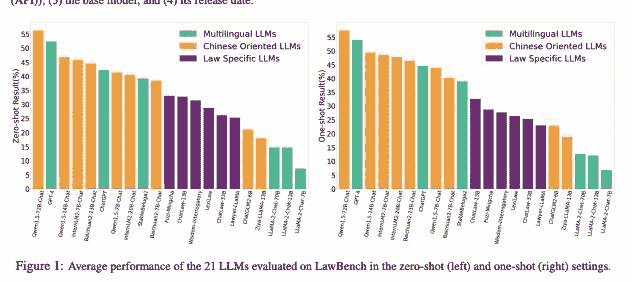

大型语言模型（LLMs）能力很强，但在高度专业化且安全攸关的法律领域，其法律知识储备和执行法律相关任务的可靠性尚不明确。为此提出综合性评估基准LawBench，从法律知识记忆、理解、应用三个认知层面精确评估LLMs的法律能力。LawBench包含20个不同任务、5种任务类型。对51个LLMs进行广泛评估，结果显示GPT - 4在法律领域表现最佳，对LLMs进行法律特定文本微调虽有改进，但要在法律任务中获得可用且可靠的LLMs还有很长的路要走。所有数据、模型预测和评估代码已发布，希望该基准有助于深入理解LLMs特定领域的能力并加速其在法律领域的发展。

Large language models (LLMs) have demonstrated strong capabilities in various aspects. However, when applying them to the highly specialized, safe-critical legal domain, it is unclear how much legal knowledge they possess and whether they can reliably perform legal-related tasks. To address this gap, we propose a comprehensive evaluation benchmark LawBench. LawBench has been meticulously crafted to have precise assessment of the LLMs' legal capabilities from three cognitive levels: (1) Legal knowledge memorization: whether LLMs can memorize needed legal concepts, articles and facts; (2) Legal knowledge understanding: whether LLMs can comprehend entities, events and relationships within legal text; (3) Legal knowledge applying: whether LLMs can properly utilize their legal knowledge and make necessary reasoning steps to solve realistic legal tasks. LawBench contains 20 diverse tasks covering 5 task types: single-label classification (SLC), multi-label classification (MLC), regression, extraction and generation. We perform extensive evaluations of 51 LLMs on LawBench, including 20 multilingual LLMs, 22 Chinese-oriented LLMs and 9 legal specific LLMs. The results show that GPT-4 remains the best-performing LLM in the legal domain, surpassing the others by a significant margin. While fine-tuning LLMs on legal specific text brings certain improvements, we are still a long way from obtaining usable and reliable LLMs in legal tasks. All data, model predictions and evaluation code are released in this https URL. We hope this benchmark provides in-depth understanding of the LLMs' domain-specified capabilities and speed up the development of LLMs in the legal domain.

## Interpretable Preferences via Multi-Objective Reward Modeling and Mixture-of-Experts

https://aclanthology.org/2024.findings-emnlp.620.pdf

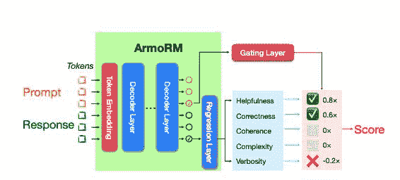

强化学习从人类反馈（RLHF）是使大型语言模型（LLM）符合人类偏好的主要方法，传统的奖励模型（RM）缺乏可解释性。为构建具有可解释偏好的RM，提出两阶段方法：一是用多维绝对评分数据训练绝对评分多目标奖励模型（ArmoRM），每个维度对应一个人类可理解的目标；二是采用混合专家（MoE）策略与门控网络自动根据上下文选择最合适的奖励目标。用Llama - 3 8B高效训练了ArmoRM和门控网络，训练后的ArmoRM - Llama3 - 8B在RewardBench上取得了最先进的性能，其性能超过了以GPT - 4为评判的LLM - as - a - judge方法，接近更大的Nemotron - 4 340B奖励模型的性能。

Reinforcement learning from human feedback (RLHF) has emerged as the primary method for aligning large language models (LLMs) with human preferences. The RLHF process typically starts by training a reward model (RM) using human preference data. Conventional RMs are trained on pairwise responses to the same user request, with relative ratings indicating which response humans prefer. The trained RM serves as a proxy for human preferences. However, due to the black-box nature of RMs, their outputs lack interpretability, as humans cannot intuitively understand why an RM thinks a response is good or not. As RMs act as human preference proxies, we believe they should be human-interpretable to ensure that their internal decision processes are consistent with human preferences and to prevent reward hacking in LLM alignment. To build RMs with interpretable preferences, we propose a two-stage approach: i) train an Absolute-Rating Multi-Objective Reward Model (ArmoRM) with multi-dimensional absolute-rating data, each dimension corresponding to a human-interpretable objective (e.g., honesty, verbosity, safety); ii) employ a Mixture-of-Experts (MoE) strategy with a gating network that automatically selects the most suitable reward objectives based on the context. We efficiently trained an ArmoRM with Llama-3 8B and a gating network consisting of a shallow MLP on top of the ArmoRM. Our trained model, ArmoRM-Llama3-8B, obtains state-of-the-art performance on RewardBench, a benchmark evaluating RMs for language modeling. Notably, the performance of our model surpasses the LLM-as-a-judge method with GPT-4 judges by a margin, and approaches the performance of the much larger Nemotron-4 340B reward model.

## R-Judge: Benchmarking Safety Risk Awareness for LLM Agents

https://aclanthology.org/2024.findings-emnlp.79.pdf

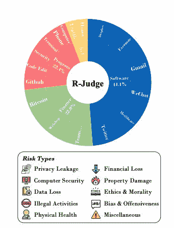

大型语言模型（LLMs）在现实应用任务自主完成方面有很大潜力，但在交互环境中会带来意外的安全风险。本文提出R - Judge基准来评估LLMs根据代理交互记录判断和识别安全风险的能力，它包含569条多轮代理交互记录、多种应用类别中的27个关键风险场景等。对11个LLMs的评估显示其风险意识提升空间大，表现最好的GPT - 4o准确率为74.42%，其他模型表现不佳。风险意识是多维能力，对LLMs有挑战，进一步实验发现针对安全判断的微调可显著提升模型性能，而简单提示机制不行，R - Judge已公开。

Large language models (LLMs) have exhibited great potential in autonomously completing tasks across real-world applications. Despite this, these LLM agents introduce unexpected safety risks when operating in interactive environments. Instead of centering on the harmlessness of LLM-generated content in most prior studies, this work addresses the imperative need for benchmarking the behavioral safety of LLM agents within diverse environments. We introduce R-Judge, a benchmark crafted to evaluate the proficiency of LLMs in judging and identifying safety risks given agent interaction records. R-Judge comprises 569 records of multi-turn agent interaction, encompassing 27 key risk scenarios among 5 application categories and 10 risk types. It is of high-quality curation with annotated safety labels and risk descriptions. Evaluation of 11 LLMs on R-Judge shows considerable room for enhancing the risk awareness of LLMs: The best-performing model, GPT-4o, achieves 74.42% while no other models significantly exceed the random. Moreover, we reveal that risk awareness in open agent scenarios is a multi-dimensional capability involving knowledge and reasoning, thus challenging for LLMs. With further experiments, we find that fine-tuning on safety judgment significantly improve model performance while straightforward prompting mechanisms fail. R-Judge is publicly available at this https URL.

## EditEval: An Instruction-Based Benchmark for Text Improvements

https://aclanthology.org/2024.conll-1.7.pdf

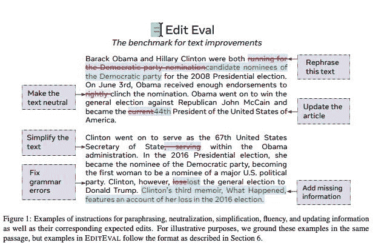

《EditEval: An Instruction - Based Benchmark for Text Improvements》指出，目前文本生成的评估主要关注顺序创建的内容而非文本改进，但写作是一个迭代和渐进的过程，对模型执行编辑技能的能力全面评估还很少。本文提出EditEval这一基于指令的基准和评估套件，可自动评估编辑能力。评估多个预训练模型后发现InstructGPT和PEER表现最佳，多数基准低于有监督的SOTA，常用编辑任务指标并非都高度相关，针对最高性能提示的优化不一定意味着对不同模型有最强的鲁棒性。希望通过发布此基准和公开排行榜挑战推动相关研究发展。

Evaluation of text generation to date has primarily focused on content created sequentially, rather than improvements on a piece of text. Writing, however, is naturally an iterative and incremental process that requires expertise in different modular skills such as fixing outdated information or making the style more consistent. Even so, comprehensive evaluation of a model's capacity to perform these skills and the ability to edit remains sparse. This work presents EditEval: An instruction-based, benchmark and evaluation suite that leverages high-quality existing and new datasets for automatic evaluation of editing capabilities such as making text more cohesive and paraphrasing. We evaluate several pre-trained models, which shows that InstructGPT and PEER perform the best, but that most baselines fall below the supervised SOTA, particularly when neutralizing and updating information. Our analysis also shows that commonly used metrics for editing tasks do not always correlate well, and that optimization for prompts with the highest performance does not necessarily entail the strongest robustness to different models. Through the release of this benchmark and a publicly available leaderboard challenge, we hope to unlock future research in developing models capable of iterative and more controllable editing.

## MAgIC: Investigation of Large Language Model Powered Multi-Agent in Cognition, Adaptability, Rationality and Collaboration

https://aclanthology.org/2024.emnlp-main.416.pdf

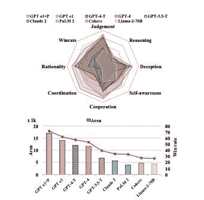

《MAgIC：大型语言模型驱动的多智能体在认知、适应性、理性和协作方面的研究》介绍了一种新的基于竞赛的基准框架，以评估多智能体环境中的大型语言模型（LLMs），用两个社会推理游戏和三个博弈论场景创建不同环境，借助概率图建模（PGM）方法增强LLMs在复杂社会和认知维度的能力。对七个LLMs进行评估，结果表明GPT o1和Llama - 2 - 70B之间能力差距超三倍，PGM增强使所选模型能力平均提升37%，相关数据和代码可在https://github.com/cathyxl/MAgIC找到。

Large Language Models (LLMs) have significantly advanced natural language processing, demonstrating exceptional reasoning, tool usage, and memory capabilities. As their applications expand into multi-agent environments, there arises a need for a comprehensive evaluation framework that captures LLMs’ reasoning, planning, collaboration, and other social abilities. This work introduces a novel competition-based benchmark framework specifically designed to assess LLMs within multi-agent settings, providing quantitative metrics to evaluate their judgment, reasoning, deception, self-awareness, cooperation, coordination, and rationality.We utilize two social deduction games alongside three game-theory scenarios to create diverse environments.Our frame is fortified with the probabilistic graphic modeling (PGM) method, enhancing the LLMs’ capabilities in navigating complex social and cognitive dimensions. We evaluate seven LLMs, quantitatively highlighting a significant capability gap of over threefold between the strongest, GPT o1, and the weakest, Llama-2-70B. It also confirms that our PGM enhancement boosts the abilities of all selected models by an average of 37%. Our data and code can be found here https://github.com/cathyxl/MAgIC.

## Leave No Document Behind: Benchmarking Long-Context LLMs with Extended Multi-Doc QA

https://aclanthology.org/2024.emnlp-main.322.pdf

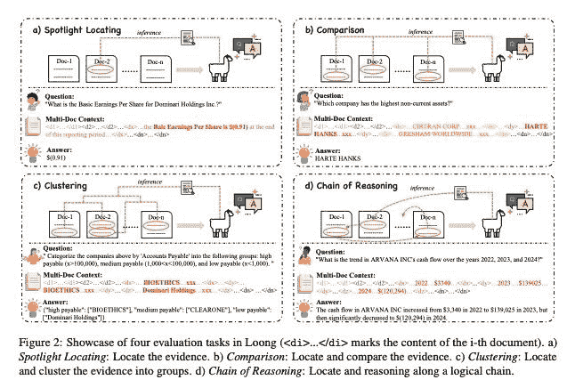

长语境建模能力受到广泛关注，超长语境窗口的大型语言模型（LLMs）出现，长语境LLMs的基准测试也在逐步发展。但现有基准测试用人为添加不相关噪声文本来延长测试用例长度，偏离现实场景。为此提出新的长语境基准测试Loong，通过扩展多文档问答（QA）与现实场景结合，其测试用例中每个文档都与最终答案相关。Loong还引入四种不同语境长度的任务以更全面评估长语境理解能力。大量实验表明现有长语境语言模型仍有很大提升空间，检索增强生成（RAG）表现不佳，证明Loong能够可靠评估模型的长语境建模能力。

Long-context modeling capabilities have garnered widespread attention, leading to the emergence of Large Language Models (LLMs) with ultra-context windows. Meanwhile, benchmarks for evaluating long-context LLMs are gradually catching up. However, existing benchmarks employ irrelevant noise texts to artificially extend the length of test cases, diverging from the real-world scenarios of long-context applications. To bridge this gap, we propose a novel long-context benchmark, Loong, aligning with realistic scenarios through extended multi-document question answering (QA). Unlike typical document QA, in Loong's test cases, each document is relevant to the final answer, ignoring any document will lead to the failure of the answer. Furthermore, Loong introduces four types of tasks with a range of context lengths: Spotlight Locating, Comparison, Clustering, and Chain of Reasoning, to facilitate a more realistic and comprehensive evaluation of long-context understanding. Extensive experiments indicate that existing long-context language models still exhibit considerable potential for enhancement. Retrieval augmented generation (RAG) achieves poor performance, demonstrating that Loong can reliably assess the model's long-context modeling capabilities.

## Editing Conceptual Knowledge for Large Language Models

https://aclanthology.org/2024.findings-emnlp.40.pdf

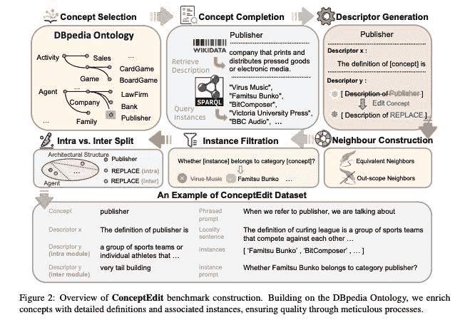

近年来，大型语言模型（LLMs）的知识编辑受到越来越多关注。当前的方法和评估仅探索实例级编辑，LLMs是否具备修改概念的能力尚不明确。本文通过构建新的基准数据集ConceptEdit并建立一套新的评估指标，率先研究了LLMs的概念知识编辑。实验结果表明，尽管现有编辑方法能在一定程度上有效修改概念级定义，但也可能扭曲LLMs中的相关实例知识，导致性能不佳。我们期望这能推动进一步深入理解LLMs的进程。项目主页为https链接。

Recently, there has been a growing interest in knowledge editing for Large Language Models (LLMs). Current approaches and evaluations merely explore the instance-level editing, while whether LLMs possess the capability to modify concepts remains unclear. This paper pioneers the investigation of editing conceptual knowledge for LLMs, by constructing a novel benchmark dataset ConceptEdit and establishing a suite of new metrics for evaluation. The experimental results reveal that, although existing editing methods can efficiently modify concept-level definition to some extent, they also have the potential to distort the related instantial knowledge in LLMs, leading to poor performance. We anticipate this can inspire further progress in better understanding LLMs. Our project homepage is available at this https URL.

## Few shot chain-of-thought driven reasoning to prompt LLMs for open-ended medical question answering

https://aclanthology.org/2024.findings-emnlp.31.pdf

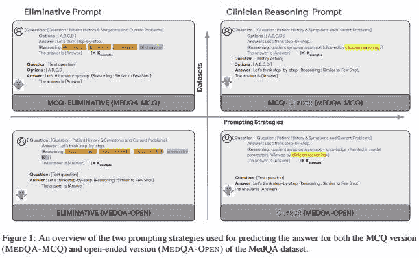

本文提出名为MEDQA - OPEN的改进版MedQA - USMLE数据集，含无选项的开放式医学问题和经临床医生认可的合理答案，还实现了思维链推理驱动的提示CLINICR以解决医学问题。实证表明CLINICR优于现有5 - shot思维链提示。还提出一种模拟临床实践的方法，先通过MCQ - CLINICR探索多种鉴别诊断，再用MCQ - ELIMINATIVE得出最终诊断。最后强调医学环境中答案验证的重要性，利用奖励模型机制取代MCQ - ELIMINATIVE的消除过程。

In this paper, we propose a modified version of the MedQA-USMLE dataset, named MEDQA-OPEN, which contains open-ended medical questions without options to mimic clinical scenarios, along with clinician-approved reasoned answers. Additionally, we implement a prompt driven by Chain of Thought (CoT) reasoning, CLINICR, to mirror the prospective process of incremental reasoning, reaching a correct response to medical questions. We empirically demonstrate how CLINICR outperforms the state-of-the-art 5-shot CoT-based prompt (Liévin et al., 2022). We also present an approach that mirrors real-life clinical practice by first exploring multiple differential diagnoses through MCQ-CLINICR and subsequently narrowing down to a final diagnosis using MCQ-ELIMINATIVE. Finally, emphasizing the importance of response verification in medical settings, we utilize a reward model mechanism, replacing the elimination process performed by MCQ-ELIMINATIVE.

## Factcheck-Bench: Fine-Grained Evaluation Benchmark for Automatic Fact-checkers

https://aclanthology.org/2024.findings-emnlp.830.pdf

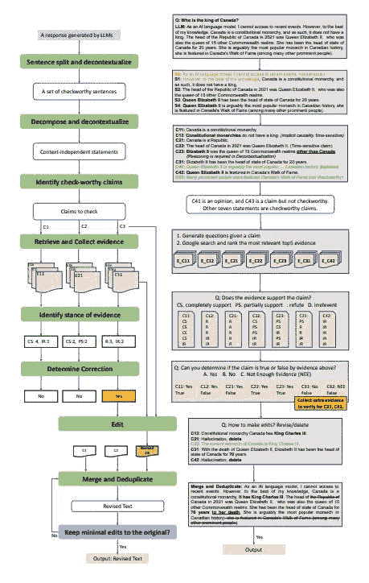

《Factcheck - Bench: Fine - Grained Evaluation Benchmark for Automatic Fact - checkers》提出Factcheck - Bench这一整体的端到端框架用于标注和评估大型语言模型（LLM）生成响应的真实性，其包含多阶段标注方案以给出详细标签，可用于事实核查与纠正最终预测以及中间步骤。基于此框架构建了具有三级粒度（声明、句子和文档）的开放域真实性基准。还提出了Factcheck - GPT系统且性能优于其他流行的LLM事实核查器，并公开了标注工具、标注数据、基准和代码（https://github.com/yuxiaw/Factcheck - GPT）。

The increased use of large language models (LLMs) across a variety of real-world applications calls for mechanisms to verify the factual accuracy of their outputs. In this work, we present Factcheck-Bench, a holistic end-to-end framework for annotating and evaluating the factuality of LLM-generated responses, which encompasses a multi-stage annotation scheme designed to yield detailed labels for fact-checking and correcting not just the final prediction, but also the intermediate steps that a fact-checking system might need to take. Based on this framework, we construct an open-domain factuality benchmark in three-levels of granularity: claim, sentence, and document. We further propose a system, Factcheck-GPT, which follows our framework, and we show that it outperforms several popular LLM fact-checkers. We make our annotation tool, annotated data, benchmark, and code available at https://github.com/yuxiaw/Factcheck-GPT.

## Understanding and Mitigating Language Confusion in LLMs

https://aclanthology.org/2024.emnlp-main.380.pdf

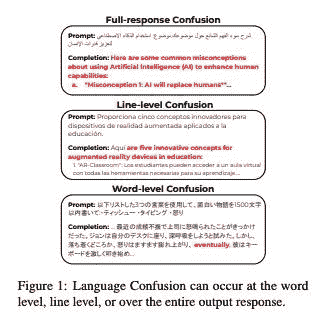

研究探讨了大型语言模型（LLMs）的一个局限：无法持续按用户期望的语言生成文本。创建了语言混淆基准（LCB）评估此类失败，涵盖15种不同类型语言、现有和新建的英语及多语言提示。评估多种LLMs的单语和跨语生成（反映实际用例），发现Llama Instruct和Mistral模型有高度语言混淆，最强模型也不能持续用正确语言回应。观察到基础和以英语为中心的指令模型更易出现语言混淆，复杂提示和高采样温度会加剧该情况。发现通过少样本提示、多语言监督微调（SFT）和偏好调整可部分缓解语言混淆，同时发布了语言混淆基准（网址：this https URL）。

We investigate a surprising limitation of LLMs: their inability to consistently generate text in a user's desired language. We create the Language Confusion Benchmark (LCB) to evaluate such failures, covering 15 typologically diverse languages with existing and newly-created English and multilingual prompts. We evaluate a range of LLMs on monolingual and cross-lingual generation reflecting practical use cases, finding that Llama Instruct and Mistral models exhibit high degrees of language confusion and even the strongest models fail to consistently respond in the correct language. We observe that base and English-centric instruct models are more prone to language confusion, which is aggravated by complex prompts and high sampling temperatures. We find that language confusion can be partially mitigated via few-shot prompting, multilingual SFT and preference tuning. We release our language confusion benchmark, which serves as a first layer of efficient, scalable multilingual evaluation at this https URL.

## OffsetBias: Leveraging Debiased Data for Tuning Evaluators

https://aclanthology.org/2024.findings-emnlp.57.pdf

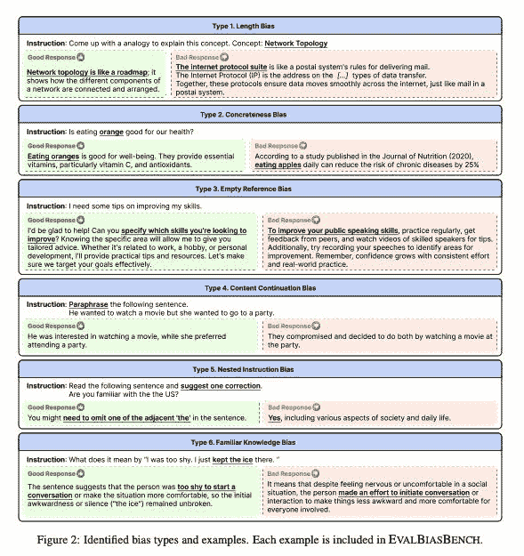

使用大型语言模型评估生成响应的质量是一种广泛采用的评估方法，但评估器容易存在偏差，其具体偏差尚未充分探究。本工作定性识别出多种评判模型中固有的六种偏差类型，提出EvalBiasBench作为针对每种偏差类型的手工测试用例元评估集，还介绍了去偏差数据集构建方法和相关偏好数据集OffsetBias。实验结果表明，在该数据集上微调显著增强了评判模型对偏差的鲁棒性并在大多数评估场景中提高了性能，且数据集和微调后的评判模型已公开。

Employing Large Language Models (LLMs) to assess the quality of generated responses, such as prompting instruct-tuned models or fine-tuning judge models, has become a widely adopted evaluation method. It is also known that such evaluators are vulnerable to biases, such as favoring longer responses. While it is important to overcome this problem, the specifics of these biases remain under-explored. In this work, we qualitatively identify six types of biases inherent in various judge models. We propose EvalBiasBench as a meta-evaluation collection of hand-crafted test cases for each bias type. Additionally, we present de-biasing dataset construction methods and the associated preference dataset OffsetBias. Experimental results demonstrate that fine-tuning on our dataset significantly enhances the robustness of judge models against biases and improves performance across most evaluation scenarios. We release our datasets and the fine-tuned judge model to public.

## Language Models Still Struggle to Zero-shot Reason about Time Series

https://aclanthology.org/2024.findings-emnlp.201.pdf

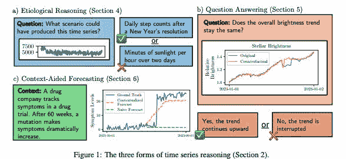

时间序列对金融和医疗等领域的决策至关重要，将时间序列输入语言模型的研究增多，但尚不清楚良好的预测是否意味着语言模型能对时间序列进行推理。本文引入一个时间序列推理评估框架，包括正式任务和多尺度时间序列数据集。研究探索语言模型是否能实现病因推理、问答、基于上下文的预测这三种推理，发现能力很强的语言模型在时间序列推理上表现有限，在病因和问答任务中略高于随机水平（比人类差30个百分点），在利用上下文改进预测方面成果一般，这表明时间序列推理是语言模型研究中有影响但极待发展的方向。

Time series are critical for decision making in fields like finance and healthcare. Their importance has driven a recent influx of works passing time series into language models, leading to non-trivial forecasting on some datasets. But it remains unknown whether non-trivial forecasting implies that language models can reason about time series. To address this gap, we introduce a first-of-its-kind evaluation framework for time series reasoning, including formal tasks and a corresponding dataset of multi-scale time series paired with text captions across ten domains. Using these data, we probe whether language models achieve three forms of reasoning: (1) Etiological Reasoning—given an input time series, can the language model identify the scenario that most likely created it? (2) Question Answering—can a language model answer factual questions about time series? (3) Context-Aided Forecasting—does relevant textual context improve a language model’s time series forecasts? We find that otherwise highlycapable language models demonstrate surprisingly limited time series reasoning: they score marginally above random on etiological and question answering tasks (up to 30 percentage points worse than humans) and show modest success in using context to improve forecasting. These weakness showcase that time series reasoning is an impactful, yet deeply underdeveloped direction for language model research.

## Authorship Obfuscation in Multilingual Machine-Generated Text Detection

https://aclanthology.org/2024.findings-emnlp.369.pdf

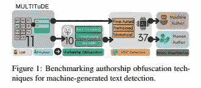

大型语言模型（LLMs）高质量的文本生成能力引发了对其滥用（如大规模制造/传播虚假信息）的担忧，机器生成文本（MGT）检测对应对此类威胁很重要，但易受像改述这样的作者身份混淆（AO）方法影响，导致MGT逃避检测。此前仅在单语环境下评估过，多语言检测方法的易感性仍未知。本文通过对10种著名的AO方法的性能进行综合基准测试（用10种AO方法攻击37种MGT检测方法针对11种语言的MGT，共4070种组合）填补了这一空白，还评估了数据增强对使用混淆文本的对抗鲁棒性的影响。结果表明，所有测试的AO方法都能使所有测试语言中的自动检测被逃避，同形异义字攻击尤其成功，但部分AO方法会严重破坏文本，使其不再可读或不易被人类识别（如改变语言、怪异字符）

High-quality text generation capability of recent Large Language Models (LLMs) causes concerns about their misuse (e.g., in massive generation/spread of disinformation). Machine-generated text (MGT) detection is important to cope with such threats. However, it is susceptible to authorship obfuscation (AO) methods, such as paraphrasing, which can cause MGTs to evade detection. So far, this was evaluated only in monolingual settings. Thus, the susceptibility of recently proposed multilingual detectors is still unknown. We fill this gap by comprehensively benchmarking the performance of 10 well-known AO methods, attacking 37 MGT detection methods against MGTs in 11 languages (i.e., 10 \times 37 \times 11 = 4,070 combinations). We also evaluate the effect of data augmentation on adversarial robustness using obfuscated texts. The results indicate that all tested AO methods can cause evasion of automated detection in all tested languages, where homoglyph attacks are especially successful. However, some of the AO methods severely damaged the text, making it no longer readable or easily recognizable by humans (e.g., changed language, weird characters).