# 复杂推理 Top15 被引盘点

> 来源：[https://v11enp9ok1h.feishu.cn/docx/TtBsd5koioXDzbx7RRBcImc5nih](https://v11enp9ok1h.feishu.cn/docx/TtBsd5koioXDzbx7RRBcImc5nih)

本文精选了 [EMNLP 2024 论文集](https://aclanthology.org/events/emnlp-2024/) 中与复杂推理相关的、被引量最高的 15 篇论文。后续我们还会继续陆续发布不同领域的 EMNLP 2024 高引盘点，在机智流👸号后台对话框回复“盘点”，加入顶会论文盘点交流群。

> 注：引用数据来自谷歌学术，数据统计截止 2024 年 11 月 13 日

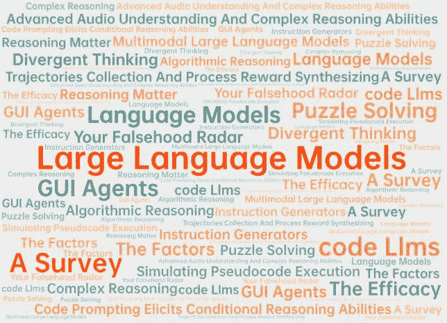

1. Encouraging Divergent Thinking in Large Language Models through Multi-Agent Debate（215 次）
2. Zero-Resource Hallucination Prevention for Large Language Models（30 次）
3. Android in the Zoo: Chain-of-Action-Thought for GUI Agents（18 次）
4. GAMA: A Large Audio-Language Model with Advanced Audio Understanding and Complex Reasoning Abilities（11 次）
5. Puzzle Solving using Reasoning of Large Language Models: A Survey（10 次）
6. Few shot chain-of-thought driven reasoning to prompt LLMs for open-ended medical question answering（10 次）
7. RAGAR, Your Falsehood Radar: RAG-Augmented Reasoning for Political Fact-Checking using Multimodal Large Language Models（10 次）
8. Learning Planning-based Reasoning by Trajectories Collection and Process Reward Synthesizing（7 次）
9. Code Prompting Elicits Conditional Reasoning Abilities in Text+Code LLMs（7 次）
10. Divide-or-Conquer? Which Part Should You Distill Your LLM?（7 次）
11. Multi-LogiEval: Towards Evaluating Multi-Step Logical Reasoning Ability of Large Language Models（5 次）
12. Language Models as Compilers: Simulating Pseudocode Execution Improves Algorithmic Reasoning in Language Models（4 次）
13. Deciphering the Factors Influencing the Efficacy of Chain-of-Thought: Probability, Memorization, and Noisy Reasoning（4 次）
14. Ada-Instruct: Adapting Instruction Generators for Complex Reasoning（4 次）
15. Making Reasoning Matter: Measuring and Improving Faithfulness of Chain-of-Thought Reasoning（3 次）

## Encouraging Divergent Thinking in Large Language Models through Multi-Agent Debate

`https://aclanthology.org/2024.emnlp-main.992.pdf`

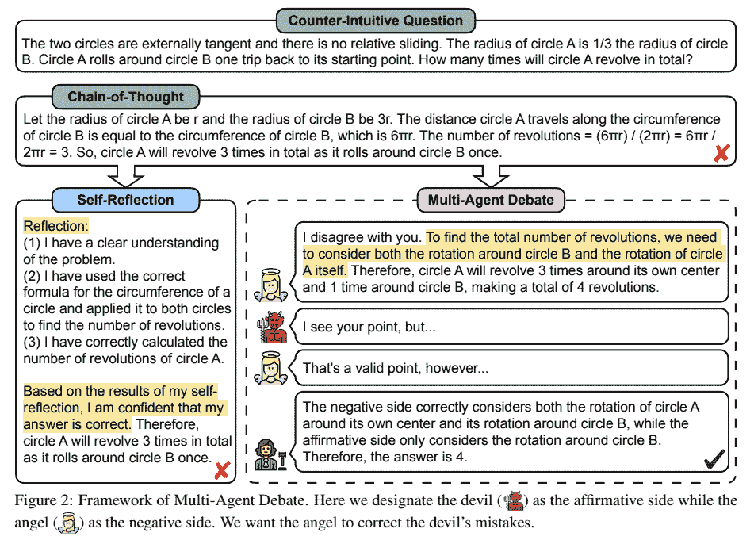

现代大型语言模型（LLMs）如 ChatGPT 在一般语言任务上表现出色，但在复杂推理任务上仍存在困难，这推动了对 LLMs 认知行为的研究以探索类人解题策略。自我反思是一种代表性策略，但存在思维退化（DoT）问题，即一旦 LLM 对其解决方案建立信心，即使初始立场错误，后续也无法通过反思产生新想法。为解决该问题，提出多智能体辩论（MAD）框架，多个智能体“针锋相对”地表达论点，由裁判管理辩论过程以获得最终解决方案，该框架鼓励 LLMs 的发散性思维，有助于需要深度思考的任务。在两个具有挑战性的数据集上的实验结果证明了 MAD 框架的有效性，分析表明 MAD 要取得良好性能需要自适应地中断辩论和适度的“针锋相对”状态，还发现若智能体使用不同 LLM，LLM 可能不是公平的裁判，代码可在指定网址获取。

Modern large language models (LLMs) like ChatGPT have shown remarkable performance on general language tasks but still struggle on complex reasoning tasks, which drives the research on cognitive behaviors of LLMs to explore human-like problem-solving strategies. Along this direction, one representative strategy is self-reflection, which asks an LLM to refine the solution with the feedback generated by itself iteratively. However, our study shows that such reflection-style methods suffer from the Degeneration-of-Thought (DoT) problem: once the LLM has established confidence in its solutions, it is unable to generate novel thoughts later through reflection even if its initial stance is incorrect. To address the DoT problem, we propose a Multi-Agent Debate (MAD) framework, in which multiple agents express their arguments in the state of "tit for tat" and a judge manages the debate process to obtain a final solution. Clearly, our MAD framework encourages divergent in case of unfamiliar concepts. This approach emulates the human ability to refrain from responding to unfamiliar topics, thus reducing hallucinations. We validate SELF-FAMILIARITY across four different large language models, demonstrating consistently superior performance compared to existing techniques. Our findings propose a significant shift towards preemptive strategies for hallucination mitigation in LLM assistants, promising improvements in reliability, applicability, and interpretability.

## Android in the Zoo: Chain-of-Action-Thought for GUI Agents

`https://aclanthology.org/2024.findings-emnlp.702.pdf`

大语言模型（LLM）促使智能手机的自主图形用户界面（GUI）智能体大量涌现，它通过预测应用程序接口（API）的一系列操作来完成由自然语言触发的任务。但现有研究很少考虑中间屏幕截图和屏幕操作所承载的语义信息。为此，本文提出了动作思维链（CoAT），它涵盖对先前操作、当前屏幕的描述，更重要的是关于应执行哪些操作的动作思维以及所选操作带来的结果。实验表明，在三个现成的大语言模型（LMMs）上进行零样本设置时，与之前提出的语境建模相比，CoAT 显著提高了操作预测能力。此外，为推动相关研究，构建了一个名为 Android-In-The-Zoo（AitZ）的数据集，其中包含 18643 个屏幕 - 操作对以及动作思维链注释，在该数据集上对 1B 模型（即 AUTO-UI-base）进行微调可实现与 CogAgent-Chat-18B 相当的性能。

Large language model (LLM) leads to a surge of autonomous GUI agents for smartphone, which completes a task triggered by natural language through predicting a sequence of actions of API. Even though the task highly relies on past actions and visual observations, existing studies typically consider little semantic information carried out by intermediate screenshots and screen operations. To address this, this work presents Chain-of-Action-Thought (dubbed CoAT), which takes the description of the previous actions, the current screen, and more importantly the action thinking of what actions should be performed and the outcomes led by the chosen action. We demonstrate that, in a zero-shot setting upon three off-the-shelf LMMs, CoAT significantly improves the action prediction compared to previous proposed context modeling. To further facilitate the research in this line, we construct a dataset Android-In-The-Zoo (AitZ), which contains 18,643 screen-action pairs together with chain-of-action-thought annotations. Experiments show that fine-tuning a 1B model (i.e. AUTO-UI-base) on our AitZ dataset achieves on-par performance with CogAgent-Chat-18B.

## GAMA: A Large Audio-Language Model with Advanced Audio Understanding and Complex Reasoning Abilities

`https://aclanthology.org/2024.emnlp-main.361.pdf`

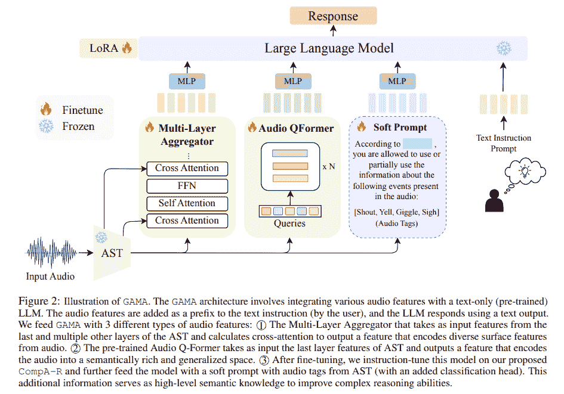

《GAMA：具有高级音频理解和复杂推理能力的大型音频 - 语言模型》。文中指出感知和理解非语音声音及非言语语音对做决策以与周围环境互动非常关键，提出了 GAMA 这一新型通用大型音频 - 语言模型（LALM），它具备高级音频理解和复杂推理能力。通过将大型语言模型（LLM）与多种音频表示集成构建 GAMA，这些音频表示包括来自定制音频 Q - 前体（Audio Q - Former）、多层聚合器（可聚合音频多层特性）的特征等。

Perceiving and understanding non-speech sounds and non-verbal speech is essential to making decisions that help us interact with our surroundings. In this paper, we propose `GAMA`, a novel General-purpose Large Audio-Language Model (`LALM`) with Advanced Audio Understanding and Complex Reasoning Abilities. We build `GAMA` by integrating an `LLM` with multiple types of audio representations, including features from a custom `Audio Q-Former`, a multi-layer aggregator that aggregates features from multiple layers of an audio encoder. We fine-tune `GAMA` on a large-scale audio-language dataset, which augments it with audio understanding capabilities. Next, we propose `CompA-R` (Instruction-Tuning for Complex Audio Reasoning), a synthetically generated instruction-tuning (`IT`) dataset with instructions that require the model to perform complex reasoning on the input audio. We instruction-tune `GAMA` with `CompA-R` to endow it with complex reasoning abilities, where we further add a soft prompt as input with high-level semantic evidence by leveraging event tags of the input audio. Finally, we also propose `CompA-R-test`, a human-labeled evaluation dataset for evaluating the capabilities of `LALM`s on open-ended audio question-answering that requires complex reasoning. Through automated and expert human evaluations, we show that `GAMA` outperforms all other `LALM`s in literature on diverse audio understanding tasks by margins of 1%-84%. Further, `GAMA` IT-ed on `CompA-R` proves to be superior in its complex reasoning and instruction following capabilities.

## Puzzle Solving using Reasoning of Large Language Models: A Survey

`https://aclanthology.org/2024.emnlp-main.646.pdf`

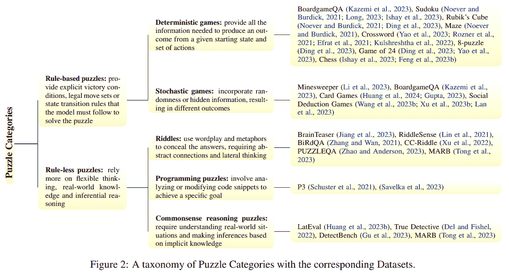

《使用大型语言模型推理解决谜题：一项调查》：探索大型语言模型（`LLMs`）在解决谜题方面的能力，能揭示其在人工智能中的潜力和挑战的关键见解，是理解其在复杂推理任务中适用性的重要一步。本调查利用独特的分类法（将谜题分为基于规则和无规则两类），通过多种方法（包括提示技术、神经符号方法和微调）对`LLMs`进行严格评估。

Exploring the capabilities of Large Language Models (`LLMs`) in puzzle solving unveils critical insights into their potential and challenges in AI, marking a significant step towards understanding their applicability in complex reasoning tasks. This survey leverages a unique taxonomy -- dividing puzzles into rule-based and rule-less categories -- to critically assess `LLMs` through various methodologies, including prompting techniques, neuro-symbolic approaches, and fine-tuning. Through a critical review of relevant datasets and benchmarks, we assess `LLMs`' performance, identifying significant challenges in complex puzzle scenarios. Our findings highlight the disparity between `LLM` capabilities and human-like reasoning, particularly in those requiring advanced logical inference. The survey underscores the necessity for novel strategies and richer datasets to advance `LLMs`' puzzle-solving proficiency and contribute to AI's logical reasoning and creative problem-solving advancements.

## Few shot chain-of-thought driven reasoning to prompt LLMs for open-ended medical question answering

`https://aclanthology.org/2024.findings-emnlp.31.pdf`

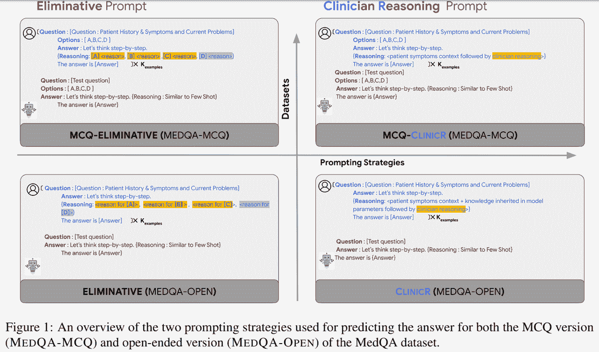

本文提出名为`MEDQA - OPEN`的改进版`MedQA - USMLE`数据集，含无选项的开放式医学问题和经临床医生认可的合理答案，还实现了思维链推理驱动的提示`CLINICR`以解决医学问题。实证表明`CLINICR`优于现有5 - shot思维链提示。还提出一种模拟临床实践的方法，先通过`MCQ - CLINICR`探索多种鉴别诊断，再用`MCQ - ELIMINATIVE`得出最终诊断。最后强调医学环境中答案验证的重要性，利用奖励模型机制取代`MCQ - ELIMINATIVE`的消除过程。

In this paper, we propose a modified version of the MedQA-USMLE dataset, named `MEDQA-OPEN`, which contains open-ended medical questions without options to mimic clinical scenarios, along with clinician-approved reasoned answers. Additionally, we implement a prompt driven by Chain of Thought (`CoT`) reasoning, `CLINICR`, to mirror the prospective process of incremental reasoning, reaching a correct response to medical questions. We empirically demonstrate how `CLINICR` outperforms the state-of-the-art 5-shot `CoT`-based prompt (Liévin et al., 2022). We also present an approach that mirrors real-life clinical practice by first exploring multiple differential diagnoses through `MCQ-CLINICR` and subsequently narrowing down to a final diagnosis using `MCQ-ELIMINATIVE`. Finally, emphasizing the importance of response verification in medical settings, we utilize a reward model mechanism, replacing the elimination process performed by `MCQ-ELIMINATIVE`.

## RAGAR, Your Falsehood Radar: RAG-Augmented Reasoning for Political Fact-Checking using Multimodal Large Language Models

`https://aclanthology.org/2024.fever-1.29.pdf`

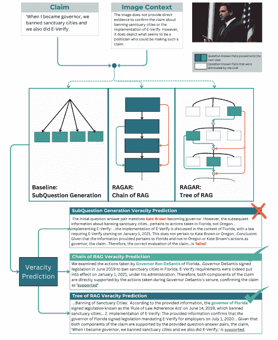

随着政治话语中错误信息的挑战不断升级，多模态声明场景下更需先进的事实核查方案。本文利用多模态大语言模型结合检索增强生成（`RAG`）解决该问题，引入两种推理技术（链状与树状`RAG`），它们通过提取文本和图像内容、检索外部信息并依据先验证据推理后续待答问题来核查多模态声明，加权F1分数达0.85，超基线推理技术0.14分，人类评估也表明多数生成的事实核查解释包含了金标准数据中的所有信息。

The escalating challenge of misinformation, particularly in political discourse, requires advanced fact-checking solutions; this is even clearer in the more complex scenario of multimodal claims. We tackle this issue using a multimodal large language model in conjunction with retrieval-augmented generation (`RAG`), and introduce two novel reasoning techniques: Chain of `RAG` (`CoRAG`) and Tree of `RAG` (`ToRAG`). They fact-check multimodal claims by extracting both textual and image content, retrieving external information, and reasoning subsequent questions to be answered based on prior evidence. We achieve a weighted F1-score of 0.85, surpassing a baseline reasoning technique by 0.14 points. Human evaluation confirms that the vast majority of our generated fact-check explanations contain all information from gold standard data.

## Learning Planning-based Reasoning by Trajectories Collection and Process Reward Synthesizing

`https://aclanthology.org/2024.emnlp-main.20.pdf`

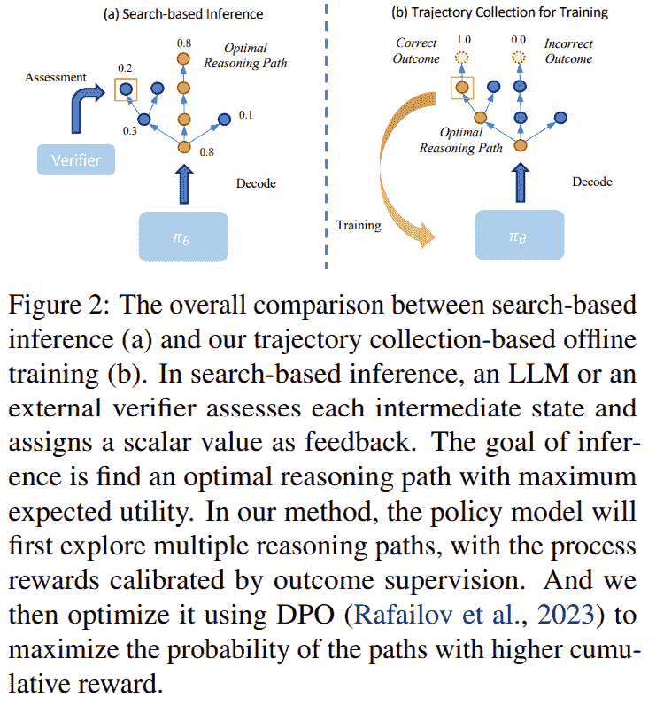

大型语言模型（`LLMs`）通过逐步生成推理过程在处理复杂推理任务方面有很大潜力，但存在推理过程中的幻觉和缺陷等问题。目前有将推理建模为规划或专注于过程监督注释等改进方式，但规划式搜索过程因频繁评估中间推理状态和广阔探索空间而导致高延迟，人类注释监督推理过程成本高且难以用于`LLM`训练。本文提出一个框架，通过对收集的轨迹进行直接偏好优化（`DPO`）学习基于规划的推理（轨迹根据合成的过程奖励排名），在具有挑战性的逻辑推理基准上的结果证明了该学习框架的有效性，其7B模型可超过`GPT-3.5-Turbo`等强大对手。

Large Language Models (`LLMs`) have demonstrated significant potential in handling complex reasoning tasks through step-by-step rationale generation. However, recent studies have raised concerns regarding the hallucination and flaws in their reasoning process. Substantial efforts are being made to improve the reliability and faithfulness of the generated rationales. Some approaches model reasoning as planning, while others focus on annotating for process supervision. Nevertheless, the planning-based search process often results in high latency due to the frequent assessment of intermediate reasoning states and the extensive exploration space. Additionally, supervising the reasoning process with human annotation is costly and challenging to scale for `LLM` training. To address these issues, in this paper, we propose a framework to learn planning-based reasoning through Direct Preference Optimization (`DPO`) on collected trajectories, which are ranked according to synthesized process rewards. Our results on challenging logical reasoning benchmarks demonstrate the effectiveness of our learning framework, showing that our 7B model can surpass the strong counterparts like `GPT-3.5-Turbo`.

## Code Prompting Elicits Conditional Reasoning Abilities in Text+Code LLMs

`https://aclanthology.org/2024.emnlp-main.629.pdf`

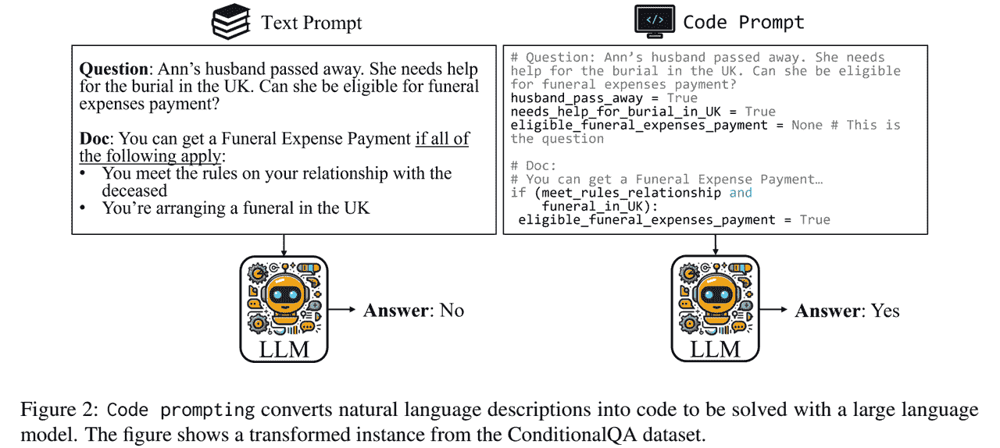

《Code Prompting Elicits Conditional Reasoning Abilities in Text+Code LLMs》指出推理是实现语言理解的基本要素，在多种推理类型中，大语言模型（`LLMs`）对条件推理（根据某些条件得出不同结论的能力）的研究较少。虽然思维链等提示方法已显著提高了`LLMs`在推理任务上的表现，但对于触发`LLMs`推理能力的因素仍知之甚少，论文假设代码提示可以触发`Text+Code LLMs`中的条件推理。

Reasoning is a fundamental component of language understanding. Recent prompting techniques, such as chain of thought, have consistently improved LLMs' performance on various reasoning tasks. Nevertheless, there is still little understanding of what triggers reasoning abilities in LLMs in the inference stage. In this paper, we introduce code prompting, a chain of prompts that transforms a natural language problem into code and directly prompts the LLM using the generated code without resorting to external code execution. We hypothesize that code prompts can elicit certain reasoning capabilities of LLMs trained on text and code and utilize the proposed method to improve conditional reasoning, the ability to infer different conclusions depending on the fulfillment of certain conditions. We find that code prompting exhibits a high-performance boost for multiple LLMs (up to 22.52 percentage points on GPT 3.5, 7.75 on Mixtral, and 16.78 on Mistral) across multiple conditional reasoning datasets. We then conduct comprehensive experiments to understand how code prompts trigger reasoning abilities and which capabilities are elicited in the underlying models. Our analysis of GPT 3.5 reveals that the code formatting of the input problem is essential for performance improvement. Furthermore, code prompts improve sample efficiency of in-context learning and facilitate state tracking of variables or entities.

## Divide-or-Conquer? Which Part Should You Distill Your LLM?

https://aclanthology.org/2024.findings-emnlp.145.pdf

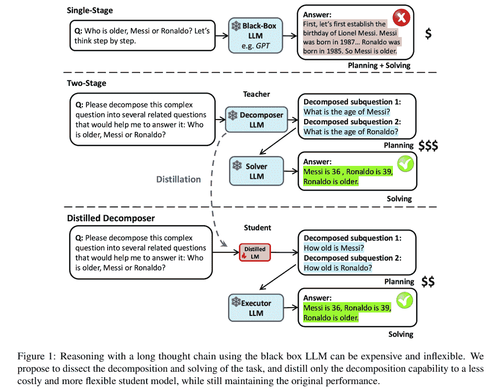

近期方法表明，大型语言模型（LLMs）在被鼓励先解决主任务的子任务时能更好地解决推理任务。本文设计了类似策略将推理任务分解为问题分解和问题解决两个阶段，该策略优于单阶段解决方案。进一步假设，与问题解决相比，分解应更容易被提炼到较小模型中，因为后者需要大量领域知识，前者只需学习通用解题策略。提出提炼这两种能力的方法并评估其对推理结果和推理成本的影响。发现可提炼问题分解阶段且在任务、数据集和模型间实现良好泛化，但在不损失性能的情况下提炼问题解决能力更困难，且提炼后的模型难以泛化。这些结果表明，将小型的、提炼后的问题分解模型与解决问题的LLMs结合，可实现高效推理和局部适应的推理。

Recent methods have demonstrated that Large Language Models (LLMs) can solve reasoning tasks better when they are encouraged to solve subtasks of the main task first. In this paper we devise a similar strategy that breaks down reasoning tasks into a problem decomposition phase and a problem solving phase and show that the strategy is able to outperform a single stage solution. Further, we hypothesize that the decomposition should be easier to distill into a smaller model compared to the problem solving because the latter requires large amounts of domain knowledge while the former only requires learning general problem solving strategies. We propose methods to distill these two capabilities and evaluate their impact on reasoning outcomes and inference cost. We find that we can distill the problem decomposition phase and at the same time achieve good generalization across tasks, datasets, and models. However, it is harder to distill the problem solving capability without losing performance and the resulting distilled model struggles with generalization. These results indicate that by using smaller, distilled problem decomposition models in combination with problem solving LLMs we can achieve reasoning with cost-efficient inference and local adaptation.

## Multi-LogiEval: Towards Evaluating Multi-Step Logical Reasoning Ability of Large Language Models

https://aclanthology.org/2024.emnlp-main.1160.pdf

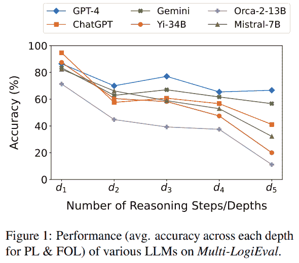

《Multi - LogiEval: Towards Evaluating Multi - Step Logical Reasoning Ability of Large Language Models》指出，随着大型语言模型（LLMs）在自然语言理解任务中表现出色，迫切需要衡量其类人多步逻辑推理能力。现有逻辑推理评估基准主要关注简单的单步或有限推理规则的多步推理，而且缺乏评估非单调推理的数据集是一个关键缺口，因为非单调推理更接近人类推理。

As Large Language Models (LLMs) continue to exhibit remarkable performance in natural language understanding tasks, there is a crucial need to measure their ability for human-like multi-step logical reasoning. Existing logical reasoning evaluation benchmarks often focus primarily on simplistic single-step or multi-step reasoning with a limited set of inference rules. Furthermore, the lack of datasets for evaluating non-monotonic reasoning represents a crucial gap since it aligns more closely with human-like reasoning. To address these limitations, we propose Multi-LogiEval, a comprehensive evaluation dataset encompassing multi-step logical reasoning with various inference rules and depths. Multi-LogiEval covers three logic types--propositional, first-order, and non-monotonic--consisting of more than 30 inference rules and more than 60 of their combinations with various depths. Leveraging this dataset, we conduct evaluations on a range of LLMs including GPT-4, ChatGPT, Gemini-Pro, Yi, Orca, and Mistral, employing a zero-shot chain-of-thought. Experimental results show that there is a significant drop in the performance of LLMs as the reasoning steps/depth increases (average accuracy of ~68% at depth-1 to ~43% at depth-5). We further conduct a thorough investigation of reasoning chains generated by LLMs which reveals several important findings. We believe that Multi-LogiEval facilitates future research for evaluating and enhancing the logical reasoning ability of LLMs. Data is available at this https URL.

## Language Models as Compilers: Simulating Pseudocode Execution Improves Algorithmic Reasoning in Language Models

https://aclanthology.org/2024.emnlp-main.1253.pdf

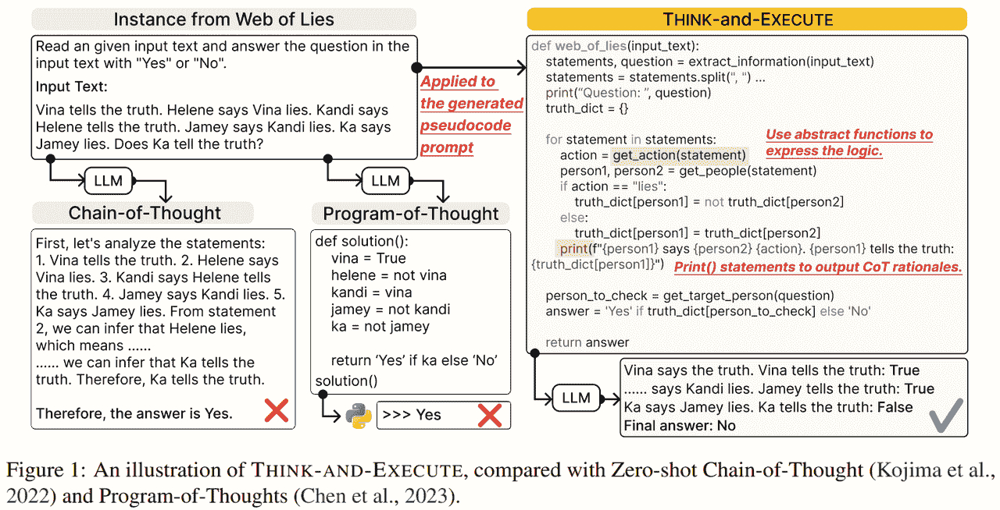

论文《Language Models as Compilers: Simulating Pseudocode Execution Improves Algorithmic Reasoning in Language Models》指出算法推理是理解问题背后复杂模式并将其分解为一系列解决步骤的能力，这对大型语言模型（LLMs）是个挑战。近期一些研究用编程语言（如Python）表达解题逻辑，但存在在单次推理中即时写出可执行正确逻辑代码不易、为特定实例生成的代码无法复用等问题。本文提出Think - and - Execute框架，分两步分解语言模型推理过程：先在Think步骤发现可用于解决给定任务所有实例的任务级逻辑并用伪代码表达，再在Execute步骤根据每个实例定制伪代码并模拟执行。经七个算法推理任务实验，该框架比特定实例推理的强基线（如CoT和PoT）更能提升LLMs推理能力，还表明伪代码比自然语言更能引导LLMs推理。

Algorithmic reasoning refers to the ability to understand the complex patterns behind the problem and decompose them into a sequence of reasoning steps towards the solution. Such nature of algorithmic reasoning makes it a challenge for large language models (LLMs), even though they have demonstrated promising performance in other reasoning tasks. Within this context, some recent studies use programming languages (e.g., Python) to express the necessary logic for solving a given instance/question (e.g., Program-of-Thought) as inspired by their strict and precise syntaxes. However, it is non-trivial to write an executable code that expresses the correct logic on the fly within a single inference call. Also, the code generated specifically for an instance cannot be reused for others, even if they are from the same task and might require identical logic to solve. This paper presents Think-and-Execute, a novel framework that decomposes the reasoning process of language models into two steps. (1) In Think, we discover a task-level logic that is shared across all instances for solving a given task and then express the logic with pseudocode; (2) In Execute, we further tailor the generated pseudocode to each instance and simulate the execution of the code. With extensive experiments on seven algorithmic reasoning tasks, we demonstrate the effectiveness of Think-and-Execute. Our approach better improves LMs' reasoning compared to several strong baselines performing instance-specific reasoning (e.g., CoT and PoT), suggesting the helpfulness of discovering task-level logic. Also, we show that compared to natural language, pseudocode can better guide the reasoning of LMs, even though they are trained to follow natural language instructions.

## Deciphering the Factors Influencing the Efficacy of Chain-of-Thought: Probability, Memorization, and Noisy Reasoning

https://aclanthology.org/2024.findings-emnlp.212.pdf

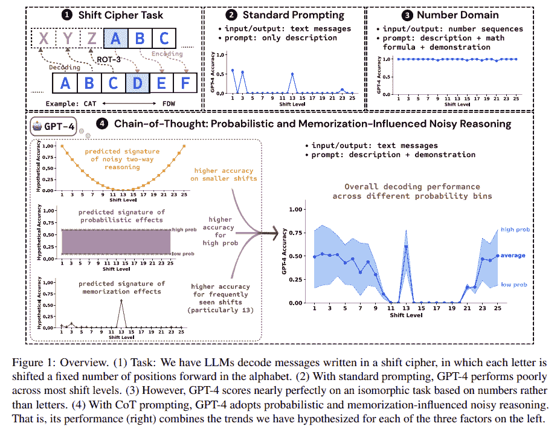

《解读影响思维链有效性的因素：概率、记忆与噪声推理》：思维链（CoT）提示能增强大型语言模型（LLMs）的多步推理能力，但关于LLMs在接受CoT提示时是表现出抽象概括还是依赖浅层启发法存在争议。为理解影响CoT推理的因素，对解密移位密码这一符号推理任务进行详细案例研究（移位密码即字母按字母表向前移位若干步），GPT - 4在多数移位密码上准确率为零。

Chain-of-Thought (CoT) prompting has been shown to enhance the multi-step reasoning capabilities of Large Language Models (LLMs). However, debates persist about whether LLMs exhibit abstract generalization or rely on shallow heuristics when given CoT prompts. To understand the factors influencing CoT reasoning we provide a detailed case study of the symbolic reasoning task of decoding shift ciphers, where letters are shifted forward some number of steps in the alphabet. We analyze the pattern of results produced by three LLMs -- GPT-4, Claude 3, and Llama 3.1 -- performing this task using CoT prompting. By focusing on a single relatively simple task, we are able to identify three factors that systematically affect CoT performance: the probability of the task's expected output (probability), what the model has implicitly learned during pre-training (memorization), and the number of intermediate operations involved in reasoning (noisy reasoning). We show that these factors can drastically influence task accuracy across all three LLMs; e.g., when tested with GPT-4, varying the output's probability of occurrence shifts accuracy from 26% to 70%. Overall, we conclude that CoT prompting performance reflects both memorization and a probabilistic version of genuine reasoning. Code and data at this this https URL

## `Ada-Instruct`: Adapting Instruction Generators for Complex Reasoning

`https://aclanthology.org/2024.findings-emnlp.409.pdf`

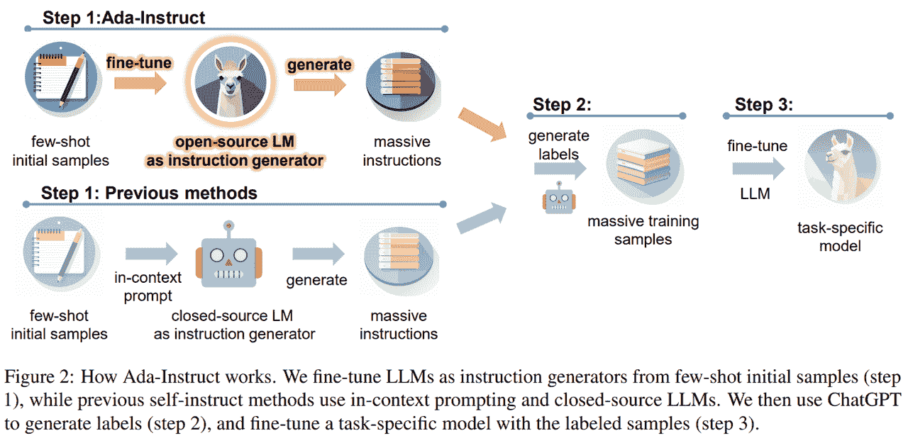

《`Ada - Instruct`: Adapting Instruction Generators for Complex Reasoning》指出大语言模型（LLMs）为下游任务生成多样且复杂的指令对提升效果至关重要。当前方法利用闭源LLMs和上下文提示来生成指令，但论文发现该方式无法为代码补全等任务生成长度≥100的复杂指令。为此，论文引入通过微调开源LLMs开发的自适应指令生成器`Ada - Instruct`。

Instructions augmentation is a crucial step for unleashing the full potential of large language models (LLMs) in downstream tasks. Existing `Self-Instruct` methods primarily simulate new instructions from a few initial instructions with in-context learning. However, our study identifies a critical flaw in this approach: even with GPT4o, `Self-Instruct` cannot generate complex instructions of length $\ge 100$, which is necessary in complex tasks such as code completion.

To address this issue, our key insight is that fine-tuning open source LLMs with only ten examples can produce complex instructions that maintain distributional consistency for complex reasoning tasks. We introduce `Ada-Instruct`, an adaptive instruction generator developed through fine-tuning. We empirically validated `Ada-Instruct`'s efficacy across different applications. The results highlight `Ada-Instruct`'s capacity to generate long, intricate, and distributionally consistent instructions.

## Making Reasoning Matter: Measuring and Improving Faithfulness of Chain-of-Thought Reasoning

`https://aclanthology.org/2024.findings-emnlp.882.pdf`

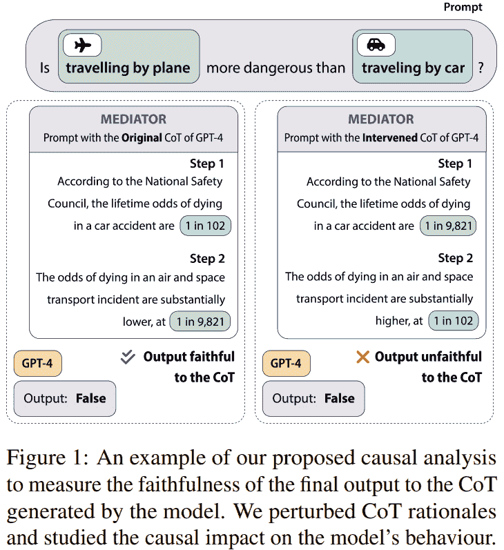

大语言模型（LLMs）逐步推理后作答表现更好，但模型最终答案在多大程度上忠实于推理步骤并不明确。本文对12个LLMs进行因果中介分析，发现LLMs生成答案时未可靠利用中间推理步骤。为解决此问题，引入`FRODO`框架，它包含学习生成正确推理步骤的推理模块和学习忠实推理中间推理的推理模块。实验表明`FRODO`优于4个竞争基准，提高了推理LLM的鲁棒性和泛化能力，且其原理比标准监督微调更忠实于最终答案预测。

Large language models (LLMs) have been shown to perform better when asked to reason step-by-step before answering a question. However, it is unclear to what degree the model's final answer is faithful to the stated reasoning steps. In this paper, we perform a causal mediation analysis on twelve LLMs to examine how intermediate reasoning steps generated by the LLM influence the final outcome and find that LLMs do not reliably use their intermediate reasoning steps when generating an answer. To address this issue, we introduce `FRODO`, a framework to tailor small-sized LMs to generate correct reasoning steps and robustly reason over these steps. `FRODO` consists of an inference module that learns to generate correct reasoning steps using an implicit causal reward function and a reasoning module that learns to faithfully reason over these intermediate inferences using a counterfactual and causal preference objective. Our experiments show that `FRODO` significantly outperforms four competitive baselines. Furthermore, `FRODO` improves the robustness and generalization ability of the reasoning LM, yielding higher performance on out-of-distribution test sets. Finally, we find that `FRODO`'s rationales are more faithful to its final answer predictions than standard supervised fine-tuning.
