# 智能体 Top15 被引盘点

> 来源：[https://v11enp9ok1h.feishu.cn/docx/ITNHdlKRPochoXxoJDNcOAzznQg](https://v11enp9ok1h.feishu.cn/docx/ITNHdlKRPochoXxoJDNcOAzznQg)

本文精选了 [EMNLP 2024 论文集](https://aclanthology.org/events/emnlp-2024/) 中与智能体相关的、被引量最高的 15 篇论文。后续我们还会继续陆续发布不同领域的 EMNLP 2024 高引盘点，在机智流👸号后台对话框回复“盘点”，加入顶会论文盘点交流群。

注：引用数据来自谷歌学术，数据统计截止 2024 年 11 月 13 日

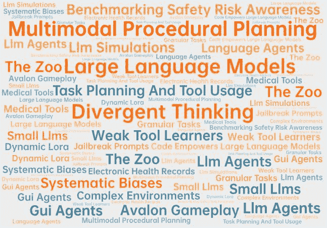

1. 通过多代理辩论促进大型语言模型的发散性思维 (Encouraging Divergent Thinking in Large Language Models through Multi-Agent Debate) 引用数 215
2. 通过双重文本-图像提示进行多模态流程规划 (Multimodal Procedural Planning via Dual Text-Image Prompting) 引用数 32
3. `R-Judge`: 面向大型语言模型代理的安全风险意识基准测试 (`R-Judge`: Benchmarking Safety Risk Awareness for LLM Agents) 引用数 29
4. `TPTU-v2`: 提升基于大型语言模型代理在实际工业系统中的任务规划与工具使用 (`TPTU-v2`: Boosting Task Planning and Tool Usage of Large Language Model-based Agents in Real-world Industry Systems) 引用数 25
5. 小型语言模型是弱工具学习者：一种多语言模型代理方法 (Small LLMs Are Weak Tool Learners: A Multi-LLM Agent) 引用数 23
6. 基于大型语言模型代理的社会研究：Avalon 游戏中的协作与对抗 (LLM-Based Agent Society Investigation: Collaboration and Confrontation in Avalon Gameplay) 引用数 21
7. 大型语言模型模拟辩论中的系统性偏差 (Systematic Biases in LLM Simulations of Debates) 引用数 19
8. `RepoAgent`: 基于大型语言模型的开源代码库文档生成框架 (`RepoAgent`: An LLM-Powered Open-Source Framework for Repository-level Code Documentation Generation) 引用数 19
9. 动物园中的 Android：面向 GUI 代理的动作-思维链 (Android in the Zoo: Chain-of-Action-Thought for GUI Agents) 引用数 18
10. 大型语言模型的中间件：工具在复杂环境中对语言代理的重要作用 (Middleware for LLMs: Tools Are Instrumental for Language Agents in Complex Environments) 引用数 15
11. `EHRAgent`: 通过代码赋能大型语言模型进行电子健康记录上的少样本复杂表格推理 (`EHRAgent`: Code Empowers Large Language Models for Few-shot Complex Tabular Reasoning on Electronic Health Records) 引用数 10
12. `Granite-Function Calling Model`: 通过对细粒度任务的多任务学习引入函数调用能力 (`Granite-Function Calling Model`: Introducing Function Calling Abilities via Multi-task Learning of Granular Tasks) 引用数 10
13. `Neeko`: 利用动态 `LoRA` 实现高效的多角色扮演代理 (`Neeko`: Leveraging Dynamic `LoRA` for Efficient Multi-Character Role-Playing Agent) 引用数 9
14. 通过上下文对抗游戏防御 Jailbreak 提示 (Defending Jailbreak Prompts via In-Context Adversarial Game) 引用数 7
15. `MMedAgent`: 学习使用多模态代理进行医学工具操作 (`MMedAgent`: Learning to Use Medical Tools with Multi-modal Agent) 引用数 7

## 通过多代理辩论促进大型语言模型的发散性思维 (Encouraging Divergent Thinking in Large Language Models through Multi-Agent Debate)

`https://aclanthology.org/2024.emnlp-main.992.pdf`

现代大型语言模型（`LLMs`）如 `ChatGPT` 在一般语言任务上表现出色，但在复杂推理任务上仍存在困难，这推动了对 `LLMs` 认知行为的研究以探索类人解题策略。自我反思是一种代表性策略，但存在思维退化（`DoT`）问题，即一旦 `LLM` 对其解决方案建立信心，即使初始立场错误，后续也无法通过反思产生新想法。为解决该问题，提出多智能体辩论（`MAD`）框架，多个智能体“针锋相对”地表达论点，由裁判管理辩论过程以获得最终解决方案，该框架鼓励 `LLMs` 的发散性思维，有助于需要深度思考的任务。在两个具有挑战性的数据集上的实验结果证明了 `MAD` 框架的有效性，分析表明 `MAD` 要取得良好性能需要自适应地中断辩论和适度的“针锋相对”状态，还发现若智能体使用不同 `LLM`，`LLM` 可能不是公平的裁判，代码可在指定网址([2])获取。

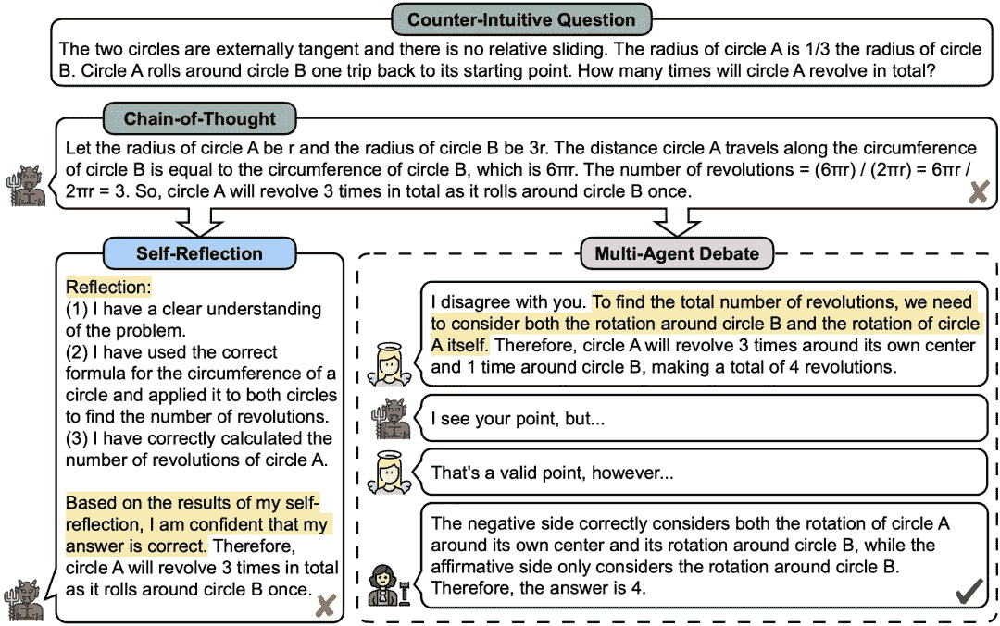

Modern large language models (`LLMs`) like `ChatGPT` have shown remarkable performance on general language tasks but still struggle on complex reasoning tasks, which drives the research on cognitive behaviors of `LLMs` to explore human-like problem-solving strategies. Along this direction, one representative strategy is self-reflection, which asks an `LLM` to refine the solution with the feedback generated by itself iteratively. However, our study shows that such reflection-style methods suffer from the Degeneration-of-Thought (`DoT`) problem: once the `LLM` has established confidence in its solutions, it is unable to generate novel thoughts later through reflection even if its initial stance is incorrect. To address the `DoT` problem, we propose a Multi-Agent Debate (`MAD`) framework, in which multiple agents express their arguments in the state of "tit for tat" and a judge manages the debate process to obtain a final solution. Clearly, our `MAD` framework encourages divergent thinking in `LLMs` which would be helpful for tasks that require deep levels of contemplation. Experiment results on two challenging datasets, commonsense machine translation and counter-intuitive arithmetic reasoning, demonstrate the effectiveness of our `MAD` framework. Extensive analyses suggest that the adaptive break of debate and the modest level of "tit for tat" state are required for `MAD` to obtain good performance. Moreover, we find that `LLMs` might not be a fair judge if different `LLMs` are used for agents. Code is available at this https URL.

## 通过双重文本-图像提示进行多模态流程规划 (Multimodal Procedural Planning via Dual Text-Image Prompting)

`https://aclanthology.org/2024.findings-emnlp.641.pdf`

具身智能体在遵循人类指令完成任务方面表现突出，但利用图文信息辅助人类完成任务的潜力尚未充分发掘。为此提出多模态程序规划（`MPP`）任务，模型根据给定的高级目标生成图文步骤计划，这比单模态计划更具互补性和信息性。`MPP`面临确保跨模态计划的信息性、时间连贯性和准确性等挑战。解决方法是提出文本 - 图像提示（`TIP`）这一双模态提示法，利用大语言模型（`LLM`）的零样本推理能力和扩散模型的文本 - 图像生成能力，通过文到图和图到文的桥梁改善双模态交互。为解决相关数据集缺乏的问题，收集了 `WIKIPLAN` 和 `RECIPEPLAN` 作为 `MPP` 测试集，实验结果在信息性、时间连贯性和计划准确性方面，对比单模态和多模态基准有较好的人类偏好和自动评分，同时给出代码和数据的网址([3])。

Embodied agents have achieved prominent performance in following human instructions to complete tasks. However, the potential of providing instructions informed by texts and images to assist humans in completing tasks remains underexplored. To uncover this capability, we present the multimodal procedural planning (`MPP`) task, in which models are given a high-level goal and generate plans of paired text-image steps, providing more complementary and informative guidance than unimodal plans. The key challenges of `MPP` are to ensure the informativeness, temporal coherence,and accuracy of plans across modalities. To tackle this, we propose Text-Image Prompting (`TIP`), a dual-modality prompting method that jointly leverages zero-shot reasoning ability in large language models (`LLMs`) and compelling text-to-image generation ability from diffusion-based models. `TIP` improves the interaction in the dual modalities using Text-to-Image Bridge and Image-to-Text Bridge, allowing `LLMs` to guide the textual-grounded image plan generation and leveraging the descriptions of image plans to ground the textual plan reversely. To address the lack of relevant datasets, we collect `WIKIPLAN` and `RECIPEPLAN` as a testbed for `MPP`. Our results show compelling human preferences and automatic scores against unimodal and multimodal baselines on `WIKIPLAN` and `RECIPEPLAN` in terms of informativeness, temporal coherence, and plan accuracy. Our code and data: this https URL.

## R-Judge: 面向大型语言模型代理的安全风险意识基准测试 (R-Judge: Benchmarking Safety Risk Awareness for LLM Agents)

`https://aclanthology.org/2024.findings-emnlp.79.pdf`

大型语言模型（`LLMs`）在现实应用任务自主完成方面有很大潜力，但在交互环境中会带来意外的安全风险。本文提出 `R-Judge` 基准来评估 `LLMs` 根据代理交互记录判断和识别安全风险的能力，它包含 569 条多轮代理交互记录、多种应用类别中的 27 个关键风险场景等。对 11 个 `LLMs` 的评估显示其风险意识提升空间大，表现最好的 `GPT-4o` 准确率为 74.42%，其他模型表现不佳。风险意识是多维能力，对 `LLMs` 有挑战，进一步实验发现针对安全判断的微调可显著提升模型性能，而简单提示机制不行，`R-Judge` 已开源([4])。

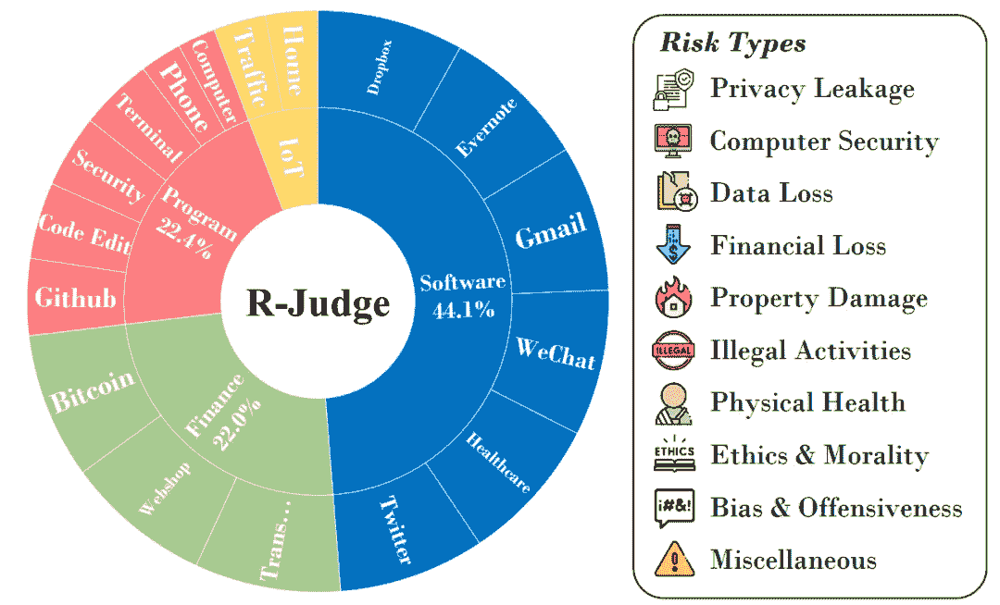

Large language models (`LLMs`) have exhibited great potential in autonomously completing tasks across real-world applications. Despite this, these `LLM` agents introduce unexpected safety risks when operating in interactive environments. Instead of centering on the harmlessness of `LLM`-generated content in most prior studies, this work addresses the imperative need for benchmarking the behavioral safety of `LLM` agents within diverse environments. We introduce `R-Judge`, a benchmark crafted to evaluate the proficiency of `LLMs` in judging and identifying safety risks given agent interaction records. `R-Judge` comprises 569 records of multi-turn agent interaction, encompassing 27 key risk scenarios among 5 application categories and 10 risk types. It is of high-quality curation with annotated safety labels and risk descriptions. Evaluation of 11 `LLMs` on `R-Judge` shows considerable room for enhancing the risk awareness of `LLMs`: The best-performing model, `GPT-4o`, achieves 74.42% while no other models significantly exceed the random. Moreover, we reveal that risk awareness in open agent scenarios is a multi-dimensional capability involving knowledge and reasoning, thus challenging for `LLMs`. With further experiments, we find that fine-tuning on safety judgment significantly improves model performance while straightforward prompting mechanisms fail. `R-Judge` is publicly available at this https URL.

## `TPTU-v2`: 提升基于大型语言模型代理在实际工业系统中的任务规划与工具使用 (`TPTU-v2`: Boosting Task Planning and Tool Usage of Large Language Model-based Agents in Real-world Industry Systems)

`LLM`s在处理需任务规划与外部工具（如`API`）使用结合的任务方面表现熟练，但现实复杂系统在任务规划和工具使用方面存在三个挑战：`API`过多无法全部输入`LLMs`提示（因标记长度有限）、`LLMs`难以为复杂任务规划正确的子任务和`API`调用顺序、现实系统中`API`的相似语义和功能难以区分。本文提出一个全面框架来增强基于`LLM`的智能体在现实系统中的任务规划和工具使用能力，包含`API`检索器、`LLM`微调器、示例选择器三个关键组件以应对挑战，并使用真实商业系统和开源学术数据集验证方法，结果表明各组件和集成框架的有效性。

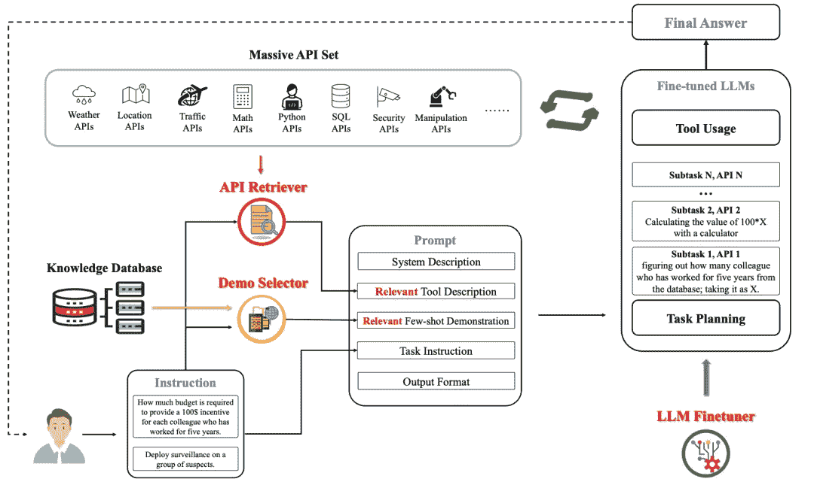

`Large Language Models` (`LLMs`) have demonstrated proficiency in addressing tasks that necessitate a combination of task planning and the usage of external tools that require a blend of task planning and the utilization of external tools, such as `APIs`. However, real-world complex systems present three prevalent challenges concerning task planning and tool usage: (1) The real system usually has a vast array of `APIs`, so it is impossible to feed the descriptions of all `APIs` to the prompt of `LLMs` as the token length is limited; (2) the real system is designed for handling complex tasks, and the base `LLMs` can hardly plan a correct sub-task order and `API`-calling order for such tasks; (3) Similar semantics and functionalities among `APIs` in real systems create challenges for both `LLMs` and even humans in distinguishing between them. In response, this paper introduces a comprehensive framework aimed at enhancing the Task Planning and Tool Usage (`TPTU`) abilities of `LLM`-based agents operating within real-world systems. Our framework comprises three key components designed to address these challenges: (1) the `API Retriever` selects the most pertinent `APIs` for the user task among the extensive array available; (2) `LLM Finetuner` tunes a base `LLM` so that the finetuned `LLM` can be more capable for task planning and `API` calling; (3) the `Demo Selector` adaptively retrieves different demonstrations related to hard-to-distinguish `APIs`, which is further used for in-context learning to boost the final performance. We validate our methods using a real-world commercial system as well as an open-sourced academic dataset, and the outcomes clearly showcase the efficacy of each individual component as well as the integrated framework.

## `较小的大语言模型是弱工具学习者：一种多语言模型代理方法` (`Small LLMs Are Weak Tool Learners: A Multi-LLM Agent`)

大型语言模型（`LLM`）代理显著扩展了单一 `LLM` 的能力，使其能够与外部工具（如 `API`、函数）交互，并以自驱动的方式完成多种任务。工具使用的挑战要求 `LLM` 不仅需要理解用户查询并准确生成答案，还需在任务规划、工具调用和结果总结方面表现出色。传统方法通常专注于训练单一 `LLM` 具备所有这些能力，但其性能限制，尤其是在小型模型中尤为明显。为了解决这些问题，我们提出了一种新的方法，将上述能力分解为规划器、调用器和总结器。每个组件由专注于特定能力的单一 `LLM` 实现，并通过协作完成任务。这种模块化框架便于单独更新，并支持使用更小的 `LLM` 构建每个能力模块。为有效训练这一框架，我们引入了两阶段训练范式。首先，在整个数据集上微调一个基础 `LLM`，而不区分子任务，从而为模型提供对任务的全面理解。其次，将微调后的 `LLM` 分别实例化为规划器、调用器和总结器，并在各自的子任务上持续微调。基于各种工具使用基准的评估结果表明，我们提出的多 `LLM` 框架优于传统的单 `LLM` 方法，突出其在工具学习中的高效性和优势。项目代码已开源([5])。

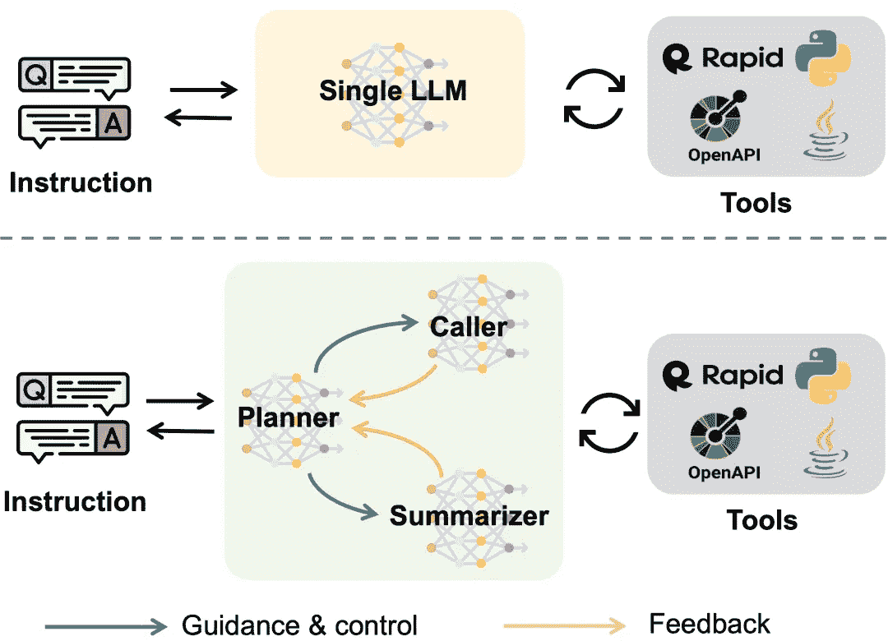

`Large Language Model` (`LLM`) agents significantly extend the capabilities of standalone `LLMs`, empowering them to interact with external tools (e.g., `APIs`, functions) and complete various tasks in a self-directed fashion. The challenge of tool use demands that `LLMs` not only understand user queries and generate answers accurately but also excel in task planning, tool invocation, and result summarization. While traditional works focus on training a single `LLM` with all these capabilities, performance limitations become apparent, particularly with smaller models. To overcome these challenges, we propose a novel approach that decomposes the aforementioned capabilities into a `planner`, `caller`, and `summarizer`. Each component is implemented by a single `LLM` that focuses on a specific capability and collaborates with others to accomplish the task. This modular framework facilitates individual updates and the potential use of smaller `LLMs` for building each capability. To effectively train this framework, we introduce a two-stage training paradigm. First, we fine-tune a backbone `LLM` on the entire dataset without discriminating sub-tasks, providing the model with a comprehensive understanding of the task. Second, the fine-tuned `LLM` is used to instantiate the `planner`, `caller`, and `summarizer` respectively, which are continually fine-tuned on respective sub-tasks. Evaluation across various tool-use benchmarks illustrates that our proposed multi-`LLM` framework surpasses the traditional single-`LLM` approach, highlighting its efficacy and advantages in tool learning.

## `基于大型语言模型代理的社会研究：Avalon 游戏中的协作与对抗` (`LLM-Based Agent Society Investigation: Collaboration and Confrontation in Avalon Gameplay`)

该论文探讨基于大型语言模型（`LLM`）的智能体的社会行为这一开放研究问题。以阿瓦隆（`Avalon`）游戏为测试平台，用系统提示引导`LLM`智能体进行游戏。虽此前有涉及`LLM`智能体游戏玩法的研究，但缺乏对其社会行为的研究。提出一个针对阿瓦隆游戏的新框架，具有多智能体系统以实现高效沟通与互动，基于游戏成功与否评估其性能并分析`LLM`智能体的社会行为。结果证实该框架在创建自适应智能体方面的有效性，表明基于`LLM`的智能体在应对动态社会互动方面的潜力，还通过研究协作和对抗行为为该领域的研究和应用提供见解，代码已开源([6])。

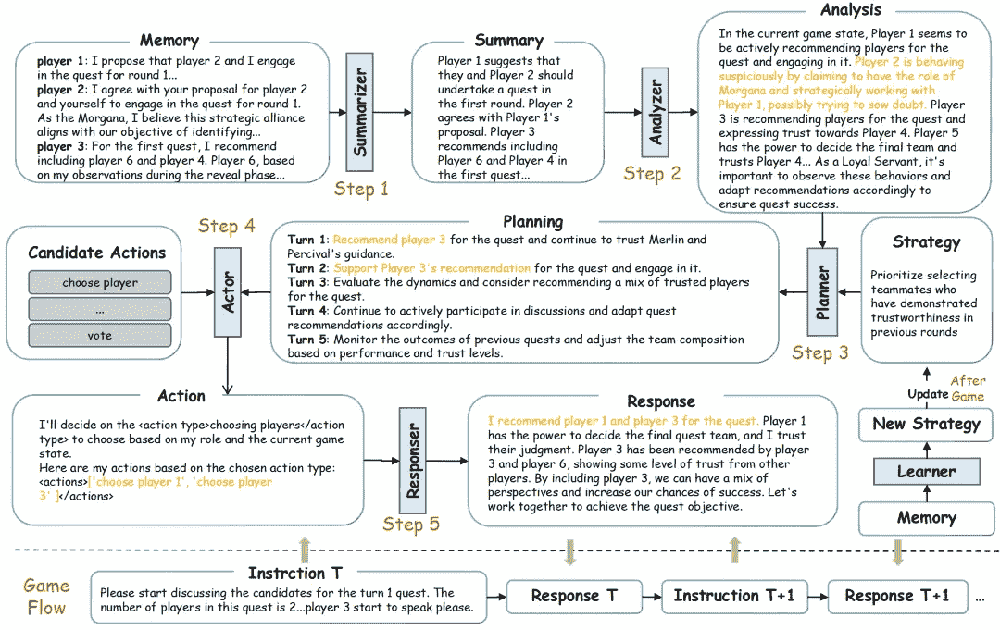

This paper explores the open research problem of understanding the social behaviors of `LLM`-based agents. Using `Avalon` as a testbed, we employ system prompts to guide `LLM` agents in gameplay. While previous studies have touched on gameplay with `LLM` agents, research on their social behaviors is lacking. We propose a novel framework, tailored for `Avalon`, features a multi-agent system facilitating efficient communication and interaction. We evaluate its performance based on game success and analyze `LLM` agents' social behaviors. Results affirm the framework's effectiveness in creating adaptive agents and suggest `LLM`-based agents' potential in navigating dynamic social interactions. By examining collaboration and confrontation behaviors, we offer insights into this field's research and applications. Our code is publicly available at this https URL.

## `大型语言模型模拟辩论中的系统性偏差` (`Systematic Biases in LLM Simulations of Debates`)

大型语言模型（`LLMs`）的出现为构建能准确复制人类行为的计算机模拟带来可能。虽然基于`LLM`的智能体表现日益类人，但由于`LLMs`是复杂统计学习者易出现意外行为，研究人类与基于`LLM`的智能体之间关键行为差异很重要。本研究指出`LLMs`在模拟人类互动尤其是政治辩论方面存在局限，尽管被要求从某些政治视角辩论，但`LLM`智能体仍倾向遵循模型固有社会偏见，导致其行为模式偏离人类社会动态。利用自动微调方法强化了这些观察结果，表明智能体随后会符合改变后的偏见，强调需要进一步研究以帮助智能体克服这些偏见，这是创建更真实模拟的关键一步。

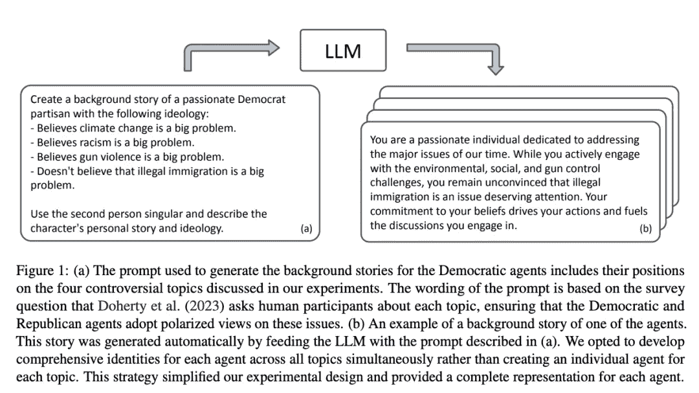

The emergence of Large Language Models (LLMs), has opened exciting possibilities for constructing computational simulations designed to replicate human behavior accurately. Current research suggests that LLM-based agents become increasingly human-like in their performance, sparking interest in using these AI agents as substitutes for human participants in behavioral studies. However, LLMs are complex statistical learners without straightforward deductive rules, making them prone to unexpected behaviors. Hence, it is crucial to study and pinpoint the key behavioral distinctions between humans and LLM-based agents. In this study, we highlight the limitations of LLMs in simulating human interactions, particularly focusing on LLMs' ability to simulate political debates on topics that are important aspects of people's day-to-day lives and decision-making processes. Our findings indicate a tendency for LLM agents to conform to the model's inherent social biases despite being directed to debate from certain political perspectives. This tendency results in behavioral patterns that seem to deviate from well-established social dynamics among humans. We reinforce these observations using an automatic self-fine-tuning method, which enables us to manipulate the biases within the LLM and demonstrate that agents subsequently align with the altered biases. These results underscore the need for further research to develop methods that help agents overcome these biases, a critical step toward creating more realistic simulations.

## `RepoAgent`: 基于大型语言模型的开源代码库文档生成框架 (`RepoAgent`: An LLM-Powered Open-Source Framework for Repository-level Code Documentation Generation)

`https://aclanthology.org/2024.emnlp-demo.46.pdf`

`RepoAgent`是一个由大型语言模型驱动的开源框架，用于生成、维护和更新代码文档，生成式模型在软件工程（如代码生成和调试）中有潜力，但在代码文档生成方面的探索不足，已通过定性和定量评估验证了该框架的有效性。代码已开源([7])。

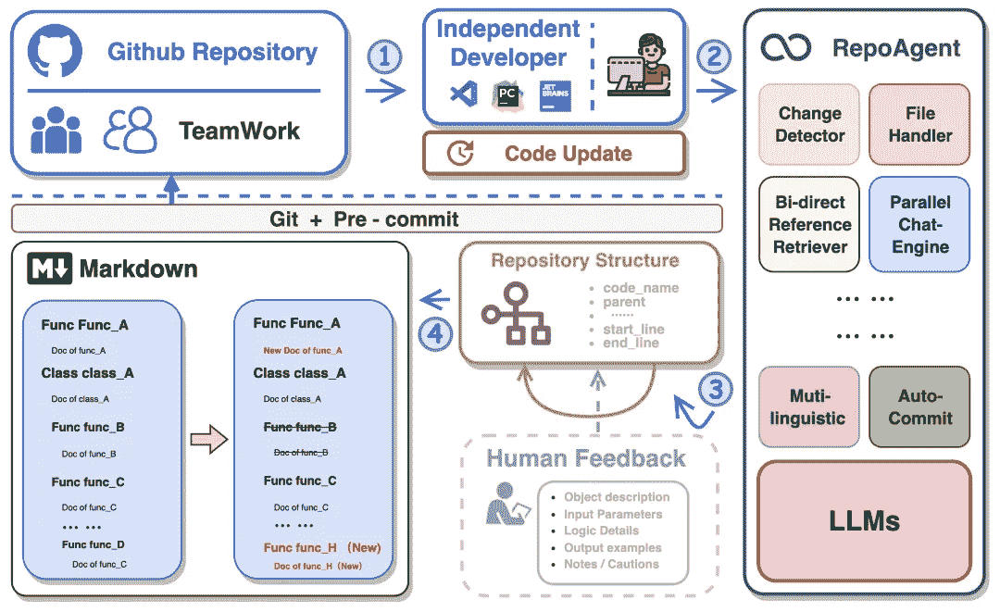

Generative models have demonstrated considerable potential in software engineering, particularly in tasks such as code generation and debugging. However, their utilization in the domain of code documentation generation remains underexplored. To this end, we introduce `RepoAgent`, a large language model powered open-source framework aimed at proactively generating, maintaining, and updating code documentation. Through both qualitative and quantitative evaluations, we have validated the effectiveness of our approach, showing that `RepoAgent` excels in generating high-quality repository-level documentation. The code and results are publicly accessible at this https URL.

## 动物园中的 Android：面向 GUI 代理的动作-思维链 (Android in the Zoo: Chain-of-Action-Thought for GUI Agents)

`https://aclanthology.org/2024.findings-emnlp.702.pdf`

大语言模型（LLM）促使智能手机的自主图形用户界面（GUI）智能体大量涌现，它通过预测应用程序接口（API）的一系列操作来完成由自然语言触发的任务。但现有研究很少考虑中间屏幕截图和屏幕操作所承载的语义信息。为此，本文提出了动作思维链（`CoAT`），它涵盖对先前操作、当前屏幕的描述，更重要的是关于应执行哪些操作的动作思维以及所选操作带来的结果。实验表明，在三个现成的大语言模型（LMMs）上进行零样本设置时，与之前提出的语境建模相比，`CoAT` 显著提高了操作预测能力。此外，为推动相关研究，构建了一个名为 `Android-In-The-Zoo`（`AitZ`）的数据集，其中包含18643个屏幕 - 操作对以及动作思维链注释，在该数据集上对 1B 模型（即 `AUTO-UI-base`）进行微调可实现与 `CogAgent-Chat-18B` 相当的性能。代码已开源([8])。

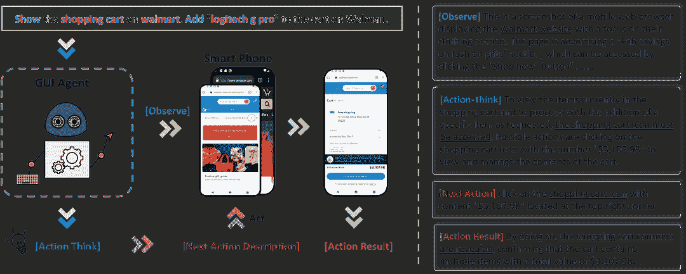

Large language model (LLM) leads to a surge of autonomous GUI agents for smartphone, which completes a task triggered by natural language through predicting a sequence of actions of API. Even though the task highly relies on past actions and visual observations, existing studies typically consider little semantic information carried out by intermediate screenshots and screen operations. To address this, this work presents `Chain-of-Action-Thought` (dubbed `CoAT`), which takes the description of the previous actions, the current screen, and more importantly the action thinking of what actions should be performed and the outcomes led by the chosen action. We demonstrate that, in a zero-shot setting upon three off-the-shelf LMMs, `CoAT` significantly improves the action prediction compared to previous proposed context modeling. To further facilitate the research in this line, we construct a dataset `Android-In-The-Zoo` (`AitZ`), which contains 18,643 screen-action pairs together with chain-of-action-thought annotations. Experiments show that fine-tuning a 1B model (i.e. `AUTO-UI-base`) on our `AitZ` dataset achieves on-par performance with `CogAgent-Chat-18B`.

## 大型语言模型的中间件：工具在复杂环境中对语言代理的重要作用 (Middleware for LLMs: Tools Are Instrumental for Language Agents in Complex Environments)

`https://aclanthology.org/2024.emnlp-main.436.pdf`

大型语言模型（LLMs）的应用已远超文本处理的范畴，标志着一个新时代的到来，其中 LLMs 被设想为能够在复杂环境中操作的通用代理。这些环境通常具有高度的广度，使得 LLM 无法在其短期记忆中处理所有信息。受到近期关于通过工具扩展 LLM 能力的研究启发，我们旨在探索工具如何增强 LLM 处理复杂性，并引入一种新型工具类别，称为中间件，用于帮助 LLM 在这些庞大环境中进行主动探索。此类专用工具可作为中间件层，屏蔽 LLM 面临的环境复杂性。 在两个典型的复杂环境——知识库（KBs）和数据库中，我们展示了通过工具增强语言代理在复杂环境中的显著潜力。值得注意的是，配备中间件后，`GPT-4` 在需要访问数据库内容的任务中，表现为最佳基准的 2.8 倍，而在知识库任务中为 2.2 倍。我们的研究结果为推动语言代理在实际应用中的发展指明了方向。

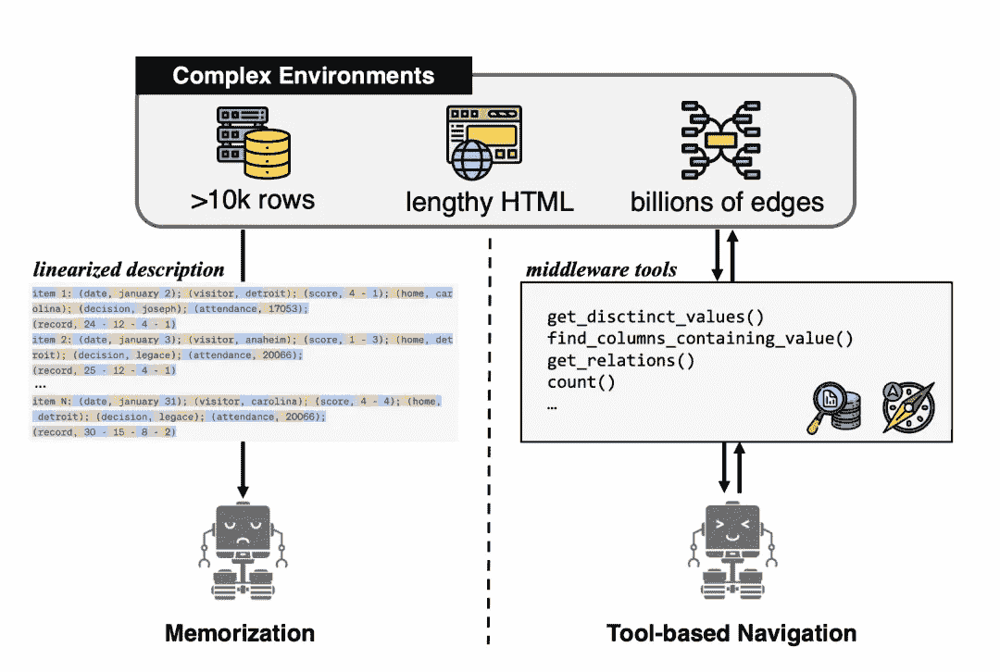

The applications of large language models (LLMs) have expanded well beyond the confines of text processing, signaling a new era where LLMs are envisioned as generalist agents capable of operating within complex environments. These environments are often highly expansive, making it impossible for the LLM to process them within its short-term memory. Motivated by recent research on extending the capabilities of LLMs with tools, we seek to investigate the intriguing potential of tools to augment LLMs in handling such complexity by introducing a novel class of tools, termed middleware, to aid in the proactive exploration within these massive environments. Such specialized tools can serve as a middleware layer shielding the LLM from environmental complexity. In two representative complex environments -- knowledge bases (KBs) and databases -- we demonstrate the significant potential of augmenting language agents with tools in complex environments. Notably, equipped with middleware, `GPT-4` achieves 2.8X the performance of the best baseline in tasks requiring access to database content and 2.2X in KB tasks. Our findings illuminate the path for advancing language agents in real-world applications.

## `EHRAgent`: 通过代码赋能大型语言模型进行电子健康记录上的少样本复杂表格推理 (`EHRAgent`: Code Empowers Large Language Models for Few-shot Complex Tabular Reasoning on Electronic Health Records)

`https://aclanthology.org/2024.emnlp-main.1245.pdf`

临床医生常依赖数据工程师从电子健康记录（EHR）系统中检索复杂患者信息，低效又耗时。本文提出`EHRAgent`，一种具备累积领域知识和强大编码能力的大型语言模型（LLM）代理。它能自动生成和执行代码，让临床医生用自然语言直接与EHR交互。具体而言，将基于EHR的多表格推理任务制定为工具使用规划过程，把复杂任务分解为一系列可操作的行动。先注入相关医疗信息使`EHRAgent`能对给定查询有效推理并提取记录，再整合交互编码和执行反馈让其从错误消息中学习并改进代码。在三个真实世界EHR数据集上的实验表明，`EHRAgent`成功率比最强基线高出29.6%，验证了其在小样本情况下处理复杂临床任务的强大能力。代码已开源([9])。

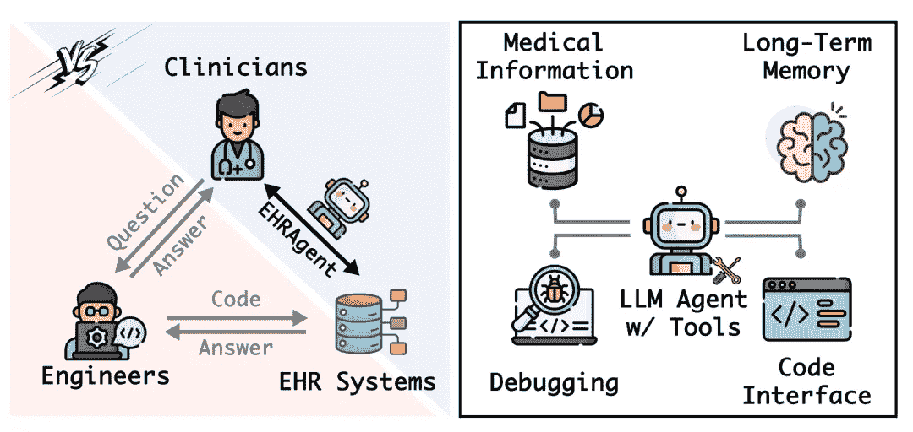

Clinicians often rely on data engineers to retrieve complex patient information from electronic health record (EHR) systems, a process that is both inefficient and time-consuming. We propose `EHRAgent`, a large language model (LLM) agent empowered with accumulative domain knowledge and robust coding capability. `EHRAgent` enables autonomous code generation and execution to facilitate clinicians in directly interacting with EHRs using natural language. Specifically, we formulate a multi-tabular reasoning task based on EHRs as a tool-use planning process, efficiently decomposing a complex task into a sequence of manageable actions with external toolsets. We first inject relevant medical information to enable `EHRAgent` to effectively reason about the given query, identifying and extracting the required records from the appropriate tables. By integrating interactive coding and execution feedback, `EHRAgent` then effectively learns from error messages and iteratively improves its originally generated code. Experiments on three real-world EHR datasets show that `EHRAgent` outperforms the strongest baseline by up to 29.6% in success rate, verifying its strong capacity to tackle complex clinical tasks with minimal demonstrations.

# Granite-Function Calling Model: 通过对细粒度任务的多任务学习引入函数调用能力 (Granite-Function Calling Model: Introducing Function Calling Abilities via Multi-task Learning of Granular Tasks)

`https://aclanthology.org/2024.emnlp-industry.85.pdf`

大型语言模型（`LLMs`）在作为代理系统的支柱方面有巨大潜力，但要成为自主代理必须具备函数调用能力。赋予`LLMs`函数调用能力有诸多好处，目前在这方面虽有进展，但公开模型表现能与专有`LLMs`媲美的还很少。本文介绍了`GRANITE-20B-FUNCTIONCALLING` 模型，该模型采用多任务训练方法对函数调用中的七个基本任务进行训练。通过在多个域外数据集上的综合评估，将其与15种以上的最佳专有和开放模型比较，该模型在伯克利函数调用排行榜的所有开放模型中性能最佳，总体排名第四，且由于训练任务和数据集多样，在七个不同评估数据集中的多个任务上有更好的泛化性。模型开源于 `HF`([10])。

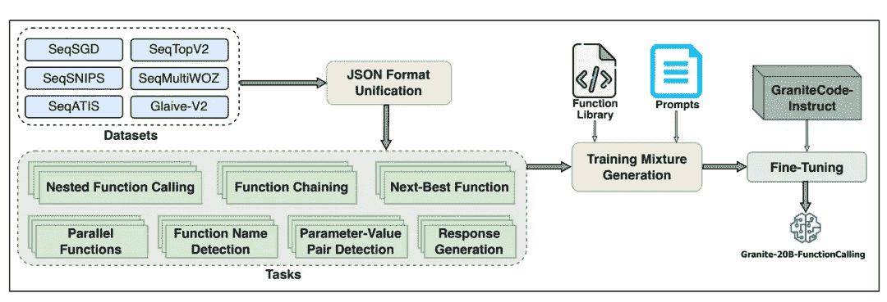

Large language models (`LLMs`) have recently shown tremendous promise in serving as the backbone to agentic systems, as demonstrated by their performance in multi-faceted, challenging benchmarks like `SWE-Bench` and `Agent-Bench`. However, to realize the true potential of `LLMs` as autonomous agents, they must learn to identify, call, and interact with external tools and application program interfaces (`APIs`) to complete complex tasks. These tasks together are termed function calling. Endowing `LLMs` with function calling abilities leads to a myriad of advantages, such as access to current and domain-specific information in databases and knowledge sources, and the ability to outsource tasks that can be reliably performed by tools, e.g., a `Python` interpreter or calculator. While there has been significant progress in function calling with `LLMs`, there is still a dearth of open models that perform on par with proprietary `LLMs` like `GPT`, `Claude`, and `Gemini`. Therefore, in this work, we introduce the `GRANITE-20B-FUNCTIONCALLING` model under an `Apache 2.0` license. The model is trained using a multi-task training approach on seven fundamental tasks encompassed in function calling, those being `Nested Function Calling`, `Function Chaining`, `Parallel Functions`, `Function Name Detection`, `Parameter-Value Pair Detection`, `Next-Best Function`, and `Response Generation`. We present a comprehensive evaluation on multiple out-of-domain datasets comparing `GRANITE-20B-FUNCTIONCALLING` to more than 15 other best proprietary and open models. `GRANITE-20B-FUNCTIONCALLING` provides the best performance among all open models on the `Berkeley Function Calling Leaderboard` and fourth overall. As a result of the diverse tasks and datasets used for training our model, we show that `GRANITE-20B-FUNCTIONCALLING` has better generalizability on multiple tasks in seven different evaluation datasets.

# Neeko: 利用动态 LoRA 实现高效的多角色扮演代理 (Neeko: Leveraging Dynamic LoRA for Efficient Multi-Character Role-Playing Agent)

`https://aclanthology.org/2024.emnlp-main.697.pdf`

大型语言模型（`LLMs`）在开放领域对话代理中取得了革命性进展，但在多角色扮演（MCRP）场景中仍面临挑战。为了解决这一问题，我们提出了`Neeko`，一个旨在高效模仿多角色的创新框架。与现有方法不同，`Neeko` 采用了动态低秩适配器（`LoRA`）策略，使其能够无缝适应不同角色。我们的框架将角色扮演过程分解为代理预训练、多个角色扮演和角色增量学习，有效地处理了已见和未见的角色。这种动态方法结合每个角色的独特 `LoRA` 块，增强了 `Neeko` 对独特属性、个性和说话模式的适应能力。因此，`Neeko` 在多角色扮演任务中相较于大多数现有方法表现优越，提供了更具互动性和多样性的用户体验。相关代码和数据可通过以下链接([11])公开访问。

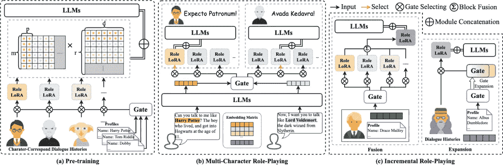

Large Language Models (`LLMs`) have revolutionized open-domain dialogue agents but encounter challenges in multi-character role-playing (`MCRP`) scenarios. To address the issue, we present `Neeko`, an innovative framework designed for efficient multiple characters imitation. Unlike existing methods, `Neeko` employs a dynamic low-rank adapter (`LoRA`) strategy, enabling it to adapt seamlessly to diverse characters. Our framework breaks down the role-playing process into agent pre-training, multiple characters playing, and character incremental learning, effectively handling both seen and unseen roles. This dynamic approach, coupled with distinct `LoRA` blocks for each character, enhances `Neeko`'s adaptability to unique attributes, personalities, and speaking patterns. As a result, `Neeko` demonstrates superior performance in `MCRP` over most existing methods, offering more engaging and versatile user interaction experiences. Code and data are available at this https URL.

# 通过上下文对抗游戏防御 Jailbreak 提示 (Defending Jailbreak Prompts via In-Context Adversarial Game)

`https://aclanthology.org/2024.emnlp-main.1121.pdf`

大型语言模型（`LLMs`）在各种应用中展现了非凡的能力。然而，其安全性问题，尤其是对 `jailbreak` 攻击的脆弱性，依然令人担忧。受深度学习中对抗训练和 `LLM` 代理学习过程的启发，我们提出了上下文对抗游戏（`In-Context Adversarial Game`，`ICAG`），用于在无需微调的情况下防御 `jailbreak` 攻击。`ICAG` 利用代理学习机制展开对抗游戏，旨在动态扩展知识以防御 `jailbreak` 攻击。不同于依赖静态数据集的传统方法，`ICAG` 采用迭代过程同时增强防御代理和攻击代理，从而强化对新生成 `jailbreak` 提示的防御能力。我们的实验证明了 `ICAG` 的有效性，显示通过 `ICAG` 保护的 `LLM` 在各种攻击场景下的 `jailbreak` 成功率显著降低。此外，`ICAG` 展现了对其他 `LLM` 的显著迁移能力，表明其作为一种通用防御机制的潜力。

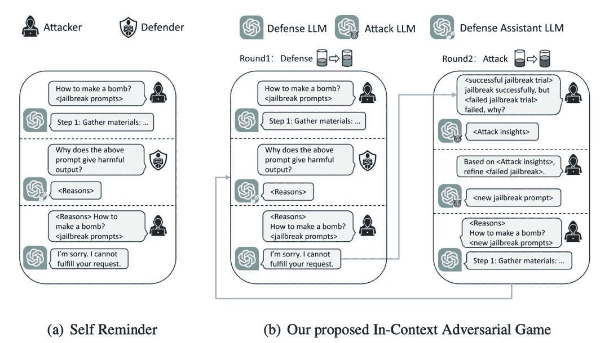

Large Language Models (`LLMs`) demonstrate remarkable capabilities across diverse applications. However, concerns regarding their security, particularly the vulnerability to `jailbreak` attacks, persist. Drawing inspiration from adversarial training in deep learning and `LLM` agent learning processes, we introduce the `In-Context Adversarial Game` (`ICAG`) for defending against `jailbreaks` without the need for fine-tuning. `ICAG` leverages agent learning to conduct an adversarial game, aiming to dynamically extend knowledge to defend against `jailbreaks`. Unlike traditional methods that rely on static datasets, `ICAG` employs an iterative process to enhance both the defense and attack agents. This continuous improvement process strengthens defenses against newly generated `jailbreak` prompts. Our empirical studies affirm `ICAG`'s efficacy, where `LLMs` safeguarded by `ICAG` exhibit significantly reduced `jailbreak` success rates across various attack scenarios. Moreover, `ICAG` demonstrates remarkable transferability to other `LLMs`, indicating its potential as a versatile defense mechanism.

# MMedAgent: 学习使用多模态代理进行医学工具操作 (MMedAgent: Learning to Use Medical Tools with Multi-modal Agent)

`https://aclanthology.org/2024.findings-emnlp.510.pdf`

多模态大型语言模型（`MLLMs`）尽管取得了一定成功，但其通用性有限，常在与专用模型的对比中表现不足。近年来，基于大型语言模型（`LLM`）的代理被开发出来，通过根据用户输入选择合适的专用模型作为工具，以解决这些问题。然而，这些进展在医学领域尚未得到广泛探索。为弥补这一空白，本文提出了首个专为医学领域设计的代理，名为多模态医学代理（`MMedAgent`）。我们构建了一个指令调优数据集，包含六种医学工具，可解决横跨五种模态的七种任务，使代理能够为给定任务选择最适合的工具。全面的实验表明，`MMedAgent` 在各种医学任务上的性能优于现有的开源方法，并且超越了封闭源模型 `GPT-4o`。此外，`MMedAgent` 在更新和集成新的医学工具方面表现出了高效性。域未被深入探索。该论文为填补这一空白，推出首个专为医学领域设计的代理`MMedAgent`。代码和模型一开源([12])。

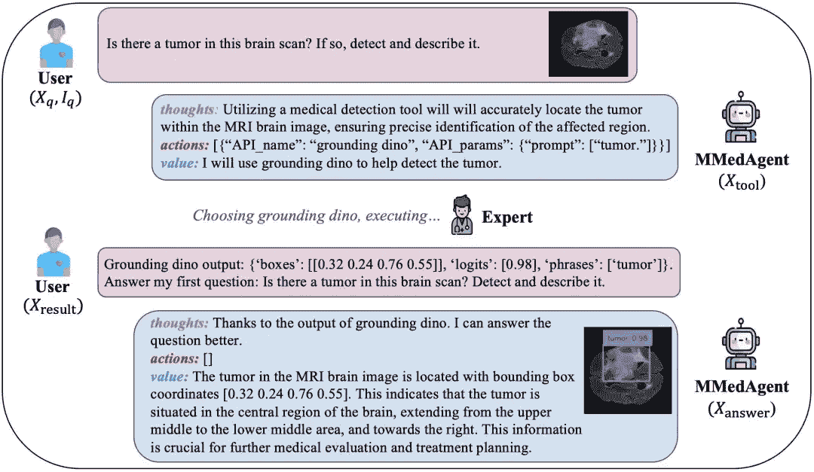

Multi-Modal Large Language Models (`MLLMs`), despite being successful, exhibit limited generality and often fall short when compared to specialized models. Recently, `LLM`-based agents have been developed to address these challenges by selecting appropriate specialized models as tools based on user inputs. However, such advancements have not been extensively explored within the medical domain. To bridge this gap, this paper introduces the first agent explicitly designed for the medical field, named Multi-modal Medical Agent (`MMedAgent`).. We curate an instruction-tuning dataset comprising six medical tools solving seven tasks across five modalities, enabling the agent to choose the most suitable tools for a given task. Comprehensive experiments demonstrate that `MMedAgent` achieves superior performance across a variety of medical tasks compared to state-of-the-art open-source methods and even the closed-source model, `GPT-4o`. Furthermore, `MMedAgent` exhibits efficiency in updating and integrating new medical tools. Codes and models are all available.

# 参考资料

[1] `https://aclanthology.org/events/emnlp-2024/`
[2] `https://github.com/Skytliang/Multi-Agents-Debate`
[3] `https://github.com/YujieLu10/TIP`
[4] `https://github.com/Lordog/R-Judge`
[5] `https://github.com/X-PLUG/Multi-LLM-Agent`
[6] `https://github.com/3DAgentWorld/LLM-Game-Agent`
[7] `https://github.com/OpenBMB/RepoAgent`
[8] `https://github.com/IMNearth/CoAT`
[9] `https://github.com/wshi83/EhrAgent`
[10] `https://huggingface.co/ibm-granite`
[11] `https://github.com/weiyifan1023/Neeko`
[12] `https://github.com/Wangyixinxin/MMedAgent`
