# 多模态 Top15 被引盘点

> 来源：`https://v11enp9ok1h.feishu.cn/docx/DGmydzfbSoxnFpxvPhzcBrOpnag`

本文精选了 [EMNLP 2024 论文集](https://aclanthology.org/events/emnlp-2024/) 中与多模态相关的、被引量最高的15篇论文。后续我们还会继续陆续发布不同领域的 EMNLP 2024 高引盘点，在机智流👸号后台对话框回复“盘点”，加入顶会论文盘点交流群。

注：引用数据来自谷歌学术，数据统计截止 2024 年 11 月 13 日

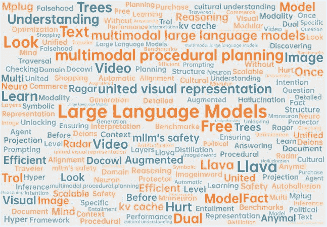

1. `Video-LLaVA`: Learning United Visual Representation by Alignment Before Projection（258次被引）
1. `AnyMAL`: An Efficient and Scalable Any-Modality Augmented Language Model（62次被引）
1. `mPLUG-DocOwl 1.5`: Unified Structure Learning for OCR-free Document Understanding（48次被引）
1. Multimodal Procedural Planning via Dual Text-Image Prompting（32次被引）
1. `MLLM-Protector`: Ensuring `MLLM`’s Safety without Hurting Performance（31次被引）
1. `LOOK-M`: Look-Once Optimization in KV Cache for Efficient Multimodal Long-Context Inference（10次被引）
1. `RAGAR`, Your Falsehood Radar: RAG-Augmented Reasoning for Political Fact-Checking using Multimodal Large Language Models（10次被引）
1. `ImageInWords`: Unlocking Hyper-Detailed Image Descriptions（7次被引）
1. `MIND`: Multimodal Shopping Intention Distillation from Large Vision-language Models for E-commerce Purchase Understanding（7次被引）
1. Benchmarking Vision Language Models for Cultural Understanding（6次被引）
1. `AutoHallusion`: Automatic Generation of Hallucination Benchmarks for Vision-Language Models（6次被引）
1. `TV-TREES`: Multimodal Entailment Trees for Neuro-Symbolic Video Reasoning（5次被引）
1. `MMNeuron`: Discovering Neuron-Level Domain-Specific Interpretation in Multimodal Large Language Model（4次被引）
1. `TraveLER`: A Modular Multi-LMM Agent Framework for Video Question-Answering（4次被引）
1. `TroL`: Traversal of Layers for Large Language and Vision Models（4次被引）

## `Video-LLaVA`: Learning United Visual Representation by Alignment Before Projection

`https://aclanthology.org/2024.emnlp-main.342.pdf`

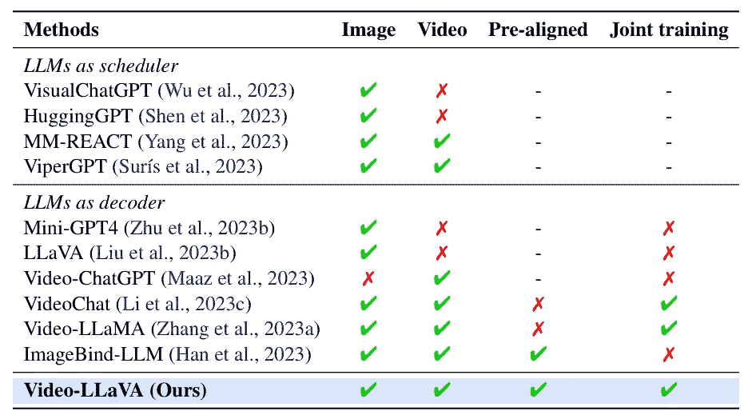

### 总结

《`Video-LLaVA`: Learning United Visual Representation by Alignment Before Projection》指出大型视觉 - 语言模型（`LVLM`）提升了视觉 - 语言理解中各项下游任务的性能。现有多数方法将图像和视频编码到不同特征空间再输入大型语言模型，但由于图像和视频缺乏统一标记化（投影前错位），大型语言模型（`LLM`）难以从几个不佳的投影层中学习多模态交互。

The Large Vision-Language Model (`LVLM`) has enhanced the performance of various downstream tasks in visual-language understanding. Most existing approaches encode images and videos into separate feature spaces, which are then fed as inputs to large language models. However, due to the lack of unified tokenization for images and videos, namely misalignment before projection, it becomes challenging for a Large Language Model (`LLM`) to learn multi-modal interactions from several poor projection layers. In this work, we unify visual representation into the language feature space to advance the foundational `LLM` towards a unified `LVLM`. As a result, we establish a simple but robust `LVLM` baseline, `Video-LLaVA`, which learns from a mixed dataset of images and videos, mutually enhancing each other. `Video-LLaVA` achieves superior performances on a broad range of 9 image benchmarks across 5 image question-answering datasets and 4 image benchmark toolkits. Additionally, our `Video-LLaVA` also outperforms `Video-ChatGPT` by 5.8%, 9.9%, 18.6%, and 10.1% on MSRVTT, MSVD, TGIF, and ActivityNet, respectively. Notably, extensive experiments demonstrate that `Video-LLaVA` mutually benefits images and videos within a unified visual representation, outperforming models designed specifically for images or videos. We aim for this work to provide modest insights into the multi-modal inputs for the `LLM`.

## `AnyMAL`: An Efficient and Scalable Any-Modality Augmented Language Model

`https://aclanthology.org/2024.emnlp-industry.98.pdf`

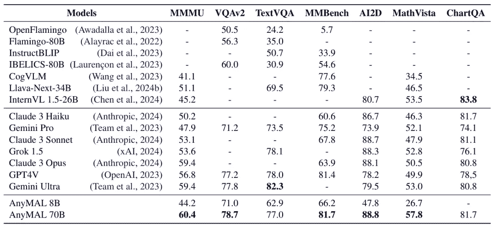

### 总结

本文介绍了`Any-Modality Augmented Language Model`（`AnyMAL`），这是一个能处理多种输入模态信号（如文本、图像、视频、音频、IMU运动传感器）并生成文本响应的统一模型。`AnyMAL`继承了包括`Llama-3`（70B）在内的最先进的大型语言模型（`LLMs`）强大的基于文本的推理能力，并通过预训练的对齐器模块将特定模态的信号转换到联合文本空间。文中详细介绍了为有效扩展训练流程而实施的优化措施，还给出了模型和训练配置的全面方案。作者进行了包括人工和自动评估在内的综合实证分析，证明与行业领先的模型相比，`AnyMAL`在各种多模态任务上达到了最先进的性能，尽管其可训练参数数量相对较少。

We present Any-Modality Augmented Language Model (`AnyMAL`), a unified model that reasons over diverse input modality signals (i.e. text, image, video, audio, IMU motion sensor), and generates textual responses. `AnyMAL` inherits the powerful text-based reasoning abilities of the state-of-the-art `LLMs` including `Llama-3` (70B), and converts modality-specific signals to the joint textual space through a pre-trained aligner module. In this paper, we provide details on the optimizations implemented to efficiently scale the training pipeline, and present a comprehensive recipe for model and training configurations. We conduct comprehensive empirical analysis comprising both human and automatic evaluations, and demonstrate state-of-the-art performance on various multimodal tasks compared to industry-leading models – albeit with a relatively small number of trainable parameters.

## `mPLUG-DocOwl 1.5`: Unified Structure Learning for OCR-free Document Understanding

`https://aclanthology.org/2024.findings-emnlp.175.pdf`

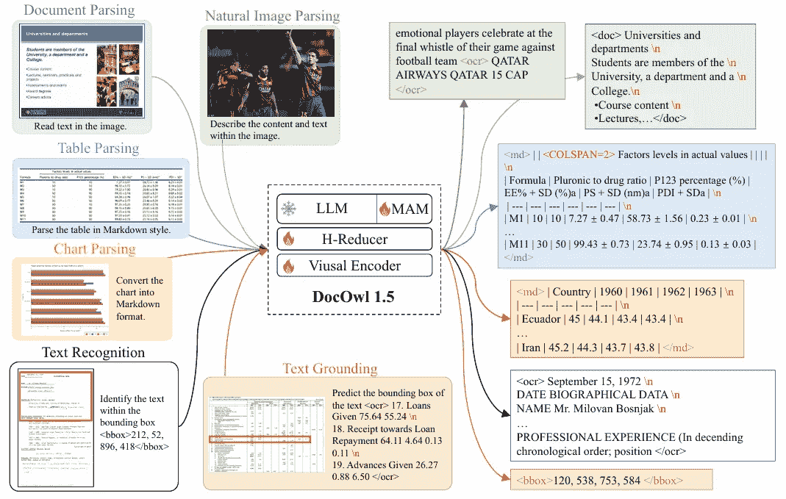

### 总结

结构信息对理解文档、表格和图表等富含文本的图像语义至关重要，现有视觉文档理解的多模态大语言模型（`MLLMs`）具备文本识别能力，但缺乏对富含文本文档图像的通用结构理解能力。本文强调结构信息在视觉文档理解中的重要性，提出统一结构学习（`Unified Structure Learning`）以提升`MLLMs`的性能。统一结构学习涵盖5个领域（文档、网页、表格、图表和自然图像）的结构感知解析任务和多粒度文本定位任务。为更好编码结构信息，设计了简单有效的视觉到文本模块`H-Reducer`，它能通过卷积合并水平相邻块来保持布局信息并减少视觉特征长度，让`LLM`更高效理解高分辨率图像。还构建了结构感知文本序列和多粒度文本与边界框对的综合训练集`DocStruct4M`以支持结构学习，构建了小型高质量推理调优数据集`DocReason25K`以激发文档领域的详细解释能力。模型`DocOwl 1.5`在10个视觉文档理解基准测试中取得了最先进的性能，在5/10基准测试中将7B `LLM`的`MLLMs`的SOTA性能提高了10多个点，代码、模型和数据集可通过特定网址获取。

Structure information is critical for understanding the semantics of text-rich images, such as documents, tables, and charts. Existing Multimodal Large Language Models (`MLLMs`) for Visual Document Understanding are equipped with text recognition ability but lack general structure understanding abilities for text-rich document images. In this work, we emphasize the importance of structure information in Visual Document Understanding and propose the Unified Structure Learning to boost the performance of `MLLMs`. Our Unified Structure Learning comprises structure-aware parsing tasks and multi-grained text localization tasks across 5 domains: document, webpage, table, chart, and natural image. To better encode structure information, we design a simple and effective vision-to-text module `H-Reducer`, which can not only maintain the layout information but also reduce the length of visual features by merging horizontal adjacent patches through convolution, enabling the `LLM` to understand high-resolution images more efficiently. Furthermore, by constructing structure-aware text sequences and multi-grained pairs of texts and bounding boxes for publicly available text-rich images, we build a comprehensive training set `DocStruct4M` to support structure learning. Finally, we construct a small but high-quality reasoning tuning dataset `DocReason25K` to trigger the detailed explanation ability in the document domain. Our model `DocOwl 1.5` achieves state-of-the-art performance on 10 visual document understanding benchmarks, improving the SOTA performance of `MLLMs` with a 7B `LLM` by more than 10 points in 5/10 benchmarks. Our codes, models, and datasets are publicly available at this https URL.

## `Multimodal Procedural Planning via Dual Text-Image Prompting`

`https://aclanthology.org/2024.findings-emnlp.641.pdf`

### 总结

具身智能体在遵循人类指令完成任务方面表现突出，但利用图文信息辅助人类完成任务的潜力尚未充分发掘。为此提出多模态程序规划（`MPP`）任务，模型根据给定的高级目标生成图文步骤计划，这比单模态计划更具互补性和信息性。`MPP`面临确保跨模态计划的信息性、时间连贯性和准确性等挑战。解决方法是提出文本 - 图像提示（`TIP`）这一双模态提示法，利用大语言模型（`LLM`）的零样本推理能力和扩散模型的文本 - 图像生成能力，通过文到图和图到文的桥梁改善双模态交互。为解决相关数据集缺乏的问题，收集了`WIKIPLAN`和`RECIPEPLAN`作为`MPP`测试集，实验结果在信息性、时间连贯性和计划准确性方面，对比单模态和多模态基准有较好的人类偏好和自动评分，同时给出代码和数据的网址。

# 多模态大语言模型相关研究综述

Embodied agents have achieved prominent performance in following human instructions to complete tasks. However, the potential of providing instructions informed by texts and images to assist humans in completing tasks remains underexplored. To uncover this capability, we present the multimodal procedural planning (`MPP`) task, in which models are given a high-level goal and generate plans of paired text-image steps, providing more complementary and informative guidance than unimodal plans. The key challenges of `MPP` are to ensure the informativeness, temporal coherence, and accuracy of plans across modalities. To tackle this, we propose Text-Image Prompting (`TIP`), a dual-modality prompting method that jointly leverages zero-shot reasoning ability in large language models (`LLMs`) and compelling text-to-image generation ability from diffusion-based models. `TIP` improves the interaction in the dual modalities using `Text-to-Image Bridge` and `Image-to-Text Bridge`, allowing `LLMs` to guide the textual-grounded image plan generation and leveraging the descriptions of image plans to ground the textual plan reversely. To address the lack of relevant datasets, we collect `WIKIPLAN` and `RECIPEPLAN` as a testbed for `MPP`. Our results show compelling human preferences and automatic scores against unimodal and multimodal baselines on `WIKIPLAN` and `RECIPEPLAN` in terms of informativeness, temporal coherence, and plan accuracy. Our code and data: `this https URL`.

## `MLLM-Protector`: Ensuring `MLLM`’s Safety without Hurting Performance

`https://aclanthology.org/2024.emnlp-main.895.pdf`

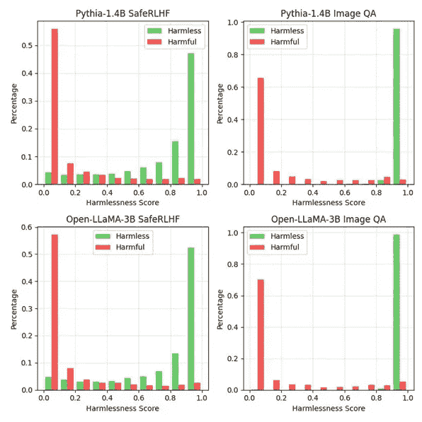

**总结：**多模态大语言模型（`MLLMs`）的部署带来独特漏洞，即易受视觉输入的恶意攻击。本文探讨防御`MLLMs`遭受此类攻击的新挑战。与大语言模型（`LLMs`）相比，`MLLMs`多了图像模态。图像像一种未在安全对齐中被考虑的“外语”，使`MLLMs`更易产生有害响应。图像信号的连续性带来对齐挑战，难以涵盖所有可能场景。多数先进`MLLMs`在有限图文对上微调，少于文本预训练语料，易在安全微调时灾难性遗忘原能力而加剧漏洞。为应对挑战，本文引入`MLLM-Protector`，这是一种即插即用策略，包含识别有害响应和将有害响应转化为无害响应两个子任务，可有效减轻恶意视觉输入风险且不损害`MLLMs`原性能，为`MLLM`安全中之前未解决的问题提供了可靠方案。

The deployment of multimodal large language models (`MLLMs`) has brought forth a unique vulnerability: susceptibility to malicious attacks through visual inputs. This paper investigates the novel challenge of defending `MLLMs` against such attacks. Compared to large language models (`LLMs`), `MLLMs` include an additional image modality. We discover that images act as a “foreign language" that is not considered during safety alignment, making `MLLMs` more prone to producing harmful responses. Unfortunately, unlike the discrete tokens considered in text-based `LLMs`, the continuous nature of image signals presents significant alignment challenges, which poses difficulty to thoroughly cover all possible scenarios. This vulnerability is exacerbated by the fact that most state-of-the-art `MLLMs` are fine-tuned on limited image-text pairs that are much fewer than the extensive text-based pretraining corpus, which makes the `MLLMs` more prone to catastrophic forgetting of their original abilities during safety fine-tuning. To tackle these challenges, we introduce `MLLM-Protector`, a plug-and-play strategy that solves two subtasks: 1) identifying harmful responses via a lightweight harm detector, and 2) transforming harmful responses into harmless ones via a detoxifier. This approach effectively mitigates the risks posed by malicious visual inputs without compromising the original performance of `MLLMs`. Our results demonstrate that `MLLM-Protector` offers a robust solution to a previously unaddressed aspect of `MLLM` security.

## `LOOK-M`: Look-Once Optimization in `KV` Cache for Efficient Multimodal Long-Context Inference

`https://aclanthology.org/2024.findings-emnlp.235.pdf`

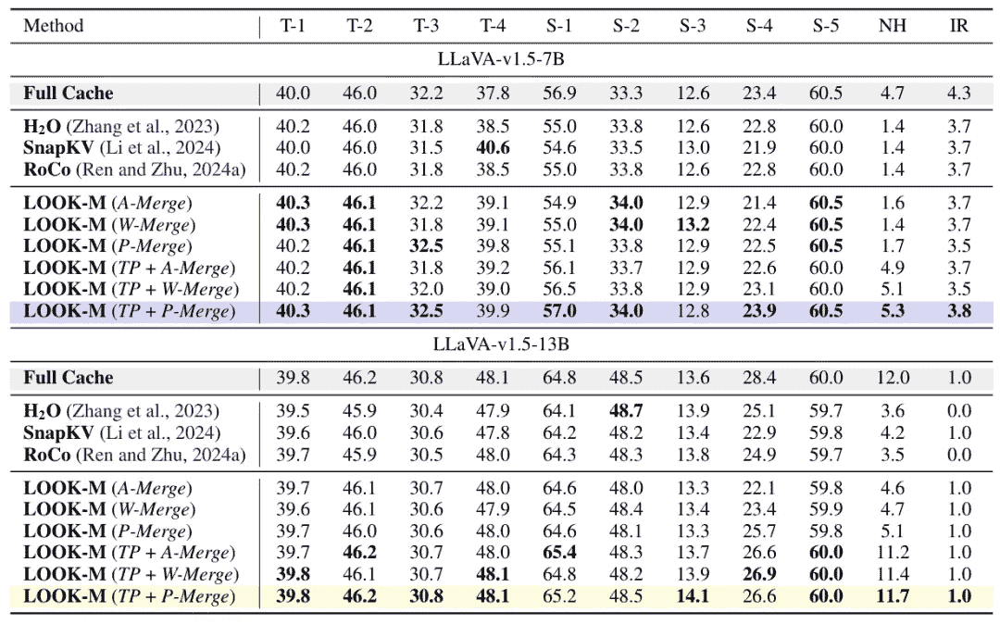

**总结：**`LOOK-M`：用于高效多模态长文本推理的`KV`缓存一次性优化。长文本多模态大语言模型（`MLLMs`）的推理需要大量计算资源，因为随着输入长度增加，其多模态键值（`KV`）缓存增长，这对内存和时间效率带来挑战。与仅处理文本语境的单模态大语言模型不同，长文本`MLLMs`的`KV`缓存包含具有时空关系的多个图像的表征以及相关文本语境。

Long-context Multimodal Large Language Models (`MLLMs`) demand substantial computational resources for inference as the growth of their multimodal Key-Value (`KV`) cache, in response to increasing input lengths, challenges memory and time efficiency. Unlike single-modality `LLMs` that manage only textual contexts, the `KV` cache of long-context `MLLMs` includes representations from multiple images with temporal and spatial relationships and related textual contexts. The predominance of image tokens means traditional optimizations for `LLMs`' `KV` caches are unsuitable for multimodal long-context settings, and no prior works have addressed this challenge. In this work, we introduce `LOOK-M`, a pioneering, fine-tuning-free approach that efficiently reduces the multimodal `KV` cache size while maintaining performance comparable to a full cache. We observe that during prompt prefill, the model prioritizes more textual attention over image features, and based on the multimodal interaction observation, a new proposed text-prior method is explored to compress the `KV` cache. Furthermore, to mitigate the degradation of image contextual information, we propose several compensatory strategies using `KV` pairs merging. `LOOK-M` demonstrates that with a significant reduction in `KV` Cache memory usage, such as reducing it by 80% in some cases, it not only achieves up to 1.5x faster decoding but also maintains or even enhances performance across a variety of long context multimodal tasks.

## `RAGAR, Your Falsehood Radar: RAG-Augmented Reasoning for Political Fact-Checking using Multimodal Large Language Models`

`https://aclanthology.org/2024.fever-1.29.pdf`

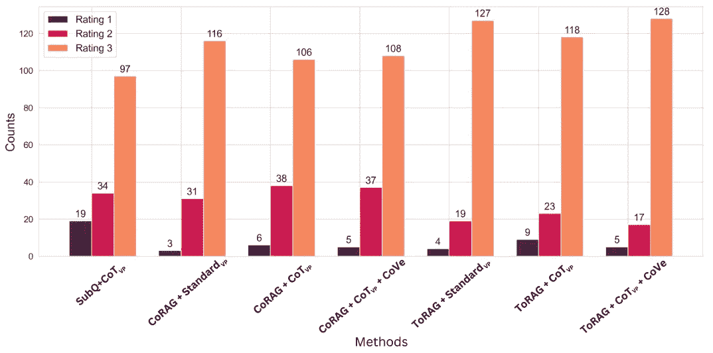

**总结：**随着政治话语中错误信息的挑战不断升级，多模态声明场景下更需先进的事实核查方案。本文利用多模态大语言模型结合检索增强生成（`RAG`）解决该问题，引入两种推理技术（链状与树状`RAG`），它们通过提取文本和图像内容、检索外部信息并依据先验证据推理后续待答问题来核查多模态声明，加权F1分数达0.85，超基线推理技术0.14分，人类评估也表明多数生成的事实核查解释包含了金标准数据中的所有信息。

The escalating challenge of misinformation, particularly in political discourse, requires advanced fact-checking solutions; this is even clearer in the more complex scenario of multimodal claims. We tackle this issue using a multimodal large language model in conjunction with retrieval-augmented generation (`RAG`), and introduce two novel reasoning techniques: Chain of `RAG` (`CoRAG`) and Tree of `RAG` (`ToRAG`). They fact-check multimodal claims by extracting both textual and image content, retrieving external information, and reasoning subsequent questions to be answered based on prior evidence. We achieve a weighted F1-score of 0.85, surpassing a baseline reasoning technique by 0.14 points. Human evaluation confirms that the vast majority of our generated fact-check explanations contain all information from gold standard data.

## `ImageInWords`: Unlocking Hyper-Detailed Image Descriptions

`https://aclanthology.org/2024.emnlp-main.6.pdf`

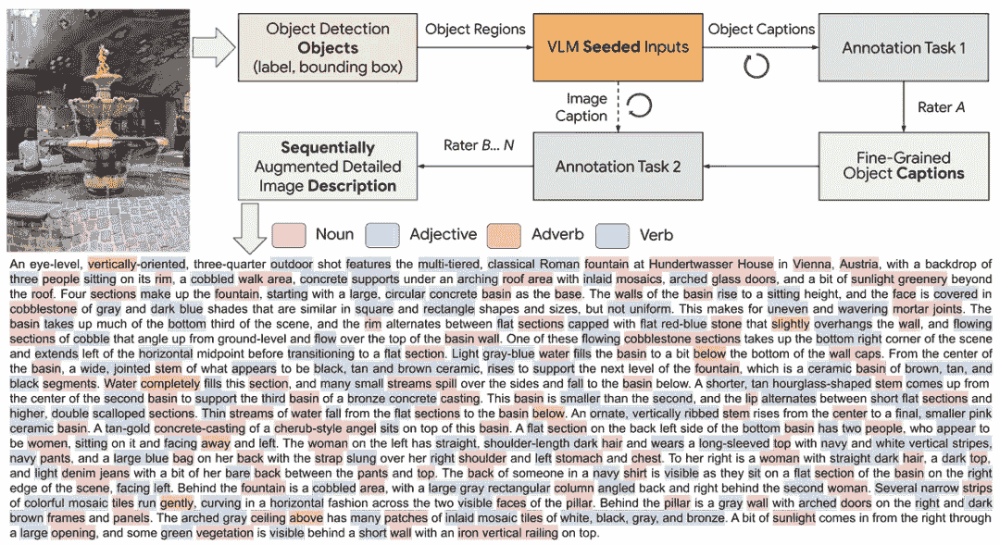

**总结：**`ImageInWords`: Unlocking Hyper-Detailed Image Descriptions指出生成准确的超详细图像描述仍是未解决的问题，视觉 - 语言模型常生成视觉不一致的不完整描述。本文通过精心设计的人工介入框架`ImageInWords`（`IIW`）的数据中心方法解决该问题。对`IIW`数据的人工评估显示，在全面性、特异性、幻觉等方面，较新数据集（提升66%）和`GPT4V`（提升48%）有重大改进。使用`IIW`数据微调较之前工作训练的模型在相关指标上提升31%（即使只有9k样本）。最后通过文生图和视觉 - 语言推理任务评估`IIW`模型，其生成的描述能得到最高保真度的图像，并在相关数据集上提升组合推理能力达6%，还发布带有人类判断标签等内容的`IIW Eval`基准。

Despite the longstanding adage "an image is worth a thousand words," generating accurate hyper-detailed image descriptions remains unsolved. Trained on short web-scraped image text, vision-language models often generate incomplete descriptions with visual inconsistencies. We address this via a novel data-centric approach with `ImageInWords` (`IIW`), a carefully designed human-in-the-loop framework for curating hyper-detailed image descriptions. Human evaluations on `IIW` data show major gains compared to recent datasets (+66%) and `GPT4V` (+48%) across comprehensiveness, specificity, hallucinations, and more. We also show that fine-tuning with `IIW` data improves these metrics by +31% against models trained with prior work, even with only 9k samples. Lastly, we evaluate `IIW` models with text-to-image generation and vision-language reasoning tasks. Our generated descriptions result in the highest fidelity images, and boost compositional reasoning by up to 6% on `ARO`, `SVO-Probes`, and `Winoground` datasets. We release the `IIW Eval` benchmark with human judgement labels, object and image-level annotations from our framework, and existing image caption datasets enriched via `IIW-model`.

## MIND: Multimodal Shopping Intention Distillation from Large Vision-language Models for E-commerce Purchase Understanding

`https://aclanthology.org/2024.emnlp-main.446.pdf`

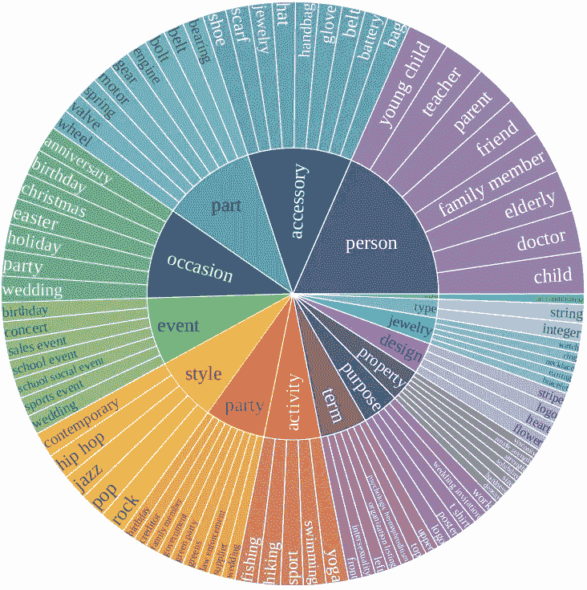

### 总结

在电商平台中，提升用户体验和提供个性化搜索结果非常依赖对购买意图的理解。现有获取大规模意图的方法依赖于通过人工标注来提炼大型语言模型以进行验证，这种方法倾向于生成以产品为中心的意图，忽视了产品图像中的视觉信息，且可扩展性成本高。为解决这些问题，本文引入了`MIND`多模态框架。

Improving user experience and providing personalized search results in E-commerce platforms heavily rely on understanding purchase intention. However, existing methods for acquiring large-scale intentions bank on distilling large language models with human annotation for verification. Such an approach tends to generate product-centric intentions, overlook valuable visual information from product images, and incurs high costs for scalability. To address these issues, we introduce `MIND`, a multimodal framework that allows Large Vision-Language Models (`LVLMs`) to infer purchase intentions from multimodal product metadata and prioritize human-centric ones. Using Amazon Review data, we apply `MIND` and create a multimodal intention knowledge base, which contains 1,264,441 million intentions derived from 126,142 co-buy shopping records across 107,215 products. Extensive human evaluations demonstrate the high plausibility and typicality of our obtained intentions and validate the effectiveness of our distillation framework and filtering mechanism. Additional experiments reveal that our obtained intentions significantly enhance large language models in two intention comprehension tasks.

## Benchmarking Vision Language Models for Cultural Understanding

`https://aclanthology.org/2024.emnlp-main.329.pdf`

### 总结

视觉语言模型（`VLMs`）在基础模型和视觉 - 语言预训练发展下可对视觉和语言数据进行多模态处理，但其性能评估多为一般场景理解而非文化理解。本研究推出`CulturalVQA`这一视觉问答基准，用于评估`VLM`对不同地域文化的理解。该基准包含2378个图像 - 问题对，问题涉及11个国家的文化多方面，答案1 - 5个不等。经`CulturalVQA`对包括`GPT - 4V`和`Gemini`在内的`VLMs`进行基准测试，发现其对不同地区文化理解水平存在差异，对北美文化理解能力强，对非洲表现差；在文化层面上表现也有差异，对服饰、仪式和传统理解表现优于食物和饮品。这些差异有助于找出`VLMs`缺乏文化理解的方面，也证明`CulturalVQA`可用于全面评估`VLM`在理解多元文化方面的进展。

Foundation models and vision-language pre-training have notably advanced Vision Language Models (`VLMs`), enabling multimodal processing of visual and linguistic data. However, their performance has been typically assessed on general scene understanding - recognizing objects, attributes, and actions - rather than cultural comprehension. This study introduces `CulturalVQA`, a visual question-answering benchmark aimed at assessing VLM's geo-diverse cultural understanding. We curate a collection of 2,378 image-question pairs with 1-5 answers per question representing cultures from 11 countries across 5 continents. The questions probe understanding of various facets of culture such as clothing, food, drinks, rituals, and traditions. Benchmarking `VLMs` on `CulturalVQA`, including `GPT-4V` and `Gemini`, reveals disparity in their level of cultural understanding across regions, with strong cultural understanding capabilities for North America while significantly lower performance for Africa. We observe disparity in their performance across cultural facets too, with clothing, rituals, and traditions seeing higher performances than food and drink. These disparities help us identify areas where `VLMs` lack cultural understanding and demonstrate the potential of `CulturalVQA` as a comprehensive evaluation set for gauging VLM progress in understanding diverse cultures.

## AutoHallusion: Automatic Generation of Hallucination Benchmarks for Vision-Language Models

`https://aclanthology.org/2024.findings-emnlp.493.pdf`

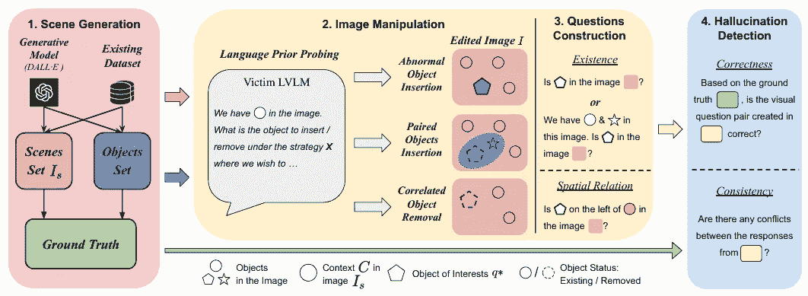

### 总结

大型视觉 - 语言模型（`LVLMs`）容易产生幻觉，现有检测其幻觉的基准测试存在依赖手工制作特殊情况（可能不具普遍性）、微调会破坏有效性等问题。为此提出`AutoHallusion`，这是首个自动生成基准的方法，采用多种策略创建多样化的幻觉示例，视觉 - 问答对给`LVLMs`带来挑战。`AutoHallusion`能低成本创建新基准，克服手工基准的脆弱性，揭示常见失败模式和原因。对顶尖`LVLMs`的综合评估表明，在`AutoHallusion`的合成和真实数据集上，幻觉诱导成功率分别为97.7%和98.7%，为应对幻觉的长期斗争铺平道路，代码库和数据可通过指定链接获取。

Large vision-language models (`LVLMs`) are prone to hallucinations, where certain contextual cues in an image can trigger the language module to produce overconfident and incorrect reasoning about abnormal or hypothetical objects. While some benchmarks have been developed to investigate `LVLM` hallucinations, they often rely on hand-crafted corner cases whose failure patterns may not generalize well. Additionally, fine-tuning on these examples could undermine their validity. To address this, we aim to scale up the number of cases through an automated approach, reducing human bias in crafting such corner cases. This motivates the development of `AutoHallusion`, the first automated benchmark generation approach that employs several key strategies to create a diverse range of hallucination examples. Our generated visual-question pairs pose significant challenges to `LVLMs`, requiring them to overcome contextual biases and distractions to arrive at correct answers. `AutoHallusion` enables us to create new benchmarks at the minimum cost and thus overcomes the fragility of hand-crafted benchmarks. It also reveals common failure patterns and reasons, providing key insights to detect, avoid, or control hallucinations. Comprehensive evaluations of top-tier `LVLMs`, e.g., `GPT-4V(ision)`, `Gemini Pro Vision`, `Claude 3`, and `LLaVA-1.5`, show a 97.7% and 98.7% success rate of hallucination induction on synthetic and real-world datasets of `AutoHallusion`, paving the way for a long battle against hallucinations. The codebase and data can be accessed at this `https URL`.

## TV-TREES: Multimodal Entailment Trees for Neuro-Symbolic Video Reasoning

`https://aclanthology.org/2024.emnlp-main.1059.pdf`

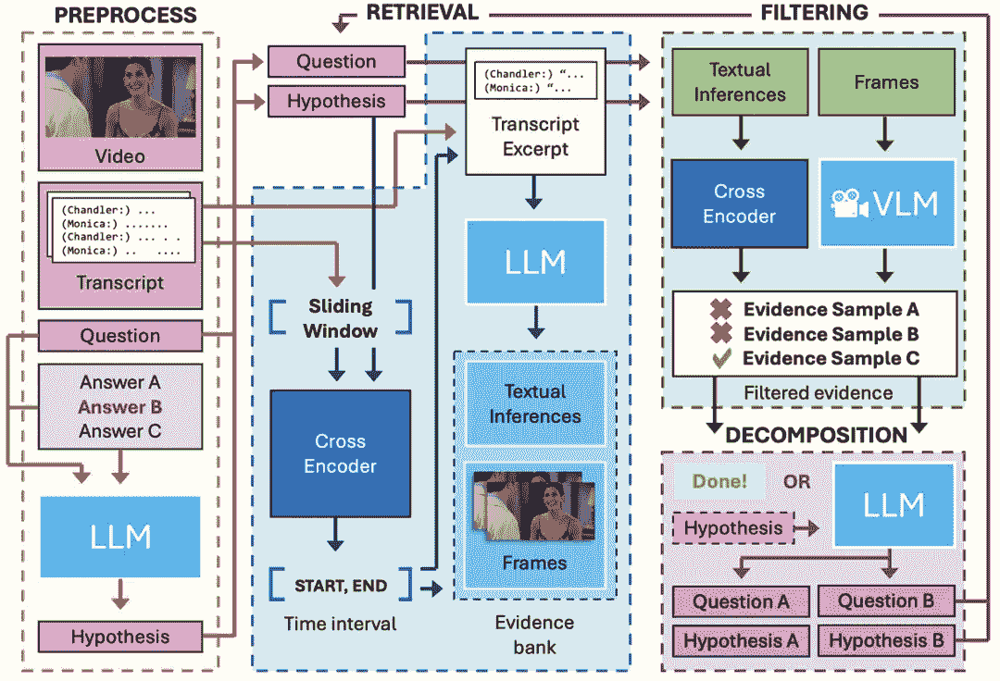

### 总结

对电视剪辑等复杂多模态内容进行问答具有挑战性，部分原因是当前视频 - 语言模型依赖单模态推理、长输入时性能降低且缺乏可解释性。我们提出首个多模态蕴含树生成器`TV - TREES`，它通过生成由简单前提之间蕴含关系构成的树来推动可解释的联合模态推理。

It is challenging for models to understand complex, multimodal content such as television clips, and this is in part because video-language models often rely on single-modality reasoning and lack interpretability. To combat these issues we propose `TV-TREES`, the first multimodal entailment tree generator. `TV-TREES` serves as an approach to video understanding that promotes interpretable joint-modality reasoning by searching for trees of entailment relationships between simple text-video evidence and higher-level conclusions that prove question-answer pairs. We also introduce the task of multimodal entailment tree generation to evaluate reasoning quality. Our method's performance on the challenging `TVQA` benchmark demonstrates interpretable, state-of-the-art zero-shot performance on full clips, illustrating that multimodal entailment tree generation can be a best-of-both-worlds alternative to black-box systems.

## MMNeuron: Discovering Neuron-Level Domain-Specific Interpretation in Multimodal Large Language Model

## `https://aclanthology.org/2024.emnlp-main.387.pdf`

### 总结
《MMNeuron：在多模态大语言模型中发现神经元级别的特定领域解释》，将视觉特征投射到词嵌入空间是多模态大语言模型（MLLMs）的重要融合策略，但其内部机制有待探索。受多语言研究启发，在多模态大语言模型中识别特定领域的神经元，探究其分布及MLLMs处理不同领域特征的机制，提出MLLMs的语言模型模块处理投射图像特征的三阶段机制且用logit lens验证。大量实验表明，当前MLLMs虽有视觉问答（VQA）能力，但可能未充分利用特定领域信息，适当操纵特定领域神经元最多会使准确率改变10%，这对未来跨领域、全包含的MLLMs发展有启示，源代码可通过特定网址获取。

Projecting visual features into word embedding space has become a significant fusion strategy adopted by Multimodal Large Language Models (MLLMs). However, its internal mechanisms have yet to be explored. Inspired by multilingual research, we identify domain-specific neurons in multimodal large language models. Specifically, we investigate the distribution of domain-specific neurons and the mechanism of how MLLMs process features from diverse domains. Furthermore, we propose a three-stage mechanism for language model modules in MLLMs when handling projected image features, and verify this hypothesis using logit lens. Extensive experiments indicate that while current MLLMs exhibit Visual Question Answering (VQA) capability, they may not fully utilize domain-specific information. Manipulating domain-specific neurons properly will result in a 10% change of accuracy at most, shedding light on the development of cross-domain, all-encompassing MLLMs in the future. The source code is available at this https URL.

## TraveLER: A Modular Multi-LMM Agent Framework for Video Question-Answering

`https://aclanthology.org/2024.emnlp-main.544.pdf`

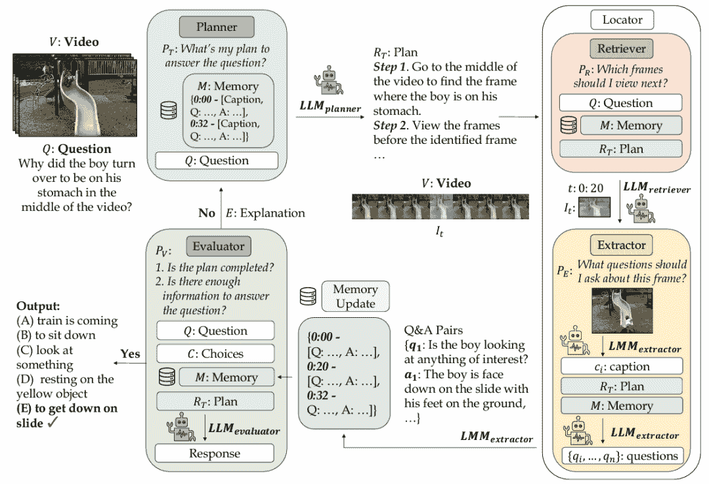

### 总结
近期，基于图像的大型多模态模型（LMMs）在视频问答（VideoQA）方面通过逐帧方法利用大规模预训练以零次学习的方式取得了重大进展。然而，这些模型需要能够同时查找相关信息、提取信息并回答问题。目前，现有方法在单次处理中执行所有这些步骤，倘若收集到的信息不充分或不正确，它们无法进行适应性调整。为克服这一问题，引入了一个模块化的多大型多模态模型智能体框架，该框架基于多个承担不同角色的智能体，并由一个规划器智能体进行指导，规划器智能体利用来自其他智能体的共享反馈来更新其指令。具体而言，提出了 `TraveLER` 方法，该方法能够制定一个计划来 "遍历" 视频，针对各个视频帧提出问题以 "定位" 并存储关键信息，然后 "评估" 是否有足够的信息来回答问题。最后，如果信息不足，方法能够基于其已收集的知识进行 "重新规划"。通过大量实验，发现所提出的 `TraveLER` 方法在多个视频问答基准测试中提高了性能，且无需针对特定数据集进行微调。

Recently, image-based Large Multimodal Models (LMMs) have made significant progress in video question-answering (VideoQA) using a frame-wise approach by leveraging large-scale pretraining in a zero-shot manner. Nevertheless, these models need to be capable of finding relevant information, extracting it, and answering the question simultaneously. Currently, existing methods perform all of these steps in a single pass without being able to adapt if insufficient or incorrect information is collected. To overcome this, we introduce a modular multi-LMM agent framework based on several agents with different roles, instructed by a `Planner` agent that updates its instructions using shared feedback from the other agents. Specifically, we propose `TraveLER`, a method that can create a plan to "Traverse" through the video, ask questions about individual frames to "Locate" and store key information, and then "Evaluate" if there is enough information to answer the question. Finally, if there is not enough information, our method is able to "Replan" based on its collected knowledge. Through extensive experiments, we find that the proposed `TraveLER` approach improves performance on several VideoQA benchmarks without the need to fine-tune on specific datasets. Our code is available at this https URL.

## TroL: Traversal of Layers for Large Language and Vision Models

`https://aclanthology.org/2024.emnlp-main.633.pdf`

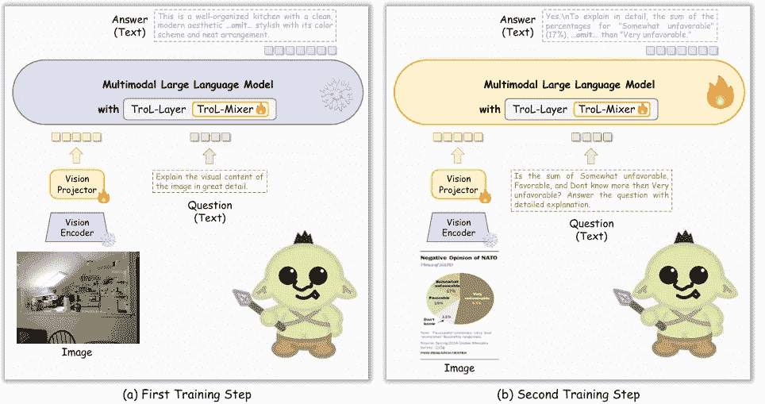

### 总结
大型语言与视觉模型（LLVMs）受到了大型语言模型（LLMs）的泛化能力以及视觉指令微调出现的推动。除了直接对它们进行扩展之外，这些模型通过自然语言指令涵盖多样的任务，使大型语言与视觉模型能够展现出强大的视觉语言（VL）性能。然而，现有在性能上能与闭源大型语言与视觉模型（如 `GPT-4V`）相媲美的开源大型语言与视觉模型往往被认为体量过大（例如，拥有 260 亿、340 亿和 1100 亿参数，层数较多）。这些大型模型在训练和推理时都需要成本高昂的高端资源。为解决这一问题，推出了一个新的高效大型语言与视觉模型家族，其大型语言模型部分的尺寸分别为 18 亿、38 亿和 70 亿参数，即 "`TroL`" 模型，它能够以词元（token）的方式对各层进行复用。这种层遍历技术模拟了回溯并重新追踪回答流程的效果，在不实际增加更多层数的情况下增加了前向传播的层数。证明了 "`TroL`" 采用了一种简单的层遍历方法，但却能高效地超越具有更大模型尺寸的开源大型语言与视觉模型，并且能与规模可观的闭源大型语言与视觉模型的性能相匹敌。

Large language and vision models (LLVMs) have been driven by the generalization power of large language models (LLMs) and the advent of visual instruction tuning. Along with scaling them up directly, these models enable LLVMs to showcase powerful vision language (VL) performances by covering diverse tasks via natural language instructions. However, existing open-source LLVMs that perform comparably to closed-source LLVMs such as `GPT-4V` are often considered too large (e.g., 26B, 34B, and 110B parameters), having a larger number of layers. These large models demand costly, high-end resources for both training and inference. To address this issue, we present a new efficient LLVM family with 1.8B, 3.8B, and 7B LLM model sizes, Traversal of Layers (`TroL`), which enables the reuse of layers in a token-wise manner. This layer traversing technique simulates the effect of looking back and retracing the answering stream while increasing the number of forward propagation layers without physically adding more layers. We demonstrate that `TroL` employs a simple layer traversing approach yet efficiently outperforms the open-source LLVMs with larger model sizes and rivals the performances of the closed-source LLVMs with substantial sizes.
