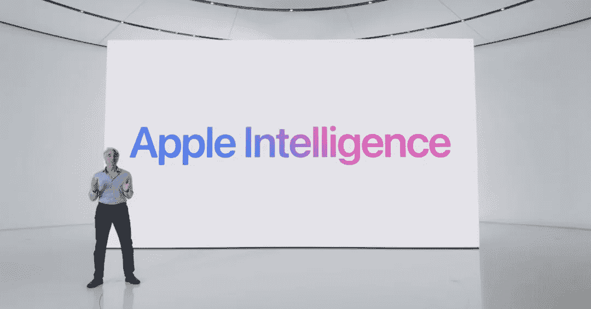

# 第1期 AI行业周报（2024-6.10-16）

> 来源：[https://v11enp9ok1h.feishu.cn/docx/KTA8dqRrio6p52xHpjicYsEvnjh](https://v11enp9ok1h.feishu.cn/docx/KTA8dqRrio6p52xHpjicYsEvnjh)

## 苹果发布 Apple Intelligence，Siri「换脑」接入 ChatGPT

本周，Apple Intelligence（Apple 智能）正式在 WWDC 2024 大会上面世。

Apple 智能利用先进的人工智能和机器学习，通过理解个人情境、确定通知的优先级、提供智能写作工具、创建自定义图像以及自动执行跨应用程序的操作来增强用户体验。

通俗一点说，就是你的 iPhone、iPad 和 Mac，真的带脑子了，会主动思考和理解用户了。

并且在发布会上，苹果也正式宣布与 OpenAI 达成合作。未来 ChatGPT 将被整合到 Siri 当中 ，并且被融入全系统的书写工具当中。

用户无需注册账户，即可直接免费使用这一功能。而 ChatGPT 的付费订阅用户可以在这些操作系统中直接连接他们的账户，并享受付费功能的便捷访问。

## 字节扣子 AI 模型广场上线

与同一个 AI 模型对话太单调，总是无法完美契合需求？

近日，字节跳动扣子平台上线了「模型广场」功能，提供了一个支持大模型匿名打 PK 的「擂台」。

具体来说，模型广场的对战模式分为「随机 Bot 对战」「指定 Bot 对战」以及「纯模型对战」三种。

和扣子聊完后，用户可以选择更好的模型并进行投票。投完票后，页面将及时揭晓两个模型的具体信息。

##  小爱同学接入豆包大模型，小米 SU7 率先搭载

士别三日，当刮目相待，你可以和小爱同学 battle 脑力了。

本周三，据字节旗下「火山引擎」公众号介绍，小米旗下人工智能助手「小爱同学」与火山引擎达成合作，双方基于豆包大模型为用户带来更智能的 AI 交互体验。

「小爱同学」作为小米公司倾力打造的智能助手，已经成功融入手机、智能家居、智能穿戴设备以及小米 SU7 等众多小米产品中，提升了用户的日常交互便捷性。

借助字节跳动豆包大模型提供的联网搜索插件能力，小爱智能助手将能够实时捕获与头条内容同源的搜索结果，为用户呈现全面且时效性强的答复。

## Stability AI 推出适用于普通电脑的文本生成图像模型 SD3 Medium

6 月 13 日消息，Stability AI 推出 Stable Diffusion 3 Medium 版，可以在自己的笔记本电脑 / 台式机上快速生成图片。该模型参数只有 20 亿，占用的显存空间较小可以在 NVIDIA RTX 和 AMD 新显卡上使用。

和之前的 SD 系列模型一样，SD3 Medium 版也是免费提供的，属于开放但非开源的模型，如果需要商业性使用则应当购买授权。

## 大模型四小龙激辩AGI的未来：价格战可以打 但不能亏本

腾讯科技讯（李安琪） 6 月 14 日上午，国内大模型四小龙：百川智能 CEO 王小川、智谱 AI CEO 张鹏、月之暗面 CEO 杨植麟、面壁智能 CEO 李大海在 2024 年智源大会上就“大模型是否是通往 AGI 之路的基石”展开深入探讨，各位嘉宾分享了他们对大模型在 AGI 发展中关键作用的见解。

## OpenAI 最新业绩曝光：年化营收 34 亿美元

6 月 13 日消息称，OpenAI CEO 山姆·奥尔特曼 (Sam Altman) 对员工表示，过去六个月时间左右，公司的年化营收达到了 34 亿美元。这表明，即便是竞争激烈的情况下，OpenAI 的增长也在加速。

相比之下，OpenAI 在 2023 年底时的年化营收还只有 16 亿美元，去年夏天时约为 10 亿美元。

该公司大部分收入来自 ChatGPT 的订阅版本，该版本为每月支付至少 20 美元的用户提供更高的消息限制，以及来自向公司付费以在自己的应用和服务中使用公司大型语言模型的开发人员。每年约有 2 亿美元来自微软，该公司向使用 Azure（微软面向企业的云计算平台）的客户销售 OpenAI 大型语言模型，从而为 OpenAI 带来一定比例的分成。

