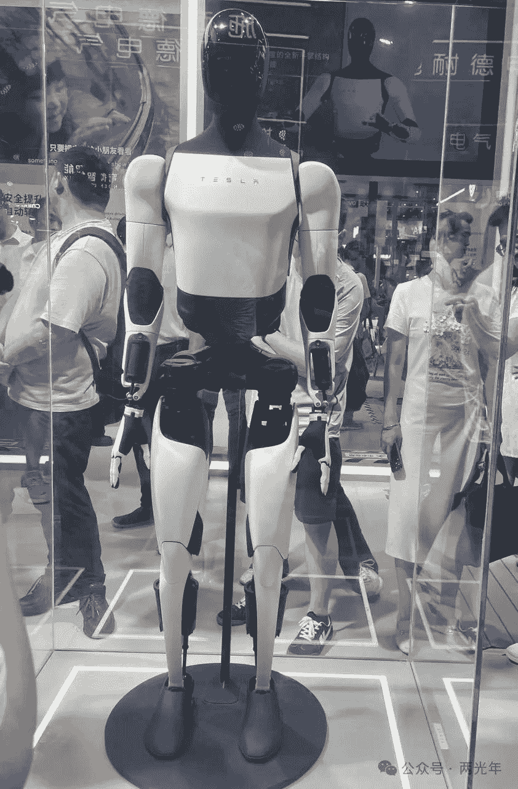
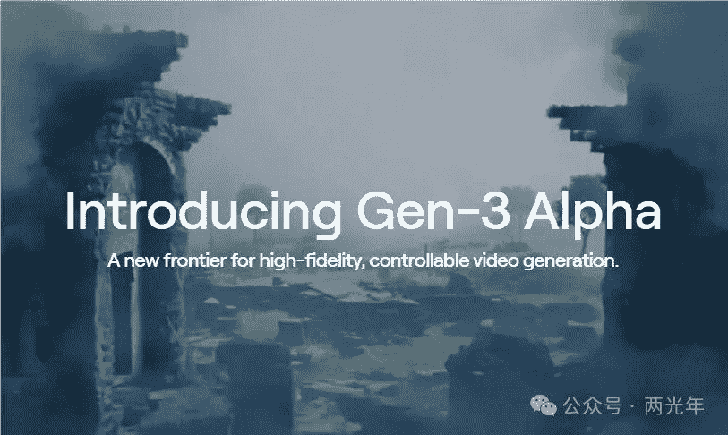
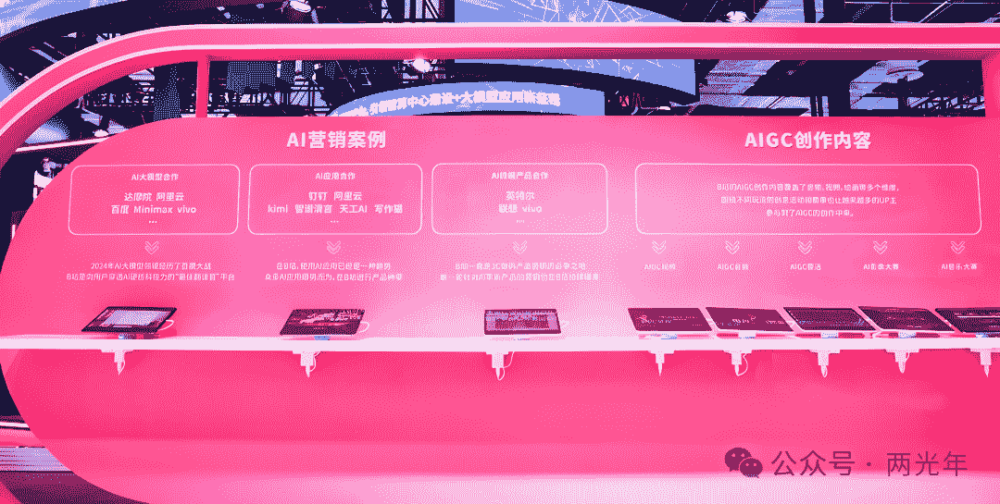
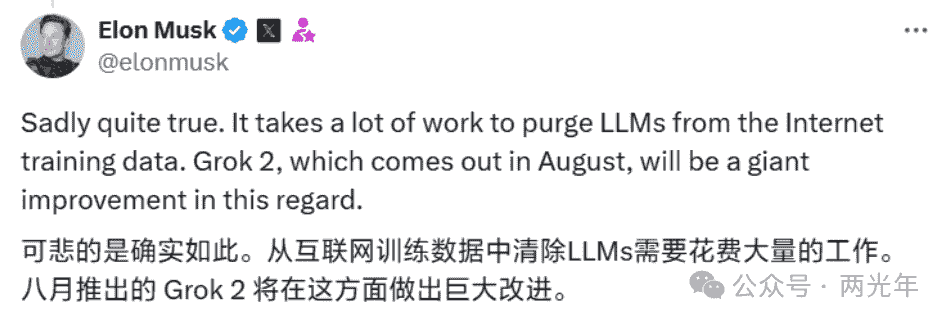
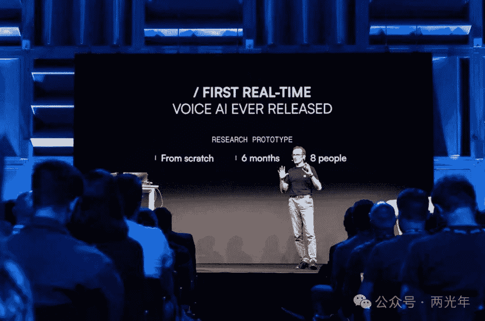

# 第4期 AI行业周报（2024-7.1-7）

> 来源：[https://v11enp9ok1h.feishu.cn/docx/CdoPdUv5CoOj9dx5X9IcaUpinYc](https://v11enp9ok1h.feishu.cn/docx/CdoPdUv5CoOj9dx5X9IcaUpinYc)

## 全球AI精英的科技盛事——2024上海世界人工智能大会开幕

2024年7月，全球AI精英将汇聚上海，共赴科技界的奥林匹克——世界人工智能大会暨人工智能全球治理高级别会议（WAIC 2024）。

本届大会将有9位图灵奖、菲尔兹奖、诺贝尔奖获得者及88位国际知名院士共襄盛举，共同探讨人工智能伦理、先进算法模型、数据科学、计算能力以及具身智能等关键议题。

本届大会展览规模宏大，占地面积超过52,000平方米，集中展示人工智能核心技术、智能设备和应用赋能三大领域的最新进展。据悉，已有包括特斯拉、微软、施耐德在内的500多家领军企业确认参展，展出项目超过1500项，充分展现出人工智能领域的创新成果和应用潜力。

本届大会可以说AI黑科技众多，让人大饱眼福！！！

我们真正意识到了，AI正在融入我们的生活，让我们的生活质量直线提升，同时也改变着我们看待世界的方式。

## 特斯拉Optimus二代机器人在世界人工智能大会上首次亮相，直逼真人！

特斯拉Optimus二代人形机器人，将在2024年世界人工智能大会上首次亮相。Optimus由特斯拉自主研发，集成了先进的神经网络和计算机视觉系统，旨在自动化 执行危险或单调的任务，如搬运、购物等。

这款机器人配备了2.3kWh的电池，拥有172CM的身高和73KG的体重，具有出色的能耗控制和超过200个自由度的灵活性，其手指设计仿生，拥有27个自由度，实现自然的行走和精细操作。

同时，埃隆·马斯克近期宣布，特斯拉计划从2025年开始对Optimus进行限量生产，这标志着特斯拉在智能机器人领域的进一步深入，或许，“真人工智能”真的离我们很近很近！

另外，这个机器人真的真的泰裤啦！！！

## Runway的Gen-3向所有人开放，媲美Sora！

前段时间，Sora的宣传片一经发出，在网络中引起了轩然大波。把人们的目光牢牢的抓去。而在此时，Sora还没有正式向用户开放，而一个与Sora有着同样功能的产品已经对用户全面开放。不得不感叹，AI发展速度之快。

关于AI视频生成平台Runway最近宣布，其最新产品Gen-3 Alpha向向所有用户开放使用，并提供了产品入口链接。

Gen-3 Alpha不仅在技术上领先，更在安全性和可靠性上树立了行业标杆，与顶级娱乐和媒体公司的合作预示着其在定制开发上的无限潜力。另外，Gen-3 Alpha通过视频和图像的联合训练，展现了卓越的光影效果和快速生成能力，无论是极速变换的场景还是细腻的叙事需求，都能轻松驾驭。

Gen-3 Alpha在多个方面，包括光影效果、质量、构图、文本语义还原、物理模拟以及动作的一致性和连贯性上都有显著提升，使其成为能够与OpenAI的Sora相媲美的产品。

## AI医生来袭：百川智能健康顾问，你的家庭医疗新伙伴！

在2024年世界人工智能大会上，百川智能推出的AI健康顾问，不仅拥有医生般的专业问诊能力，还在医疗知识测试中击败了GPT-4，成为医疗界的"学霸"！

这款AI不仅能够深入挖掘病症信息，还能给出精准的诊断和用药建议，让你在家就能享受到全科医生的专业服务。百川智能的创新，让AI在医疗领域迈出了一大步。

可能在未来，当我们需要健康咨询时，可能只需一句"你好，AI医生"。就是如此简单，如此美好。

## 支付宝发布多模态医疗大模型，支持千亿级视觉识别

在2024世界人工智能大会“可信大模型论坛”上，支付宝多模态医疗大模型正式亮相，成为国内首批多模态医疗大模型之一。基于蚂蚁百灵的多模态能力，该模型可实现直接理解并训练音频、视频、图、文等多模态数据，使其更像人一样感知和互动，同时支持千亿级别参数医疗视觉识别。

该模型在诊疗报告、医学药品识别及毛发状况分析等领域的测试准确率超过90%，并在中英文医疗专业考试和基准测试中达到了GPT4水准。

此外，支付宝联合全国20家顶级三甲医院和医疗管理机构，共同发起AI医疗共建计划，旨在推动大模型技术在医疗健康领域的深度融合与创新应用，以提高医疗服务质量和效率，助力医疗行业数字化转型。

或许，那句"你好，AI医生"，在不久的将来，出现在我们的日常生活中。医疗大模型将会彻底改变我们面对疾病的处理方式，为我们的健康保驾护航。

## B站亮相2024世界人工智能大会，首次展出自研大语言型

是的，你没有看错，就是它，那个学习网站也在此次的大会上公布了众多AI黑科技，其中最为重要的，便是它的自研大模型。

在 2024 世界人工智能大会(WAIC 2024)上，哔哩哔哩(以下简称“B站”)公布了多项自主研发的 A! 技术成果和AIGC 多元创意，包括最新定制的 A语音声库、自研音视频大模型必剪 Studio 以及自研 AI动态漫技术等。

此外，B站自研的大语言模型系列也在此次 WAIC 2024 大会上首次展出，包括开源的 |ndex-1.9B chat 和 Index-1.9Bcharacter 两个模型。

另提一句，在B站 15 周年演讲上，B站董事长兼 CEO 陈睿表示，2023 年，B站 AI 相关内容的日均视频播放量同比增长超过 80%，爆款内容涵盖科普资讯、AI 技术应用、数字人和创意应用等领域。这足以说明AI在这个时代的火爆之处。

## 马斯克：xAI 将于 8 月推出 Grok-2 大语言模型，预计年底推出 Grok-3

xA1今年3月、4月陆续推出了 Grok-1.5 大语言模型和首个多模态模型 Grok-1.5 Vision。xAl 曾表示，Grok-1.5V 在多学科推理、文档理解、科学图表、表格处理、屏幕截图和照片等多个领域"都能媲美现有的前沿多模态模型"。

而就在本周，马斯克在自己的X(推特)平台上发文宣布，其人工智能初创公司 xA! 的大语言模型 Grok-2 将于8月推出。，承诺在数据质量和模型安全性上实现重大突破。忘掉AI训练的'人体蜈蚣效应'，Grok-2将引领我们进入一个更智能、更可靠的AI新时代。

此外，马斯克还透露，计划年底推出的 Grok-3，预计在10万块英伟达H100芯片的强大算力上训练，势将刷新人工智能的性能极限。或许，在不久，它将成为OPen AI最难缠的对手。

## 仅成立半年就敢直面 OpenAI ，首个开源模型Moshi不输 GPT-4o

7月4日凌晨，法国知名开源A1研究实验室Kyut，在官网发布了多模态大模型——Moshi。Moshi功能与OpenAI在5月14日展示的最新模型GPT-40差不多，都可以听取人的语音提问后进行实时推理回答内容。但GPT-40的语音模式要在秋天才能全面开放使用，而Moshi已经提供使用了。

值得注意的是，Moshi从提出到诞生只用了半年的时间，而其效果就已比肩GPT-4o，只能说两个字——疯狂。

而它的使用方式也异常的简单，只需要填写一个邮箱地址就能直接使用，无需任何等待。同时Moshi还不锁区。另外值得一提的是，Moshi还支持手机移动端。只能说，太方便啦！

