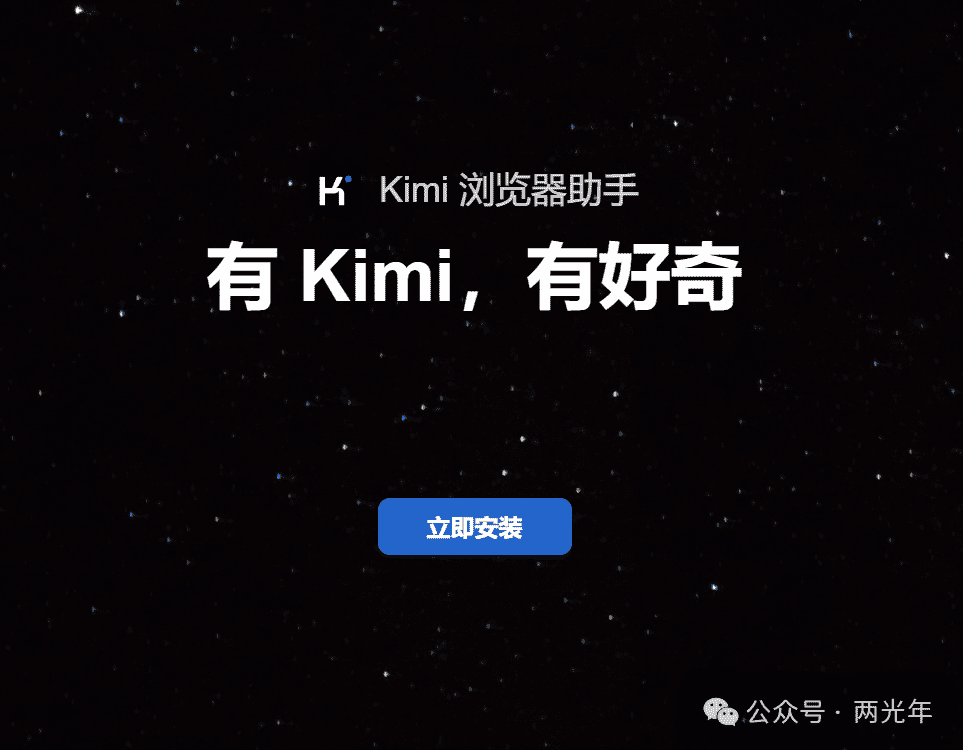
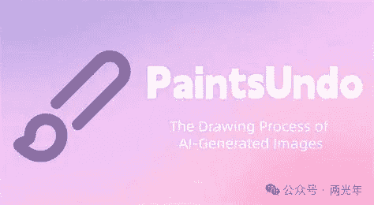
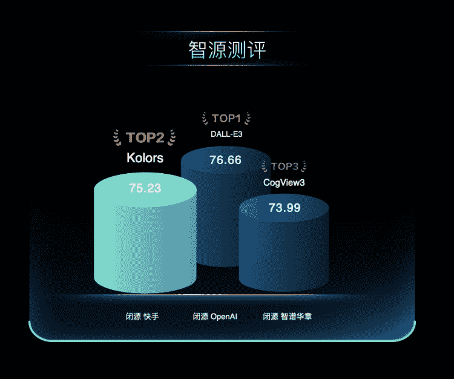
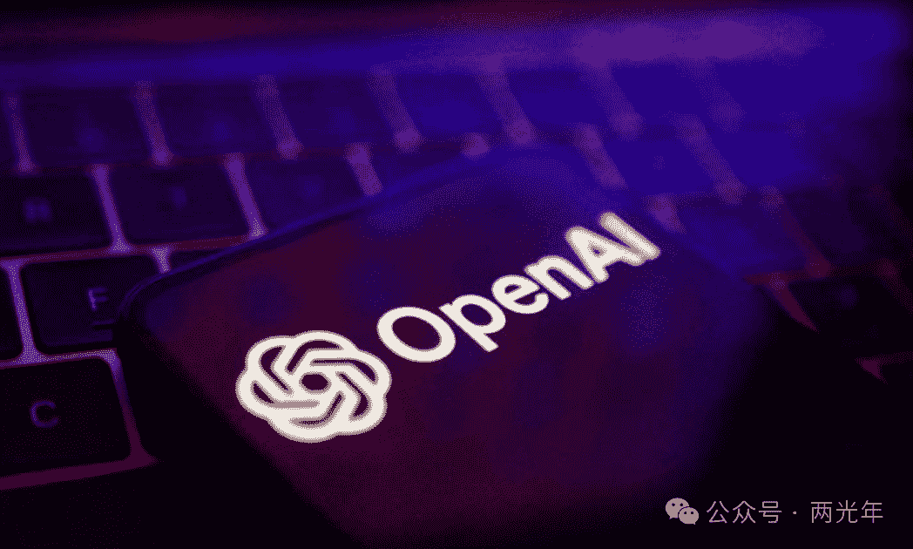

# 第5期 AI行业周报（2024-7.8-14）

> 来源：[https://v11enp9ok1h.feishu.cn/docx/TIXqdsADHoJyrlxTZexcgUL6nkF](https://v11enp9ok1h.feishu.cn/docx/TIXqdsADHoJyrlxTZexcgUL6nkF)

## TTT架构问世，挑战Transformer地位！

从 125M 到 1.3B 的大模型，性能都有提升。大的要来了。

AI界又迎来一大突破！斯坦福、UCSD、UC伯克利和Meta的研究人员联手打造了全新的TTT架构，可能颠覆现有的Transformer模型！

TTT，全称Test-Time-Training layers，是一种用机器学习模型取代RNN隐藏状态的创新尝试。这项技术通过梯度下降压缩上下文，处理速度和效率都让人眼前一亮。

TTT不仅替代了传统的注意力机制，更在实验中显示出超越Transformer和Mamba的性能。无论是在短上下文还是长上下文的处理上，TTT架构都展现出了卓越的潜力和应用前景。

研究人员相信，这项研究将彻底改变我们对语言模型的理解。而TTT的高效性能，特别是在处理长视频时的优势，让我们对未来的AI应用充满期待。

它的论文地址如下，感兴趣的可以去看看！

论文地址：https://arxiv.org/abs/2407.04620

## AI社交大战升级，百度推出“文小言”

AI社交领域迎来新玩家！百度近日推出"文小言"——一款基于文心大模型技术的AI数字人社交App，引领社交应用进入2.0时代。

"文小言"App通过仿真数字人形象，提供实时沟通、互动体验，并建立情感连接。用户可以在App内通过上下滑动，发现并选择心仪的数字人聊天对象，享受逼真的动态交流体验。

每个AI数字人都有详细的个人资料，如年龄、地方、性格、职业等，并配有语音自我介绍。用户可以通过手写、语音、发送图片等多种方式与数字人互动，数字人则以语音、文字及肢体语言进行生动回应。

相比市场上其他AI聊天产品，"文小言"在真实感和互动性上迈出了一大步。然而，产品在肢体语言流畅度及用户个性化方面还有待提升。

## 智谱AI开源推出视频理解模型 CogVLM2-Video

智谱 AI 宣布，训练了一种新的视频理解模型 CogVLM2-Video，并将其开源，该模型可以回答视频时间进度相关问题。

据介绍，智谱提出了一种基于视觉模型的自动时间定位数据构建方法，生成了 3 万条与时间相关的视频问答数据，然后基于这个新数据集和现有的开放领域问答数据，引入了多帧视频图像和时间戳作为编码器输入。

智谱表示，CogVLM2-Video 不仅在公共视频理解基准上达到了最新的性能，还在视频字幕生成和时间定位方面表现出色，为视频生成和视频摘要等后续任务提供了强有力的工具。

## Kimi浏览器插件：一键提升阅读与工作效率！

国产AI技术的骄傲——Kimi浏览器助手插件，以其极简设计和强大功能，迅速成为提升工作效率的新宠。

两大核心功能：点答笔的哪里不会点哪里，总结器的全文快速梳理。还有多轮追问和痕迹保留功能，让信息获取和理解变得前所未有的便捷。尤其适合需要处理大量文本信息的用户，无论是工作学习中的资料整理，还是日常阅读中的知识点掌握，Kimi插件都能大显身手。

同时它是免费且无使用次数限制的，真正实现了降本增效，让AI技术成为每个人的得力助手，开启智能高效的工作生活新篇章。

只能说这个插件简直就是工作与学习的神器！！！强烈推荐！！！

而它的使用方式也十分的简单，只需要点击这个链接即可下载安装使用

https://kimi.moonshot.cn/extension/download

## 张吕敏新作Paints-Undo，25秒一键生成绘画视频！

AI艺术界再起风云，ControlNet作者张吕敏（Lvmin Zhang）携新作Paints-Undo震撼登场！ 只需25秒，就能将任意图片转化为生动的绘画过程视频，从草图到成品，每一步都细致呈现。

Paints-Undo一经发布，便在GitHub上迅速揽获600+星标，成为AI艺术创作领域的新宠。 它不仅能还原动漫风格，更支持多种绘画风格，满足不同艺术家的需求。

操作简便，创意无限。无论是单帧模型还是多帧模型，Paints-Undo都能提供高质量的图像生成效果。其中单帧模型基于SD1.5架构，通过操作步骤模拟撤消操作；而多帧模型则利用VideoCrafter技术，生成中间帧，创造流畅的绘画过程。

总的来说，Paints-Undo是一个令人兴奋的项目，它不仅推动了AI技术的发展，也为艺术创作提供了新的方向和灵感。为数字艺术的发展提供了一个强有力的工具，同时也期待它在未来加入更多自定义的功能，让数字艺术创作者能够自由的创作。

最后，附上该项目GitHub链接：https://github.com/lllyasviel/Paints-UNDO 。大家可以去尝试尝试！

## 快手可图大模型开源，引发社区热烈反响，领跑开源生态

在AI技术飞速发展的今天，快手凭借其最新的文生图大模型——可图（Kolors），在开源生态中异军突起，展现出强大的技术实力和开放的创新精神。

可图的开源，标志着一个全新的开始。它在GitHub上的迅速蹿红，证明其受到开发者社区的广泛认可和支持。短短几天内，轻松斩获2k stars的佳绩，更是对其技术实力的有力证明。

可图在图像生成方面的表现尤为出色，其生成效果不仅超越了现有的开源模型，更与闭源商业模型相媲美。它所采用的隐空间扩散模型和大语言模型文本表征技术，使其在处理复杂长文本和生成高质量图像方面达到了国际领先水平。

特别值得一提的是，可图提供了对中文汉字的支持，填补了此前文生图模型的空白。

随着可图的开源，我们有理由相信，它将为文生图大模型社区带来新的发展机遇。而快手通过这一举措，不仅展现其在AI技术领域的开放态度，更为全球开发者提供了一个强大的工具，以促进各类创新应用的诞生。

最后，附上它的项目地址：https://github.com/Kwai-Kolors/Kolors

## OpenAI新项目[草莓]被曝光，旨在探索AI推理能力的新极限！

近日，据路透社报道：OpenAI公司正在秘密研发代号为[草莓]的全新项目，旨在进一步延伸去年11月宣布的Q*项目，提升AI的推理能力，使其更接近人类的智力水平。

[草莓]项目的核心，是让AI自主、高效地扫描互联网，并执行OpenAI所描述的深度研究，以解决现实世界中的复杂问题。

据内部知情人士透露：我们希望我们的人工智能模型能够像我们一样看待和理解这个世界。这一愿景，正逐渐通过「草莓」项目变为现实。

虽然[草莓]项目目前仍在开发阶段，且其工作原理严格保密，但业内人士普遍认为，这将是AI技术的一项重大突破，预示着更强大的人工智能模型即将诞生。

我们期待着[草莓]项目的正式发布，期待它能像它的老大哥chatgpt一样，给这个世界带来深深的变化。

## 亚马逊推出 AI 购物助手 Rufus，用AI重塑购物方式！

亚马逊正式进军消费者聊天机器人领域，推出了AI购物助手Rufus，开启了智能购物的新篇章。

Rufus不仅是一位聊天伙伴，更是一位精通亚马逊产品目录的购物专家。Rufus能够回答各种购物相关问题，为用户提供从产品选择到具体问题探讨的全方位帮助。

与市面上其他面向消费者的AI聊天机器人如OpenAI的ChatGPT或Google的Bard不同，Rufus的独特之处在于它深度整合了购物功能，使用户能够更便捷地找到所需商品。

