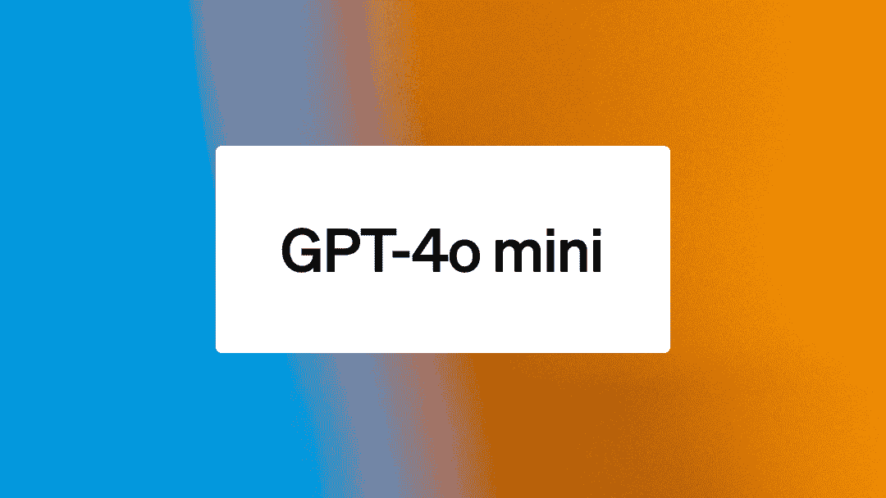
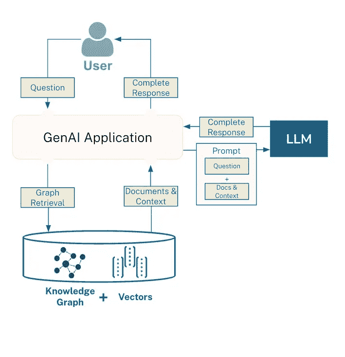
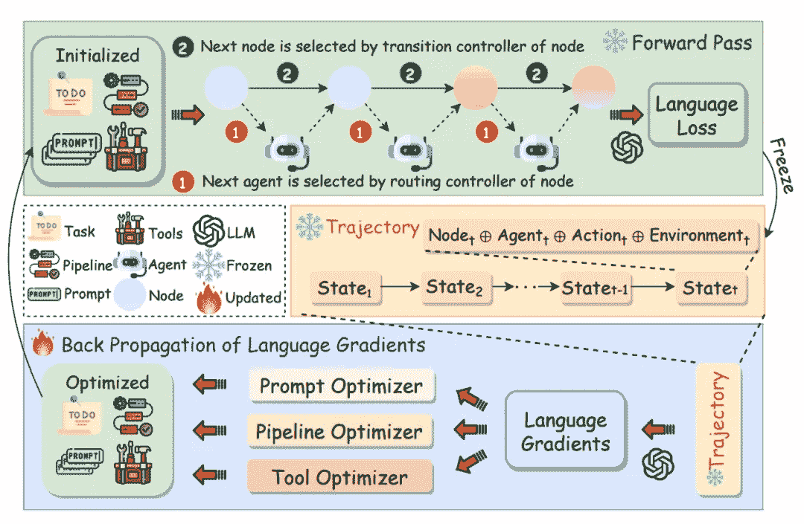
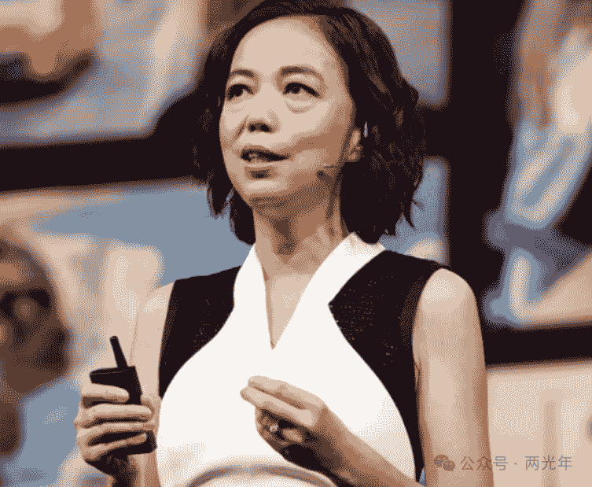
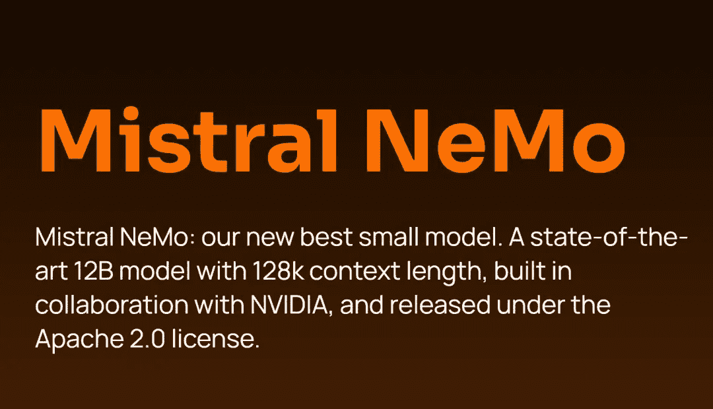
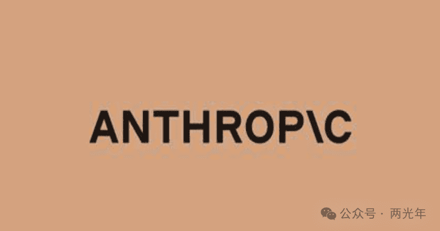
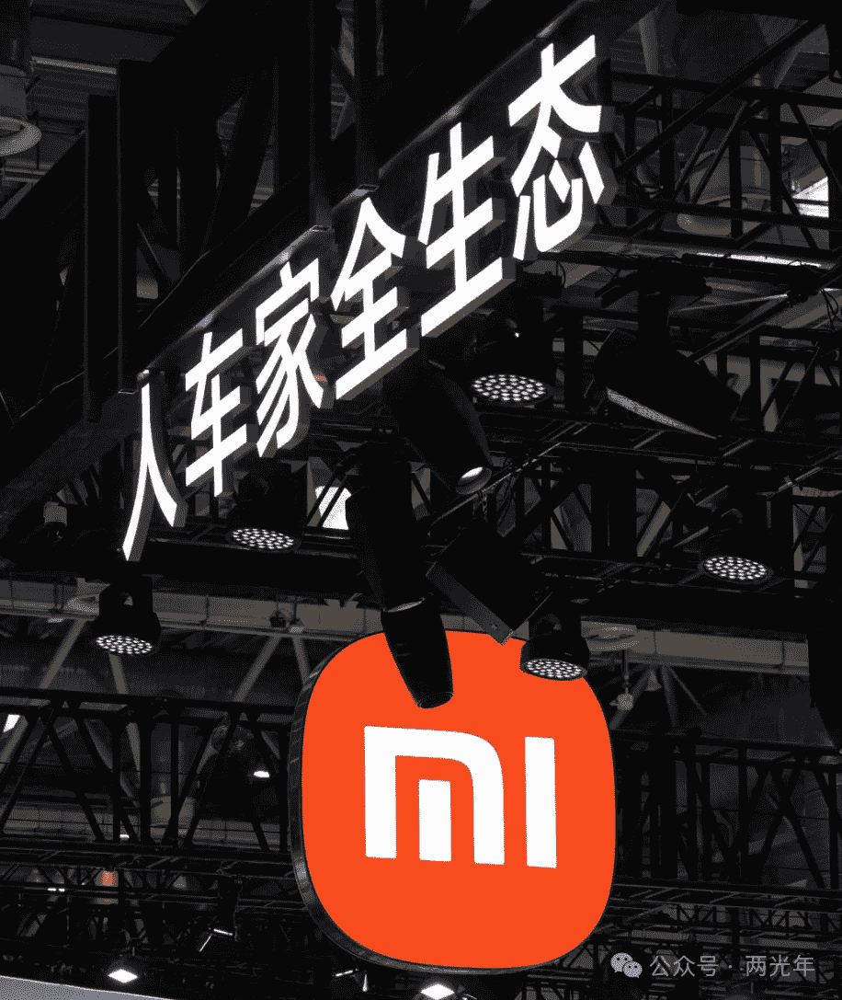

# 第6期 AI行业周报（2024-7.15-21）

> 来源：[https://v11enp9ok1h.feishu.cn/docx/MzdNdoCxBolgSyxJ1SIceinIn9f](https://v11enp9ok1h.feishu.cn/docx/MzdNdoCxBolgSyxJ1SIceinIn9f)

## OpenAI发布GPT-4o mini，全面进入4.0的时代

就在前天，OpenAI 推出了一款新的AI模型——GPT-4o mini，它目标是完全取代之前的GPT-3.5 Turbo，这也标志着GPT全面进入4.0的时代。

首先，让我们来聊聊它的性能。GPT-4o mini在数学、编码和视觉推理等方面的表现简直让人眼前一亮，它的得分不仅超越了之前的GPT-3.5 Turbo，甚至接近了GPT-4o的80%能力，简直就是一个性能小钢炮。

然后是价格，你们知道吗？GPT-4o mini的价格超级亲民，每100万tokens的输入只需要15美分，输出60美分，这比上一代产品便宜了超过60%！这就意味着我们可以以更低的成本享受到API服务。同时，它对于我们普通玩家来   说，它是完全免费的。

安全性也是GPT-4o mini的一大亮点。它是首个基于指令层级结构的模型，通过系统消息、用户消息和第三方内容的优先级排序，确保了模型的安全性和鲁棒性。

目前，GPT-4o mini仅支持文本和图像处理，但未来还会开放语音、视频等更多功能，这无疑将为教育、翻译等多个领域带来革命性的变化。

## 微软发布最强 RAG 知识库开源方案 GraphRAG

微软最近开源了一个超厉害的项目——GraphRAG！

GraphRAG是什么？简单来说，它是一种基于图谱的检索增强生成方法，可以对私有或以前未见过的数据集进行问答。

GraphRAG实际上就是在RAG的基础上，使它通过图谱的方式存储实体及其相互之间的关系。这使得GraphRAG在处理复杂查询和提供深入信息时更为有效。

对于GraphRAG来说，它的核心优势在于：解锁了大型语言模型在私有数据的探索能力。提供了更准确、更完整的答案。在可解释性方面有着不俗的表现。

微软的这个项目一上线就爆火，目前star数已经达到了11k！如果你对RAG和知识图谱感兴趣，这个项目绝对值得你关注。

项目地址：https://github.com/microsoft/graphrag

官方文档：https://microsoft.github.io/graphrag/

## 首个端到端智能体符号化训练框架开源啦！

本周AI界迎来了一个重大突破：波形智能联合浙江大学和北京航空航天大学，开源了首个端到端智能体符号化训练框架。这一创新性框架借鉴了神经网络的反向传播和梯度下降原理，实现了对智能体的端到端符号化训练。

具体来说，它将智能体解构为prompts、tools和agent pipeline三个主要元素，可以模拟神经网络中的层、权重和计算图。更为重要的是，这个框架赋予了智能体自主进化的能力，它可以自主更新和优化自身的关键元素。

另外从多个benchmark上的实验结果来看，该算法相比传统方法有显著提升。

令人激动的是，波形智能将算法的全部代码开源，旨在推动“Data-centric Agent”和“Agent Learning”的全面发展。

下面是它的论文与项目地址，感兴趣的小伙伴可以去玩一玩！

论文地址：https://arxiv.org/pdf/2406.18532

代码仓库：https://github.com/aiwaves-cn/agents

## 李飞飞3月速造独角兽！

AI教母李飞飞仅用3个月就带领她的新公司World Labs成为估值超10亿美元的AI独角兽！

World Labs专注于"空间智能"技术，其核心就是让AI像人类一样理解三维空间中的物体位置和关系。让AI不仅能"看"，还能与现实世界互动。

李飞飞教授的这次创业，不仅是科研上的一次飞跃，更是商业上的一次巨大成功。她的公司在短时间内就达到了独角兽的估值，这在AI领域是前所未有的。太疯狂了！

## 小模型卷疯了——Mistral联合英伟达推出了Mistral NeMo

Mistral AI联合英伟达推出的Mistral NeMo小模型，以其 12B 参数量和 128k 的上下文窗口，在AI界掀起了一股新风。

这款小模型不仅性能强悍，推理能力、世界知识和编码准确性均达到 SOTA 级别，同时还支持全球多语言应用，特别在处理长文本和复杂任务时表现出色。

Mistral NeMo还采用了高效的 Tekken 分词器，大幅提升了文本和源代码的压缩效率。此外，它经过了高级指令微调，使得在遵循指令、推理和多轮对话方面的能力显著提升。

性能强劲的小模型Mistral NeM，可以让小公司也能轻松运用的 AI 解决方案，避免了高昂的经济成本。所以对于Mistral NeM来说，这不仅是 AI 技术的突破，也在为 AI 在企业环境中的应用开辟了新的空间。

## Anthropic 推出 1 亿美元 AI 基金，加剧与 OpenAI 竞争

AI初创公司Anthropic与风险投资公司Menlo Ventures联合推出了价值1亿美元的Anthology Fund，旨在支持早期初创公司并提供技术赋能。Menlo Ventures负责投资，而Anthropic则为这些初创公司创始人提供25000美元信贷，用于使用其大型语言模型。

这一举措不仅为初创公司提供了资金支持，更重要的是，它们可以利用Anthropic的技术加速产品开发和创新。

与此同时，Anthropic的直接竞争对手OpenAI也拥有自己的风险基金——OpenAI创业基金，使得这场AI领域的资金和技术竞赛更加激烈。对于初创公司来说，这是一个难得的机遇，可以在Anthropic的技术助力下快速成长，甚至在AI领域占据一席之地。

## 小米、王田苗、智源投资具身智能科技公司「小雨智造」

小米集团和机器人泰斗王田苗，投了一家具身智能科技公司小雨智造。该公司2023年2月成立成立之后陆续完成了亿元种子轮融资，由小米集团、机器人泰斗王田苗、北京智源研究院联合出资。

据了解，小雨智造的核心创始团队也曾是小米曾经的高层。小雨智造创始人乔忠良是小米的初创成员之一，曾经是MIUI研发负责人，负责过MIU 9到MIUI 12等产品，于2023年1月从小米离职。

其联合创始人王文林，曾任职小米软件系统平台部总经理，主导了“小米大脑"和IoT系统的开发。团队其他成员来自于小米、华为、字节跳动、微软等公司。

具身智能或许将成为未来最为火爆的一个AI概念，它能够真正意义上的给我们的生产结构带来巨变。

## 谷歌 Gemini 被曝推出多项新功能：定制 GPT、记忆或个性化回复等

根据反向工程师@testingcatalog的最新发现，谷歌即将为其Gemini人工智能助手带来一系列令人期待的更新。这些更新包括：

1. Imagen3文生图工具：为AI Labs的alpha测试人员提供，未来可能扩展至Gemini Advanced用户。

2. 定制GPT「GEM」：允许用户查看、编辑和复制个性化的GEM，预计将通过GEMs管理器选项卡访问。

3. 记忆或个性化回复：类似于ChatGPT的记忆功能，用户将在「设置」中找到专门的个性化回复选项。

4. 集成录音、Google Photos：用户可以录制语音上传或从Google Photos选择照片，提高交流的便捷性。

5. 集成Chrome浏览器扩展：通过Chrome扩展程序，用户可以在提示词中发送链接，提升使用体验。

这些新功能预计将大幅提升Gemini助手的个性化和互动性。沸腾期待！

