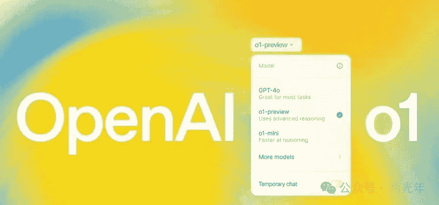
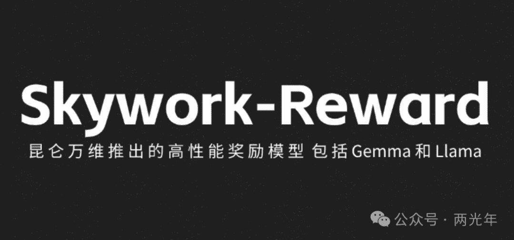
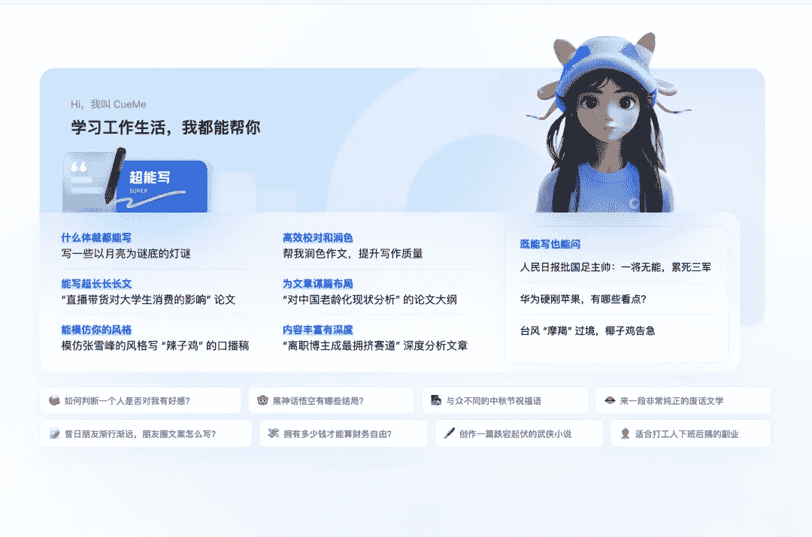
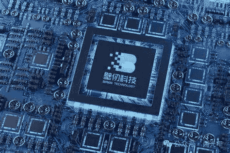

# 第13期 AI行业周报（2024-9.2-8）

> 来源：[https://v11enp9ok1h.feishu.cn/docx/T0hHdkSLCorfjExbZTIcDtDznVd](https://v11enp9ok1h.feishu.cn/docx/T0hHdkSLCorfjExbZTIcDtDznVd)

## OpenAI 发布OpenAI o1模型：具有人类般的推理能力

本周，OpenAI发布了具备人类般逐步思考能力的全新模型o1系列模型o1。分为两个版本：o1-preview和o1-mini。

o1 与 GPT-4o 之间的关键差异在于其处理编程和数学难题的能力。OpenAI 将训练方法引入了强化学习，这赋予了 o1 类似于人类的逐步推理能力。这意味着模型能够深入分析问题，花费更多时间来寻找解决方案。

在这一过程中，o1 会不断优化自己的思考模式，尝试多种解决策略，并能够识别并纠正自身的错误。尽管 OpenAI 并未声称 o1 完全克服了幻觉问题，但通过这种训练，o1 产生幻觉的频率已经显著降低。

它在各项测试过程中，均遥遥领先。其中，它在国际奥林匹克数学资格考试中取得了83%的高分，远超GPT-4o的13%，并在物理、生物和化学问题上展现出超过人类博士水平的准确度。目前，ChatGPT Plus用户已经可以访问o1-preview和o1-mini，而企业和教育用户也将于下周获得权限。开发人员可以通过API调用o1，尽管其价格远高于GPT-4o，但它在推理方面的进步足以匹配这个价格！

## 李飞飞正式官宣启动创业公司——World Labs

本周，李飞飞的创业公司World Labs，正式官宣启动！将致力于打造名为“大世界模型”的空间智能AI。以实现AI在3D世界中的感知、生成和互动。

目前，World Labs已经完成了两轮融资。最近一次为2.3亿美元，投资者包括a16z、NEA以及英伟达的风投部门。此外，AI领域的知名人物如Geoffrey Hinton、Jeff Dean和Reid Hoffman等也参与了投资。

World Labs的愿景是通过构建”大世界模型”，推动AI从2D图像和文本处理走向3D空间的理解和操作。这将使得AI能够更好地进行空间推理，如在3D环境中导航和操作物体。此技术有望在多个领域产生深远影响，包括机器人技术、增强现实、虚拟现实以及城市规划等。

World Labs的创始团队由李飞飞博士和其他三位在计算机视觉和图形学领域的专家组成，包括Ben Mildenhall、Justin Johnson和Christoph Lassner。他们共同致力于将前沿的研究成果转化为实际应用，以推动AI技术的进一步发展。

李飞飞博士曾因其在深度学习和计算机视觉领域的杰出贡献而被誉为“AI教母”，此次World Labs的成立和融资成功，再次证明了她在AI领域的领导地位和远见卓识。随着“世界模型”的研发，我们有望看到AI技术在空间智能方面的重大突破。

## 昆仑万维推出的高性能奖励模型——Skywork-Reward

近日，昆仑万维正式推出了一系列的高性能奖励模型——Skywork-Reward

该系列包括两个版本：Skywork-Reward-Gemma-2-27B和Skywork-Reward-Llama-3.1-8B，它们通过提供精准的奖励信号，助力Agent在复杂环境中做出更优决策。

在RewardBench评估基准中，Skywork-Reward展现出了卓越的性能，尤其在对话生成、安全性和推理任务上表现突出。

Skywork-Reward的核心功能包括提供奖励信号、偏好评估、性能优化、数据集筛选等等。其技术原理就是强化学习和偏好学习。通过精心策划的数据集进行训练，确保模型输出更符合人类偏好。

此外，该模型基于现有的大型语言模型架构，如Gemma-2-27B-it和Meta-Llama-3.1-8B-Instruct，提供了强大的计算能力和灵活性。

它的推出，不仅为AI领域的研究和应用提供了新的工具，也为Agent的发展注入了新动力。

## 寒武纪开源Torch-MLU，支持PyTorch原生！

寒武纪科技近日宣布开源Torch-MLU，这是一套支持PyTorch原生运行在寒武纪硬件上的设备后端扩展插件。此举标志着寒武纪硬件对PyTorch的支持达到了新的高度。

开发者可以在不修改PyTorch核心代码的情况下，将深度学习网络从GPU迁移到寒武纪MLU加速卡上。

自2018年起，寒武纪就开始布局，与PyTorch框架进行集成适配。而现在寒武纪硬件能够原生支持PyTorch。在开发者无缝接入寒武纪硬件的算力的同时，还可以享受原生PyTorch的使用体验。

此外，寒武纪对PyTorch社区的持续贡献也不容忽视。公司提交了多个Patch，优化了非CUDA设备的接入体验，并完善了PrivateUse1机制，为第三方设备厂商和开发者提供了更高效便捷的集成路径。

开源Torch-MLU插件不仅展示了寒武纪对开源社区的承诺，也体现了其推动AI生态共建的决心。寒武纪通过开源项目，促进了技术成果的广泛应用，并为AI开源生态注入了新动力。

大家有兴趣的话，可以去尝试一下！

开源地址：

https://github.com/Cambricon/torch_mlu

## 元象发布中国最大混合专家开源模型

本周，元象科技发布了中国最大的混合专家（MoE）开源模型——XVERSE-MoE-A36B。该模型拥有255B的总参数量和36B的激活参数，

元象声称其性能可与100B模型相媲美，同时在训练时间上减少了30%，推理性能提升了100%，并且大幅降低了每token的成本。

该模型使用了混合专家模型架构。即将多个细分领域的专家模型组合成一个超级模型。这种架构打破了传统扩展定律的局限，使得在扩大模型规模的同时，不显著增加训练和推理的计算成本。

此外，元象还宣布将其[高性能全家桶]系列模型全部开源，并无条件免费商用，这为AI社区和开发者提供了宝贵的资源。这有助于推动AI技术的进一步发展。

XVERSE-MoE-A36B模型的开源，不仅为研究人员和开发者提供了强大的工具，也为AI技术的商业化和普及化开辟了新的道路。随着更多类似模型的发布和应用，我们可以期待AI将在更多领域发挥关键作用，推动社会和经济的发展。

## 夸克发布智能对话助手 CueMe

本周，夸克推出了其全新的智能对话助手CueMe，这是一款基于夸克自主研发的大模型的AI工具。

CueMe在AI写作领域展现了显著的能力。它支持多种体裁的文本创作，并能够根据不同的写作需求生成高质量的内容，无论是简短的文案还是长篇的报告。

除了写作能力，CueMe还提供了多样化的问答服务，覆盖用户在日常生活和学习过程中可能遇到的各类问题。

夸克通过推出CueMe，进一步扩展了其在人工智能领域的应用，同时也为用户带来了更加便捷和高效的交互体验。

智能对话助手正逐渐成为人们日常生活中不可或缺的一部分，它们通过提供个性化的服务，极大地丰富了人机交互的维度。已成为我们未来生活中，不可或缺的一部分。

## AI 芯片公司壁仞科技正式开启上市辅导

目前，壁仞科技股份有限公司，已在上海证监局完成了辅导备案登记，正式开启了其首次公开募股（IPO）的进程。该公司由国泰君安担任辅导券商，标志着其上市计划已进入实质性阶段。

壁仞科技在AI芯片领域的深耕获得了资本市场的高度认可，目前已完成多轮融资，累计公开融资额超过50亿元人民币。

此前，壁仞科技曾有计划在香港进行IPO的消息传出，而此次在上海证监局的备案登记，可能预示着公司将选择在中国内地资本市场上市。随着AI技术的不断进步和应用领域的拓展，壁仞科技的上市进程不仅为其自身的发展提供了资金支持，也为投资者提供了参与AI芯片行业增长的机遇。

AI芯片作为推动人工智能发展的核心硬件，其市场需求正快速增长。壁仞科技的上市计划，反映了AI芯片行业在资本市场的活跃度，同时也展现了中国在AI领域自主创新和产业化进程中的积极态势。随着更多相关企业的加入，AI芯片行业有望迎来更广阔的发展空间。

## Getty Images 开源免费高画质照片 AI 训练集

全球最大的商业图库Getty Images推出了一个免费高画质照片AI训练集，包含3750张高分辨率照片，分为15个类别，如商业、教育、医疗健康、运动与健身、物品与物体、插图、图标等。这些照片可用于开发和训练机器学习和AI模型。数据集已在Hugging Face上线，用户需要同意服务条款并提供联系方式后，即可免费访问。Getty Images希望通过这个免费样本数据集吸引企业和开发者使用其付费授权服务。Getty Images拥有超过5.72亿张图片，其中2亿多张可用于商业用途，每张照片都附有结构化的元数据和关键词，以确保用户在训练模型时的安全和免受侵权诉讼风险。而这极大解决AI公司的数据来源的合规问题。

