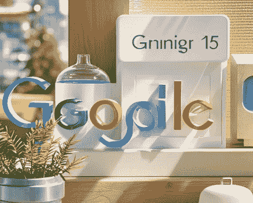
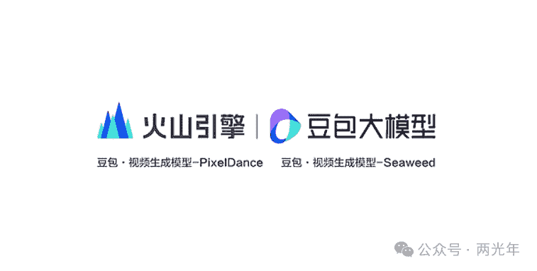
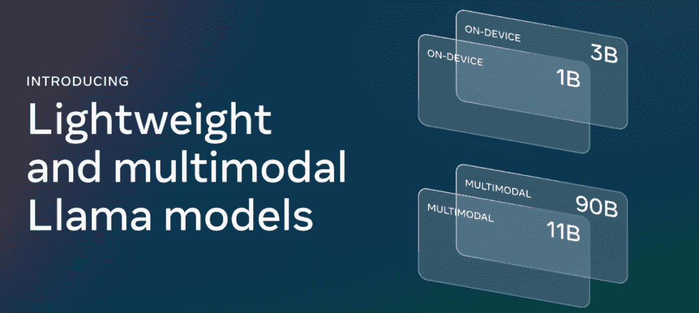
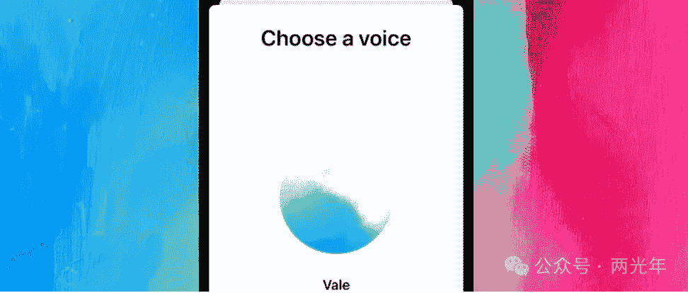
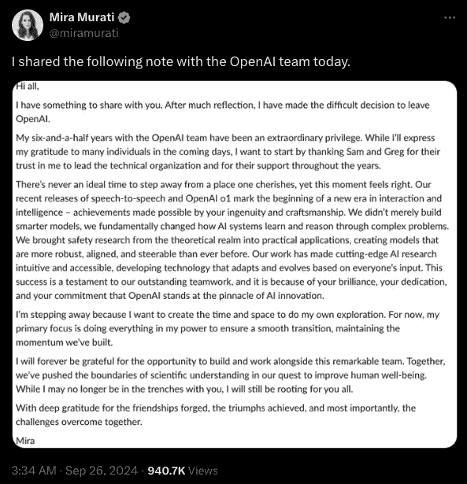
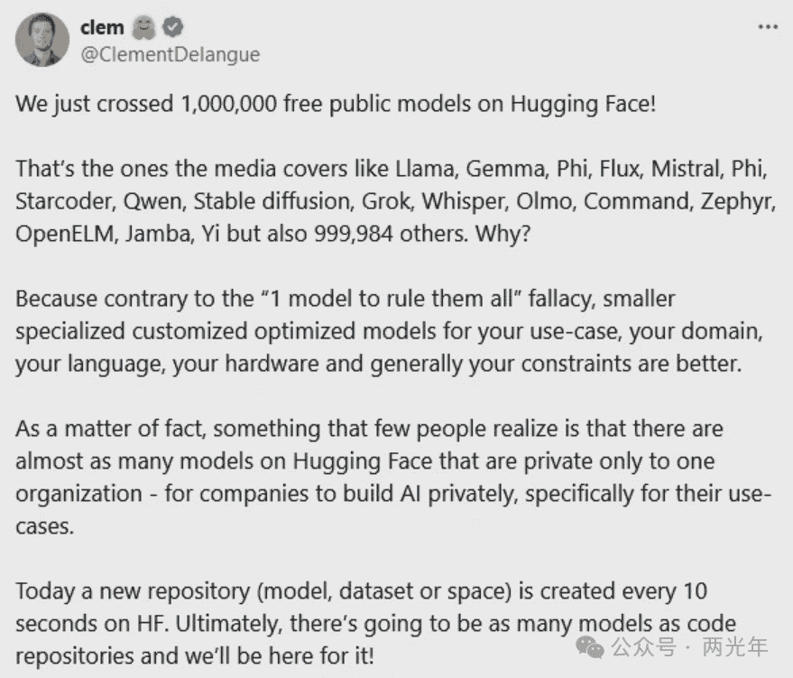
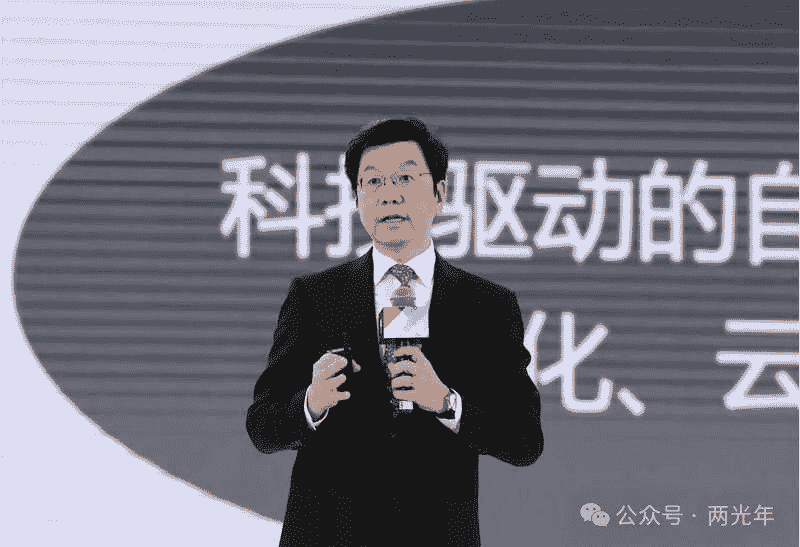
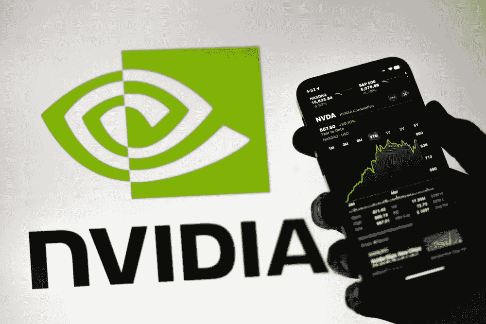

# 第15期 AI行业周报（2024-9.23-29）

> 来源：[https://v11enp9ok1h.feishu.cn/docx/IkWWdKvUgoxpTgxeLxRcbptDn4b](https://v11enp9ok1h.feishu.cn/docx/IkWWdKvUgoxpTgxeLxRcbptDn4b)

## 谷歌 Gemini 1.5 模型全面升级

本周，谷歌宣布对其Gemini 1.5 AI模型进行升级，推出了全新的Gemini-1.5-Pro-002和Gemini-1.5-Flash-002。这些新模型在成本、性能和响应速度方面进行了全面改进。

这次主要更新包括：

+   成本更低：谷歌降低了token输入和输出的费用，最高降幅达到50%，并提高了模型的速率限制，减少了延迟。

+   性能更强：在MMLU-Pro基准测试中，新模型的性能提高了约7%，在MATH和HiddenMath基准测试中，数学性能提高了20%。此外，视觉和代码相关任务也得到了改进。

+   其它改进：谷歌还升级了8月发布的Gemini 1.5实验模型，推出了Gemini-1.5-Flash-8B-Exp-0924升级版，增强了文本和多模态应用。

新定价将于2024年10月1日生效，而用户可以通过Google AI Studio、Gemini API和Vertex AI（面向Google Cloud客户）访问新的Gemini模型。此外，针对Gemini Advanced用户的Gemini 1.5 Pro-002聊天优化版也即将推出。

这次升级显示了谷歌在提高AI模型性能和降低成本方面的努力，旨在吸引更多开发者使用其AI服务。

## 字节跳动发布视频生成模型

字节跳动近日在“2024火山引擎AI创新巡展”上宣布进军AI视频生成领域，并发布了多个面向不同细分领域的多模态大模型，包括视频生成、音乐和同声传译模型。这些模型共同构成了火山引擎的“豆包全模态大模型家族”。

重点发布的两个视频生成模型是PixelDance和Seaweed。这些模型采用DiT（扩散 Transformer）架构，高效融合计算单元，支持多镜头语言能力，包括变焦、环绕、平摇、缩放和目标跟随等，同时在镜头切换时保持主体、风格和氛围的一致性。

豆包视频生成模型还支持更复杂的提示词、多动作多主体交互、多样化的风格以及多种宽高比，这使得它适用于多种平台和场景。

火山引擎通过这些创新和升级，展现了其在AI领域的全面发展和技术实力，同时也为用户提供了更多的工具和接口，推动了AI技术的进一步应用和普及。

模型已经开启邀测，可通过火山引擎官网提交测试申请。

## Llama 3.2 系列模型震撼登场

Meta公司推出了最新版本的开源AI大模型系列——Llama 3.2，这一系列包括小型和中型视觉语言模型（11B和90B参数）以及轻量级纯文本模型（1B和3B参数）。

Llama 3.2的关键特性包括：

+   视觉和文本处理：支持图像推理和多语言文本生成。

+   轻量级模型：适合在设备上运行，提供更好的隐私保护。

+   高性能：在重写任务和摘要等本地边缘运行任务中领先。

+   优化硬件支持：特别优化在高通和联发科硬件上的使用。

该系列模型的应用场景广泛，涉及方方面面。包括移动设备上的智能助手、增强现实（AR）、智能家居设备以及客户服务自动化等。

Llama 3.2的推出进一步推动了AI技术的开放性和可访问性，这使得边缘AI和移动AI应用的开发变得更加便捷和高效。

## OpenAI 发布了高级语音模式！

本周，OpenAI宣布向更多ChatGPT付费用户推出“高级语音模式”（Advanced Voice Mode，简称AVM），使用GPT-4o的原生音频技术，实现更自然的实时对话。

AVM将逐步向Plus和Team用户开放，企业版和教育版用户将在下周获得此功能。AVM具备每天使用量的限制，而标准语音模式适用于所有用户。

OpenAI还增加了自定义指令、记忆功能、五种新语音和改进的口音支持。新增的语音包括Arbor、Maple、Sol、Spruce和Vale，使得ChatGPT的语音总数达到九种。这些语音各具特色，从生动活泼到沉着直接，为用户提供了丰富的选择。

ChatGPT的语音功能现在能够提供更自然、更迅速的对话体验。部分定制功能也已扩展到AVM，包括允许用户个性化ChatGPT的响应方式和记忆功能，让ChatGPT能够记住之前的对话供以后参考。

AVM的推出彰显了OpenAI在人工智能技术与用户体验上的持续创新，而这也进一步巩固了其在AI行业的领导地位。

## OpenAI 首席技术官宣布离职

本周，OpenAI的首席技术官Mira Murati宣布离职，这是OpenAI今年经历的一系列高层变动中的最新一次。

在Sam Altman短暂离职期间，Mira Murati曾被临时任命为OpenAI的CEO，并且她在公司今年最重要的发布会上发布了新模型GPT-4o。

Mira Murati在离职信中表达了对OpenAI团队的感激和对未来的期待。她表示，离职是为了给自己创造时间和空间进行探索，并会尽最大努力确保工作的平稳过渡。

OpenAI近期的高层变动包括联合创始人John Schulman的离职，总裁Greg Brockman的长期休假，以及产品负责人Peter Deng的离职。这一系列事件表明，自去年11月份的内部动荡以来，OpenAI的领导层仍尚未完全稳定。

Mira Murati的离职也标志着OpenAI四位核心人物中除了Sam Altman外都已离开公司。同时，这也可能会对OpenAI产生一定影响。但公司在AI领域的创新和发展仍在继续。Sam Altman和其他团队成员将继续推动公司的使命，致力于构建安全、对齐和可控的AI系统。

## Hugging Face 平台托管模型数量破 100 万

AI托管平台Hugging Face本周宣布，其平台托管的AI模型数量已突破100万个。这是标志着AI领域快速增长的一个重要里程碑。

Hugging Face自2016年成立以来，一直致力于推动自然语言处理（NLP）技术和工具的发展，为开发者提供了一个开源社区和便捷的使用、微调和部署NLP技术的方式。

Hugging Face托管了许多知名的AI模型，包括但不限于Llama、Gemma、Phi、Flux、Qwen通义千问、Zephyr、OpenELM、Jamba和Yi零一万物等。这些模型覆盖了多种语言处理任务，从文本生成到语言翻译，再到图像和音频处理等多个领域。

这一成就不仅展示了Hugging Face在AI社区的影响力，也反映了AI技术的快速发展和广泛应用。随着AI模型数量的不断增加，Hugging Face平台已成为AI开发者获取和分享最新技术的重要资源库。这一增长趋势预示着未来AI技术将在更多行业中发挥关键作用，推动技术创新和产业升级。

## 李开复推出BeaGo AI搜索引擎，旨在提供精准单一搜索结果

零一万物CEO李开复推出了一款新型AI搜索引擎——BeaGo，旨在通过提供每个查询的单一搜索结果，改善用户的搜索体验。

BeaGo的独特之处在于，它不仅给出文本答案，还整合了图片信息，使用户在有限的屏幕空间内无需打开多个标签页即可获取全面信息。

BeaGo搜索引擎的推出，是李开复及其团队在AI应用领域的又一次重要尝试，它通过创新的搜索结果呈现方式，为用户提供了更为直观、高效的信息检索服务。这一创新举措有望进一步提升用户在使用搜索引擎时的便捷性和满意度。

## 英伟达宣布收购OctoAI，AI芯片市场战略扩张

英伟达于2024年9月27日宣布完成了对西雅图软件初创公司OctoAI的收购，这次收购是英伟达在AI领域的第五次收购活动。

OctoAI专注于开发能够提高生成性AI模型构建和运行效率的工具。尽管收购的具体价格未公开，但据The Information报道，交易金额可能约为1.65亿美元，而GeekWire的消息来源指出，包括关键团队成员的激励费用在内，总金额可能超过2.5亿美元。

作为交易的一部分，OctoAI的创始人之一兼CEO Luis Ceze将加入英伟达，为这家芯片巨头的AI战略贡献自己的力量。

这次收购是英伟达在AI芯片市场持续扩张的战略举措。英伟达将通过整合OctoAI的技术和团队，进一步推动AI技术的发展，并巩固其在AI领域的领导地位。

