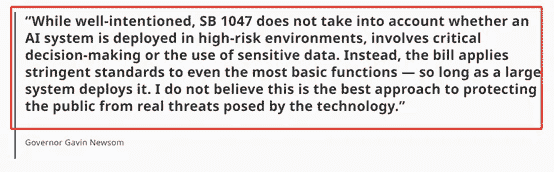
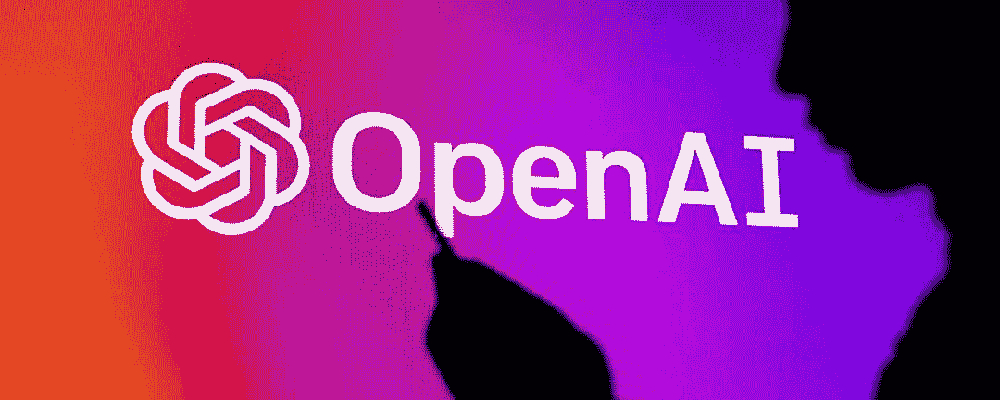
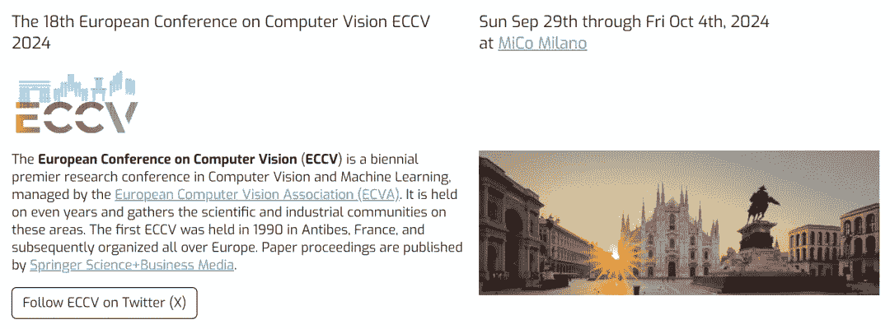
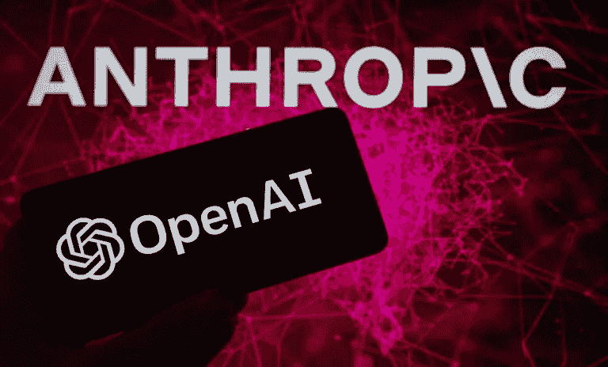
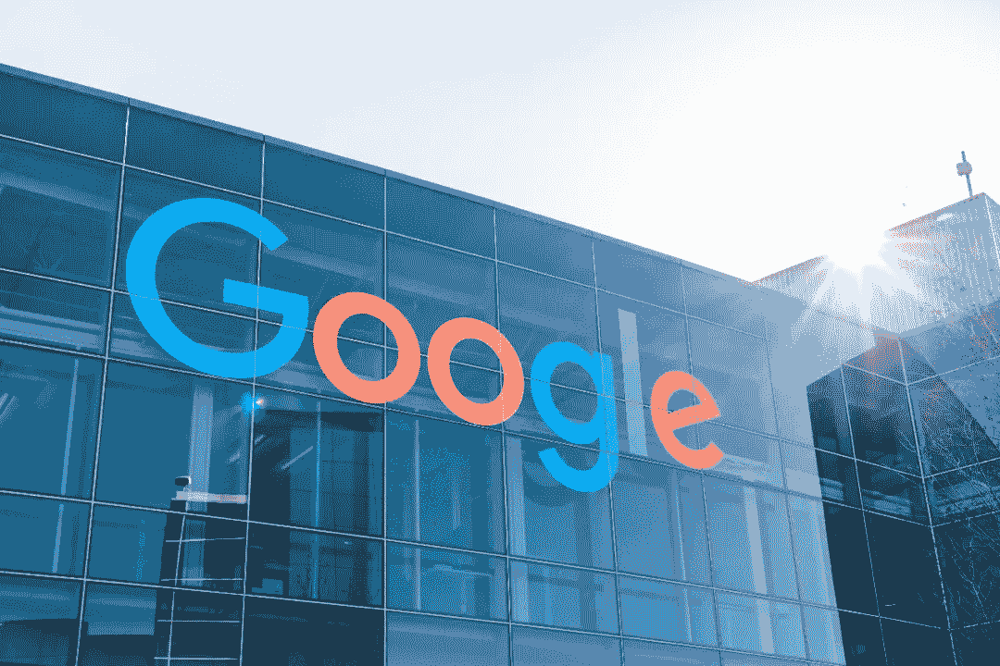
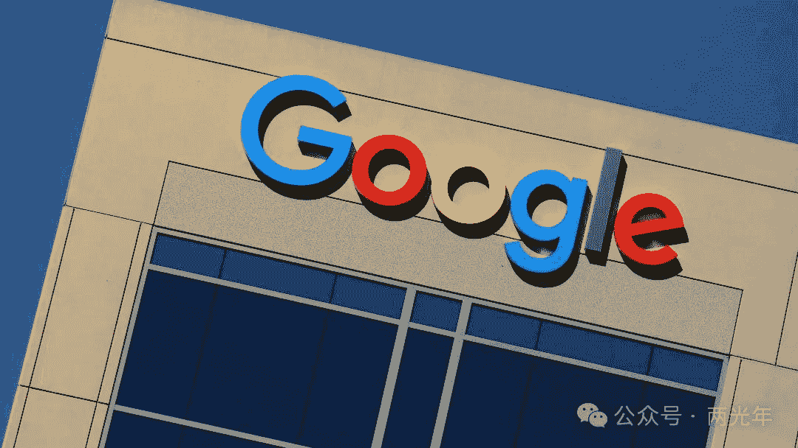

# 第16期 AI行业周报（2024-9.30-10.6）

> 来源：[https://v11enp9ok1h.feishu.cn/docx/JipqdS3f7oryiExGwXpcKhTSn5x](https://v11enp9ok1h.feishu.cn/docx/JipqdS3f7oryiExGwXpcKhTSn5x)

## ChatGPT 发布重磅更新——ChatGPT Canvas，让AI成为你的智能助手

本周，ChatGPT发布了一个重磅更新——Canvas功能！

想象一下，如果你有一个AI助手，它不仅能听懂你的话，还能帮你写文章、改代码，甚至在你工作时提供实时反馈，那会是什么体验？ChatGPT的Canvas功能，就是这样一个神奇的存在。

Canvas是一个全新的交互界面，它让AI更懂你的需求。你可以在Canvas上编辑和改进AI的输出，就像有一个专业的文案编辑或代码审查员在旁边帮你一样。

此外，Canvas的智能程度超乎想象。它能够根据你的指示，精准地修改文章的某个部分，或者重写整篇文章。无论是写作还是编码，Canvas都能提供实时的建议和反馈，让你的工作更加高效。

更棒的是，Canvas的启动非常智能。它会在检测到可以提供帮助的场景时自动启用，让你的工作流程更加流畅。

目前，Canvas已经向ChatGPT Plus和Team用户开放，Enterprise和Edu用户也将在下周获得访问权限。

这不仅仅是一次更新，更是AI技术的一大步。Canvas让我们看到了人机交互的未来，让我们的工作更加智能、高效。

## 加州州长否决SB-1047法案，AI重获新生！

本周，美国加州州长Gavin Newsom否决了SB-1047法案，这对全球AI开发者来说无疑是个好消息！

SB-1047法案是美国加州在今年2月7日拟定的，旨在增强大模型安全、透明性、使用规范。但其中包含了许多不合理内容，可能会严重阻碍AI技术的发展。

法案规定，如果开发成本超过1亿美元的大模型被用于非法活动，源开发商将受到严重处罚。此外，要求大公司开放模型给其他国家用户使用时，提交客户的所有资料，包括敏感信息，并要求用户资料需备份7年，在海关、边境总署备案。

如果法案实施，像OpenAI、Meta、谷歌这样的科技巨头将成为最大受害者。加州作为全球科技创新中心，许多初创企业也将受到重创。

幸好，加州州长认为，SB-1047法案在实施上存在严重问题，可能会给公众一种控制这项快速发展技术的虚假安全感。同时，法案缺乏灵活性，没有为不同类型的AI应用提供足够的灵活性。

AI界一众大牛吴恩达、Yann LeCun、李飞飞等在否决过程中发挥了重要作用。他们多次公开呼吁科技人士抵制该法案。

否决SB-1047法案后，全球开发者可以继续使用Meta、谷歌等美国科技大厂开源的大模型。这将有助于推动AI技术的创新和发展。

## OpenAI完成了一轮66亿美元的融资，公司的估值飙升至上千亿

OpenAI 最近完成了一轮66亿美元的融资，使得公司的估值飙升至1570亿美元，跻身全球顶尖的独角兽企业之列。

在这次融资中，Thrive Capital担任了领投方，微软、英伟达、软银等公司也参与了投资，其中微软投入了约7.5亿美元。这次融资采用了可转换票据的形式，标志着OpenAI向营利性公司的转变。

随着OpenAI从非营利性向营利性的转变，OpenAI将更积极地推动技术的商业化和应用。面对激烈的市场竞争，OpenAI期待通过持续的创新和合作，保持其在生成式人工智能领域的领先地位，并引领人工智能技术的未来发展方向。

## ECCV2024奖项揭晓，哥大夺魁，微软COCO数据集获经典论文奖！

AI视觉领域的盛会ECCV2024在意大利米兰圆满落幕，各大奖项也已新鲜出炉。今年ECCV的录用率仅为18%，竞争激烈程度可见一斑。

在众多优秀论文中，哥伦比亚大学的研究者凭借一篇关于极简主义视觉系统的论文摘得最佳论文奖，该论文提出了一种创新的相机设计，使用最少数量的像素来完成视觉任务，为保护隐私和节能提供了新思路。

同时，ECCV2024还颁发了最佳论文荣誉提名奖，共有2篇论文获此殊荣。一篇聚焦于计算渲染过程的梯度问题，提出了一种新方法来处理光栅化渲染器在可见性不连续处的梯度；另一篇则探讨了如何通过概念算术绕过扩散模型中的概念抑制。

此外，微软的COCO数据集获得了经典论文Koenderink奖，该数据集自2014年发表以来，引用次数已超过5万次，对物体识别、场景理解和图像描述领域做出了基础性贡献。

ECCV2024的奖项不仅是对研究者们工作的肯定，也代表了AI视觉技术的最新发展趋势。这些研究成果不仅推动了学术界的进步，也为工业界带来了新的启示和应用前景。

## OpenAI联合创始人Kingma转战Anthropic

OpenAI的联合创始人之一Durk Kingma，最近加入了Anthropic，这是一家由OpenAI前成员创立的AI初创公司。

Kingma在社交媒体上表示，他非常期待与Anthropic的团队合作，共同推进负责任的AI系统开发。

Kingma拥有阿姆斯特丹大学的机器学习博士学位，曾在谷歌担任研究员，后来成为OpenAI的创始团队成员。在OpenAI，他带领团队开发了包括DALL-E 3在内的多个前沿AI模型。

Anthropic致力于开发通用AI系统和语言模型，他们的愿景是创造出能够理解和生成自然语言的智能系统。

Kingma的加入，无疑会给Anthropic带来新的活力和创新。我们有理由期待，他们将如何引领AI技术的下一个浪潮。

## Google正开发新型AI软件，模拟人类推理能力

Google正在研发一种新型人工智能软件，旨在模拟人类的推理能力，以解决数学和计算机编程等领域的复杂问题。

据彭博社报道，Google的多个团队近几个月来在人工智能推理软件方面取得了显著进展。这种软件程序通过使用一种名为[思维链提示]的技术，模拟人类解决问题时的思维过程。

这种技术的核心在于，它能够使AI系统在处理问题时进行深层次的思考和推理，从而得出更加准确和有效的解决方案。这标志着人工智能在理解和解决复杂问题方面迈出了重要的一步。

显然，Google的这项技术与OpenAI的o1相似，都致力于提高AI的推理和问题解决能力。尽管目前这些技术仍处于开发阶段，但它们预示着人工智能在模拟人类思维和推理方面的巨大潜力。

随着技术的不断成熟，我们有理由相信，未来的AI将能够更好地理解复杂问题，并提供更加精准的解决方案。这不仅将推动人工智能领域的发展，也将对各行各业产生深远的影响。

## 谷歌将在泰国投资 10 亿美元，东南亚将成AI数据中心新战场！

本周，谷歌计划投资 10 亿美元在泰国建立先进的数据中心，以加强其云计算和人工智能基础设施。

计划在曼谷和春武里府建立新的数据中心。根据德勤的研究，这项投资在未来五年内每年将为泰国创造1.4万个就业机会，并可能到2029年为泰国经济贡献高达40亿美元的增长。

谷歌的这一投资计划是与泰国新任总理Paetongtarn Shinawatra共同宣布的，这不仅显示了谷歌的扩张雄心，也反映了东南亚政府吸引外国科技公司的努力。

除了谷歌，苹果、微软、英伟达和亚马逊等公司也在积极投资东南亚，在泰国、马来西亚、新加坡和印度尼西亚等地投入数十亿美元建设人工智能数据中心。

这一系列的投资不仅将为东南亚地区带来经济上的直接增长，还将促进当地科技行业的发展，提高该地区的数字化水平。随着越来越多的科技巨头将目光投向东南亚，我们可以预见，这个地区将成为全球科技创新的重要引擎。

