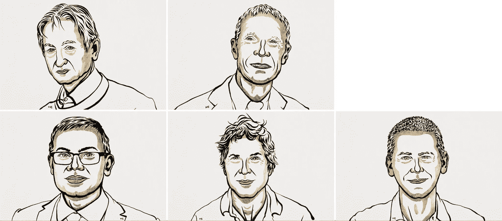
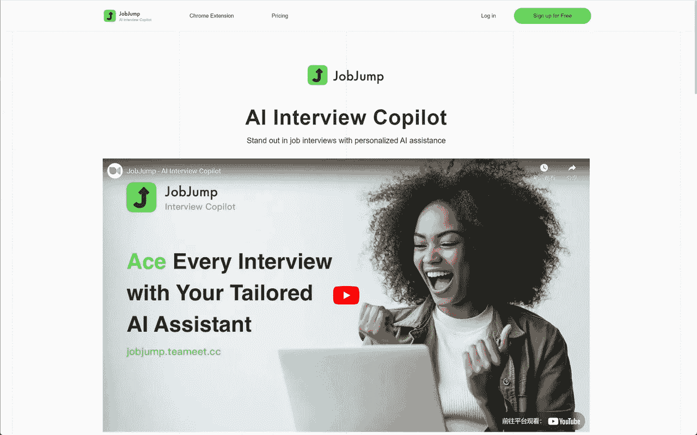
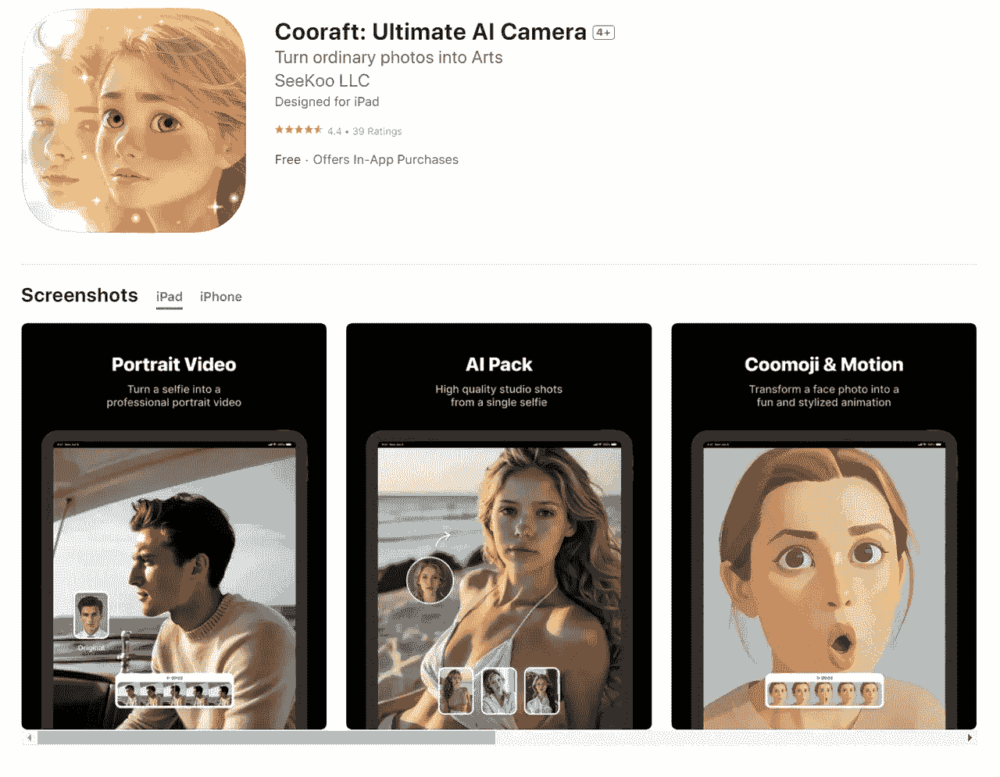
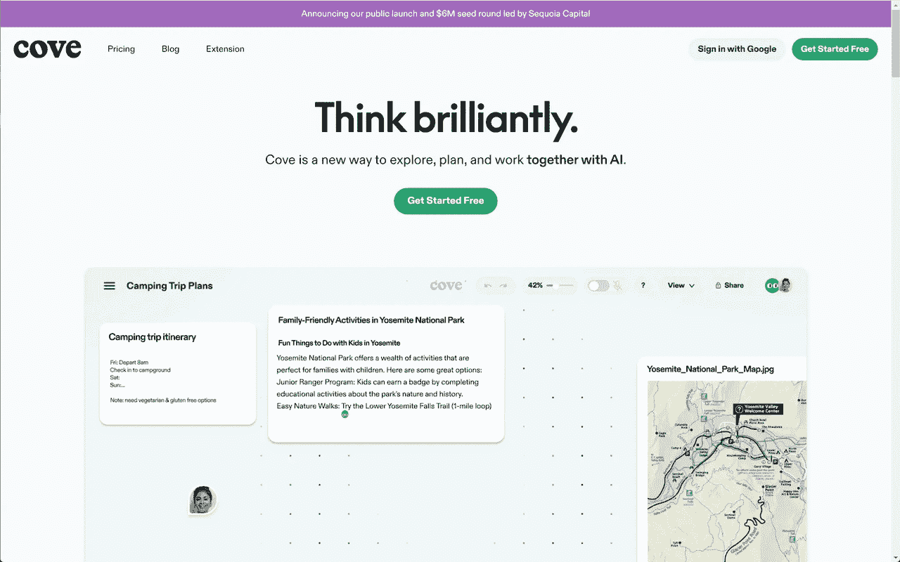

# 第17期 AI行业周报（2024-10.7-13）

> 来源：[https://v11enp9ok1h.feishu.cn/docx/GwXJdZVAno62kcxJBqbckdcundh](https://v11enp9ok1h.feishu.cn/docx/GwXJdZVAno62kcxJBqbckdcundh)

## 上周精选 ✦

### 诺贝尔物理学奖和化学奖都颁给了AI项目

上周诺贝尔奖24年的开奖了，物理学和化学奖的获得者都跟AI相关。特别搞笑的是 Geoffrey 在获奖视频上说最自豪的是 自己的学生（Ilya）解雇了Sam ，哈哈。

其中诺贝尔物理学奖颁给了约翰·J·霍普菲尔德（John J. Hopfield）和杰弗里·E·辛顿（Geoffrey E. Hinton），以表彰他们在机器学习领域，特别是人工神经网络方面的奠基性贡献。

**获奖理由是：**

这两位获奖者利用物理学工具开发了如今强大的机器学习方法。约翰·霍普菲尔德创建了一种关联记忆，可以存储和重建图像及其他类型的数据模式。杰弗里·辛顿则发明了一种方法，可以自主发现数据中的属性，从而执行诸如识别图片中特定元素的任务。这些技术在物理学中被广泛应用，例如开发具有特定属性的新材料。

**两位的具体履历：**

+   **约翰·J·霍普菲尔德**

+   **出生日期 **：1933年

+   **教育背景 **：1958年获得康奈尔大学博士学位

+   **职业生涯 **：曾在加州大学伯克利分校、普林斯顿大学和加州理工学院任教。他以发展霍普菲尔德网络而闻名，这是一种用于内容寻址存储器的人工网络。

+   **其他荣誉 **：曾获得麦克阿瑟奖（1983-1988）、狄拉克奖章（2001）和爱因斯坦奖（2005）等。

**杰弗里·E·辛顿**

+   **出生日期 **：1947年

+   **教育背景 **：1978年获得爱丁堡大学人工智能博士学位

+   **职业生涯 **：主要在多伦多大学任职，并在2013年至2023年间为谷歌工作。他是深度学习领域的先驱，开发了反向传播算法和深度信念网络等关键技术。

+   **其他荣誉 **：2018年图灵奖得主，并于2024年因其在机器学习中的基础性发现与发明而获得诺贝尔物理学奖。

---

诺贝尔化学奖授予了三位科学家：大卫·贝克（David Baker）、德米斯·哈萨比斯（Demis Hassabis）和约翰·M·朱姆珀（John M. Jumper），以表彰他们在蛋白质研究领域的杰出贡献。

**获奖原因有：**

**大卫·贝克 **因其在“计算蛋白质设计”方面的工作获得了半数奖金。他开发了计算方法，能够设计出全新的蛋白质，这些蛋白质具有独特的形状和功能，可能用于药物、疫苗、纳米材料和传感器等多个领域

**德米斯·哈萨比斯 **和 **约翰·M·朱姆珀 **共同分享了另一半奖金，他们利用人工智能模型AlphaFold2解决了一个长达50年的科学难题：从氨基酸序列预测蛋白质的三维结构。这一突破性成就使得几乎所有已知蛋白质的结构预测成为可能。

**三位的具体履历：**

**大卫·贝克**

+   **出生 **：1962年，美国华盛顿州西雅图

+   **教育背景 **：1984年毕业于哈佛大学，1989年获得加州大学伯克利分校生物化学博士学位。

+   **职业生涯 **：现为华盛顿大学生物化学教授，并担任蛋白质设计研究所所长。他是美国国家科学院院士，曾获得多个奖项，包括2021年的生命科学突破奖。

**德米斯·哈萨比斯**

+   **出生 **：1976年，英国伦敦

+   **教育背景 **：剑桥大学计算机科学双一等学位，2009年获得伦敦大学学院认知神经科学博士学位。

+   **职业生涯 **：DeepMind联合创始人兼首席执行官。DeepMind是全球领先的AI研究公司，以开发AlphaGo而闻名。哈萨比斯在AI领域有着丰富的成就，并多次荣获国际大奖。

### 特斯拉举办We, Robot发布会，发布完全自动驾驶的出租车和大巴

马斯克这个发布会是真的失败，只是做了一些简单的开场和表演，关于全自动驾驶汽车的相关技术以及安全和性能完全没有介绍，这个发布会直接导致特斯拉股价的暴跌。

具体发布内容有：

+   **Cybercab（赛博出租车）**

+   这是一款全新设计的无人驾驶出租车，取消了传统汽车的侧后视镜、踏板和方向盘，完全依赖于特斯拉的全自动驾驶（FSD）软件。

+   Cybercab采用无线感应充电技术，并配备机械臂进行车内环境自动清洁。

+   预计生产成本低于3万美元，交通费用约为每英里0.2美元，计划于2026年开始生产。

Robovan（无人驾驶多功能车）

+   Robovan是一款比Model Y更大的无人驾驶多功能车，可容纳20人，同时具备一定的货运能力。

+   特斯拉计划将其用于商业运输和共享出行领[域，](https://news.qq.com/rain/a/20241011A09PQ600)[预期](http://m.itbear.com.cn/html/2024-10/538299.html)运输成本降至每英里5-10美分 2 4 。

Tesla Bot（人形机器人Optimus）

+   Optimus是特斯拉的人形机器人，与特斯拉车辆共享核心技术，如三电系统、软件系统和人工智能计算机。

+   该机器人能够完成如照顾孩子、遛狗、购物等日常任务，并具备一定的沟通能力。

+   马斯克表示，未来每个人都可以拥有自己的Optimus，预计成本将降至2万至3万美元。

# 其他动态 ✦

+   阿里妈妈发布了一个 FLUX DEV的8步Lora ，看演示图片质量的损失非常小，比FLUX schell本身好很多。

+   拓竹旗下 3D 打印社区 Make World 发布 AI 生成 3D 卡通形象服务 PrintMon Maker ，3D 生成模型终于找到了一条非常踏实的落地和变现路径。

+   上海国投公司搞了一个 [上海人工智能生态基金 ](https://www.ithome.com/0/801/764.htm)。基金规模 100 亿元，首期 30 亿元。并且和与稀宇科技（MiniMax）、阶跃星辰签署战略合作协议。

+   智谱的 [智谱清言 ](https://chatglm.cn/main/gdetail/659e54b1b8006379b4b2abd6?lang=zh)和月之暗面的 [Kimi ](https://kimi.moonshot.cn/)都推出了基于深度思考COT的AI搜索。

+   字节跳动发布 Ola Friend 豆包智能体耳机 ，支持随时唤起豆包进行交流和辅助。

+   Krea ai 想做视频和图片界的 POE 。他们现在集成了海螺、Luma、Runway 和可灵四家最好的视频生成模型。

+   [可灵的对口型能力更新了 ](https://klingai.kuaishou.com/)，现在可以直接输入文本指定对应声音朗读，然后再对口型。

+   海螺视频生成海外版推出付费计划 。就两个档位一个 10 美元，一个无限生成的 95 美元。

+   根据美国专注为企业提供金融服务的公司 Ramp 的数据显示， 9 月份Cursor 的新增企业客户数量 超过了 Open AI 。

+   [Runway Tur](https://x.com/runwayml/status/1843707595141644617)bo 模型现在 支持首尾帧生成视频 。

+   Anthropic 发布新的 Message Batches API 。可以批量发送最多 10,000 个查询。每个批次的处理时间不到 24 小时。成本比标准 API 调用低 50%，不受标准 API 速率限制影响。

+   Prime Intellect宣布推出 INTELLECT-1 ，首个 10B 的去中心化训练模型。

# 产品推荐 ✦

### [EVE：3D AI伴侣](https://www.bilibili.com/video/BV1Ti2DY5EJt/)

朋友圈看到曲凯发的这个《EVE》3D AI伴侣的演示也太好了。建模、动作和声音都无可挑剔，还有多模态能力。做成手机APP确实比电脑要用要好，可以在使用电脑工作或者游戏的时候随时触发。

# Podcastfy ai：开源版本Notebook LM

它使用 GenAI 将多模式内容（文本、图像）转换为引人入胜的多语言音频对话。输入内容包括网站、PDF、YouTube 视频以及图像。

Podcastfy 专注于从多种多模式源中以编程方式和定制方式生成引人入胜的对话文本和音频，从而实现定制和规模化。

# JobJump：AI辅助面试工具

JobJump 旨在通过提供个性化的 AI 辅助，帮助用户在求职面试中脱颖而出。该扩展支持超过 3 个在线平台、50 种以上的面试语言，并为 200 多个行业和职位提供定制服务。

在加入 Google Meet 会议时，面试辅航窗口会自动显示在屏幕顶部，点击 “开始” 按钮即可启动会话。AI 将自动识别面试官的问题，并即时生成个性化的回答提示。用户可以将提示固定在屏幕上，随时更新最新的问题，并自信地回答问题以获得理想的工作。

# AIGC Weekly #92

JobJump 旨在通过提供个性化的 AI 辅助，帮助用户在求职面试中脱颖而出。该扩展支持超过 3 个在线平台、50 种以上的面试语言，并为 200 多个行业和职位提供定制服务。

在加入 Google Meet 会议时，面试辅航窗口会自动显示在屏幕顶部，点击 “开始” 按钮即可启动会话。AI 将自动识别面试官的问题，并即时生成个性化的回答提示。用户可以将提示固定在屏幕上，随时更新最新的问题，并自信地回答问题以获得理想的工作。

### Cooraft：将自拍照变为华丽的专业拍摄视频

只需轻轻一按，即可将您的自拍照和日常照片变成华丽的工作室视频和镜头、艺术动画和渲染。专业摄影、2D 到 3D、脸部动画、素描到写实等等。还是原来的AI照片美化，不过现在增加了视频，感觉是先生成视频再换脸的逻辑。

# Cove：无限画布AI协作效率平台

Cove 是一个利用 AI 协作的新型工具平台，它通过共享工作空间、直接编辑内容、从用户添加中学习、提供多种可能的思路、加速网络研究以及与常用工具无缝集成，旨在提高用户的思考和工作效率。

Cove 将答案直接投入到共享工作空间中，而不是仅仅停留在聊天线程上，这样用户和 AI 都可以在彼此的想法基础上进行构建。

# 精选文章 ✦

1）以 Alex Redden 的 flux-fp8-api 为基础，然后使用 torch.compile 进行了优化，并在 Torch 的每日构建版本中采用了快速的 CuDNN 注意力核心 (attention kernels)。

2）添加了一个新的同步 HTTP API，大大提高了 Replicate 平台上所有图像模型的速度。

### Entropy-based sampling：基于熵的采样方法

现在大部分宣称复刻Open AI o1的项目基本都是基于提示工程和模型微调，没有一个是基于强化学习的。Entropy-based sampling 这个项目看起来更有价值一些。

主要逻辑是基于熵的采样方法，用于改善大型语言模型（LLMs）的文本生成过程。通过控制熵和方差熵来避免分布退化，提高生成结果的多样性和质量。

框架中，根据当前熵和方差熵的值，采取不同的策略，如贪心解码、分支、回溯或引入推理链（Chain of Thought, CoT）。

### Lex Fridman 访谈了Cursor 创始团队

Lex Fridman 访谈了Cursor 创始团队，这一期干货非常多。他们详细介绍了 Cursor 的技术细节、AI 在编程中的应用、对未来 AI 编程的看法以及Cursor 团队的理念。

我整理的要点总结在这里：[https://mp.weixin.qq.com/s/EK](https://mp.weixin.qq.com/s/EKzhtkfZa0Bml0WBHVKsiQ)zhtkfZa0Bml0WBHVKsiQ

### Mixture of Experts, MoE的视觉指南

深入探讨了专家混合技术，特别是在大语言模型 (Large Language Model, LLM) 领域的应用。

具体内容包括：专家混合 (MoE) 概述、工作原理、路由机制、在视觉模型中的应用、计算效率等。

# [2024年人工智能行业报告](https://www.stateof.ai/)

State of AI Report 2024 是一份分析人工智能领域最有趣发展的报告，旨在促进有关 AI 现状及其对未来影响的知情讨论。内容包括研究、行业、政策、安全、预测五个方面。

+   **AI 研究 **：前沿实验室的性能开始趋同，专有模型的优势减少，基础模型在多个科学领域展现了突破。

+   **AI 商业化 **：AI 公司的企业价值显著增长，一些 AI 公司开始产生实质性收入，但商业模式的可持续性受到质疑。

+   **AI 政策与监管 **：AI 的监管和经济影响成为关注焦点，美国对中国的制裁对中国实验室的影响有限。

+   **AI 安全 **：关注高度能力未来 AI 系统的灾难性风险，研究人员提出了修复方法和保护措施。

+   **AI 未来趋势 **：AI 技术的商业应用不断扩展，但随着技术的发展，如何确保 AI 的安全和可持续性成为重要议题。

# a16z：如何利用 AI 技术 “导出大脑”

**Justine Moore **探讨了如何利用 AI 技术 “导出大脑”，即将个人思想、情感和经验转化为 AI 可以理解和分析的格式，以提高个人与他人沟通、自我理解和与应用程序交互的效率。

她指出，尽管 ChatGPT 并不是最佳工具，但它展示了将个人信息导入 AI 以获得更好的自我反思和决策指导的潜力。文章详细介绍了三个核心用例：与他人沟通、自我理解和与应用程序交互。

在与他人沟通方面，AI 伴侣能够帮助用户以最有效的方式表达自己的内心思想，甚至能够根据过去的交互来优化沟通策略。在个人自我理解方面，AI 可以帮助用户反思自己的优势和弱点，并提供个性化的建议。在与应用程序交互方面，AI 可以提供更加个性化的推荐和服务，因为它能够更深入地理解用户的偏好和历史。

# 重点研究 ✦

上海交通大学开源了F5-TTS 语音合成技术，这是一种完全非自回归的文本到语音系统，它通过流匹配与扩散变换器 (DiT) 实现。

F5-TTS 简化了传统的 TTS 系统设计，不需要复杂的时长模型、文本编码器和音素对齐，而是通过将文本输入用填充标记填充到与输入语音相同的长度，并利用 ConvNeXt 模型对文本表示进行细化，以便与语音对齐。

模型特点有：v

+   零样本 (Zero-shot) 声音克隆

+   速度控制（基于总时长）​

+   可以控制合成语音的情感表现

+   长文本合成

+   支持中文和英文多语言合成

+   在 10 万小时数据上训练

+   最重要的是支持商用

论文： https://arxiv.org/abs/2410.06885

模型下载： [https://huggingf](https://t.co/ffD2m6L1EG)ace.co/SWivid/F5-TTS

演示Demo：[https://huggingface.co/spaces/](https://huggingface.co/spaces/mrfakename/E2-F5-TTS)mrfakename/E2-F5-TTS

### DIAMOND：实时生成可游玩的CS:GO和雅达利小游戏

DIAMOND 这个项目太牛了。你甚至可以用鼠标和键盘玩实时生成的CS：GO。

和真实游戏的区别是，这里的游戏环境、人物动作、装备都是实时生成的不存在预置的3D模型。

而且这个项目是开源的，你可以自己部署试一试，目前可以在3090显卡上以10帧的速度运行。

DIAMOND是一种在扩散世界模型中训练的强化学习代理。

它通过考虑代理的动作和之前的帧来模拟环境响应，并且能够在雅达利和 CSGO 等游戏中模拟 3D 环境。

### Pyramidal Flow：视频生成模型

快手和北大开源了一个基于流匹配的自回归视频生成模型 Pyramidal Flow Matching。

演示视频看起来效果非常好。

所有的数据都来源于开源数据集；可以生成 768P、10 秒 24FPS 的视频；总参数量为 2B。

Comfyui插件：[https://github.com/kijai/ComfyU](https://github.com/kijai/ComfyUI-PyramidFlowWrapper)I-PyramidFlowWrapper

### Swarm：Open AI开源的多智能体编排框架

Swarm 关注的重点是让智能体协作和执行变得轻量、高度可控且易于测试。

为此，它使用了两种原语抽象： 智能体（agent） 和 交接（handoff） 。其中，智能体包含指令和工具，并且在任何时间都可以选择将对话交接给另一个智能体。

Swarm （几乎）完全运行在客户端，与 Chat Completions API 非常相似，不会在调用之间存储状态。

### [OpenAI 推出 MLE-ben](https://openai.com/index/mle-bench/)ch：评估AI在MLE方面表现的基准测试

MLE-bench 是一个由 OpenAI 设计的机器学习工程评估基准，用于衡量 AI 代理在 MLE 领域的能力。该基准由 75 个来自 Kaggle 的竞赛组成，涵盖了从数据准备到实验执行等多项实际 MLE 技能。

OpenAI 使用 Kaggle 的公开领先者榜单为每个竞赛建立了人类基线。通过使用开源的代理架构，OpenAI 评估了多个前沿语言模型，并发现最佳表现的设置 —— 使用 AIDE 架构的 OpenAI 的 o1-preview —— 在 16.9% 的竞赛中至少达到了 Kaggle 青铜奖的水平。

### Mistral Pixtral 12B 技术报告

Pixtral-12B 经过训练，可以理解自然图像和文档，实现了在各种多模态基准测试中的领先表现，超过了许多更大的模型。

与许多开源模型不同，Pixtral 还是一个尺寸上前沿的文本模型，并且在自然语言性能方面不会为了在多模态任务上表现出色而妥协。Pixtral 使用了一个经过从头开始训练的新视觉编码器，这使得它能够以自然分辨率和长宽比处理图像。这使用户可以灵活地确定用于处理图像的令牌数量。Pixtral 还能够在其长上下文窗口 128K 令牌中处理任意数量的图像。

Pixtral 12B 的表现明显优于其他相似规模的开放模型（Llama-3.2 11B 和 Qwen-2-VL 7B）。它还胜过了远大于它的开放模型，比如 Llama-3.2 90B，而尺寸却小了 7 倍。

我们进一步贡献了一个开源基准测试，MM-MT-Bench，用于评估在实际场景中的视觉语言模型，并为多模态 LLMs 的标准化评估协议提供了详细分析和代码。