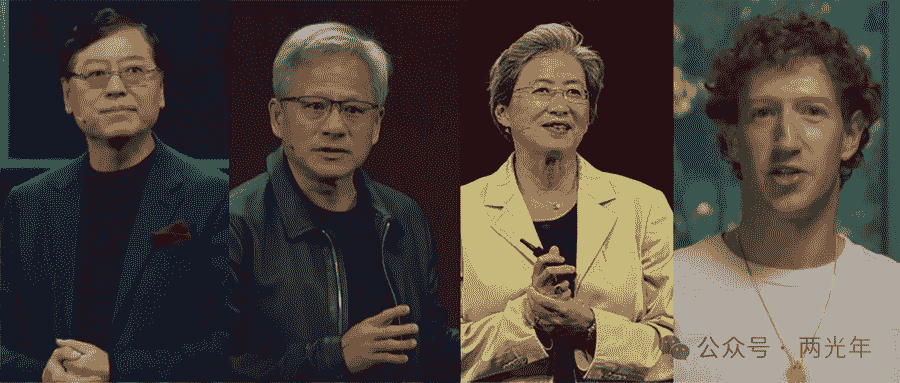
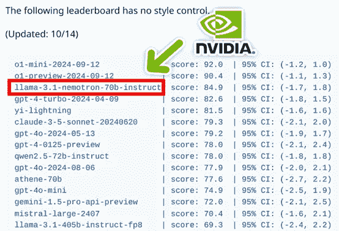
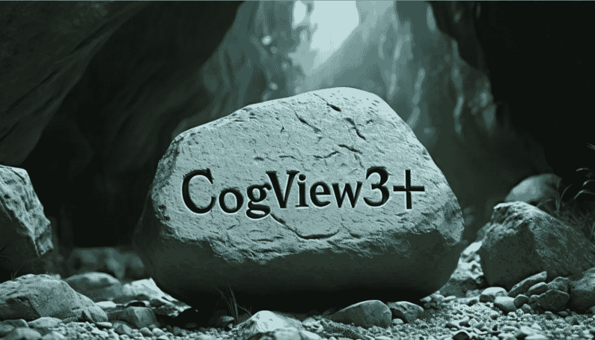
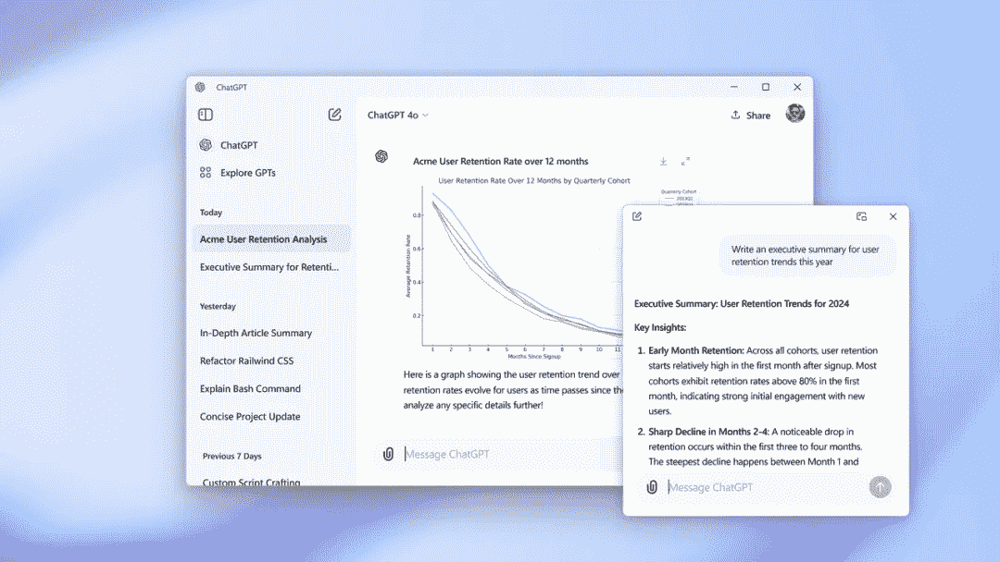
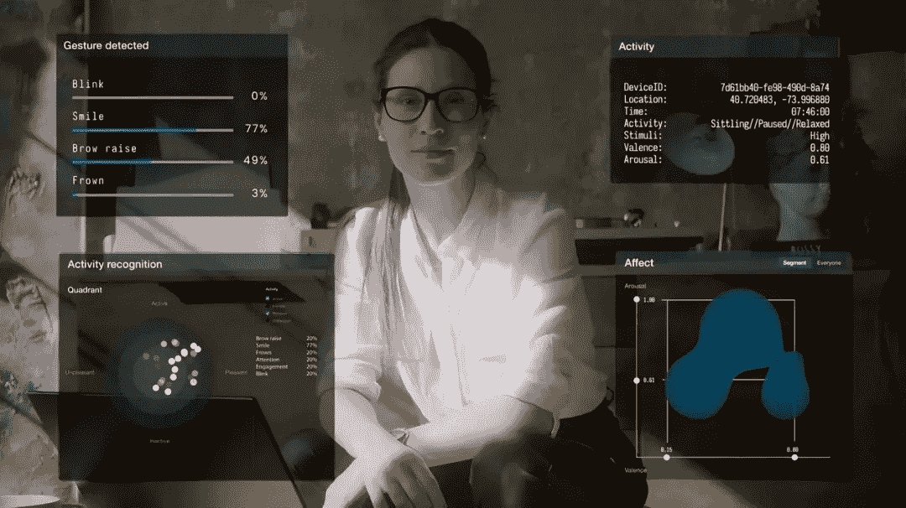
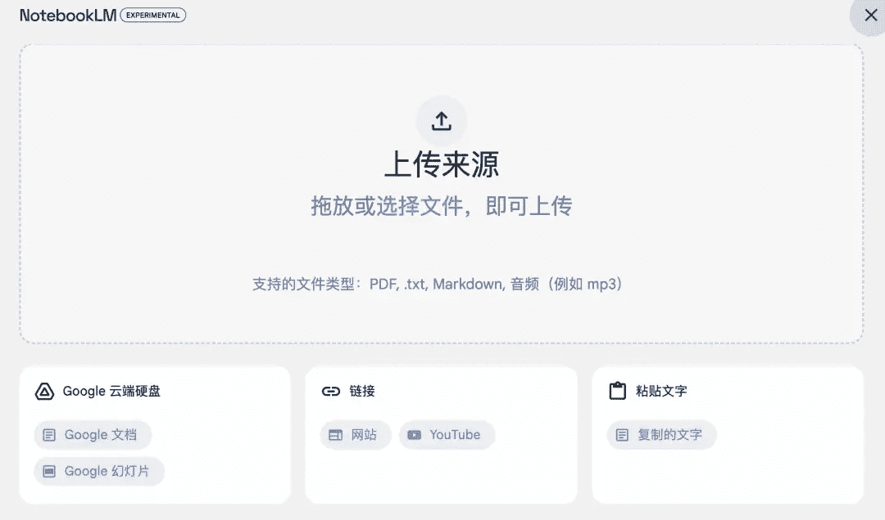
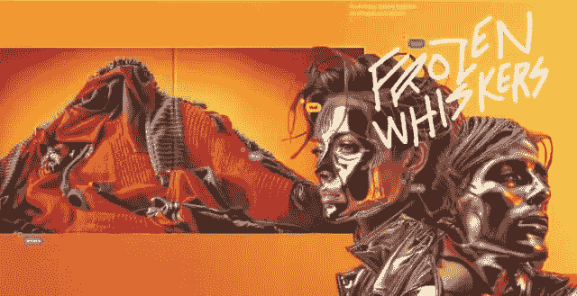

# 第18期 AI行业周报（2024-10.14-20）

> 来源：[https://v11enp9ok1h.feishu.cn/docx/HGNIdiVm8oeiCkxDGuVcWl4OnVg](https://v11enp9ok1h.feishu.cn/docx/HGNIdiVm8oeiCkxDGuVcWl4OnVg)

## 联想创新科技大会2024：AI智能体引领AI产品新浪潮

联想创新科技大会2024带来了一场AI领域的盛宴，全球AI圈的顶级大咖齐聚一堂，共同见证了联想在AI领域的重大突破。

联想的AI手机和PC化身为超级AI私人助理，不仅能够记住用户的每个细节信息，还能简化复杂操作，如一句话完成点外卖等任务。超级互联功能更是让AI能力跨设备流转，实现无缝连接。

联想集团董事长兼CEO杨元庆强调，AI不是昙花一现的潮流，而是切实可行的技术。联想在AI智能体方面的布局，旨在实现个人计算向AI支持的个性化计算转变。AI智能体将成为每个人的“AI双胞胎”，提供主动服务。

会上，联想还宣布了与英特尔、AMD等科技巨头的合作，共同推动AI的发展。英特尔CEO帕特·基辛格宣布了与AMD的首次合作，组建x86生态咨询小组，以推动x86架构的创新和发展。

此外，联想还发布了第六代Neptune海神液冷解决方案，该方案采用温水冷却技术，可减少40%的电力消耗，为AI和HPC客户提供高效节能的解决方案。

AI智能体和混合式AI将在未来成为两大关键趋势，这也预示着AI技术正从云端走向终端，深入人们的日常生活。



## 英伟达重磅开源超强大模型--Nemotron

本周，英伟达开源了一款名为Llama-3.1-Nemotron-70B-Instruct的超强大模型，这款模型在性能上已经超越了GPT-4o、GPT-4turbo、Gemma-2等140多个开闭源模型，仅次于OpenAI发布的最新模型o1。

Nemotron的基础模型基于Llama-3.1-70B开发，采用了一种新的混合训练方法，结合了Bradley-Terry和Regression两种训练奖励模型的方法。这使得模型能够更准确地理解和遵循用户的提示指令。

英伟达还开源了Nemotron的训练数据集，这对于开发同类型或更先进的模型具有重要意义。

Nemotron模型的开源，展示了英伟达在AI技术极强的创新能力，同时也为研究人员和开发者提供了强大的工具，以探索和实现更先进的AI应用。

大家如果有兴趣，可以访问下面的地址进行体验。

开源地址：

```
https://huggingface.co/nvidia/Llama-3.1-Nemotron-70B-Reward
```

数据集：

```
https://huggingface.co/datasets/nvidia/HelpSteer2
```

在线demo：

```
https://huggingface.co/chat/
```



## 智谱科技开源了最新的文本到图像AI模型CogView3-Plus！

本周，智谱科技宣布开源其最新的文本到图像AI模型——CogView3-Plus。

CogView3-Plus基于DiT框架构建，采用Zero-SNR扩散噪声调度，并引入了文本-图像联合注意力机制。这些创新使其在保持模型基本能力的同时，有效降低了训练和推理成本。该模型支持在512到2048像素的区间内灵活生成不同分辨率的图像。

在性能上，CogView3-Plus在人工评估中相较于目前最先进的开源文本到图像扩散模型SDXL高出77.0%，同时推理时间仅需SDXL的大约1/10。这一成果不仅展示了CogView3-Plus在图像生成质量上的显著优势，也体现了其在效率上的大幅提升。

智谱科技还提供了CogView3-Plus的图像编辑功能，并已将其集成[智谱清言]平台，供用户体验。

此外，该公司还开源了CogView3以及CogView3-Plus-3B模型，均采用Apache 2.0协议，这可通过GitHub和Hugging Face等平台访问。

智谱科技的这一开源行动不仅为AI研究社区提供了强大的工具，也为创意产业的发展注入了新的动力。



## Windows版ChatGPT应用上线！

本周，OpenAI发布了适用于Windows的ChatGPT桌面应用，目前仅对ChatGPT Plus等用户开放。

新应用引入了「Companion Chat」功能，允许用户通过快捷键快速调用ChatGPT，进行提问或文件上传，而无需切换应用。该功能还包括记住聊天位置和快速清除聊天内容等便捷操作。应用可在微软商店下载，支持Win10及以上版本。

目前，ChatGPT的桌面版本已向Mac和Windows两大操作系统开放，但Linux版本尚未给出明确的时间表。此外，ChatGPT Canvas功能也更新了一个实用功能，允许用户查看文章或代码的更改。这些更新进一步完善了ChatGPT的生态系统。



## Sense眼镜可以察觉你的情绪

英国科技公司Emteq Labs推出了全球首款“情感感知智能眼镜”——Sense，这款革命性的产品旨在通过追踪用户的面部表情、饮食习惯、情绪、姿势、注意力水平和身体活动等指标，它深入理解用户的情绪反应，以改善生活和健康状况。

Sense智能眼镜的主要功能包括：

这款Sense智能眼镜的推出，不仅展示了Emteq Labs在智能可穿戴设备领域的创新能力，也体现了科技在情感识别和健康管理方面的应用潜力。随着技术的不断进步，未来我们可能会看到更多类似的产品，它们将为人们的日常生活带来更多便利和健康益处。



## Google推出AI播客神器NotebookLM，让复杂信息秒变轻松播客！

Google最近推出了一款名为NotebookLM的AI产品，它通过其独特的音频概览功能，将文本内容转换成AI播客，为用户提供了一种全新的信息消费方式。这款产品不仅能够处理多种格式的内容，还能通过机器学习算法分析数据，为用户提供深入的洞察。

NotebookLM的推出，展示了AI在播客领域的应用潜力，为用户提供了个性化的内容创作和消费体验。它通过使用Google的大语言模型Gemini 1.5 Pro，使其知识内容转换变得更加简单易懂。

此外，NotebookLM还提供了摘要、建议问题、常见问题解答等功能，进一步增强了用户的互动体验。



## OPPO 发布 ColorOS 15 系统，推出一键问屏等AI功能

OPPO在2024年开发者大会上正式发布了ColorOS 15系统，并推出了一系列新的功能。

这其中就包括了超级小布助手，它能够通过一键问屏、一拍即问、一圈即搜、图片问答、文档问答等多种交互方式与用户进行交流。同时，ColorOS 15系统还能够深度理解并分析屏幕内容，实现基于上下文理解的多轮连续自然对话。

此外，该系统还具备多种AI功能，如AI去反光、AI超清像素、AI文档助手、AI帮写、AI语音摘要等，这些功能旨在提高用户的使用体验和工作效率。ColorOS 15系统通过系统级AI的感知与调度能力，实现了自有应用与第三方应用间的无缝协作。

这次ColorOS 15系统的发布，展示了OPPO在AI技术和智能手机操作系统上的深入探索和持续创新，进一步提升了OPPO手机的智能化水平和用户体验。


## Adobe发布AI创意工具Project Concept，激发设计灵感新境界。

在Adobe MAX年度会议上，Adobe预览推出了一款革命性的AI创意头脑风暴工具——Project Concept。这款工具的使命是助力设计师们快速生成更具想象力和协作性的创意，从而将更多时间投入到探索创意的无限可能中。

Project Concept致力于优化设计流程的早期阶段，让设计师能够迅速产生创意，减少在日常生产任务上的时间消耗。让设计师拥有更多的自由，以拓展创造的无限可能。

该工具搭载了Adobe最新的Firefly生成AI模型，为设计师提供强大的支持，帮助他们快速实现创意的生成和资产的混合。

目前，Project Concept仍处于测试阶段，但预计将很快推出私人测试版。Adobe通过这一创新工具，展现了其推动创意产业发展，为设计师提供更广阔创意空间的决心。

