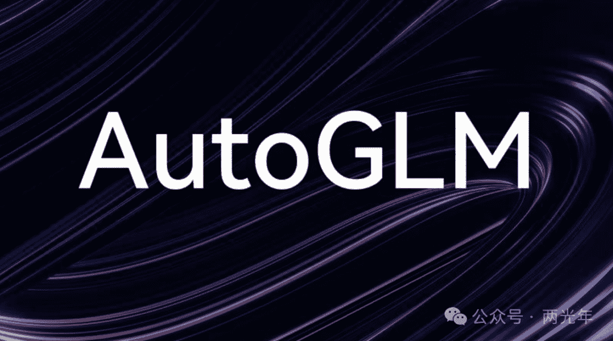
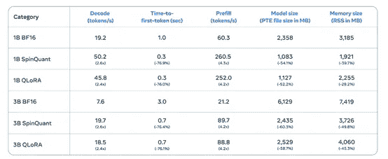
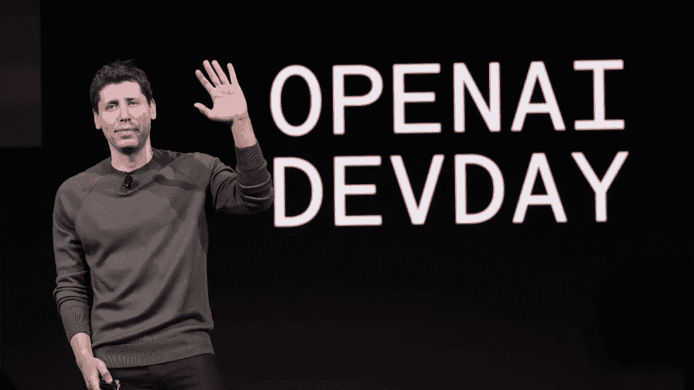
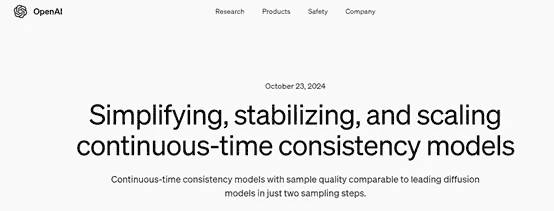
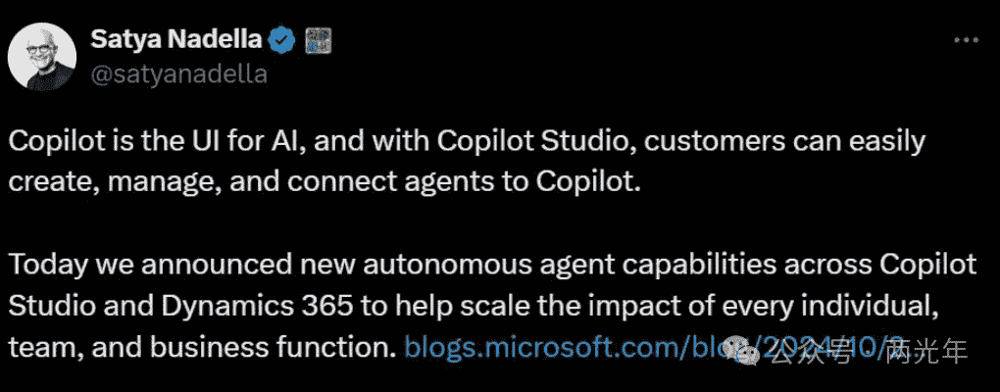
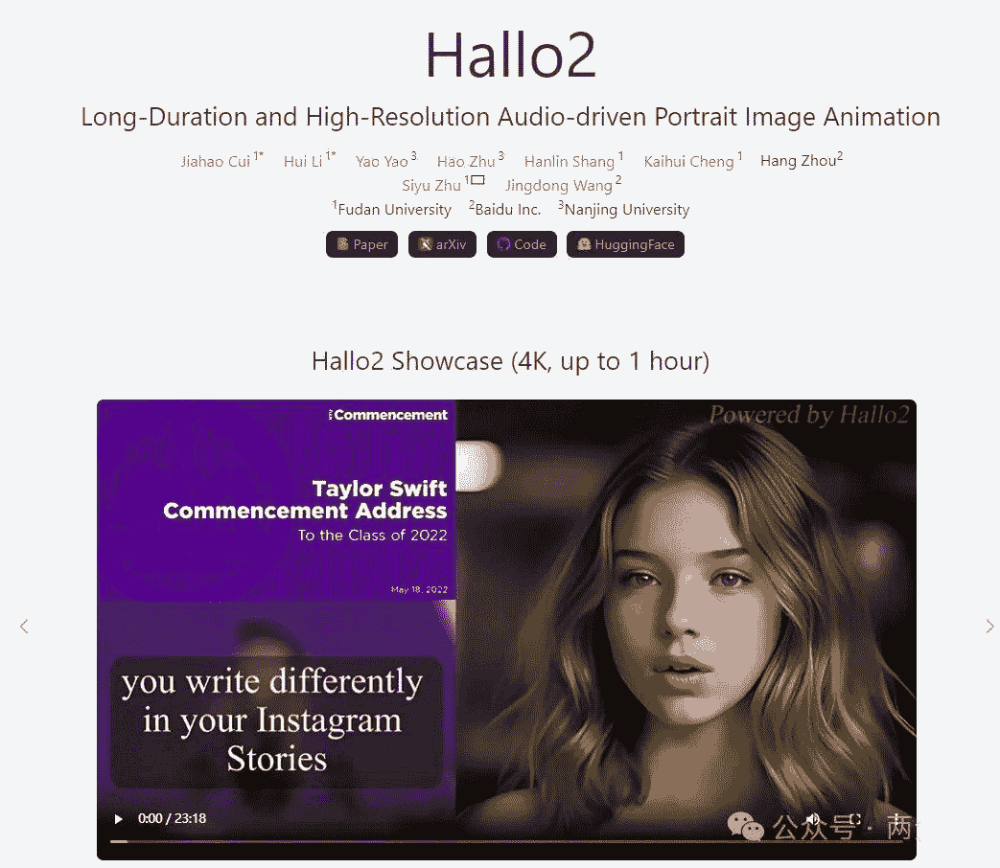
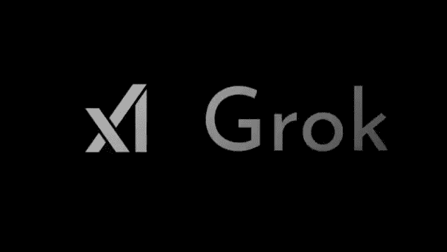

# 第19期 AI行业周报（2024-10.21-27）

> 来源：[https://v11enp9ok1h.feishu.cn/docx/C9tEdfeSxougiIxvdnGc9hs8nCd](https://v11enp9ok1h.feishu.cn/docx/C9tEdfeSxougiIxvdnGc9hs8nCd)

## 智谱发布AutoGLM大模型，可模拟人类操作手机

本周，智谱科技宣布推出AutoGLM大模型，这是一款具备「Phone Use」能力的AI模型，能够通过简单的文字或语音指令模拟人类操作手机。

AutoGLM的设计理念就是模仿人类操作逻辑。不需要复杂的工作流搭建，就可以完成电子设备上的各类任务。

在AndroidLab评测基准上，AutoGLM超越了GPT-4o和Claude-3.5-Sonnet的表现，而在WebArena-Lite评测基准中，其性能相比GPT-4o提升了约200%。这显著缩小了人类与AI在GUI操控上的成功率差距。

目前，AutoGLM Web版本已经通过「智谱清言」插件发布，能够根据用户指令自动完成网站上的高级检索、内容总结与生成。手机端的AutoGLM也已开启内测，不过，现阶段仅支持Android系统。



## Meta发布量化模型Llama 3.2，内存减少40%，效率提升2倍

Meta最近开源了首个轻量级量化版模型Llama 3.2，包含10亿和30亿两种参数规模的版本。这一新模型专为在手机、平板、笔记本等移动设备上的部署使用而设计。

Llama 3.2在架构上采用了标准的Transformer结构，并针对线性层进行了特定的量化处理。在模型优化方面，通过量化感知训练和SpinQuant技术，实现了内存使用平均减少41%，模型规模减少56%，同时推理效率提升了2-4倍。

在实际测试中，Llama 3.2在一加12手机等设备上的解码延迟和预填充延迟均显著提高。此外，虽然它的参数规模较小，但Llama 3.2能支持长达128k tokens的上下文长度，能够处理长文本的总结和复杂指令的理解等任务。

Meta公布的测试数据还显示，量化后的Llama 3.2在多个主流基准测试中，性能与Llama 3 8B相当。

它的开源地址如下，大家感兴趣的可以试着去体验一番！

+

```
https://huggingface.co/collections/meta-llama/llama-32-66f448ffc8c32f949b04c8cf
```



## OpenAI计划推出新模型「Orion」，预计比GPT-4强大100倍

据The Verge报道，OpenAI正在准备推出其下一代大型AI模型Orion，并预计在12月前亮相。有消息称，Orion的性能可能比现有的GPT-4强大100倍。

与之前的o1模型不同，Orion将利用o1生成的合成数据来训练模型，以提高其性能。

报道进一步指出，Orion模型不会通过ChatGPT向公众广泛发布，而是选择与OpenAI有紧密合作关系的公司，提供访问权限，以便这些公司能够基于Orion构建自己的产品和功能。此外，有消息人士透露，微软的工程师正在准备在11月于Azure平台上托管Orion服务。

尽管Orion在OpenAI内部被视为GPT-4的继任者，但目前还不确定OpenAI是否会在外部将该模型称为GPT-5。无论如何，这一新模型的推出，无疑将进一步推动AI技术的发展，并为合作伙伴提供更强大的AI支持。



## OpenAI发布sCM扩散模型，效率提升50倍

本周，OpenAI宣布了一项重大技术突破——全新的扩散模型方法sCM。这一模型能够在仅需2步的情况下生成高质量图片和3D模型，实现了高达50倍的时钟加速。特别是在处理高分辨率任务时表现更为出色。例如，一个15亿参数的模型在单个A100 GPU上，无需任何推理优化，0.11秒内就能生成内容。

sCM的核心原理就是将噪声直接转换为无噪声样本，与传统扩散模型的渐进式去噪路径不同，sCM找到了一条更直接的路径，能在单步或少数几步内从噪声状态跳跃到数据状态。同时，sCM采用连续时间框架，避免了离散时间模型中的离散化误差，使得模型在理论上可以在连续的时间轴上进行操作。

在网络架构方面，sCM引入了多项改进，包括时间条件、自适应组归一化、新的激活函数和自适应权重，以提高模型的训练稳定性和生成质量。

这些改进使得sCM在CIFAR-10、ImageNet 64×64和ImageNet 512×512等多个数据集上的性能评测中，成为目前最高效的扩散生成方法。

研究人员表示，sCM的效率提升为实时视频生成等领域带来了新的可能性。目前，OpenAI已经分享了该论文方法，值得注意的是，该方法由两位华人提出。

论文地址：

```
https://arxiv.org/abs/2410.11081
```



## o1加持下，微软发布了10个AI Agent！

微软近日宣布在Dynamics 365中集成了10个自主AI Agent，这些智能体能够协助企业在客服、销售、财务、仓储等多个业务领域实现自动化，开创了全新的智能自动化工作模式。

这些AI Agent得到了OpenAI最新模型o1的支持，具备自主学习能力，能够执行跨平台的复杂业务流程，大幅节省时间和降低运营成本。

AI Agent通过分析来自Microsoft 365 Graph、Dataverse以及其他业务系统的数据，学习工作模式和趋势，从而优化业务流程。它们能够通过与用户的互动和反馈进一步训练和优化行为，具备了持续自我改进的能力。

用户可以在Copilot Studio的可视化界面中开发AI Agent，无需大量代码即可完成开发。这使得AI Agent的开发变的极其的简单。同时，AI Agent的实际应用场景也十分广泛，包括加快员工入职流程、法律审核、资料审核等，能够适用于销售、供应链、客户服务、财务、人力资源等多个领域。

微软表示，Copilot Studio中创建自主AI Agent的功能将在下个月发布预览版，并将持续加大AI Agent的研发力度。这也表明，全民智能体时代即将到来！



## 复旦、百度联手打造音频驱动图像动画生成器——Hallo2模型

Hallo2是由复旦大学、百度公司共同研发的音频驱动肖像图像动画生成模型。该模型结合单张参考图片和音频输入，通过文本提示调节肖像表情，生成与音频同步的4K高分辨率视频。

Hallo2采用了先进的数据增强技术，如补丁下降和高斯噪声，以增强视频的长期视觉一致性和时间连贯性。此外，它还实现了潜在代码的矢量量化和时间对齐技术，引入语义文本标签作为条件输入，从而提高动画的可控性和多样性。

Hallo2的主要特点包括长时视频生成能力，能够处理长达一小时的视频，解决外观漂移和时间伪影问题。它还支持4K分辨率输出，提供清晰的视觉效果。音频驱动动画功能使基于音频输入的肖像图像动画实现口型和表情的同步。此外，模型还支持文本提示调节，增加动画的多样性和表现力。

Hallo2的应用场景广泛，包括电影和视频制作、虚拟助手和数字人、游戏开发、社交媒体和内容创作以及新闻和广播等。它为这些领域提供了一种创新的工具，以创建逼真的动画和增强用户体验。



## xAI发布了Grok API，开发者可集成至其他应用

本周，xAI宣布正式发布Grok API，允许开发者将Grok集成到其他应用程序中。马斯克在周一宣布了这一消息，并在xAI网站上发布了该接口的链接。

用户需要登录xAI账户，并在个人资料设置中选择“Request Access”来申请访问PromptIDE和API。目前，API提供了一个名为“grok-beta”的模型，其定价为每百万输入token 5美元，每百万输出token 15美元。

此外，API还支持用户执行函数调用，使Grok能够与数据库、搜索引擎和其他外部软件工具集成。

