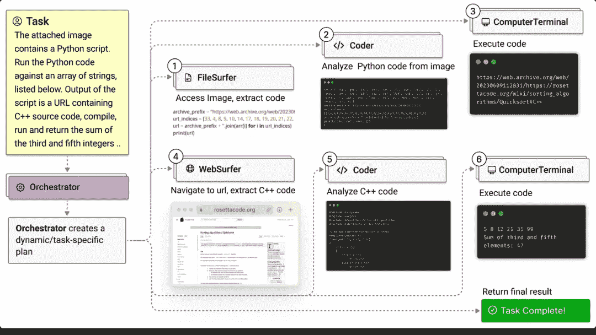
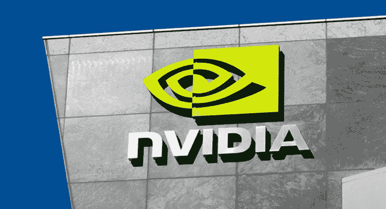
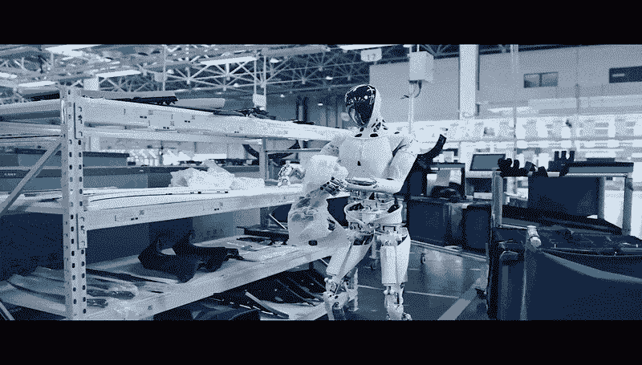
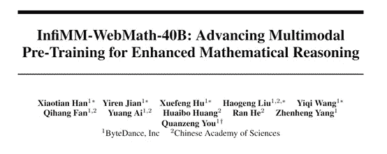
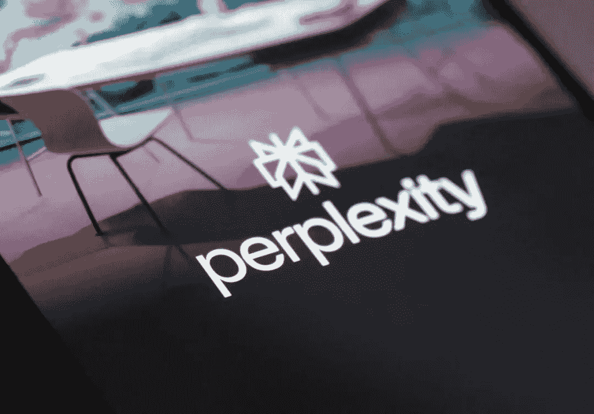

# 第21期 AI行业周报（2024-11.04-11.10）

> 来源：[https://v11enp9ok1h.feishu.cn/docx/Sp7sd5jBHo3XCWxKDolcRGVKnbf](https://v11enp9ok1h.feishu.cn/docx/Sp7sd5jBHo3XCWxKDolcRGVKnbf)

## 微软推出了Magentic-One——多AI智能体协同系统

微软最新推出了Magentic-One，一款创新的多AI智能体协同系统，它通过多个专用AI智能体的合作，旨在高效处理复杂的工作流程。

Magentic-One的核心是一个名为协调器代理（Orchestrator）的智能体，负责任务调度和设计整个任务的蓝图。协调器通过构建「任务账本」来启动操作，并在项目进展中维护「进度账本」，确保每个阶段的任务都能按时完成。

Magentic-One通过协调器指挥四个主要代理，各自承担不同的角色：

1.  WebSurfer智能体：负责在网络上进行搜索、点击链接和与在线元素互动，能够跨多个网站收集信息并提供摘要。

1.  FileSurfer智能体：探索本地目录、分析文件内容，支持文档管理和数据检索。

1.  编码智能体：具备编写和评估代码的能力，能够撰写新脚本、调试现有代码，并与其他代理协作。

1.  计算机终端智能体：直接执行由编码代理生成的代码，适用于需要即时测试或部署的项目。

Magentic-One在多个基准测试中表现出色，证明了其在提升工作流程效率方面的潜力。目前，该系统已经开源，供研究人员和开发人员使用，这将进一步推动AI技术的发展和应用。



## 英伟达股价上涨，市值超越苹果成为全球最高

在本周二的交易中，英伟达的股价上涨超过2%，收盘时公司估值达到了3.43万亿美元，超越了苹果公司的3.38万亿美元市值，成为全球市值最高的公司。这一成就标志着英伟达在人工智能和相关技术领域的领先地位得到了市场的广泛认可。

今年6月份，英伟达的市值曾短暂超越苹果，成为全球市值最高的公司，但仅保持了一天。自2022年底以来，英伟达的股价已经上升超过850%，这与公司作为人工智能热潮中的关键基础设施提供商密切相关。英伟达的GPU技术在AI训练、深度学习和高性能计算中发挥着重要作用，这使其成为这一领域的最大受益者之一。

英伟达的市值增长不仅反映了其在技术和市场上的成功，也预示着人工智能技术在全球经济中日益增长的影响力。随着AI技术的不断进步和应用范围的扩大，英伟达有望继续保持其在全球科技领域的领导地位。



## 腾讯混元发布「混元Large」及「Hunyuan3D-1.0」开源大模型，引领MoE技术新浪潮

腾讯混元近日宣布，其最新的MoE模型 混元Large 和混元3D生成大模型 Hunyuan3D-1.0 已正式开源。这些模型支持企业及开发者在精调和部署等不同场景下的应用需求。

混元Large是开元领域参数规模最大、效果最好的MoE模型，总参数量达到389B，激活参数量52B，上下文长度高达256K。在CMMLU、MMLU、CEval、MATH等多学科综合评测集以及中英文NLP任务、代码和数学等9大维度上，「混元Large」全面领先，超过了Llama3.1、Mixtral等一流的开源大模型。

Hunyuan3D-1.0则是业界首个同时支持文字、图像生成3D的开源大模型。首批开源模型包含轻量版和标准版，轻量版仅需10秒即可生成高质量3D资产。目前已在技术社区公开发布，包含模型权重、推理代码、模型算法等完整模型，可供开发者、研究者等各类用户免费使用。

腾讯混元的这一开源举措，不仅推动了AI技术的进一步发展，也为全球AI社区提供了强大的工具和资源，促进了技术的共享与创新。


## 小鹏汽车发布AI机器人Iron，身高1米8，已投入工厂使用

小鹏汽车在其AI科技日上正式亮相了最新的AI机器人Iron。这款机器人以其1:1拟人形态、灵活的双手和先进的技术应用引起了广泛关注。

Iron身高178厘米，体重70千克，拥有62个自由度，其设计灵感来源于人体的生理特征和功能，包括心脏、肌肉、脊椎、大脑等。Iron的双手特别引人注目，拥有15个可动自由度，并支持触觉反馈，配备了新一代直线执行器和微型手指关节，较上一代扭矩密度提升了20%。

在行走方面，Iron也展现出了更加自然的步伐，这得益于小鹏端到端的大模型和强化学习技术。

Iron使用了小鹏自研的图灵AI芯片和天玑AIOS，这些技术的应用使得Iron在算力和自主思考方面有了显著提升。此外，Iron还采用了小鹏汽车即将发布的P7+上的AI鹰眼视觉系统，提供了360度和720度的立体空间感知能力。

目前，Iron已经在小鹏广州工厂中实践应用，参与了小鹏P7+部分生产岗位的操作，展现了其在工业场景中的潜力和实用性。



## 美团联合创始人王慧文回归，带队探索AI应用

据智能涌现报道，美团联合创始人、光年之外创始人王慧文已重返美团，将带领美团AI团队GN06探索人工智能应用的新领域。GN06团队的主要业务方向涵盖情感陪伴和聊天机器人等，致力于提供“没有边界的AI尝试机会”给团队成员。

王慧文亲自负责产品和运营角色的面试把关，确保团队的质量和方向。接近美团的人士透露，GN06由王慧文直接管理，不隶属于任何事业群，保持相对独立的状态。该团队专注于探索美团主营业务之外的AI应用方向，与美团现有的大模型团队以及各业务条线中的AI团队相互独立。

王慧文的回归和GN06团队的成立，标志着美团在AI领域的进一步布局和发展，展现了公司对于AI技术应用的重视和对未来技术趋势的把握。


## 字节跳动及中科院开源WebMath-40B数据集，助力多模态AI研究

字节跳动与中国科学院合作，发布了名为WebMath-40B的多模态数据集，这一数据集的规模和质量均达到了业界领先水平。

WebMath-40B包含了2400万个网页和8500万个关联图片URL，以及400亿个文本标记，为多模态模型的训练和优化提供了丰富的资源。

该数据集的构建过程中，研究人员从CommonCrawl的庞大数据中筛选出了与数学相关的网页内容，并利用先进的数据清洗和去重技术，确保了数据集的高质量和准确性。此外，通过大语言模型的能力，对文档的数学质量进行了评估和打分，进一步提升了数据集的专业性和实用性。

WebMath-40B的开源，不仅为学术界和工业界提供了宝贵的研究资源，也为多模态AI模型的发展提供了强有力的支持。该数据集在HuggingFace平台上的开源，使得全球的研究人员和开发者都能够免费访问和使用，这极大的推动了AI技术在数学推理、图文识别等领域的进步。

开源地址：

+

```
https://huggingface.co/datasets/Infi-MM/InfiMM-WebMath-40B
```



## Perplexity完成新一轮融资，估值达90亿美元

据The Information报道，AI聊天机器人驱动的搜索引擎Perplexity即将完成新一轮融资，公司估值预计将达到90亿美元。

此轮融资由Institutional Venture Partners领投，投资金额高达5亿美元。这已是Perplexity今年完成的第四轮融资，显示了投资者对其业务模式和市场潜力的高度认可。

Institutional Venture Partners在此前也对Perplexity进行了多次投资，包括去年由其领投的B轮融资。Perplexity自2022年推出以来，以其独特的研究和对话搜索引擎受到市场关注，该搜索引擎能够通过自然语言处理技术预测文本并提供回答和查询服务。

随着AI技术的不断进步，Perplexity有望进一步扩大其业务范围，并在全球搜索引擎市场中占据一席之地。

