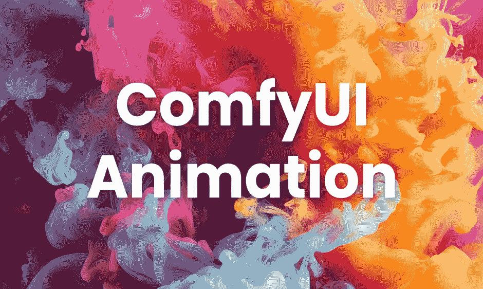
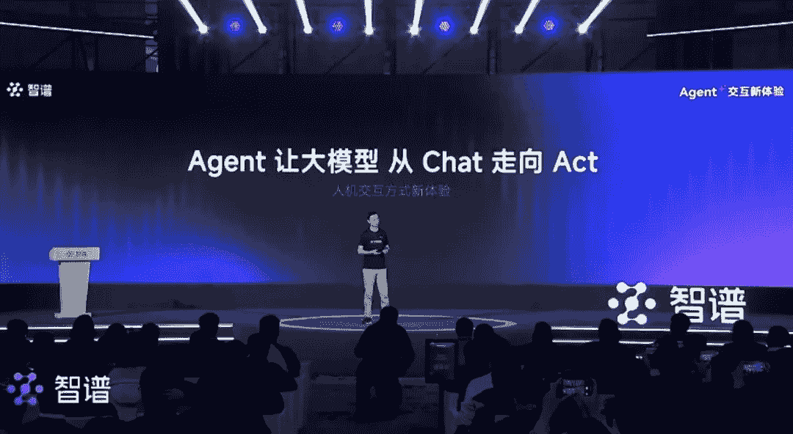
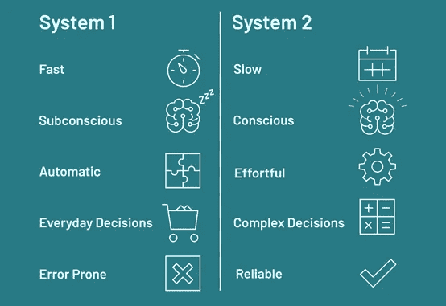
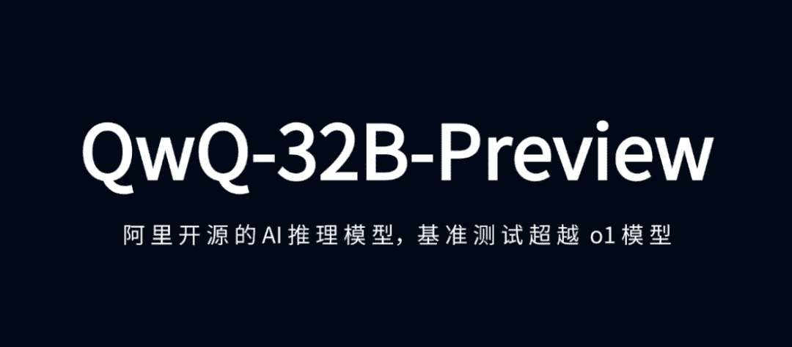
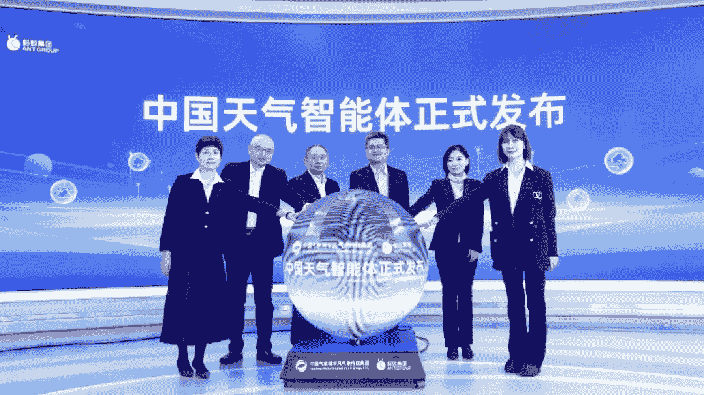

# 第24期 AI行业周报（2024-11.25-12.01）

> 来源：[https://v11enp9ok1h.feishu.cn/docx/UHw5d7GFgoMjilxeUpmc4Sz5nNb](https://v11enp9ok1h.feishu.cn/docx/UHw5d7GFgoMjilxeUpmc4Sz5nNb)

## ComfyUI官方推出了桌面客户端，优化AI图像生成体验

ComfyUI官方推出了桌面客户端，支持Windows和Mac系统，为用户提供了一个高效、稳定且易于使用的AI图像生成环境。该客户端以其简洁直观的用户界面和一键安装的便利性，以及自动更新功能和轻量级的安装包，为用户提供了强大的AI生图创作工具。

ComfyUI客户端的主要功能包括跨平台支持、全新用户界面设计、代码签名和安全性、自动更新、预配置的Python环境、内置ComfyUI管理器以及标签页功能。此外，新版本还支持自定义快捷键和自动资源导入，极大地提升了用户的工作效率。

使用ComfyUI客户端，用户可以通过连接不同的节点构建复杂的图像生成流程，并精确控制每个步骤的参数。客户端的安装方法简单，用户可以通过官方提供的链接下载Windows或Mac版本的安装包，并按照指引完成安装。安装后，用户可以导入模型、使用ComfyUI Manager插件管理节点，并查看后台日志和运行状况。

ComfyUI客户端的应用场景广泛，包括图像生成与创作、室内设计、图像编辑与修复、虚拟现实与增强现实以及医学影像处理等。这使得ComfyUI客户端成为艺术家、设计师、建筑师、医疗专业人员等多个领域专业人士的有力助手。

下载地址如下，有兴趣的可以下载使用。

ComfyUl Windows客户端下载地址:

```
https://download.comfy.org/windows/nsis/x64
```

ComfyUl Mac客户端下载地址:

```
https://download.comfy.org/mac/dmg/arm64
```

ComfyUl客户端 GitHub开源地址：

```
https://github.com/Comfy-Org/desktope
```



## 智谱Agent OpenDay展示最新进展，AutoGLM功能大幅提升

11月29日，智谱科技在举办的Agent OpenDay上分享了其AI智能体Agent的最新进展。

这些进展包括AutoGLM的多项新功能，如执行超过50步的长步骤操作和跨应用程序任务执行的能力，以及开启“全自动”上网新体验，支持数十个网站的无人驾驶。

智谱CEO张鹏在活动现场展示了AutoGLM的落地成果，包括使用AutoGLM给在场嘉宾发送“一个来自AI的🛰️红包”，以及通过手机远程指挥电脑自动发送文件。这些演示展示了AutoGLM在实际应用中的潜力和灵活性。

智谱COO张帆表示，智能设备在大模型的加持下将焕发新的机会。AI技术与各类产品的结合将转变为全新的智能助理、生产力工具，甚至成为第三生活空间。他还提到，大模型的不断进化已经为Agent变革人车交互体验奠定了强大的基础。

此次Agent OpenDay不仅展示了智谱在AI智能体领域的技术实力，也揭示了AI技术在提升用户体验和推动产品创新方面的广阔前景。



## 谷歌DeepMind发布双思维AI Agent，模拟人类快慢思维

谷歌DeepMind近期宣布了一项重大技术突破，推出了双思维AI Agent——Talker-Reasoner框架。这一框架集成了System 1/2 thinking技术，模拟人类的快思维（System 1）和慢思维（System 2），使得AI Agent能够像人类一样处理复杂任务。

Talker-Reasoner框架包含两个独立模块：Talker和Reasoner。Talker模块类似于人类的System 1，负责快速、直观的对话生成，能够迅速响应用户需求并生成自然语言回答。Reasoner模块则类似于System 2，负责复杂的多步推理和规划，需要更多时间和计算资源来处理复杂任务。

这种设计突破了传统AI Agent执行业务流程的方法，极大提升了效率。Talker-Reasoner框架的测试数据显示，在睡眠辅导等场景中，AI Agent能够与用户进行有效对话，同时制定和调整睡眠辅导计划，显示出双思维AI Agent的强大性能。

谷歌DeepMind的这一创新，不仅展示了AI技术在模拟人类思维方面的潜力，也为未来AI应用的发展提供了新的方向。通过这种双思维框架，AI Agent能够更好地理解和响应用户需求，提供更加精准和个性化的服务。



## 阿里开源AI推理模型QwQ-32B-Preview，性能超越o1模型

阿里巴巴推出了QwQ-32B-Preview，一款开源的AI推理模型，在数学和编程领域展现出卓越的性能。该模型包含325亿参数，能够处理长达32000个tokens的提示词，并在多个基准测试中超越了OpenAI的o1模型。

QwQ-32B的主要功能包括处理复杂推理任务、透明化推理流程、解决数学问题、应用在编程场景以及处理长文本。技术原理方面，QwQ-32B基于深度学习架构，采用注意力机制，并通过预训练和微调提高特定领域的性能。模型的推理能力基于模拟人类的推理过程，涉及复杂的算法和模型架构设计。

在基础测试表现方面，QwQ-32B在GPQA、AIME、MATH-500和LiveCodeBench等测试中均取得了优异的成绩，展现了其在高阶科学问题解决、数学问题解决和实际编程场景中的出色能力。

尽管QwQ-32B在数学和编程领域表现出色，但在其他领域仍有提升空间，且可能存在语言切换问题和安全性考虑。模型可能在回答中混合使用不同语言，影响表达的连贯性，并在处理复杂逻辑问题时偶尔陷入递归推理模式。



## OpenAI视频生成工具Sora内测版本泄露

11月27日凌晨，OpenAI的视频生成工具Sora的内测版本遭到泄露，其原因是部分早期测试人员对OpenAI的不满。

泄露的信息显示，Sora支持生成1080p、720p、360p三种分辨率的视频，时长支持5-10秒。模型的代号为Turbo，此前外媒The Information报道称，Sora存在多个版本的模型，不排除Sora在正式发布时会有其他更高/低级的版本。

针对此次泄露事件，OpenAI做出了正式回应，官方表示Sora目前仍处于测试阶段，公司正在努力在创造力和安全性之间找到平衡，为未来的广泛应用做好准备。


## Perplexity计划推出低于50美元的语音对话设备，进军硬件市场

AI搜索引擎初创公司Perplexity近日宣布可能拓展其业务范围，进军硬件市场。公司CEO Aravind Srinivas在X平台上透露，Perplexity正在考虑推出一款售价低于50美元的语音对话设备。

Perplexity的这一计划展现了AI技术从软件向硬件延伸的趋势，以及AI初创公司在拓展业务模式和市场影响力的积极尝试。通过推出价格亲民的语音对话设备，Perplexity有望进一步扩大其用户基础，并推动AI技术的普及和应用。

目前，越来越多的AI公司正投入硬件市场的怀抱，去年8月，AI艺术生成工具Midjourney组建了自己的硬件团队。OpenAI的CEO Sam Altman也证实，他们正在与前苹果首席设计师Jony Ive合作开发AI硬件项目。我们也期待着，未来硬件因AI的加入，会发生什么样的奇妙变化。


## 中国气象局联合支付宝推出「中国天气小助手」智能体

11月29日，中国气象局与支付宝合作推出了「中国天气小助手」智能体，旨在为用户提供更便捷、更精准的气象服务。这一智能体由中国气象局提供权威气象数据支持，依托蚂蚁百灵大模型和支付宝政务AI智能体解决方案的技术力量，并结合中国气象局的权威语料构建。

「中国天气小助手」能够为用户提供包括「查天气」、「穿衣推荐」、「气象科普」等多种气象领域的服务。用户可以通过支付宝首页下拉或下载支小宝App来便捷地使用这些服务。

蚂蚁集团总裁韩歆毅强调，气象事业在各领域都扮演着至关重要的角色，而技术创新是推动气象服务进步的重要驱动力。通过「中国天气小助手」，用户可以享受到更智能、更精准、更高效、更贴心的气象服务体验。

