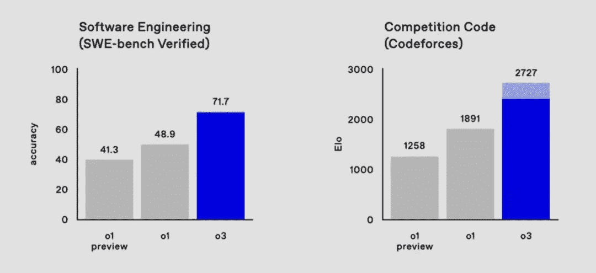
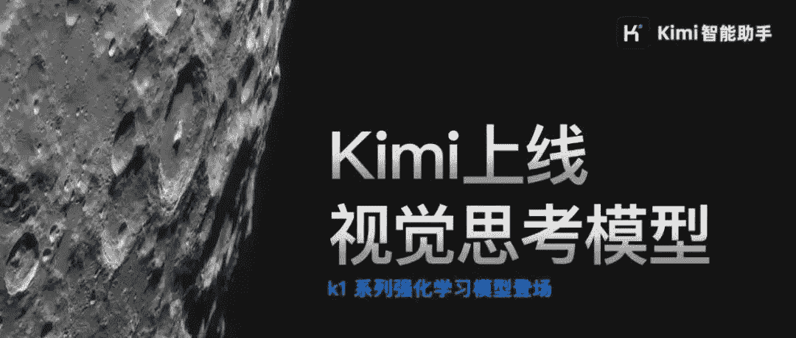
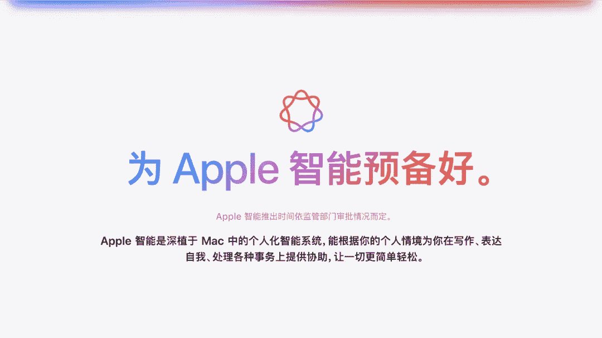
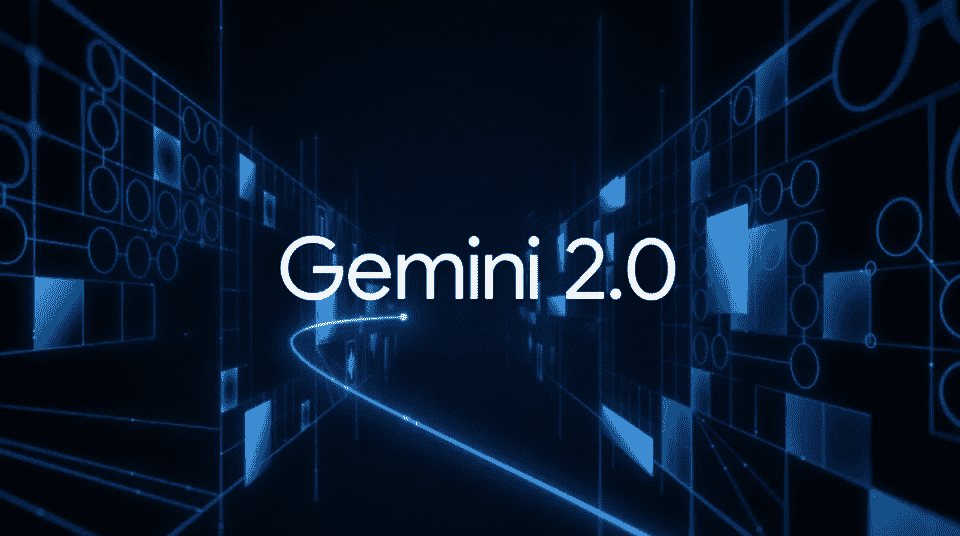
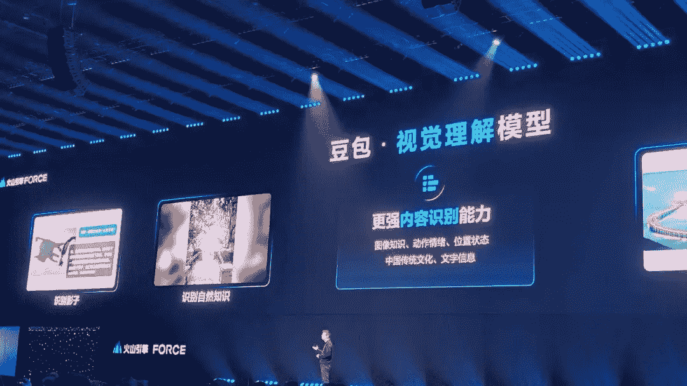

# 第27期 AI行业周报（2024-12.16-12.22）

> 来源：[https://v11enp9ok1h.feishu.cn/docx/Tz5wd2SJro8BThxygO1cZHvDnmg](https://v11enp9ok1h.feishu.cn/docx/Tz5wd2SJro8BThxygO1cZHvDnmg)

## OpenAI推出性能飞跃的o3系列模型

本周，在最新发布会上，OpenAI宣布了o3系列模型的问世。o3系列包括两款模型：性能卓越的OpenAI o3和性价比突出的OpenAI o3 mini。这两款模型在多个关键领域实现了显著的性能提升，包括准确率和处理速度。

o3系列模型在SweepBench Verified基准测试中达到了约71.7%的准确率，相较于前代o1模型提高了20%。在编程竞赛平台Codeforces上，o3的得分高达2,727，远超o1的1,891分。在美国数学竞赛aime 2024测试中，o3以90.67%的准确率超越o1的83.3%。此外，在衡量博士级科学问题解答能力的GPQA Diamond测试中，o3取得了87.7%的成绩，而o1为78%。

o3 mini保留了o1 mini的强大数学和编程能力，并支持低、中、高三种推理时间模式，用户可根据任务复杂度灵活调整模型的思考时间。在Codeforces Elo评分中，o3 mini的Elo分数随着推理时间的增加而持续攀升，中等推理时间下就已超越o1 mini。在AIMe数学基准测试中，o3 mini的低推理模式就达到了与o1 mini相当的性能，中等推理模式更是超越了o1 mini，且延时更低。

o3系列目前仅对安全测试申请者开放，o3 mini预计将于1月向所有用户推出，而完整版o3将后续发布。

## 月之暗面发布Kimi视觉思考模型k1

月之暗面发布了其最新的视觉思考模型k1。k1模型基于强化学习技术构建，支持端到端图像理解和思维链技术，并将能力扩展到数学之外的更多基础科学领域。

k1模型在数学、物理、化学等基础科学学科的基准能力测试中表现卓越，超过了全球标杆模型OpenAI o1、GPT-4o以及Claude 3.5 Sonnet。此外，k1的图像理解能力也解决了之前k0-math模型无法处理的几何图形问题，在基础教育各阶段的几何和图形题专项基准能力测试中，k1-preview的成绩打平或超过了OpenAI的o1模型。

k1模型不仅能够识别各种真实拍题场景，处理复杂状况，如照片图像不清晰、多题一起拍、手写字迹干扰，甚至纯手写的题目，还能以端到端的方式组合其强大的推理能力与视觉能力。这种端到端的有机结合范式使得k1在真实应用场景中的性能相比于OpenAI和Anthropic的视觉模型有了大幅提升。

k1还展现出了一些涌现能力，包括古代文献分析、梗图理解、基于照片推断地点等，大大提升了其在日常生活中的实用性。

## OpenAI开放o1模型API

本周，OpenAI宣布了o1模型API的正式发布，并对其进行了重大升级。包括支持WebRTC。与之前的预览版本相比，o1模型的思考成本降低了60%，并且增加了高级视觉功能。同时，GPT-4o的音频成本也降低了60%，而mini版本价格更是降低了10倍。

o1模型API集成了多项新功能，包括函数调用、结构化输出、开发者消息以及推理工作量调整，这些功能使得API更加强大和灵活。函数调用允许模型自动调用后端服务或外部API，结构化输出支持JSON格式数据返回，开发者消息赋予开发者更大的控制权，推理工作量参数用于平衡性能与准确性。

OpenAI还展示了基于高级视觉功能的应用案例，如检测错误表单，o1模型能够识别出填写有误的文本表格图片中的错误，并提供修正建议。此外，o1模型还可以通过内置函数库与后台服务器通信，获取最新信息，确保结果的准确性和时效性。

在实时API方面，OpenAI支持WebRTC技术，极大简化了开发流程。与之前的Websockets集成相比，采用WebRTC可以显著减少代码量，提高开发效率。OpenAI还推出了Python SDK支持，并大幅度降低了价格。

此外，OpenAI发布了全新的偏好微调方法，通过直接偏好优化算法让大模型更好地掌握用户的偏好风格。偏好微调采用成对样本比较学习的方式，使模型能够理解并适应特定应用场景中的细微差异，特别适合对回答格式、语气或抽象特质有较高要求的应用场合。

## OpenAI推出ChatGPT电话功能，拓展AI应用边界

本周，OpenAI宣布，ChatGPT新增电话功能，用户现在可以通过拨打专属电话号码与ChatGPT进行交流。这一新功能的推出，极大地降低了ChatGPT的使用门槛，尤其是对于那些不熟悉互联网的老年人来说，提供了极大的便利。

目前，这个电话号码仅在美国地区可用，无论是旧款智能手机还是老式座机都能拨打。这不仅对电话客服领域产生冲击，也可能影响到许多人的工作岗位。同时，ChatGPT还与WhatsApp完成了集成，用户可以通过这个号码直接发送短信咨询各种内容。

OpenAI为用户提供了每月15分钟的免费通话时长，让用户在不产生额外费用的情况下体验ChatGPT的电话服务。如果用户希望进行更长时间的对话，可以直接去源应用体验。

这项功能的推出，是向全民AGI（人工通用智能）迈出的巨大一步，使得AI技术更加开放和可访问，让更多人有机会接触和体验AI互动。

## 苹果就国行 iPhone AI 与腾讯、字节接洽

据路透社报道，苹果公司正在与中国科技公司腾讯和字节跳动就国行iPhone整合AI模型进行谈判。尽管苹果已在海外市场推出Apple Intelligence，但中国市场的推出时间仍需等待监管部门的审批。

目前，苹果与腾讯和字节跳动的谈判仍处于初期阶段，知情人士因谈判未公开而要求匿名。字节跳动拒绝置评，而苹果和腾讯尚未对置评请求作出回应。

同时，苹果也在与智谱就国行iPhone中使用其大模型进行谈判。智谱于10月推出了AutoGLM智能体，该智能体能够根据用户的口头指令完成一系列复杂操作。

苹果在中国市场整合AI模型的举措，显示了其在全球最大的智能手机市场中进一步扩展AI服务的决心。随着与本土科技公司的合作，苹果有望为中国用户提供更加个性化和本地化的AI服务体验。

## 谷歌发布Gemini 2.0 Flash Thinking模型，展示深度思维链

谷歌DeepMind首席科学家近日宣布推出全新测试模型——Gemini 2.0 Flash Thinking。这款新模型基于2.0 Flash版本，采用了类似o1模型的慢思维思考方式，能够深度可视化展示整个思维链过程，尤其在执行数学、编程等复杂问题方面，能持续输出全部推理过程，而非直接给出答案。

Thinking模型支持多模态推理，能在解决复杂问题时提供详尽的推理步骤。例如，在解读一道复杂的物理题或推理图片时，Thinking能够完整地展现出所有推理过程。

根据Chatbot Arena LLM Leaderboard最新评测数据，Thinking模型在代码、数学、指令遵循、多轮测试等基准测试中全部排名第一，超越了o1的预览版。

Gemini 2.0 Flash Thinking的推出标志着谷歌在AI领域的重大进展。这款模型不仅提升了推理的智能、速度和强度，还预示着智能的指数级增长。目前，Thinking模型已经开放使用，可以在Google AI Studio和Vertex AI中的Gemini API中尝试。

## GitHub Copilot Free发布，全球开发者免费享受AI辅助编程

GitHub于12月19日宣布推出GitHub Copilot Free免费订阅服务，允许开发者在Visual Studio Code代码编辑器中免费使用GitHub Copilot AI服务。这一举措意味着全球1.5亿GitHub平台开发者现在可以在VS Code中体验AI辅助编程的强大功能。

通过GitHub Copilot Free免费订阅，开发者可以选择Anthropic的Claude 3.5 Sonnet或OpenAI的GPT-4o模型，每月可以调用2000次生成和补全代码，以及50次聊天信息。这些功能可以帮助开发者回答编程问题、解释现有代码、排查代码BUG、跨文件执行编辑等。此外，GitHub Copilot Free还支持Copilot的第三方智能体。

GitHub Copilot Free的发布，不仅为开发者提供了便利，也进一步推动了AI技术在编程领域的应用。这一服务的免费开放，将极大地促进开发者的工作效率，并为编程新手提供学习编程的有力工具。

## 豆包发布视觉理解大模型

豆包近日发布了其视觉理解大模型，这一重磅更新进一步巩固了其在全球AI应用领域的地位。

豆包的月活用户已达5998万，仅次于ChatGPT，位列全球第二。新模型具备强大的内容识别能力，不仅能精准识别图像中的物体类别和形状等基本元素，还能深入理解它们之间的关系、空间结构以及场景的整体语义。

豆包的视觉理解模型在理解和推理能力上表现出色，能基于文字与图像信息进行复杂的逻辑推演与计算。例如，它可以根据动物影子的照片识别出动物种类，或根据建筑照片提供背后的历史和细节。在推理能力方面，豆包模型在解答微积分题和高考物理题时能正确理解题意，并给出清晰的解题思路。

此外，豆包还提升了内容创作的能力，如根据涂鸦编写故事等。豆包的视觉理解模型的发布，不仅丰富了AI创作功能，也填补了AI应用生成中文内容的空白。

在价格方面，豆包将视觉理解的价格降至每千tokens 0.003元，相当于一块钱可以处理284张720P的图片，相较于行业平均价格降低了85%。这一激进的定价策略，使得豆包在国产大模型中的价格战中占据了优势。

