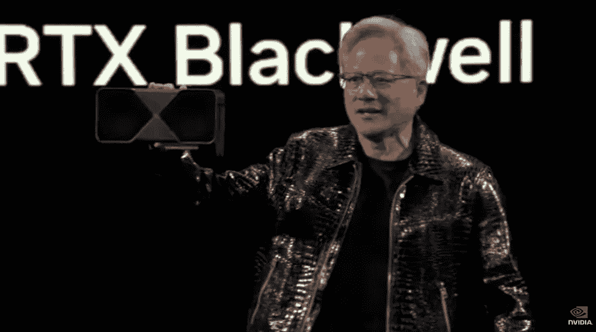
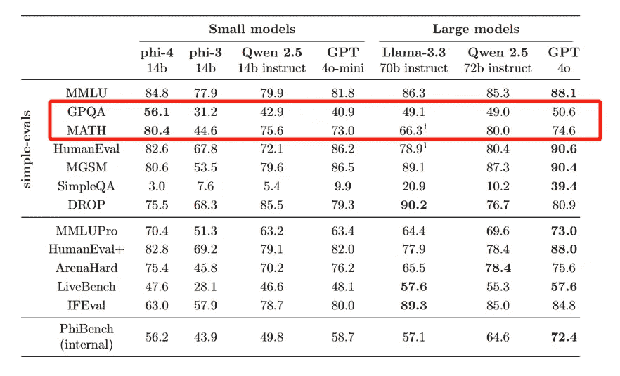
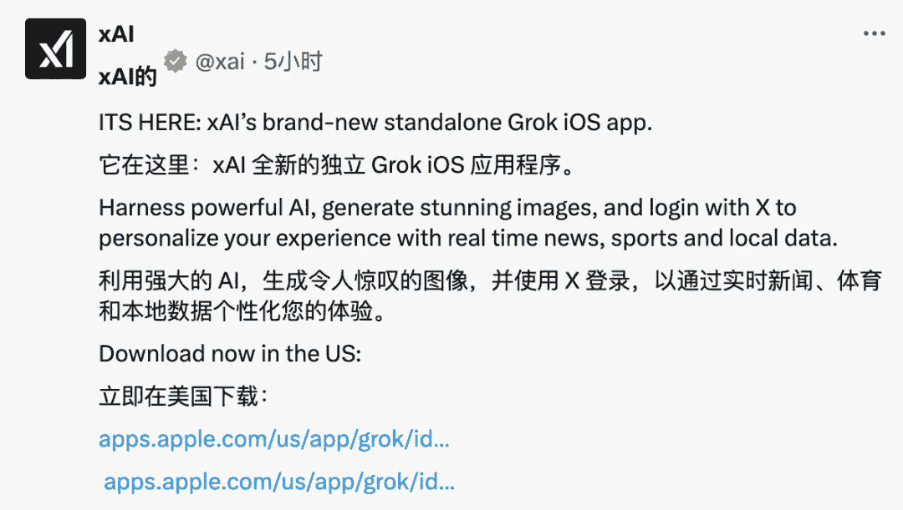
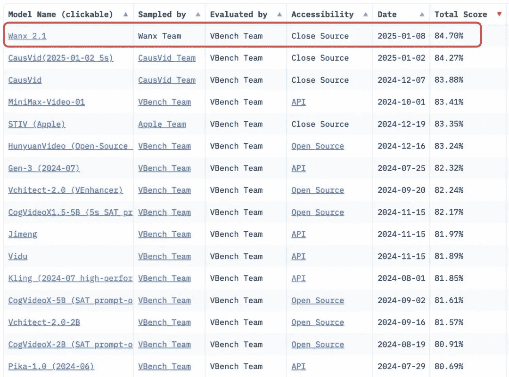
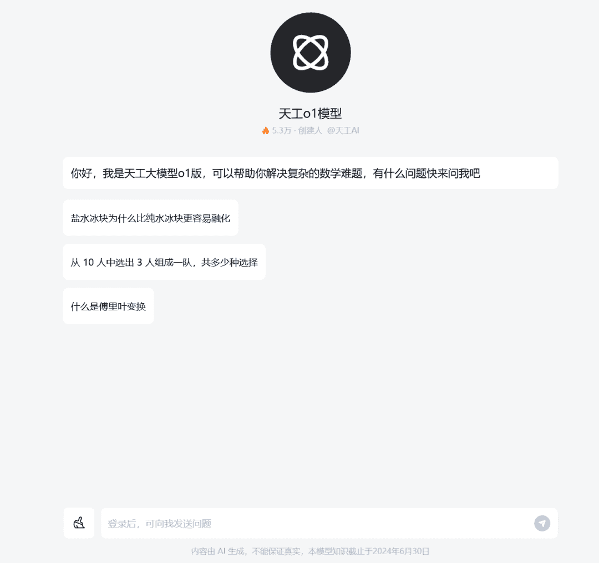

# 第30期 AI行业周报（2025-01.06-2025-01.12）

> 来源：[https://v11enp9ok1h.feishu.cn/docx/EyUidZQ3fo7xp6xq5XhcFBiGnPf](https://v11enp9ok1h.feishu.cn/docx/EyUidZQ3fo7xp6xq5XhcFBiGnPf)

## 英伟达CES 2025发布RTX 50系列显卡及AI超级计算机

在CES 2025上，英伟达CEO黄仁勋以一场激动人心的开幕式主题演讲和一系列AI新品发布，为展会拉开序幕。

黄仁勋在演讲中，发布了基于Blackwell架构的新一代RTX 50系列显卡，包括RTX 5090和RTX 5080。

RTX 5090 GPU是迄今为止最快的GeForce RTX GPU，配备了920亿个晶体管，每秒可实现超过3352万亿次AI运算，性能较上一代RTX 4090提升了近两倍。RTX 5080设计目标是性能达到RTX 4080的两倍，配备16GB的GDDR7显存，内存带宽为960GB/秒，以及10752个CUDA核心。

英伟达还推出了DLSS 4技术，这是新一代深度学习超级采样技术，首次推出多帧生成功能，通过使用AI为每个渲染帧生成多达3帧来提高帧速率。DLSS 4将在发布当天支持超过75款游戏和应用程序，并可在GeForce RTX 50系列GPU上使用。

此外，英伟达还宣布推出世界基础模型平台——「英伟达宇宙」（NVIDIA Cosmos），专注于理解和模拟物理世界。该平台主要聚焦于物理动态，包括自然运动、人类行为和物体操作等场景，致力于教导AI理解物理世界的运作方式。

黄仁勋还展示了Project Digits，这是一款搭载英伟达新型GB10 Grace Blackwell超级芯片的AI超级计算机，专为AI研究人员、数据科学家和学生设计。可提供高达petaflop级别的计算性能。Project Digits将于今年5月通过英伟达的顶级合作伙伴推向市场，定价3000美元。

## 微软发布Phi-4，小参数模型性能超越GPT-4o

微软研究院近日发布了Phi-4，这是Phi系列模型的第五代，以其小参数和高性能著称。Phi-4仅有140亿参数，但在多个基准测试中表现出色，超过了GPT-4o以及其他知名模型，如Qwen 2.5-14B和Llama-3.3-70B。

在GPQA研究生水平和MATH数学基准测试中，Phi-4分别达到了56.1和80.4的高分，超过了GPT-4o。在美国数学竞赛AMC的测试中，Phi-4更是达到了91.8分，超过了GeminiPro 1.5、GPT-4o、Claude 3.5Sonnet、Qwen 2.5等知名模型，整体性能可与4050亿参数的Llama-3.1相媲美。

Phi-4的高性能得益于其使用高质量合成训练数据和创新训练方法。它采用了种子策划、多Agent提示、自我修订工作流、重写和增强以及指令反转等多种合成方法，有效解决了传统无监督数据集的缺点。此外，Phi-4还通过改变任务描述的方式，增加了模型处理不同类型问题的能力，进一步增强了其灵活性和适应性。

在训练方法上，Phi-4增加了rope位置编码的基础频率至25万次，并相应地降低了最大学习率，以更好地适应更长的文本序列。这种做法有效提升了模型对于复杂结构化信息的理解力。Phi-4还特别注重了不同类型数据之间的平衡，避免某类数据过多导致其他方面性能下降的情况发生。

在Phi-4的后训练过程中，研究团队采用了基于人工标注的SFT数据和自动构建的DPO对进行强化训练。通过结合这两种方式，Phi-4不仅学会了如何产生更符合预期的回答，还能够在不同情境下灵活调整语气和风格，从而提供更加个性化的交互体验。

## 马斯克版ChatGPT iOS应用上线

马斯克旗下的AI聊天机器人Grok的独立iOS应用已正式上线Beta版，率先在美国推出。这款应用无需注册即可体验，为用户提供了方便快捷的AI服务。同时，Grok App保留了访问X平台内容的能力，尽管信息更新可能不如实时，但已足够满足用户的基本需求。

Grok的主要优势之一是其对隐私安全的重视。它提供临时会话选项，相当于无痕浏览模式，确保用户的隐私安全。此外，Grok支持文字、图片和文件等多种输入形式，为用户提供了多样化的交互方式。

在功能方面，Grok的表现可圈可点。它能够处理复杂的数学问题，生成高质量的图像，并在一些实用问题上提供简洁明了的答案。然而，Grok在某些方面仍有改进空间，例如在处理特定类型的问题时，其回答可能不够精确或详细。

尽管Grok App的推出稍显迟缓，但其与X平台的集成联动为其积累了知名度。推出独立应用将有助于Grok获得更广泛的用户覆盖。xAI正在筹备专门的网站Grok.com，预计不久后推出Web版服务。

总体而言，Grok继承了马斯克式的叛逆与创新，具有独特的个性和风格。它不一定是最强的，但绝对是最特立独行的AI助手。

## 雷鸟创新发布AI拍摄眼镜雷鸟V3，1799元起现货发售

雷鸟创新在近期发布了全新款AI拍摄眼镜——雷鸟V3，这款眼镜搭载了通义定制大模型，将于1月10日起现货发售。雷鸟V3采用了Meta同款的第一代高通骁龙AR1平台，拥有32G内存，重量仅有39g，比Meta轻了13.3%。

在AI功能方面，雷鸟V3与阿里通义深度合作，内置了定制化的多模态大模型，可以面对眼前看到的一切，向AI发出提问。此外，雷鸟V3还配备了定制款1200万像素高清摄像头，支持1080P/30fps的横屏拍摄，拍摄画质堪比手机。

雷鸟V3的AI回答准确率高达98%，涵盖人文社科、天文地理等各个领域，并支持多模态识别。例如，用户可以使用雷鸟V3翻译日语信件、识别路牌、分析食物热量等。雷鸟还承诺为V3提供三年的免费AI更新维护，并已放出今年的部分更新计划。

在拍照能力方面，雷鸟V3采用了“猎鹰影像系统”，配备索尼IMX681传感器，支持4K照片和1080P/30帧视频的拍摄。此外，雷鸟V3还支持0.8秒光速抓拍，帮助用户快速捕捉精彩瞬间。在听觉设计上，雷鸟V3研发了降噪、抗风噪和空间收音的三重算法，提供清晰的听觉体验。

雷鸟V3的框架重量为39克，配重比例、鼻托、框架等专门针对亚洲头型进行了设计，佩戴更加舒适。配备159mAh的电池，支持30小时超长续航时间，40分钟即可充满电，并支持磁吸式边用边充。

雷鸟V3的标准版（无充电盒）价格为1799元，套装款（眼镜+充电盒）为1999元，墨镜款（含充电盒）为2299元。此外，雷鸟还展示了在AR光学领域的最新技术成果——雷鸟X3 Pro，将于今年第二季度正式发布。

## 阿里云通义万相2.1视频生成模型重磅升级

1月9日，阿里云通义万相迎来了重磅升级，推出了万相2.1视频生成模型。该模型在大幅度复杂运动、物理规律遵循、艺术表现等方面实现了全面提升。

根据权威评测榜单VBench的信息，新版通义万相登上榜首位置，超越了混元、海螺AI、Gen3、Pika等国内外视频生成模型。

在具体项目中，通义万相在运动幅度、多对象生成、空间关系等关键能力上获得了最高分，并以总分84.7%的成绩斩获第一。官方介绍称，通义万相团队采用了自研高效的VAE和DiT架构，有效增强了时空上下文关系建模能力，解决了精准理解和模拟物理世界的两大难题。

此外，通义万相在文字视频生成方面实现了突破，成为首个支持中文文字生成能力且同时支持中英文文字特效生成的视频生成模型。这一升级不仅提升了模型的性能，也为用户提供了更丰富的创作工具和更广泛的应用场景。

## 昆仑万维「天工大模型4.0」o1版和4o版正式上线

1月6日，昆仑万维宣布旗下「天工大模型4.0」o1版和4o版同步上线，并全量登陆天工网页和App，用户均可免费使用。这两款模型经过全方位的技术栈升级和模型优化，具备强大的逻辑推理和多模态交互能力。

「天工大模型4.0」o1版是国内第一款中文逻辑推理能力的o1模型，不仅包含上线即开源的模型，还有两款性能更强的专用版本。它能够熟练处理各种推理挑战，包括数学、代码、逻辑、常识、伦理决策等问题。

「天工大模型4.0」4o版是由昆仑万维自研的多模态模型，其赋能的实时语音对话助手Skyo具备情感表达能力、快速响应能力、多语言流畅切换的智能语音对话工具，为用户带来温暖贴心、流畅实时的对话体验。

这两款模型的上线，标志着昆仑万维在AI技术领域的进一步发展，为用户提供了更强大的工具和更丰富的应用体验。用户现在可以通过昆仑万维的天工网页和App，免费体验这两款先进的AI模型。

## 京东方发布AI视听中心

在CES 2025上，京东方发布了行业首款65英寸4K超高清「AI视听中心」。这款概念级智慧大屏终端新品集成了丰富的AI能力，应用了京东方基于高通QCS8550芯片设计的SoM核心板卡，具备计算机视觉和生成式AI智慧功能，为用户带来身临其境的视听体验。

京东方副总裁文兴烨表示，此次新品的发布标志着京东方与高通技术公司在物联网应用领域的合作进一步加深和拓展。他期待京东方联合高通，能不断赋能更加广泛和多元的工作生活场景。

这款「AI视听中心」不仅展示了京东方在显示技术方面的领先地位，也体现了其在AI集成和物联网应用方面的创新实力。通过与高通的合作，京东方进一步拓展了其在智能终端设备领域的应用范围，为用户提供了更加智能化和个性化的体验。

