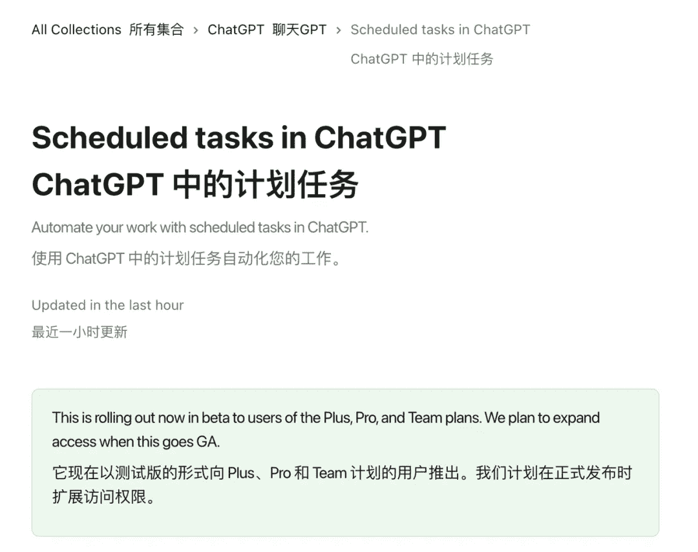
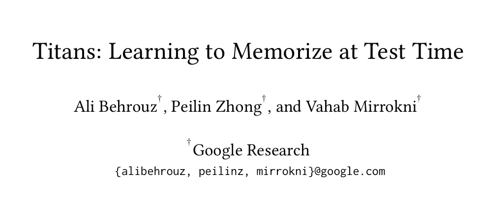
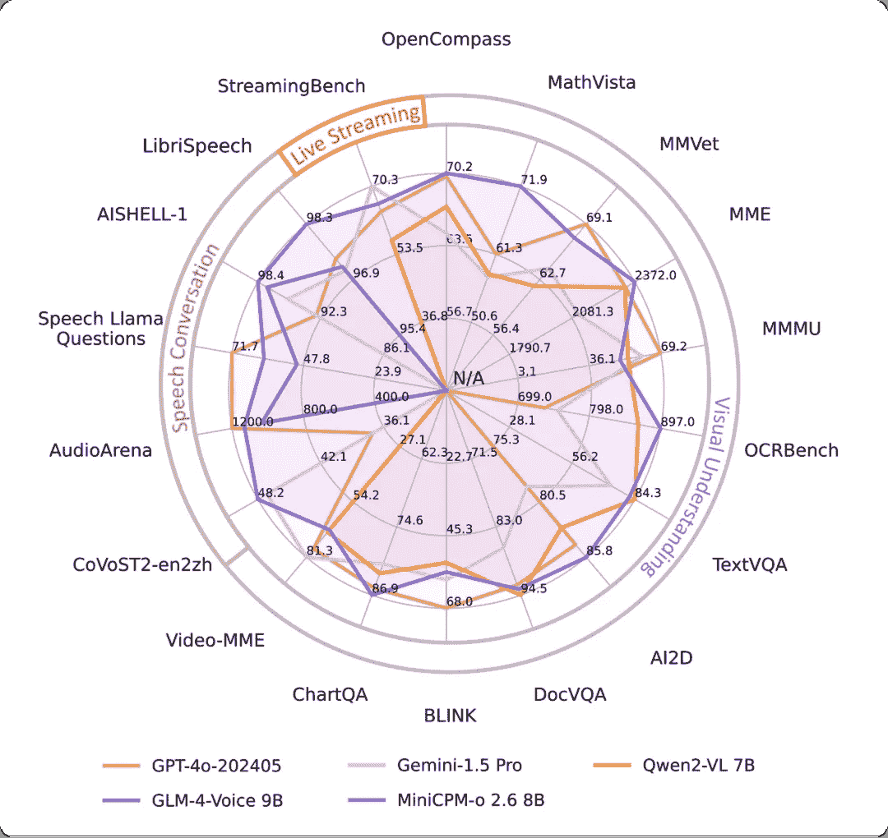
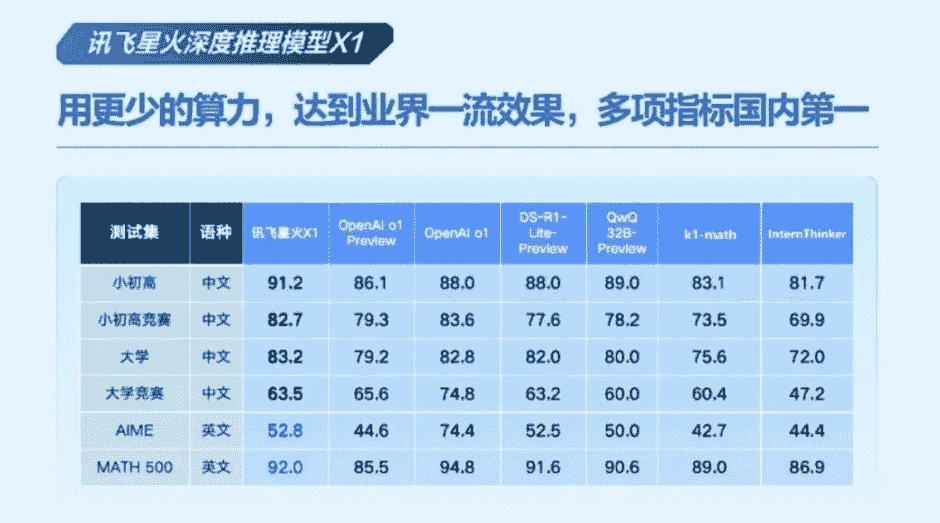
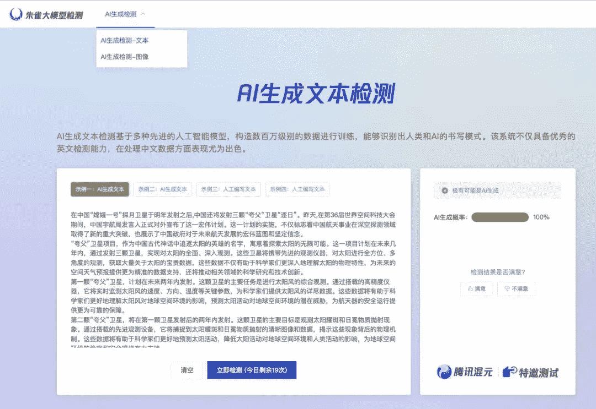

# 第31期 AI行业周报（2025-01.13-2025-01.19）

> 来源：[https://v11enp9ok1h.feishu.cn/docx/XH3mdv6X1oQlx6xOmsJcbjmkntb](https://v11enp9ok1h.feishu.cn/docx/XH3mdv6X1oQlx6xOmsJcbjmkntb)

## MiniMax开源4M超长上下文新模型

MiniMax开源了最新的MiniMax-01系列模型，包含基础语言模型MiniMax-Text-01和视觉多模态模型MiniMax-VL-01。

这两个模型首次大规模扩展了新型Lightning Attention架构，替代了传统Transformer架构，使模型能够高效处理4M token上下文。

在基准测试中，MiniMax-01的性能与顶级闭源模型表现相当。MiniMax-Text-01在处理超长上下文时表现出显著优势，特别是在上下文超过20万token时，其优势逐渐明显。在预填充延迟方面，MiniMax-01也表现出色，处理超长上下文时更高效，延迟更低。

MiniMax-01系列模型的开源，为AI研究和应用提供了强大的工具。官方已公开了MiniMax-01的68页技术论文，并在Hailuo AI上部署了该模型，供用户免费试用。新模型的API价格也较为亲民，输入每百万token 0.2美元，输出每百万token 1.1美元。

## OpenAI发布Tasks测试版

1月15日，OpenAI宣布推出Tasks测试版功能，为ChatGPT带来任务自动化处理的新体验。

用户只需向ChatGPT说明需求和时间，无论是一次性提醒还是重复性任务，都能轻松搞定。任务完成后，系统会通过网页端、桌面端和移动端推送提醒，确保用户不会错过任何重要信息。每位用户可同时运行最多10个任务，方便高效管理日常事务。

目前，Tasks功能已支持ChatGPT网页版、iOS、Android和MacOS平台，Windows版本也将在第一季度晚些时候推出。该功能现以测试版形式向Plus、Pro和Teams用户开放，未来将逐步覆盖所有ChatGPT用户。不过，OpenAI尚未明确该功能免费开放的具体时间。

此外，据Tibor Blaho发文剖析，OpenAI似乎正在开发代号为「Caterpillar」的新功能。Caterpillar将与Tasks集成，赋予ChatGPT更强大的能力，如搜索特定信息、分析问题、总结数据、浏览网站和访问文档。

## 谷歌Transformer继任者「Titans」来袭，打破上下文记忆瓶颈

谷歌在AI领域又有新动作啦！继2017年推出影响深远的Transformer架构后，时隔近8年，全新的架构「Titans」终于来了。

这次谷歌把重点放在了记忆层面，推出了测试时计算的新架构，致力于打破上下文记忆的瓶颈。

Titans架构的核心在于结合了注意力机制和元上下文记忆，能够在测试时学习记忆，将上下文窗口扩展到惊人的200万tokens。这可是比现有的Transformer和现代线性RNN更有效，甚至比GPT-4等超大型模型性能更强哦。

谷歌还提出了长期神经记忆模块，能够学习记忆历史上下文，帮助注意力机制在利用过去信息的同时处理当前上下文。这种神经记忆模块具有快速并行化训练的优势，同时还能保持快速推理，简直是太厉害了。

Titans架构有三种变体：记忆作为上下文（MAC）、记忆作为门（MAG）和记忆作为层（MAL），它们在语言建模、常识推理、基因组学和时序预测任务上的实验结果都表明，Titans架构比Transformer和近年来的现代线性循环模型更有效。

此外，Titans架构在大海捞针任务中，能够有效地扩展到超过200万tokens的上下文窗口，并且比基准模型实现了更高的准确性。这无疑为AI领域带来了新的突破和可能性。

## 国产小钢炮新模型，让iPad也能运行GPT-4o级别模型

近日，国产AI领域迎来了一项重大突破，一款新的AI模型——MiniCPM-o 2.6 成功发布。它能让ipad也能成功运行。这标志着AI硬件的应用范围得到了显著扩展。

这款新模型的推出，得益于国产AI技术的不断进步和创新。通过优化模型架构和算法，研究人员成功地将GPT-4o级别的模型适配到iPad等移动设备上。这不仅提升了移动设备的AI处理能力，也为用户提供了更便捷的AI体验。

在实际应用中，这款新模型能够处理复杂的文本生成任务，提供高质量的文本输出。它的出现，不仅让iPad等移动设备在AI应用方面不再鸡肋，还为未来的AI硬件发展提供了新的方向和思路。

## 科大讯飞发布星火深度推理模型X1

1月15日，科大讯飞带来了一系列重磅发布。星火深度推理模型X1正式亮相，这将是首个基于全国产算力训练的大模型。

X1具备深度思考和推理能力，其数学能力尤为出色，已经在教育、医疗等关键领域实现了落地应用。科大讯飞还宣布将推出基于讯飞星火X1的医疗大模型升级版，进一步拓展AI在医疗领域的应用边界。

同时，讯飞星火4.0 Turbo底座也进行了全面升级，不仅行业能力得到显著提升，图文能力和长文本处理能力也全面提升。值得一提的是，图文识别能力也迎来重大升级，即使是倾斜少线表格也能被精准识别。此外，星火语音同传大模型作为业界唯一的端到端语音同传大模型，通过模仿人类同传译员的思维链路进行训练，实现了同传翻译效果的丝滑体验。

目前，星火深度推理模型X1已上线讯飞星火网页端和App端，而星火语音同传大模型在讯飞同传中限量开放功能入口，为用户提供了更多选择和便利。

## 腾讯上线AI「鉴别工具」，助力文本和图像检测

1月17日，腾讯宣布上线AI「鉴别工具」，由腾讯混元安全团队旗下的朱雀实验室推出。朱雀大模型检测网站提供了一个用户友好的平台，用户可以使用该工具对文本和图像进行AI检测。

官方表示，AI生成文本检测基于多种先进的人工智能模型，经过数百万级别的数据训练，能够识别出人类和AI的书写模式。该系统不仅具备优秀的英文检测能力，在处理中文数据方面表现尤为出色。

AI生成图像检测则利用先进的AI模型检测图片是否由AI模型生成，或是否是真实图像。该模型经过百万张自然图片和生成图片训练，涵盖摄影、艺术、绘画等内容，能够检测多类主流文生图模型生成的图片。

腾讯的这一举措旨在帮助用户更好地识别和理解AI生成的内容，提升内容的真实性和可信度。朱雀大模型检测网站的推出，为AI检测领域提供了新的工具和解决方案。

## 孟樸：AI赋能产业，未来终端将花样百出

高通中国区董事长孟樸在与钛媒体的对话中深入探讨了AI的未来。孟樸认为，AI的最大价值在于全面赋能产业、技术与产品。他指出，在AI时代，我们不会看到单一的“杀手级”应用，而是会见证多样化的创新不断涌现。孟樸预见，在未来几年，AI将重塑PC、手机、汽车以及工业领域的多种类型终端，带来前所未有的变革。

孟樸强调，AI的发展并非近几年才开始，而是因为大模型的出现而加速。他认为，目前AI的发展还只是刚刚开始，它是一个赋能的技术，将通过赋能终端产品，在今后几年里一代代叠加，变得花样百出。

对于芯片公司在AI时代的挑战，孟樸提出了两个关键点。一方面，芯片公司需要满足生成式AI对算力的新要求，进行芯片设计和架构创新。另一方面，要平衡性能、能效和成本，以确保移动终端的续航能力和用户体验。

