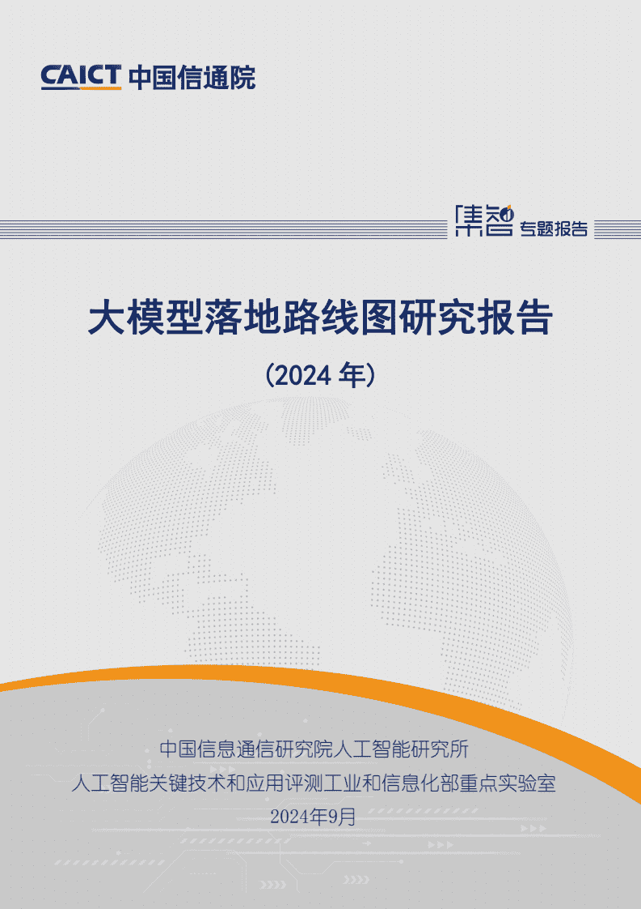
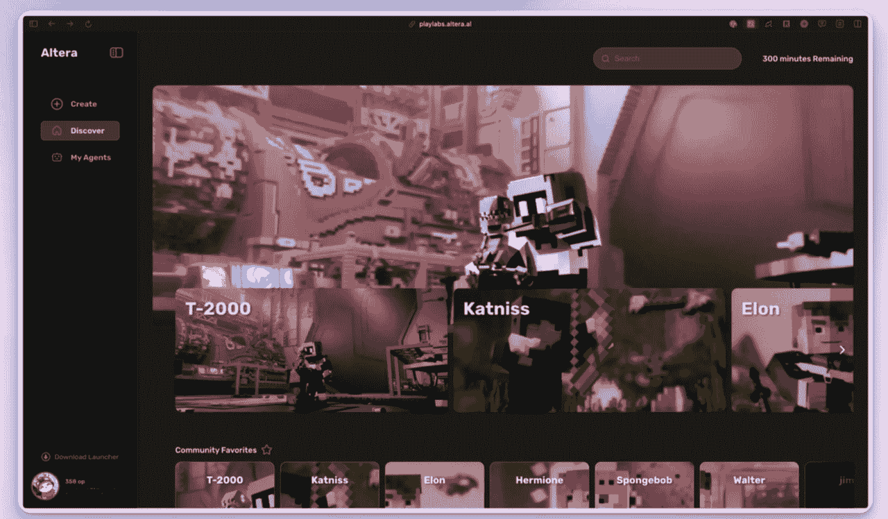

# 9🈷️10日

> 来源：[https://v11enp9ok1h.feishu.cn/docx/NQyTdvKhIo6Ip1x5LAIcEIsQnVh](https://v11enp9ok1h.feishu.cn/docx/NQyTdvKhIo6Ip1x5LAIcEIsQnVh)

+   《大模型行业可信应用框架研究报告》由蚂蚁集团和中国信通院联合发布，探讨了大型在金融、医疗、政务等行业的应用挑战和解决方案。报告提出了一个系统化的可信应用框架，强调了专业性、可控性、真实性和安全性四个核心要素，并从数据质量、型能力、推理过程、系统安全等方面提供了具体的技术实现建议。

[大模型行业可信应用框架研究报告.pdf](https://internal-api-drive-stream.feishu.cn/space/api/box/stream/download/all/YxPLbVHoLoqG2oxs4wucTYwcnHF)

[AI行业报告](https://v11enp9ok1h.feishu.cn/wiki/QuT3ws0gBiuXPjkTrkKc7yZsng7?from=from_copylink)它一些报告发布在行业报告板块|

《InfoQ:中国AI Agent应用研究报告2024》

《脉脉:2024大模型人才报告》

《2024人工智能术语研究阶段性成果报告》

+   [《AGI范式大转移:和广密预言草莓模型和se](https://www.xiaoyuzhoufm.com/episode/66d866f0f39a2201c069dccb)lf-play RL|全球大模型季报4》我们正进入的9月会是AGI的一个大月，0penAI造势已久且绝密的项目“草莓(Strawberry)“将在不久后揭开它神秘的面纱。此外，Anthropic也会推出Claude 3.5 0pus，这两个模型将是AGI进程是否顺利的关键风向标。

+   《AIGC Weekly #88》歸藏的 AIGC Weekly 第 88 期内容涵盖了 AI 编程工具 ReplitAgent 的发布、由 1000 个 Agent 组成的 Project Sid 等动态。推荐了 Fluxgym 的 FLUXLora 训练工具和 AdvancedLivePortrait 的自定义面部表情动画。精选文章包括 AndreiKarpathy 的访谈及 Anthropic 的提示工程师访谈，重点研究包括音频驱动肖像头像和新型RAG 方法的应用等。

