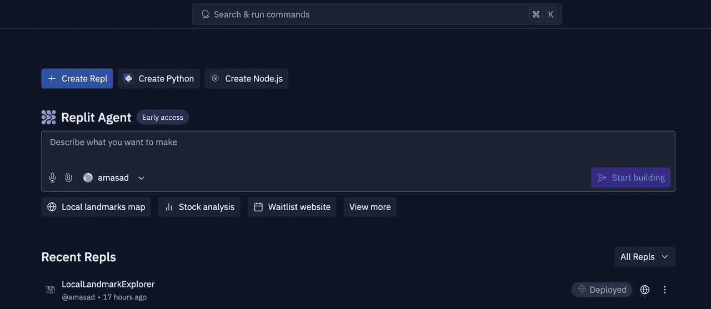
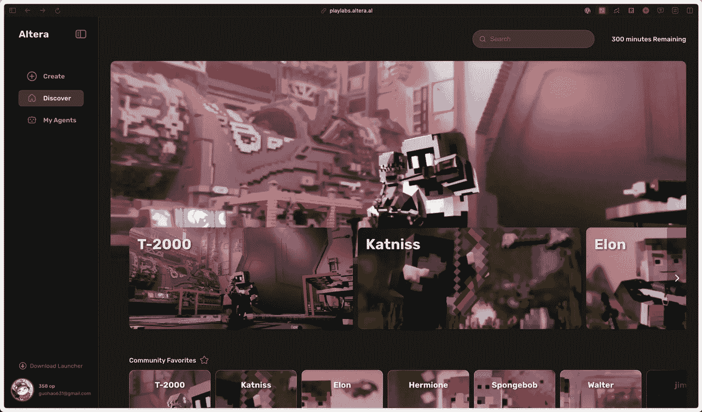
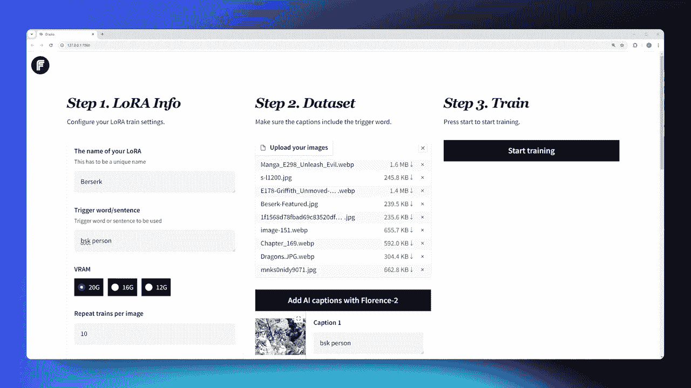
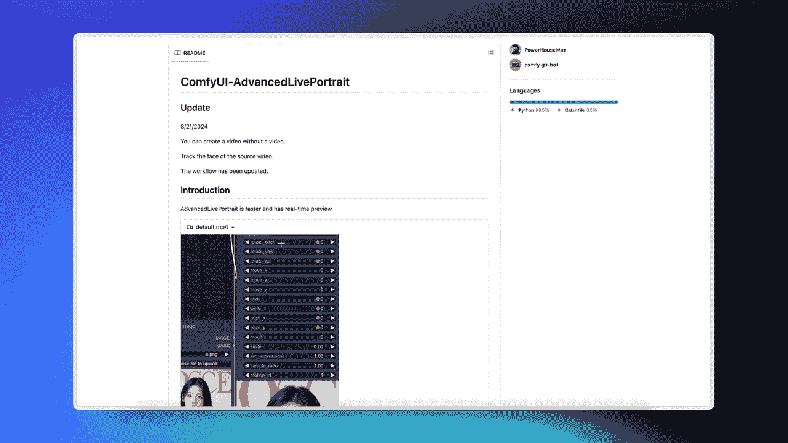
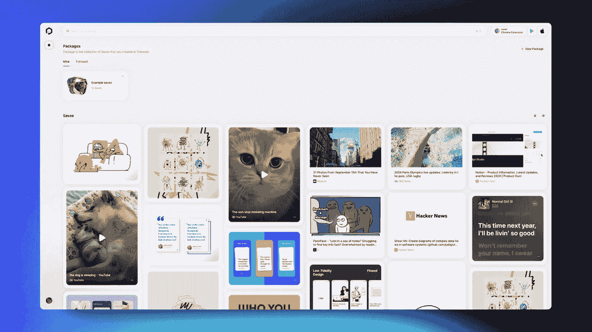

# AIGC Weekly #88

> 来源：[https://v11enp9ok1h.feishu.cn/docx/Gobtd5jlLogYY7xGTHWc5Hc5nSf](https://v11enp9ok1h.feishu.cn/docx/Gobtd5jlLogYY7xGTHWc5Hc5nSf)

封面提示词：abstract network out of glass made of holographic liquid crystal, dark background, blue light reflections, symmetrical com[**position, ce**](https://catjourney.life/)ntered in the frame, highly detailed, hyper-realistic, cinematic lighting, in the style of Octane Rende --ar 16:9 --style raw --personalize --v 6.1 💎查看更多风格和提示词

**这周同样训练了一个 FLUX Lora 模型**，褪色胶片风格，推荐权重 0.6-0.8。

+   非常适合生成毛茸茸的动物玩偶

+   人像会偏向复古褪色的胶片风格

+   涉及到玻璃制品产品展示摄影的表现很好

+   整体景深模糊的也很好，过度自然柔和

下载：https://www.liblib.art/modelinfo/4510bb8cd80142168dc42103d7c20f82?from=personal_page

# 上周精选 ✦

## Replit 发布了 AI 编程工具 Replit Agent

Replit 发布了 AI 编程工具 Replit Agent。这玩意太强了，对于编程零基础的人非常有用。

Cluade 已经可以写出很好的代码了，但是对于零基础的人来说如何运行和部署这些代码反而是最麻烦的事情。

他们需要解决报错，选择服务商，在云服务后台迷路。Replit Agent可以直接从文本生成应用，支持自我修复和环境部署。直接向所有付费用户开放，并且可以在带有 Postgres 后端的实时 URL 上部署。

但是一些使用过的用户也说整体的实力不如那些专门的 AI 变成工具，希望其他比较强的 AI 变成工具也重视一下自动部署环境这个需求。

## Project Sid：1000 个 Agent 组成的社会

这玩意太强了。一千个 Agent 在《我的世界》游戏里自主运行和发展：

+   会根据领导人的不同发展出不同的社会政策。

+   发现村民丢失，剩下的 Agent 会更改目标一起寻找。

+   可以长期自主运行，几个小时甚至几天都不会崩溃。

自主 Agent 网络加上实时游戏内容生成两个条件都具备了。难道说有生之年可以看到类似《西部世界》的实现吗？

另外，你可以在他们网站上下载用户自定义的 Agent。然后导入到你的《我的世界》游戏中，陪你玩游戏。赫敏、马斯克、海绵宝宝等人格都有，想试试了。

# 其他动态 ✦

+   DeepSeek就发了 [DeepSeek-V2.5](https://huggingface.co/deepseek-ai/DeepSeek-V2.5) 。将基础语言模型和代码模型混合。探索封闭域带来的推理能力提升能否扩展到开放域的基础模型。

+   Nijijourney 的[模型个性化功能上线](https://x.com/midjourney/status/1831875002016395597)。可以根据你 Rank 和喜欢的图片帮你微调一个自己的Niji 模型，提示词后加--p使用。使用前需要 Rank 超过 200 张图片才行，大概选个五六分钟就行。

+   [Elevenlabs](https://x.com/elevenlabsio/status/1831732006121590931) 的文字转语音现在第一次生成的不满意可以免费再生成两次。希望其他 AI 产品尤其是图片和视频产品可以普及这个操作。

+   GlaiveAI 开源了 Reflection Llama-3.1 70B。这个模型可以主动纠正自己的错误，从而避免幻觉问题。在基准测试上的得分超过 GPT-4o 和 Claude 3.5 Sonnet。其他机构的测试无法复现他们的结果，谨慎期待。

+   Claude 推出[企业版](https://www.anthropic.com/news/claude-for-enterprise)，可以使用高达50万Token的上下文；支持授权后自动同步Github项目，可以直接对Github项目进行提问。

+   Ilya 新公司 [SSI 融了 10 亿美金](https://x.com/ssi/status/1831325643226890379)，投资人有 a16z, Sequoia, DST Global, and SV Angel 等。

+   [Luma](https://lumalabs.ai/dream-machine/creations) 发布了相机运动功能，触发需要你输入 Camera 之后在下拉菜单选择对应的运镜方式。他们之前收集的 3D 数据真的有用，运镜响应非常准确。

+   ComfyUI 更新了 0.20 大版本，带来大量易用性优化，原生支持 InstantX 发布的 Canny 和 Union ControlNet，队列管理支持右键图片快速跳转到对应节点，队列管理支持显示完整的不同比例图片等。

# 产品推荐 ✦

## AdvancedLivePortrait：自定义面部表情动画

Live Portrait 被玩出花了。AdvancedLivePortrait 这个插件可以让你手动编辑人脸图片的表情生成视频。而且也可以复用别人编辑的表情。也支持从图片里面提取表情参数。提取后可以直接讲表情参数合成到视频里。

## Polymet ：AI 生成前端界面

YC 投了一个类似V0 的前端代码生成项目 Polymet。

这个比 V0 多了很多很实用的功能对设计的还原也很好。

+   自定义主题色、字体、圆角以及亮暗模式。

+   Figma 设计稿导入后生成代码。

+   除了能生成页面外也会生成前端组件。

最好的是可以选择区域告诉 AI 要修改的部分比文字描述精准。

## PackPack：保存和收集内容 AI 整理

PackPack是一个为用户提供一键保存网页内容的浏览器扩展插件。用户可以通过扩展按钮快速保存页面、捕获帖子、通过悬停图片气泡保存图片。AI 技术的应用使得 PackPack 能够提供相关性搜索、内容总结、图片分析、字幕识别等功能，帮助用户更高效地管理和分享保存的内容。

# 精选文章 ✦

## No Priors Ep. 80：Andrej Karpathy 访谈

Andrej Karpathy 分享了他在 OpenAI 和特斯拉工作的经历，以及他对人工智能在教育领域的新创业。他对自动驾驶技术的发展进行了深入的讨论，认为特斯拉和 Waymo 在技术和策略上各有优势。Karpathy 强调，尽管技术已经取得了巨大进展，但规模化部署和全球化仍然面临挑战。他还讨论了 AI 模型的大规模数据集和训练，特别是 Transformer 模型的重要性和效率。

在谈论人形机器人时，Karpathy 认为，从汽车到人形机器人的技术转移相对容易，因为两者在很多方面都有共性。他预测，人形机器人将首先在工业和商业领域得到应用，而家庭用途将来得慢。此外，他对 AI 在教育领域的应用表示乐观，认为 AI 可以作为个人教师，帮助学生更有效地学习。

## Anthropic 内部三个顶级提示工程师的访谈

谈到了很多实用的提示工程内容：

+   怎样成为一名优秀的提示工程师

+   编写更好提示的实用技巧

+   LLM 内部发生了什么

+   关于 LLM 越狱

+   提示工程的未来

除了常见的内容外，他们提了三个比较重要的概念：

+   好的提示类似于向educated layperson解释复杂概念

+   重要的是externalize your brain to the model

+   提示工程仍将在追求模型极限表现中发挥作用

## 张小珺：AGI范式大转移:和广密预言草莓模型和self-play RL

刚才听到张小珺这一期的播客讲到 Self-play RL 到现在依然还是非共识。

有点感叹，没了 Open AI 和 Anthropic 这行业真不知道怎么办。

Andrej Karpathy 在去年的公开视频都讲烂的东西，讲的中学生都可以听懂的东西（推理能力、奖励模型、封闭域、数学&代码）。

目前国内只有 DeepSeek 在实践和探索，其他公司不知道在干嘛。无论之前怎么想建议听一下，再补课去年 Andrej Karpathy 的视频。

## FLUX Lora 训练中标签数量对结果的影响

文章作者 mnemnic 分享了使用 CivitAI 在线训练工具进行 Flux 训练的经验，并详细记录了训练过程中使用不同类型标注的差异。作者尝试了四种不同的标注方法：无标注、单词标注、WD14 标注和 JoyCaption 复杂标注。每种方法的效果都通过实验和图片对比进行了展示。作者还提供了训练设置的详细信息，包括使用的工具、参数配置以及数据集的生成方法。

## Meta 如何微调： 关注有效数据集

Meta AI 团队关于如何微调 LLM 的第三篇文章，主要探讨如何通过精细化数据集来提高大型语言模型（LLMs）的性能，包括全参数精细化（Full fine-tuning）与参数高效精细化（PEFT）的比较，以及数据集质量、多样性和 LLM-based 数据流水线的重要性。

全参数精细化与参数高效精细化（PEFT）的比较：全参数精细化可能会导致模型崩溃和严重遗忘，而 PEFT 技术作为自然的正则化方法，在资源受限的情况下更具成本效益。

**数据集质量的重要性**：高质量的数据集比大量低质量的数据更为重要，关键在于一致的标注、无误差、无错误标签、无噪声输入 / 输出，以及与总体代表性的分布。

**数据多样性**：数据集的多样性对于防止模型偏向特定响应至关重要，包括通过去重、输入多样性、数据集多样性和标准化输出来实现。

LLM-based 数据流水线的应用：使用 LLM 来减少标注成本，通过评估、生成和人工改进来提高数据集的质量和多样性。

## [在浏览器中解锁 7B+ 语言模型： 深入了解 Google](https://research.google/blog/unlocking-7b-language-models-in-your-browser-a-deep-dive-with-google-ai-edges-mediapipe/) AI Edge 的 MediaPipe

谷歌 AI Edge 的 MediaPipe 团队通过重新设计模型加载代码，克服了内存限制，成功在浏览器中运行了超过 70 亿参数的大型语言模型 Gemma 1.1 7B。这一进展使得在设备上运行大型语言模型成为可能，提高了用户隐私保护和离线使用的可能性。

+   在浏览器中运行 LLMs 需要克服 CPU 内存限制，尤其是在 WebAssembly 和 JavaScript 层面。

+   WebGPU API 的使用允许直接访问 GPU 资源，从而实现高性能的模型推理。

+   通过将模型权重分割成小块，并按需加载，可以显著降低内存使用，尤其是在 WebAssembly 内存中。

+   为了处理 JavaScript 内存中的文件读取限制，团队创建了一个临时本地缓存，以便按需加载模型权重。

# 重点研究 ✦

## Loopy： 驯服具有长期运动依赖性的音频驱动肖像头像

音频加人脸生成视频新的最佳实践来了，太稳了。字节的新研究 Loopy，他们删掉了项目主页的 Github 地址，开源无望了。

涉及到非语言的动作也可以生成，比如叹息、情感驱动的眉毛和眼睛运动。唱歌音频也没问题，对二次元图片的支持也比较好。

## 谷歌：风格转移模型 RB-Modulation

谷歌开源了一个新的风格转移模型 RB-Modulation。从演示来看效果非常好，而且它还直接支持 SDXL 和 FLUX。

在风格泄露问题的处理以及推理效率上的表现都比较好。提出了一个注意力特征聚合（AFA）模块，确保文本注意力图不被风格注意力图污染。

## RAG仍然重要:新型RAG方法在长上下文语言模型中的应用

即使在长上下文语言模型时代,检索增强生成(RAG)技术仍然很重要。作者们提出了一种新的RAG方法,叫做"保序RAG"(OP-RAG),并通过实验证明了它的优越性。

+   背景:长上下文语言模型的出现使得RAG的必要性受到质疑。

+   问题:作者认为,过长的上下文可能会分散模型对相关信息的注意力,反而降低回答质量。

+   方法:提出了"保序RAG"(OP-RAG)方法,保留检索到的文本块在原文中的顺序。

+   发现:随着检索文本块数量增加,OP-RAG的表现呈现倒U型曲线。存在一个最佳点,在这个点上OP-RAG能用更少的token达到比长上下文模型更好的效果。

+   结果:在公开基准测试中,OP-RAG显著优于仅使用长上下文的方法,同时大幅减少了输入token数量。

## 先定策略再推理:一种提升大模型推理能力的新方法

这篇论文的核心思想是:在让大语言模型直接回答问题之前,先让它思考一下解决这个问题的最佳策略。具体来说,SCoT方法包括两个步骤:

1.  策略生成:模型先分析问题,找出最有效的解决方案。

1.  答案生成:根据生成的策略,模型再逐步推理出最终答案。

研究人员还把这个方法扩展到了少样本学习场景,用策略来自动匹配最相关的示例。

实验结果表明,SCoT方法在多个推理任务数据集上都取得了显著的性能提升。比如在GSM8K数据集上,准确率提高了21.05%。

## AI助手提升软件开发效率:三项大规模实验的证据

这项研究分析了在微软、埃森哲和一家匿名电子制造公司进行的三项随机对照试验数据。实验给随机选择的软件开发人员提供了GitHub Copilot(一种基于AI的代码辅助工具)的使用权限。研究发现:

1.  使用Copilot的开发人员完成的任务数量平均增加了26.08%。

1.  代码更新(commits)数量增加了13.55%,代码编译次数增加了38.38%。

1.  经验较少的开发人员采用率更高,生产力提升也更大。

1.  即使在高技能工种中,AI也能显著提高生产力,特别是对经验较少的员工帮助更大。

1.  尽管AI工具易于采用,但仍有30-40%的工程师选择不使用,表明个人偏好和对工具效用的感知也很重要。

## AlphaProteo 为生物学和健康研究生成新型蛋白质

AlphaProteo 是 DeepMind 的第一个用于设计新型蛋白质结合体的 AI 系统，旨在作为生物和健康研究的基础构建块。这种系统能够针对多种目标蛋白质，包括与癌症和糖尿病并发症相关的 VEGF-A，设计出高效力的结合体，其成功率和结合亲和力高于现有方法。

AlphaProteo 通过学习蛋白质数据库（PDB）中的大量数据以及 AlphaFold 预测的超过 1 亿个蛋白质结构，掌握了分子之间复杂的结合方式。在实验中，AlphaProteo 针对多种涉及感染、癌症、炎症和自身免疫性疾病的蛋白质目标设计了结合体，并在实验室内验证了其高结合成功率和强大的结合力。