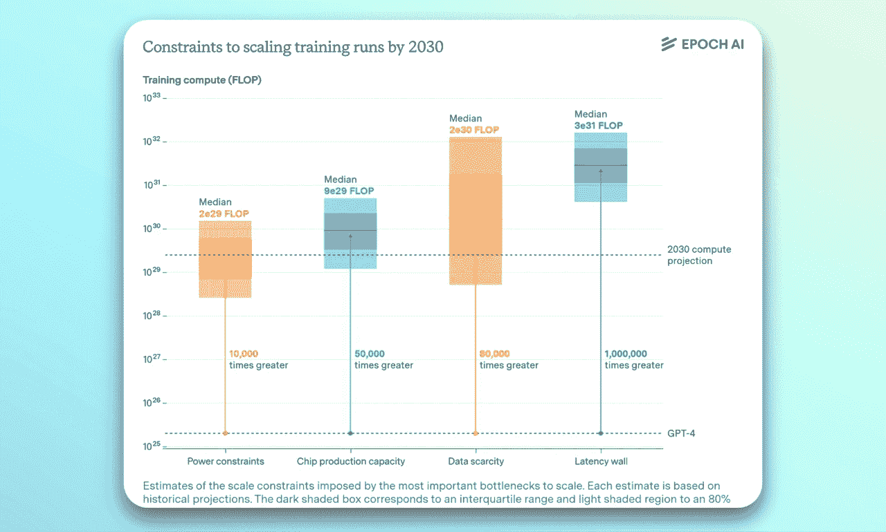

# 9🈷️11日

> 来源：[https://v11enp9ok1h.feishu.cn/docx/OUOFdl9mgoV9zBxTdI4c7sIbnGg](https://v11enp9ok1h.feishu.cn/docx/OUOFdl9mgoV9zBxTdI4c7sIbnGg)

+   [《Scaling Law 的困局、Self-play ](https://v11enp9ok1h.feishu.cn/wiki/WyTRwD6JFibLAokFf2AcoRo1nef?from=from_copylink)RL 的希望，以及200美金一斤的草莓》来自橘子汽水铺，近期，AI 行业面临 Scaling Law 瓶颈，许多公司放弃预训练，转向 Self-play RL 作为突破口。OpenAI 预计在两周内发布新模型“草莓”，其初步表现稍好于 GPT-40，但响应速度较慢且不支持图像处理。草莓的核心优势在于代码.数学和推理能力的提升，未来值得关注其在 AI 领域的影响。

+   [AI应用专家的实战经验：如何通过智能工具实现博客的高效数字化转型](https://v11enp9ok1h.feishu.cn/wiki/K595wIJ7bixlJ1krTQ4c9TWrnHc?from=from_copylink)作者大雨，本文探讨了如何通过 AI工具实现个人博客的数字化转型作者分享了在多语言管理和内容优化中与 AI合作的经历，强调 AI不仅改变了问题解决的方式，还提升了工作效率。通过 A的帮助，作者克服了以往写作中的障碍，重新审视人机协作关系，鼓励读者在工作中充分利用 AI 带来的显著变化。

+   [《2030年，Scaling L](https://mp.weixin.qq.com/s/RgbZrdVNz7io🐧sabww82w)aw会到达极限吗?GPT-6能出来吗?》文章探讨了到 2030 年 AI 训练的潜在瓶颈，包括电力供应、芯片产能、数据稀缺和延迟。预计 AI 训练计算量将达到 2e^29 FLOP，推动 AI 模型能力显著提升。电力供应将是主要限制，需发展分布式训练以应对。此外，GPU产能有望提升，数据资源也将扩展但数据质量和延迟问题仍需解决。

[AI行业报告](https://v11enp9ok1h.feishu.cn/wiki/QuT3ws0gBiuXPjkTrkKc7yZsng7?from=from_copylink)它一些报告发布在行业报告板块|

+   《亿欧智库 | 2024年人形机器人核心场景发展洞察研究报告》

+   [《【亿欧智库】人工智能开启汽车产业](https://v11enp9ok1h.feishu.cn/record/GKsZrDp59eKwSzcSrDwc8md1nfb)智能化新时代—2024AIEV产业研究》

+   《亿欧智库 | 2024中国AI商业落地投资价值研究报告》

+   《亿欧智库 | 2024中国智能电动汽车域控制器产业分析报告》

+   《Sensor Tower 2024年AI应用市场洞察》

+   《头豹 2024年中国AI Agent行业研究 》