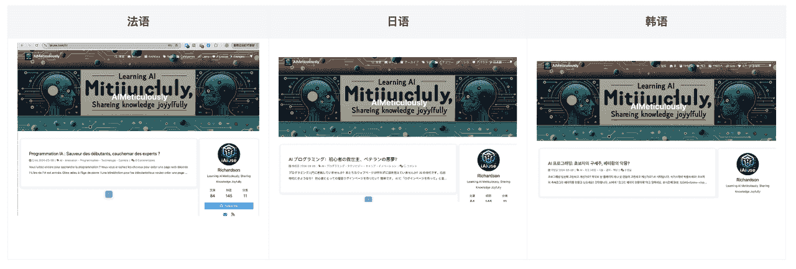
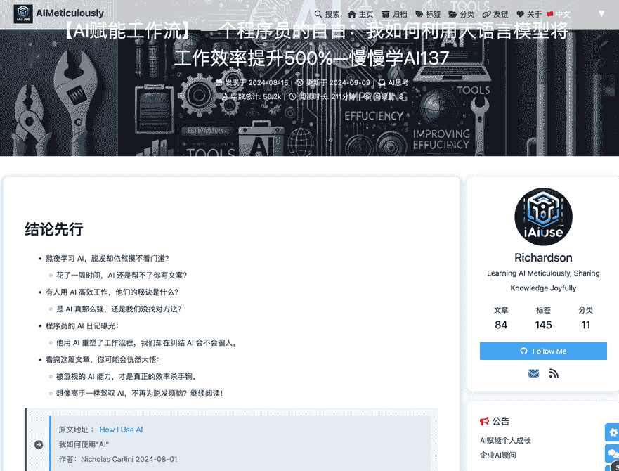
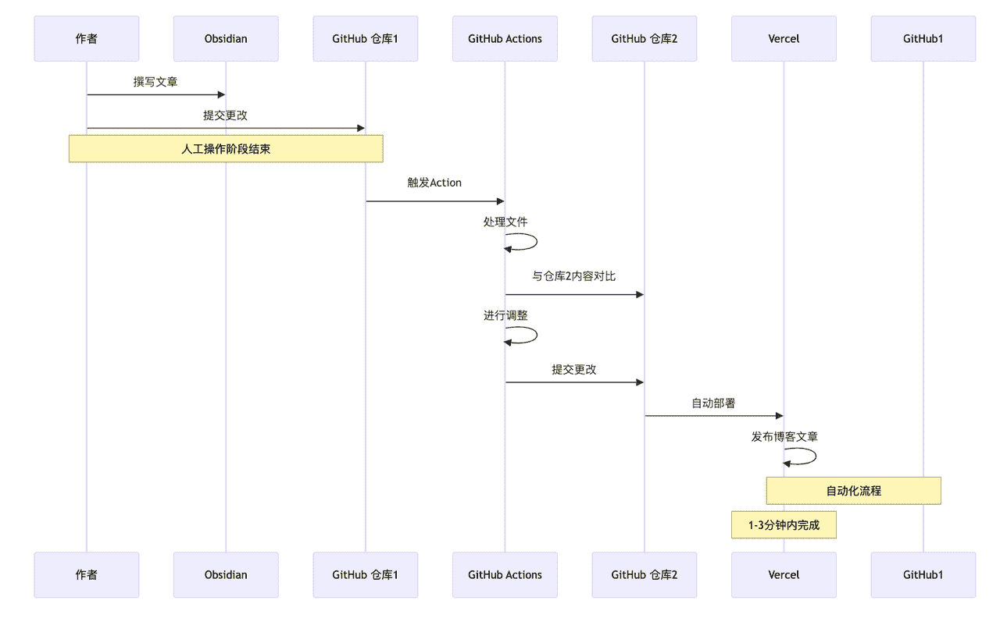

# AI应用专家的实战经验：如何通过智能工具实现博客的高效数字化转型

> 来源：[https://v11enp9ok1h.feishu.cn/docx/H6UEdxj0PoXvZ5xohsncarIlnvd](https://v11enp9ok1h.feishu.cn/docx/H6UEdxj0PoXvZ5xohsncarIlnvd)

## 写在前面

+ 当 AI 能在几分钟内生成详细报告，你还愿意花数小时手动撰写吗？

+ AI 已经可以高效解决复杂任务，为什么还要浪费时间？

+ 你会让 AI 在决策时替你做选择吗？

+ 如果 AI 能比你更快发现问题、更精准地预测结果，你会完全信任它的判断吗？

+ 如何让 AI 成为得力助手，而不是一个只会给出模糊建议的工具？

+ 如何真正掌控 AI，避免让它成为增加工作量的负担？

+ 在与 AI 合作解决问题的过程中，你学到了哪些意想不到的东西？

+ AI 不仅能帮你解决问题，还可能让你以全新的方式看待工作流程。

+ 当 AI 给出的解决方案超出你的理解范围时，你会如何应对？

+ 面对技术复杂的 AI 提案，你是选择质疑、理解，还是直接应用？

+ 与 AI 共事，是否改变了你解决问题的方式？

+ AI 的思维方式不同于传统方法，这种转变是否让你重新审视问题的解决策略？

> 这篇文章讲述了升级个人博客时通过 AI 解决技术难题的经历，包括如何利用 AI 攻克多语言管理和内容优化的挑战。分享了与 AI 合作的成功与失败，逐渐意识到 AI 不仅改变了问题解决方式，还学会了更好地驾驭这个强大的工具。这次经历让我重新思考了人机协作的关系，以及如何在未来的工作中充分利用 AI。通过这些经验，希望帮助大家了解如何高效应用 AI，无论是简化流程还是提升生产力，AI 都能带来显著的变化。相信无论是个人用户还是企业主，本文都将提供在 AI 时代游刃有余的实用启发。

对于个人博客，有接近 10 年的痛苦折腾史，接触 AI 之前，心中有输出的想法，真正写出来 1 年可能也不超过 5 篇，很大的原因在于输出过程遇到的障碍非常多。但是 AI 给出了完全不同的思路和视角，让这件事变得可执行可操作了。

## 缘起：给个人博客加上多国语言

近期和小伙伴一起给 [WayToAGI 官网](https://www.waytoagi.com/)增加多语言能力，突发奇想，能不能给自己的博客也加上多语言的能力呢？经过一段时间的努力，最后在 AI 的帮助下，居然完成了，带来很大的信心和启发。AI 在很多任务上给我们很大的帮助，甚至可以可以夸张说，有想不到，没有它做不到的地步。



[另](https://www.iaiuse.com/posts/3e748359)外一个挑战在于，最近翻译一篇长文 【AI 赋能工作流】一个程序员的自白：我如何利用大语言模型将工作效率提升 500%—慢慢学 AI 137 ，其中设计大量的 AI 对话，为了方便阅读，希望将其中的对话抽离出来，但是又不希望这些内容放在整体的页面上，这是 Hexo 博客本身的限制。



在解决这两件事的过程，给了我极大启发，对于不那么熟悉 `Hexo` 的人来说，如何入手呢？开始之前先介绍一下这个博客的由来。

## 个人博客升级和遇到的挑战和解决思路

### 静态博客和去👸号发文有什么不同

输出倒逼输入是非常好的学习方法，通过输出能非常好像实践费曼学习法。这也是所谓写下来的力量，当我们要讲所思所想输出的时候，会发现有太多的卡点，而梳理这些卡点，能帮我们更加系统看待自己的知识体系。

输出的方式方法很多，平台也很多，通过文字方式有👸号，头条等等，视频有 b 站，抖音，视频号，国内外平台很多。我选择了相对比较冷门的静态博客-`Hexo`。

有利有弊，好处是自由度更好，坏处是自己需要折腾，也无法享受平台带来的流量红利。通过 `Hexo` 这样的静态博客，在写文章的时候我只需要关注内容，如何展示是由 `Hexo` 来完成的，通过下面的对比可以了解到他们之间的区别

| 区别 | 静态博客（如 `Hexo`） | 👸号 / 今日头条 / 知乎等 |
| --- | --- | --- |
| 控制权与灵活性 | 完全自控，内容和设计高度自定义，适合技术用户 | 平台控制，固定模板，功能有限，适合快速发布 |
| 内容所有权 | 你自己拥有内容，存储在自己的服务器或云端 | 内容存储在平台上，平台有一定的控制权 |
| SEO优化 | 完全掌控SEO设置，适合提升搜索引擎可见性 | SEO功能有限，依赖平台推荐机制 |
| 维护与技术需求 | 需要技术支持，手动配置和更新 | 平台维护，不需要技术背景 |
| 发布便捷性 | 需要本地编辑、部署到服务器 | 简单快捷，随时随地在线发布 |

> 还有个不算好不算坏的点，`Hexo` 的文章通过模板决定了长什么样，这个过程我们 不用管排版，也不好管排版。

选择使用静态博客也是缘于折腾的心思，使用半年多，真正发布的过程比想象中简单。大概是这样的流程：



这样一套写作输出流程，是半年前，在 AI 的帮助下搭建起来的，一直用到现在。搭建的过程比想象中简单，只是告诉它，我想有一套简洁的写作体系，后续的内容都是在它的指导下完成的。

最近因为一篇长文 [【AI 赋能工作流】一个程序员的自白：我如何利用大语言模型将工作效率提升 500%—慢慢学 AI 137](https://www.iaiuse.com/posts/3e748359) ，其中设计大量的 AI 对话，为了方便阅读，希望将其中的对话抽离出来，但是又不希望这些内容放在整体的页面上，这是 `Hexo` 博客本身的限制，但是对于不那么熟悉 `Hexo` 的人来说，如何入手呢？接下来分享这次博客改造的过程。

### 升级挑战，如何让部分文章在列表中隐藏

如果类比👸号文章，有点像是不推送文章，但是发布了，可以发链接给朋友，他们能打开，但是👸号的通知里面没有这篇文章。这在👸号看起来很自然的事，在 `Hexo` 这种静态博客里面实现就不容易了，需要借助额外的插件能力。

一想到“插件“，心理就犯嘀咕了，这玩意咱也不会呀。要不放弃？老实说，这件事在没有借助 AI 的情况，确实折腾了快 1 个月，前段时间博客文章列表里面有 20 多篇 ChatGPT 的对话记录，确实有碍观瞻，但是也无可奈何。毕竟，咱也不会呀！

AI 对话记录 - 隐藏不同文章

```
作为一个Hexo开发者，专家，我是一个Hexo的新手，我希望有部分文章不在列表中显示，但是能通过地址访问他们，我搜到可以使用 hexo-hide-posts 插件，但是隐藏以后，无法在archive中通过链接访问，我看到有人和我一样，他提到使用了hexo-abbrlink 插件所以失效，我没有编程基础，请给我具体的步骤
```

我理解您的需求是希望隐藏文章不出现在列表中，但仍然可以通过 URL 访问，同时您使用了 `hexo-abbrlink` 插件。您提到的问题是设置了 `hexo-hide-posts` 后，虽然在 archive 中能看到链接，但打开报 404 错误。让我们来分析一下这个问题并尝试提供一个解决方案。

我建议创建一个新的 `Hexo` 插件来解决这个问题。这个插件将在 `hexo-hide-posts` 之后运行，确保隐藏的文章仍然被生成并可以通过 URL 访问。以下是插件的实现：

```
const fs = require('fs');
const path = require('path');

module.exports = function(hexo) {
  hexo.extend.filter.register('after_generate', function() {
    const hiddenPosts = hexo.locals.get('hidden_posts');
    const publicDir = hexo.public_dir;

    hiddenPosts.forEach(post => {
      const layout = post.layout || 'post';
      const destPath = path.join(publicDir, post.path);

      fs.mkdirSync(path.dirname(destPath), { recursive: true });

      hexo.post.render(post.full_source, post).then(renderedPost => {
        fs.writeFileSync(destPath, renderedPost.content);
      });
    });
  });
};
```

要使用这个插件，请按照以下步骤操作：

1. 在您的 `Hexo` 项目根目录创建一个新文件夹，命名为 `scripts` （如果还没有的话）。

1. 在 `scripts` 文件夹中创建一个新文件，命名为 `show-hidden-posts.js` ，并将上面的代码粘贴进去。

1. 确保您的 `_config.yml` 中的 `hide_posts` 配置正确设置，例如：

```
hide_posts:
  enable: true
  filter: hidden
  public_generators: []
  noindex: false
```

1. 在您想要隐藏的文章的 front-matter 中添加 `hidden: true` 。

这个插件会在 `Hexo` 生成站点后运行，它会找到所有被标记为隐藏的文章，然后手动生成这些文章的 HTML 文件并将它们放在正确的位置。这样，这些文章就不会出现在列表中，但可以通过直接 URL 访问。

这种方法的优点是：

1. 不需要修改任何现有的主题或插件代码。

1. 与 `hexo-abbrlink` 插件兼容。

1. 保持了隐藏文章的功能，同时也允许通过 URL 访问。

请注意，这个解决方案可能会稍微增加生成时间，特别是如果您有大量隐藏的文章。但对于大多数博客来说，这个影响应该是可以忽略的。

如果您在实施这个解决方案时遇到任何问题，请随时告诉我，我会很乐意帮您进一步调试和优化。

当然，这个过程中间有很多反复，好处是通过和它的对话过程，逐步了解了其中的机制，虽然看起来是

> 奇奇怪怪的知识又增加了

实实在在解决了我的问题。

如果你了解过 comfyui，学习过🛰️机器人，学习过 coze，dify，fastgpt，那么你可能会对做一个 comfyui 的节点，做一个 coze 的插件，觉得遥不可及。那么接下来要分享的内容，也会有同样的困惑。

但是，AI 拉平了这里的技术障碍

解决了这个问题以后，燃起了心中的想法——能不能给它加上多语言的能力呢？通过高级的 谷歌搜索技巧 , 发现网上大部分的资料，仅仅使用了模板本身的能力，大多数是中/英。缘于 AI 给我过分的期望，就想着能不能加更多语言呢？果然没失望！

### 让静态博客拥有 10 国语言

这里的出发点，是通过 AI 把优质的内容传播给更多的语言，而不同语言都有专属的文章列表清单，减少相互之间的干扰，现有的解决方案语言非常少，怎么办呢？有了前面文章隐藏的先例，决定放弃抵抗了，直接让 AI 来吧。

AI 对话记录 - 实现多国语言

```
我现在希望实现的功能是在我本地的obsidian文件夹中，创建一个目录，比如说en，或者zh-tw。 这里的文件是放多语言的，发布的时候，这个action会自动把文件夹里面的内容移动到合适的位置，加上语言的标签，方便我最终发布出去，成为多语言的博客。请告诉我具体的步骤，我现在首先需要给这个博客加上多语言的标签和菜单，然后告诉我写作的流程等
```

为您的 `Hexo` 博客添加多语言支持并自动化发布流程是一个很好的想法。我会为您提供一个详细的步骤指南，包括如何设置多语言支持、修改 GitHub Action，以及调整写作流程。

#### 1. 在 Hexo 中启用多语言支持

1. 编辑 `Hexo` 的 `_config.yml` 文件，添加或修改以下内容：

```
language:
  - zh-CN
  - en
  - zh-TW
```

1. 在 `Butterfly` 主题的 `_config.yml` 文件中添加语言菜单：

```
menu:
  Home: / || fas fa-home
  Archives: /archives/ || fas fa-archive
  Tags: /tags/ || fas fa-tags
  Categories: /categories/ || fas fa-folder-open


language:
  - name: 简体中文
    path: /
  - name: English
    path: /en/
  - name: 繁體中文
    path: /zh-tw/
```

1. 创建语言特定的配置文件：

在 `Hexo` 根目录的 `source` 文件夹中创建 `_data` 目录，然后创建以下文件：

+ `languages.yml`

+ `en.yml`

+ `zh-TW.yml`

1. 在 `languages.yml` 中添加：

```
zh-CN:
  menu:
    home: 首页
    archives: 归档
    tags: 标签
    categories: 分类
en:
  menu:
    home: Home
    archives: Archives
    tags: Tags
    categories: Categories
zh-TW:
  menu:
    home: 首頁
    archives: 歸檔
    tags: 標籤
    categories: 分類
```

#### 2. 修改 GitHub Action

修改您的 GitHub Action 配置文件以处理多语言内容：

```
name: 同步多语言内容到iaiuse的_post文件夹

on:
  push:
    paths:
      - '02.Area领域/230、写作输出/IAIUSE/**'

jobs:
  sync:
    runs-on: ubuntu-latest
    steps:

      - name: 同步多语言文件信息
        run: |
          # 同步中文内容
          rsync -av --delete ./02.Area领域/230、写作输出/IAIUSE/ iaiuse/source/_posts/
          # 同步英文内容
          rsync -av --delete ./02.Area领域/230、写作输出/IAIUSE/en/ iaiuse/source/_posts/en/
          # 同步繁体中文内容
          rsync -av --delete ./02.Area领域/230、写作输出/IAIUSE/zh-tw/ iaiuse/source/_posts/zh-tw/

      - name: 处理多语言标签
        run: |
          cd iaiuse/source/_posts
          # 为英文文章添加语言标签
          find en -type f -name "*.md" -exec sed -i '1s/^/---\nlang: en\n---\n/ ' {} +
          # 为繁体中文文章添加语言标签
          find zh-tw -type f -name "*.md" -exec sed -i '1s/^/---\nlang: zh-TW\n---\n/ ' {} +
          # 为默认语言（简体中文）文章添加语言标签
          find . -maxdepth 1 -type f -name "*.md" -exec sed -i '1s/^/---\nlang: zh-CN\n---\n/ ' {} +
```

#### 3. 调整写作流程

1. 在 Obsidian 中创建以下文件夹结构：

```
02.Area领域/230、写作输出/IAIUSE/
├── en/
├── zh-tw/
└── (默认中文文章)
```

1. 写作流程：

+ 中文文章：直接放在 `IAIUSE` 文件夹下

+ 英文文章：放在 `IAIUSE/en` 文件夹下

+ 繁体中文文章：放在 `IAIUSE/zh-tw` 文件夹下

1. 文章 front-matter 示例：

```
---
title: 你的文章标题
date: 2024-09-06 14:30:00
tags: [tag1, tag2]
categories: [category1, category2]
---
```

1. 注意：不需要手动添加 `lang` 字段，GitHub Action 会自动处理。

1. 提交和推送：

+ 照常提交你的更改到 GitHub

+ GitHub Action 将自动处理文件同步和语言标签添加

1. 验证：

+ 检查 `iaiuse` 仓库中的 `source/_posts` 文件夹

+ 确保文章被正确分类到相应的语言文件夹中

+ 验证文章的 front-matter 中是否自动添加了正确的 `lang` 字段

通过遵循这个流程，你可以轻松地管理多语言内容，并自动化部署过程。


我已经为您创建了一个详细的指南，包括如何设置 Hexo 的多语言支持、修改 GitHub Action 以处理多语言内容，以及调整您的写作流程。这个指南涵盖了以下主要步骤：

1. 在 Hexo 中启用多语言支持
2. 修改 GitHub Action 以处理多语言内容
3. 调整写作流程以适应多语言博客

请查看上面的 Markdown 文档，其中包含了所有必要的步骤和代码示例。这个指南应该能帮助您顺利地将博客转换为多语言版本，并保持自动化发布流程。

实施这些更改后，您的写作流程将变为：

1. 在 Obsidian 中，根据语言将文章放在相应的文件夹中（默认、`en`、`zh-tw`）。
2. 正常提交和推送更改到 GitHub。
3. GitHub Action 将自动处理文件同步、添加语言标签，并部署到您的博客。

如果您在实施过程中遇到任何问题或需要进一步的解释，请随时告诉我。我很乐意为您提供更多帮助或澄清任何不清楚的地方。

> 期间有非常多的挑战，而这些挑战对于我来说，最重要的不是如何解决这些问题，而是始终要了解，我想要的是什么。而不是迷失在具体实现细节中。

回顾这一路学习 AI，使用 AI 的经历，深深感觉到，作为一名内容创作者和技术爱好者，最初在面对大量内容需求时，逐渐感到传统的手动创作方式不仅效率低下，还容易导致重复劳动和创意枯竭。然而，通过探索 AI 技术，发现它不仅可以帮助我突破这些限制，还能在管理和优化我的 Hexo 博客过程中提供强有力的支持。

# 从 AI 爱好者到应用专家的转变

作为一个早期接触 AI 的爱好者，最初使用 AI 主要是为了提升工作效率，比如生成文章大纲、自动化创意扩展等。然而，随着深入的使用，逐渐意识到 AI 不仅能在创作过程中节省时间，它还能应对更为复杂的挑战——例如多语言内容管理和博客优化等。

特别是在管理 Hexo 静态博客时，面临着如何高效处理长篇文章翻译、多语言版本维护、以及如何通过 AI 优化内容显示等诸多问题。AI 在解决这些问题上的表现，彻底改变了对内容创作与管理的看法。

# 内容创作与管理中的常见挑战

## 信息爆炸与内容质量的提升压力

我们生活在信息爆炸的时代，每天都有海量内容涌现。作为内容创作者，如何在这种环境中脱颖而出，创作出高质量、引人入胜的内容，成了巨大的挑战。AI 工具不仅能帮助生成大量高质量的内容创意，还能通过自然语言处理技术来优化文章的结构和连贯性，确保内容符合读者的期望和需求。

## AI 辅助内容创作：突破效率与质量的瓶颈

在内容创作的过程中，创作者常常面临两个核心问题：一是如何高效生成具有创意和深度的内容，二是如何确保创作的质量和逻辑性不因追求效率而打折。尤其是对于长篇文章或多语言版本的内容创作，这些挑战更为突出。幸运的是，AI 工具的出现不仅极大地提升了内容生产的效率，还能帮助创作者保持创作质量的稳定性。

> 创作者的拖延症，其中一个非常重要的原因是无法提笔。AI 的好处是它能给我们一个靶子，让我们在它的基础上调整，极大降低了心理压力。

## 通过 AI 生成文章大纲与创意扩展

在创作内容时，许多创作者都会遇到写作瓶颈，特别是在撰写长篇内容或深入探讨某一话题时，创意可能枯竭，思路也难以清晰。AI 写作助手在这方面提供了极大帮助。

首先，AI 能通过分析现有的内容主题和结构，自动生成文章大纲。这意味着创作者可以直接从一个结构化的框架开始，而不必花费大量时间思考如何组织文章逻辑。此外，AI 能够根据大纲建议进一步扩展内容。例如，如果你有一篇 1000 字的短文，AI 可以通过添加相关细节、背景信息、实例或数据分析，将文章扩展到 5000 字甚至更多。这个过程不仅保证了文章的长度，同时还能通过 AI 的算法确保内容的逻辑连贯性。

### 案例：从 1000 字到 5000 字的扩展

以下是一个 Mermaid 流程图，展示了您描述的写作过程：

这个图展示了从初始想法到最终 5000 字文章的整个过程，突出了与 AI 交互的关键节点。现在，让我们详细展开这个案例，包括具体的扩展过程和成果：

#### 初始阶段：构思和大纲（约 1000 字）

起初，我有一个关于”AI 在内容创作中的应用”的想法。我先用大约 200 字概括了主要观点，然后与 AI 讨论了这个主题的潜在结构。AI 建议将内容分为以下几个部分：

1. AI 在内容创作中的现状
2. AI 工具的类型和应用
3. AI 辅助写作的优势
4. 潜在的挑战和限制
5. 未来展望

基于这个结构，我快速写出了一个约 1000 字的初稿，每个部分大约 200 字。

#### 与 AI 交互：评估和调整

我将这 1000 字的初稿提交给 AI 进行评估。AI 指出了一些逻辑跳跃和未充分展开的观点。例如，在”AI 工具的类型和应用”部分，AI 建议增加具体的工具示例和使用场景。

#### 开始扩展：举例深化理解

基于 AI 的反馈，我开始逐节扩展内容。以”AI 辅助写作的优势”为例：

原文（约 200 字）：

“AI 能显著提高写作效率，生成创意，并帮助克服写作瓶颈。它可以提供数据支持，确保内容的准确性和全面性。”

扩展后（约 800 字）：

“AI 在提升写作效率方面表现卓越。例如，在我的个人经验中，使用 Claude 模型辅助写作后，我的日均文章产出从 1 篇增加到 3 篇，而质量并未下降。AI 不仅能快速生成初稿，还能提供多角度的创意思路。

在克服写作瓶颈方面，AI 堪称神助。有一次，我在写一篇关于可持续发展的文章时陷入困境，不知如何展开论述。我向 AI 描述了我的困境，它立即提供了三个新颖的切入点：从经济效益、社会影响和技术创新的角度分析可持续发展。这些建议极大地启发了我，帮我突破了思维限制。

AI 的另一大优势是其强大的数据处理和分析能力。在写作过程中，AI 可以快速检索和整理相关数据，确保内容的准确性和全面性。例如，当我撰写一篇关于全球气候变化的文章时，AI 为我提供了最新的科研数据和各国政策信息，这些信息若靠人工搜集，至少需要几天时间。”

#### 持续优化和润色

在扩展每个部分后，再次与 AI 互动，请它审阅扩展的内容，并提供进一步的优化建议。AI 指出了一些表达不清的地方，并建议添加更多的转折句来增强文章的连贯性。

#### 最后润色：标题选择和整体评估

当文章扩展到接近 5000 字时，我再次与 AI 合作，讨论了几个可能的标题选项。最终，我们选定了”AI 与人类协作：重塑内容创作的未来”这个标题，因为它既吸引人又准确概括了文章的核心内容。

AI 还对整篇文章进行了最后的评估，指出了一些微小的语法错误和表达不一致的地方，我据此做了最后的修改。

#### 成果和反思

最终，这篇文章从最初的 1000 字扩展到了 5200 字。整个过程耗时约 4 小时，比我独立完成节省了至少 60%的时间。更重要的是，通过与 AI 的持续互动，文章的深度和广度都得到了显著提升。

这个过程让我深刻体会到，AI 不仅是一个高效的写作助手，更是一个强大的思维拓展工具。它帮助我从多个角度思考问题，发现了我原本可能忽视的观点。同时，这种协作方式也启发我去思考人类创作者在 AI 时代的独特价值——我们需要学会如何更好地利用 AI 工具，同时保持自己的创造力和批判性思维。

> 随着 AI 使用的不断深入，在创作的各个环节提高效率，自然而然就萌生出自动化的诉求，自动化+智能化就成了创作者必然的选择。

## AI 工具的未来潜力：从自动化到智能优化

AI 不仅仅是一个内容生成工具，它更能帮助内容创作者不断优化写作过程。随着 AI 技术的进步，未来的内容创作将越来越智能化，AI 将能够更加精确地理解读者的需求，甚至根据读者的反馈，自动调整和优化内容结构和表达方式。

通过与 AI 的深度合作，创作者可以在保持创作灵感的同时，轻松应对高效生产和质量控制的双重挑战。AI 的应用不仅在于提高效率，更在于创造一种全新的内容创作模式，让创作者从繁琐的技术性工作中解放出来，专注于创意和战略性思考。

AI 编程成为了普通人一种类似 PPT 的能力。超过 1000 小时的深入 AI 交流，在 AI 辅助下写了几十篇万字长文，有了一些自己的想法，接下来开始尝试回答文章开头的那些问题。

# 未来展望：拥抱 AI，成为数字时代的领导者

## 当 AI 能在几分钟内生成详细报告，你还愿意花数小时手动撰写吗？

最初对 AI 的理解，确实是希望它能帮我写一些东西，但是真正实际操作下来，发现并没有那么容易。分阶段是必然，这个过程帮我们节省时间是其中一方面，更重要的是让我们对这件事理解更加深刻了。

还有一个很重要的原因，我们对复杂的理解不一样了，因为，我们的能力在过程中提升了。

## 你会让 AI 在决策时替你做选择吗？

我会让它去帮我找出更多看待这件事的视角和角度，同时也在这个过程中和它学习。更重要的是，需要对它保持足够的警惕。因为，这会是一个新的信息茧房。

## 如何让 AI 成为得力助手，而不是一个只会给出模糊建议的工具？

分解任务是很重要的，只有分解合理，我们才能更好的去把控整体的过程。但是这件事是有非常大的边际效应，我们会在这个过程中快速成长。

## 在与 AI 合作解决问题的过程中，你学到了哪些意想不到的东西？

最大的感触是它对于流程本身的全新视角，因为流程基于过去的能力限制，但是现在变了。

## 当 AI 给出的解决方案超出你的理解范围时，你会如何应对？

实际情况并不会这么绝对，而是在不断探索中找到当前相对合适的解决方案。

## 与 AI 共事，是否改变了你解决问题的方式？

它会让我更加聚焦目标，避免陷入具体的细节。

在和 AI 交互的过程中，逐渐意识到，让 AI 成为助理辅助日常生活，不再是一句口号，一种思维，而是非常具体而实际的事。

它让我们从实现细节中抽离出来，让我们更加高效，更加聚焦真正的目标。

# 个人化建议

无论你是技术爱好者、内容创作者，还是其他领域的专业人士，AI 都能在你的工作中发挥重要作用。以下是针对不同群体的具体建议，帮助你开始或深化与 AI 的协作：

## 对于技术爱好者

1. 从小项目开始：选择一个小型个人项目，如搭建一个简单的博客或自动化脚本，尝试使用 AI 辅助编码。这可以帮助你熟悉 AI 的能力和局限性。
2. 探索 AI 编程工具：尝试使用如 GitHub Copilot 或 Cursor 等 AI 编程助手。开始时可以用它们来生成注释或简单的函数，逐步过渡到更复杂的任务。
3. 参与 AI 社区：加入 AI 相关的在线社区或论坛，如 Stack Overflow 的 AI 板块或 Reddit 的 `r/artificial` 子版块。与其他开发者交流经验，了解最新 trends。
4. 构建 AI 驱动的项目：尝试开发一个利用 AI API 的项目，如一个简单的聊天机器人或图像识别应用。这将帮助你深入理解 AI 的实际应用过程。

## 对于内容创作者

1. AI 辅助头脑风暴：下次遇到创意瓶颈时，尝试用 AI 进行头脑风暴。给 AI 一个主题，让它生成多个创意方向，然后从中选择最适合的进行深化。
2. 建立 AI 写作流程：逐步将 AI 整合到你的写作流程中。可以从使用 AI 生成文章大纲开始，然后尝试让 AI 扩展某些段落或提供相关数据支持。
3. 多语言内容探索：如果你有兴趣拓展国际市场，可以尝试使用 AI 辅助翻译和本地化你的内容。从一篇博文开始，逐步扩大到更多内容。
4. 优化 SEO：利用 AI 工具分析你的内容，获取 SEO 优化建议。尝试根据 AI 的建议调整标题、元描述和关键词使用。

## 对于企业管理者

1. AI 辅助决策：开始在小规模决策中使用 AI 分析工具。例如，使用 AI 分析客户反馈或市场趋势数据，作为决策参考。
2. 员工培训计划：制定一个 AI 工具使用的培训计划，帮助团队成员了解如何在日常工作中有效利用 AI。
3. 流程优化：识别公司中可能受益于 AI 自动化的重复性任务。从一个小流程开始，测试 AI 解决方案的效果。
4. AI 伦理和政策：开始制定公司的 AI 使用政策，确保 AI 的应用符合伦理标准和法律要求。

## 对于教育工作者

1. AI 辅助教案设计：尝试使用 AI 来帮助设计课程大纲或生成教学材料 ideas。这可以为你的课程带来新的视角。
2. 个性化学习路径：探索如何使用 AI 分析学生的学习数据，为不同学生制定个性化的学习计划。
3. 创新教学方法：考虑如何将 AI 工具整合到课堂活动中，例如使用 AI 生成的案例研究或模拟场景。
4. AI 素养教育：开发一个简单的课程模块，教导学生了解 AI 的基础知识、应用领域及其对社会的影响。

无论你属于哪个群体，记住：与 AI 协作是一个学习过程。从小处着手，保持好奇心和开放态度，你会发现 AI 不仅能提高工作效率，还能激发你的创造力，开拓新的可能性。最重要的是，始终保持批判性思维，将 AI 视为强大的工具，而不是完全依赖的解决方案。

祝你在 AI 辅助创作的旅程中收获满满！
