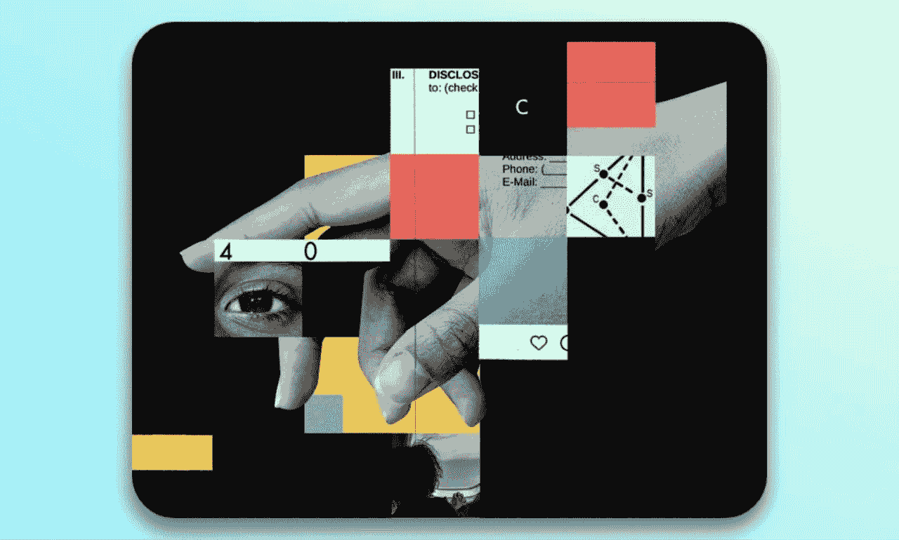

# 9🈷️12日

> 来源：[https://v11enp9ok1h.feishu.cn/docx/PMckdRHwmoaHo4xUy0ncAQp9nFg](https://v11enp9ok1h.feishu.cn/docx/PMckdRHwmoaHo4xUy0ncAQp9nFg)

+   [产品经理经理面试官视角](https://v11enp9ok1h.feishu.cn/wiki/Z91kwYYYeiy9ExkjSUNc3fpenmf?from=from_copylink) 面试一个产品经理，我主要问两方面问题：

+   ** 一、**是围绕他过去做过的某件事(一般是某个产品或某个功能，也可以是其他)进行深入提问。

+    你开始为什么要做这个东西?

+    你是怎么想到的?

+    针对以后的情况你考虑了哪些方面和做了些什 么?

+    开始做的过程中遇到了什么问题?

+    你是怎么解决的?发现了什么?

+    什么东西和原来理解的不一样了?

+    又发现了哪些相关的洞察，你和外部市场上的 其他人对其认知不一样?

+    在迭代过程中又是怎么做的?

+    你现在对这件事情的认知有什么变化?

+    如果再回到当初，你还会做什么?

+   《通往人类永生!AI时代如何保存记忆和历史?》来自 FrankGPT 推荐《麻省理工科技评论》的一篇文章随着数字时代的到来，人类创造的数据远超以往，但这些数据的保存却面临脆弱性。许多在线平台可能随时消失，导致珍贵记忆和历史资料的丧失。档案管理员和互联网档案馆等机构正在努力保存这些数据，优先保护易逝和风险较高的资料。未来的历史学家需要尽可能多的材料以便研究，而个人也可以通过捐赠个人数据来帮助保存我们的数字遗产。(结合下面推荐的两个 AI 产品一起阅读，可能会引发更多思考。)

