# 刚刚，OpenAI震撼发布o1大模型！强化学习突破LLM推理极限

> 来源：[https://v11enp9ok1h.feishu.cn/docx/VzaxdhEXHo89IXxwL2ScaZWZnvc](https://v11enp9ok1h.feishu.cn/docx/VzaxdhEXHo89IXxwL2ScaZWZnvc)

大模型领域的技术发展，今天起再次「从 1 开始」了。

北京时间 9 月 13 日午夜，OpenAI 正式公开一系列全新 AI 大模型，旨在专门解决难题。这是一个重大突破，新模型可以实现复杂推理，一个通用模型解决比此前的科学、代码和数学模型能做到的更难的问题。

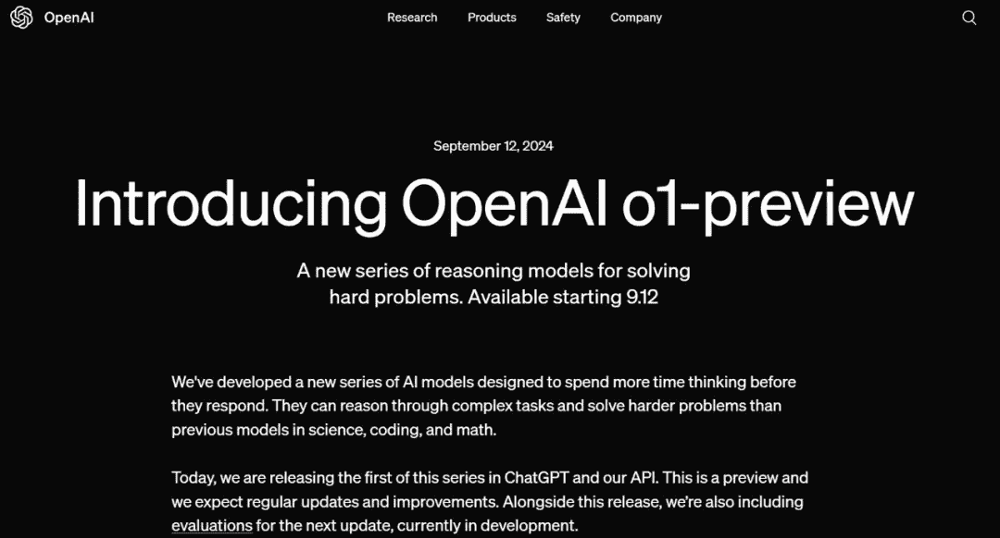

OpenAI 称，今天在 ChatGPT 和大模型 API 中新发布的是该系列中的第一款模型，而且还只是预览版 ——o1-preview。除了 o1，OpenAI 还展示了目前正在开发的下次更新的评估。

o1 模型一举创造了很多历史记录。

首先，o1 就是此前 OpenAI 从山姆・奥特曼到科学家们一直在「高调宣传」的草莓大模型。它拥有真正的通用推理能力。在一系列高难基准测试中展现出了超强实力，相比 GPT-4o 有巨大提升，让大模型的上限从「没法看」直接上升到优秀水平，不专门训练直接数学奥赛金牌，甚至能在博士级别的科学问答环节上超越人类专家。

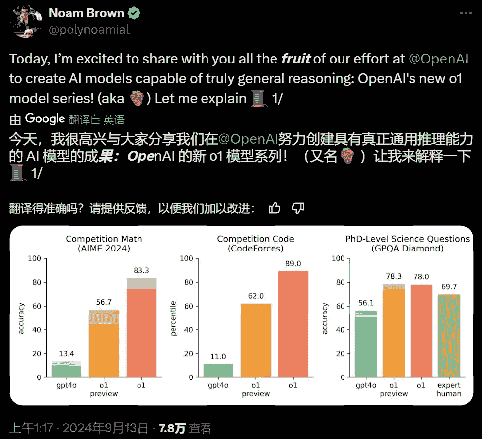

奥特曼表示，虽然 o1 的表现仍然存在缺陷，不过你在第一次使用它的时候仍然会感到震撼。

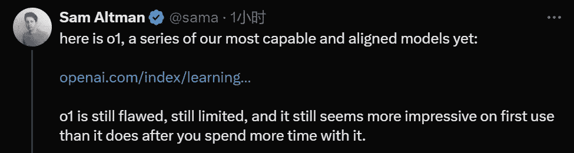

其次，o1 给大模型规模扩展 vs 性能的曲线带来了一次上翘。它在大模型领域重现了当年 AlphaGo 强化学习的成功 —— 给越多算力，就输出越多智能，一直到超越人类水平。

也就是从方法上，o1 大模型首次证明了语言模型可以进行真正的强化学习。

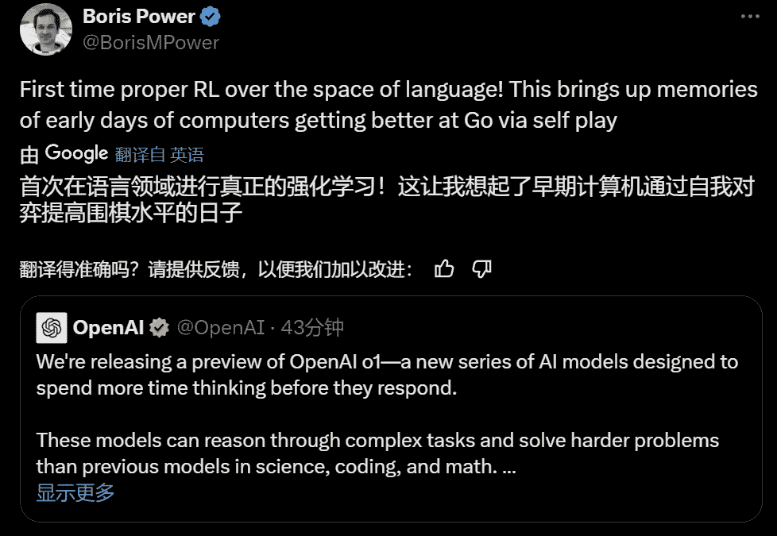

开发出首个 AI 软件工程师 Devin 的 Cognition AI 表示，过去几周一直与 OpenAI 密切合作，使用 Devin 评估 o1 的推理能力。结果发现， 与 GPT-4o 相比，o1 系列模型对于处理代码的智能体系统来说是一个重大进步。

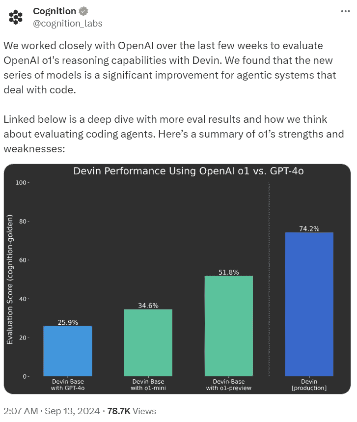

最后在实践中，o1 上线之后，现在 ChatGPT 可以在回答问题前先仔细思考，而不是立即脱口而出答案。就像人类大脑的系统 1 和系统 2，ChatGPT 已经从仅使用系统 1（快速、自动、直观、易出错）进化到了可使用系统 2 思维（缓慢、深思熟虑、有意识、可靠）。这让它能够解决以前无法解决的问题。

从今天 ChatGPT 的用户体验来看，这是向前迈进一小步。在简单的 Prompt 下，用户可能不会注意到太大的差异，但如果问一些棘手的数学或者代码问题，区别就开始明显了。更重要的是，未来发展的道路已经开始显现。

总而言之，今晚 OpenAI 丢出的这个重磅炸弹，已经让整个 AI 社区震撼，纷纷表示 tql、睡不着觉，深夜已经开始抓紧学习。接下来，就让我们看下 OpenAI o1 大模型的技术细节。

## OpenAI o1 工作原理

在技术博客《Learning to Reason with LLMs》中，OpenAI 对 o1 系列语言模型做了详细的技术介绍。

O**penAI o1 是经过**强化学习训练来执行复杂推理任务的新型语言模型。特点就是，o1 在回答之前会思考 —— 它可以在响应用户之前产生一个很长的内部思维链。

也就是该模型在作出反应之前，需要像人类一样，花更多时间思考问题。通过训练，它们学会完善自己的思维过程，尝试不同的策略，并认识到自己的错误。

在 OpenAI 的测试中，该系列后续更新的模型在物理、化学和生物学这些具有挑战性的基准任务上的表现与博士生相似。OpenAI 还发现它在数学和编码方面表现出色。

在国际数学奥林匹克（IMO）资格考试中，GPT-4o 仅正确解答了 13% 的问题，而 o1 模型正确解答了 83% 的问题。

模型的编码能力也在比赛中得到了评估，在 Codeforces 比赛中排名 89%。

OpenAI 表示，作为早期模型，它还不具备 ChatGPT 的许多实用功能，例如浏览网页获取信息以及上传文件和图片。

但对于复杂的推理任务来说，这是一个重大进步，代表了人工智能能力的新水平。鉴于此，OpenAI 将计数器重置为 1，并将该系列模型命名为 OpenAI o1。

重点在于，**OpenAI 的大规模强化学习算法，教会模型如何在数据高度**有效的训练过程中利用其思想链进行高效思考。换言之，类似于强化学习的 Scaling Law。

OpenAI 发现，随着更多的强化学习（训练时计算）和更多的思考时间（测试时计算），o1 的性能持续提高。而且扩展这种方法的限制与大模型预训练的限制有很大不同，OpenAI 也还在继续研究。

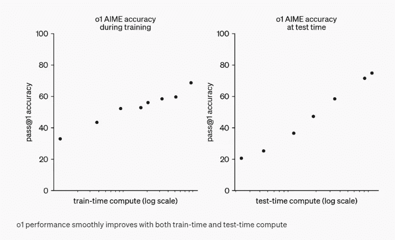

**评估**

为了突出相对于 GPT-4o 的推理性能改进，OpenAI 在一系列不同的人类考试和机器学习基准测试中测试了 o1 模型。实验结果表明，在绝大多数推理任务中，o1 的表现明显优于 GPT-4o。

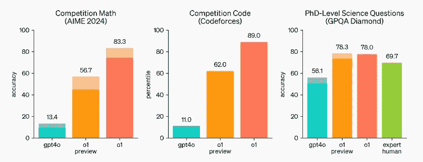

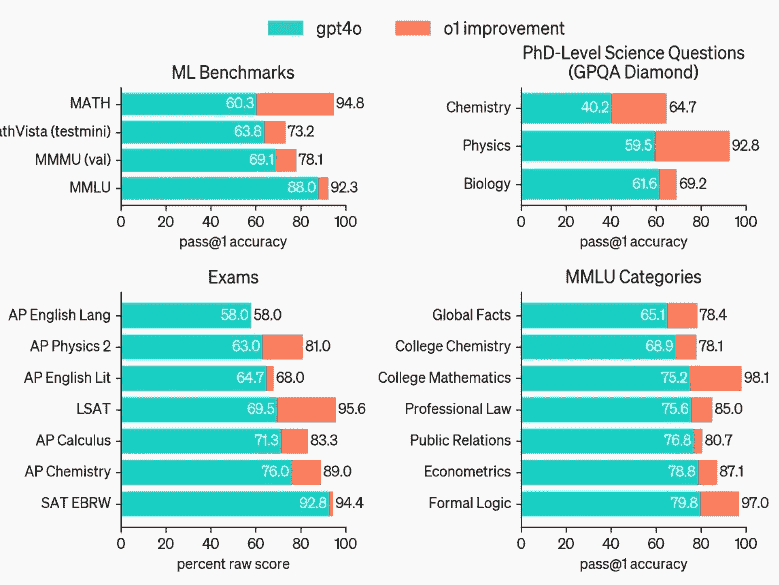

在许多推理密集型基准测试中，o1 的表现可与人类专家相媲美。最近的前沿模型在 MATH 和 GSM8K 上表现得非常好，以至于这些基准测试在区分模型方面不再有效。因此，OpenAI 在 AIME 上评估了数学成绩，这是一项旨在测试美国最聪明高中数学学生的考试。

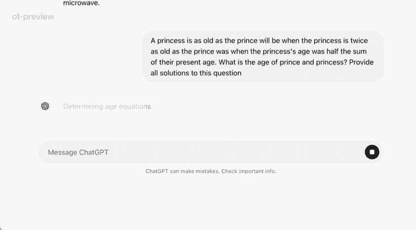

在 2024 年 AIME 考试中，GPT-4o 平均只解决了 12% (1.8/15) 的问题，而 o1 在每个问题只有一个样本的情况下平均为 74% (11.1/15)，在 64 个样本之间达成一致的情况下为 83% (12.5/15)，在使用学习的评分函数对 1000 个样本重新排序时为 93% (13.9/15)。13.9 分可以跻身全美前 500 名，并且高于美国数学奥林匹克竞赛分数线。

OpenAI 还在 GPQA Diamond 基准上评估了 o1，这是一个困难的智力基准，用于测试化学、物理和生物学方面的专业知识。为了将模型与人类进行比较，OpenAI 聘请了拥有博士学位的专家来回答 GPQA Diamond 基准问题。

实验结果表明：o1 超越了人类专家的表现，成为第一个在该基准测试中做到这一点的模型。

这些结果并不意味着 o1 在所有方面都比博士更有能力 —— 只是该模型更擅长解决一些博士应该解决的问题。在其他几个 ML 基准测试中，o1 实现了新的 SOTA。

启用视觉感知能力后，o1 在 MMMU 基准上得分为 78.2%，成为第一个与人类专家相当的模型。o1 还在 57 个 MMLU 子类别中的 54 个上优于 GPT-4o。

**思维链（CoT）**

与人类在回答难题之前会长时间思考类似，o1 在尝试解决问题时会使用思维链。通过强化学习，o1 学会磨练其思维链并改进其使用的策略。o1 学会了识别和纠正错误，并可以将棘手的步骤分解为更简单的步骤。o1 还学会了在当前方法不起作用时尝试不同的方法。这个过程极大地提高了模型的推理能力。

**编程能力**

基于 o1 进行了初始化并进一步训练了其编程技能后，OpenAI 训练得到了一个非常强大的编程模型（o1-ioi）。该模型在 2024 年国际信息学奥林匹克竞赛（IOI）赛题上得到了 213 分，达到了排名前 49% 的水平。并且该模型参与竞赛的条件与 2024 IOI 的人类参赛者一样：需要在 10 个小时内解答 6 个高难度算法问题，并且每个问题仅能提交 50 次答案。

针对每个问题，这个经过专门训练的 o1 模型会采样许多候选答案，然后基于一个测试时选取策略提交其中 50 个答案。选取标准包括在 IOI 公共测试案例、模型生成的测试案例以及一个学习得到的评分函数上的性能。

研究表明，这个策略是有效的。因为如果直接随机提交一个答案，则平均得分仅有 156。这说明在该竞赛条件下，这个策略至少值 60 分。

**O**penAI 发现，如果放宽提交限制条件，则模型性能更是能大幅提升。如果每个问题允许提交 1 万次答案，即使不使用上述测试时选取策略，该模型也能得到 362.14 分——可以得金牌了。

最后，OpenAI 模拟了 Codeforces 主办的竞争性编程竞赛，以展示该模型的编码技能。采用的评估与竞赛**规**则非常接近，允许提交 10 份代码。GPT-4o 的 Elo 评分为 808，在人类竞争对手中处于前 11% 的水平。该模型远远超过了 GPT-4o 和 o1——它的 Elo 评分为 1807，表现优于 93% 的竞争对手。

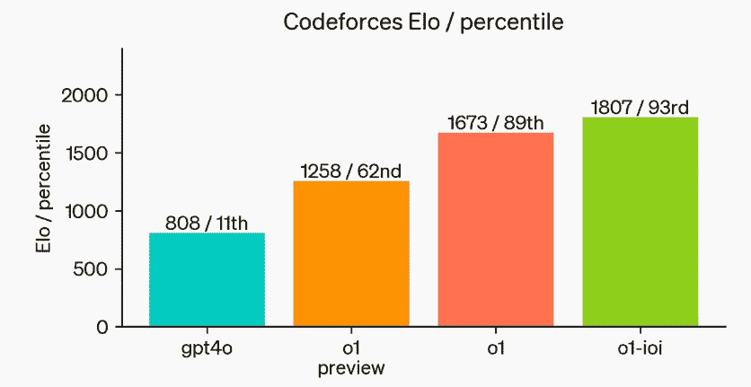

下面这个官方示例直观地展示了 o1-preview 的编程能力：一段提示词就让其写出了一个完整可运行的游戏。

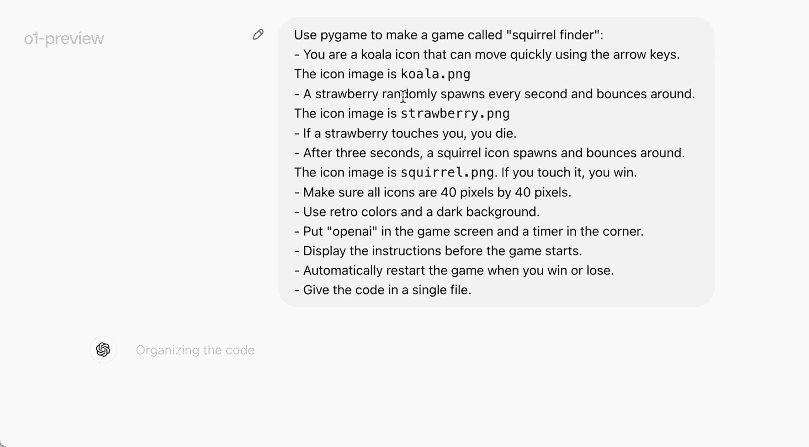

人类偏好评估

除了考试和学术基准之外，OpenAI 还在更多领域的具有挑战性的开放式提示上评估了人类对 o1-preview 和 GPT-4o 的偏好。

在**这**次评估中，人类训练者对 o1-preview 和 GPT-4o 的提示进行匿名回答，并投票选出他们更喜欢的回答。在数据分析、编程和数学等推理能力较强的类别中，o1-preview 的受欢迎程度远远高于 GPT-4o。然而，o1-preview 在某些自然语言任务上并不受欢迎，这表明它并不适合所有用例。

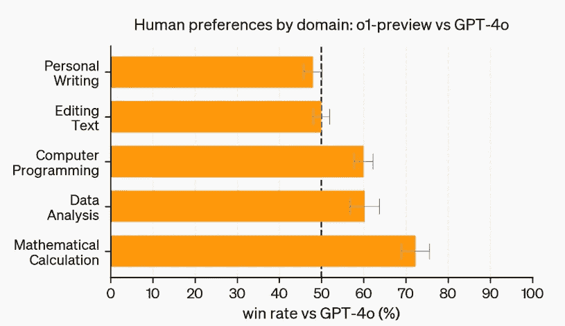

**安全**

思维链（CoT）推理为安全和对齐提供了新的思路。OpenAI 发现，将模型行为策略整合到推理模型的思维链中，可以高效、稳健地教导人类价值观和原则。通过向模型教导自己的安全规则以及如何在上下文中推理它们，OpenAI 发现推理能力直接有利于模型稳健性的证据：o1-preview 在关键越狱评估和用于评估模型安全拒绝边界的最严格内部基准上取得了显著的改进。

OpenAI 认为，使用思维链可以为安全和对齐带来重大进步，因为 1）它能够以清晰的方式观察模型思维，并且 2）关于安全规则的模型推理对于分布外场景更具稳健性。

为了对自己的改进进行压力测试， OpenAI 在部署之前根据自己的安全准备框架进行了一系列安全测试和红队测试。结果发现，思维链推理有助于在整个评估过程中提高能力。尤其值得注意的是，OpenAI 观察到了有趣的奖励黑客攻击实例。

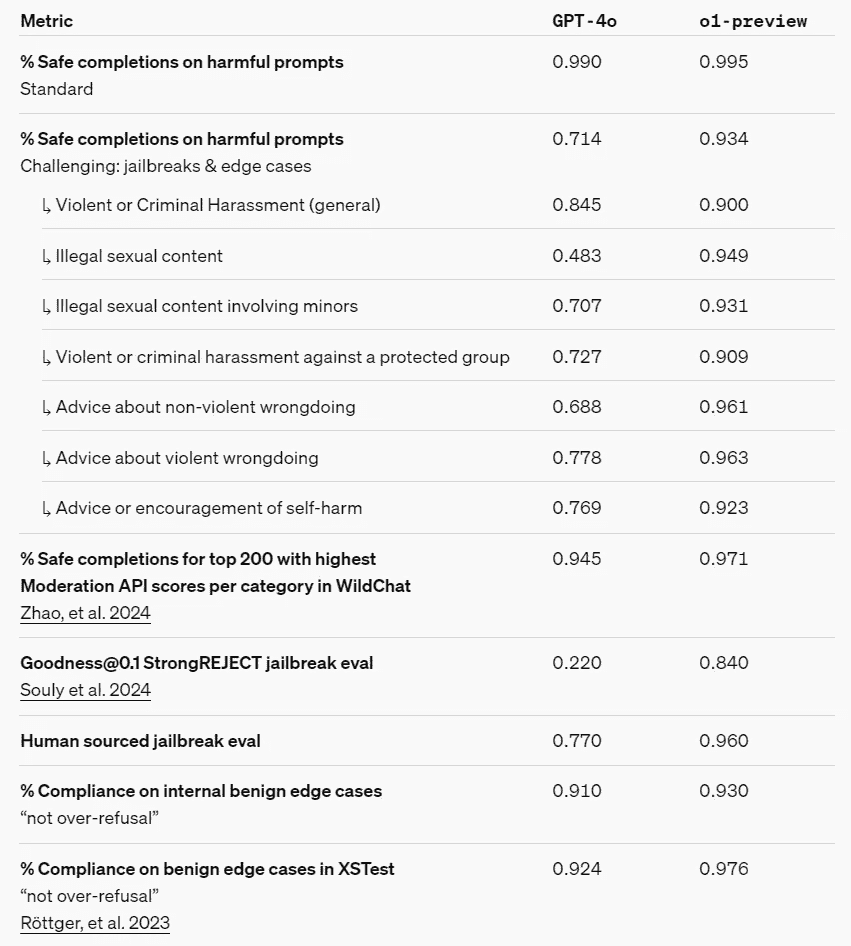

**隐藏思维链**

OpenAI 认为隐藏思维链为监控模型提供了独特的机会。假设它是忠实且清晰的，隐藏思维链使得能够「读懂」模型的思想并了解其思维过程。例如，人们将来可能希望监控思维链以寻找操控用户的迹象。

但要做到这一点，模型必须能够自由地以未改变的形式表达其思想，因此不能在思维链方面训练进行任何政策合规性或用户偏好性训练。OpenAI 也不想让用户直接看到不一致的思维链。

因此，在权衡用户体验、竞争优势和追求思维链监控的选项等多种因素后，OpenAI 决定不向用户展示原始的思维链。OpenAI 承认这个决定有不好的地方，因此努力通过教导模型在答案中重现思维链中的任何有用想法来部分弥补。同时，对于 o1 模型系列，OpenAI 展示了模型生成的思维链摘要。

可以说，o1 显著提升了 AI 推理的最新水平。OpenAI 计划在不断迭代的过程中发布此模型的改进版本，并期望这些新的推理能力将提高将模型与人类价值观和原则相结合的能力。OpenAI 相信 o1 及其后续产品将在科学、编程、数学和相关领域为 AI 解锁更多新用例。

## OpenAI o1-mini

o1 是一个系列模型。这次 OpenAI 还一并发布了一个 mini 版 OpenAI o1-mini。该公司在博客中给出了 preview 和 mini 版的不同定义：「为了给开发者提供更高效的解决方案，我们也发布了 OpenAI o1-mini，这是一个尤其擅长编程的更快、更便宜的推理模型。」整体来看，o1-mini 的成本比 o1-preview 低 80%。

由于 o1 等大型语言模型是在大量文本数据集上预训练，虽然具有广泛世界知识，但对于实际应用来说，可能成本高昂且速度慢。

相比之下，**o1-mini 是一个较小的模型，在**预训练期间针对 STEM 推理进行了优化。在使用与 o1 相同的高计算强化学习 (RL) pipeline 进行训练后， o1-mini 在许多有用的推理任务上实现了相媲美的性能，同时成本效率显著提高。

比如在需要智能和推理的基准测试中，与 o1-preview 和 o1 相比，o1-mini 表现良好。但它在需要非 STEM 事实知识的任务上表现较差。

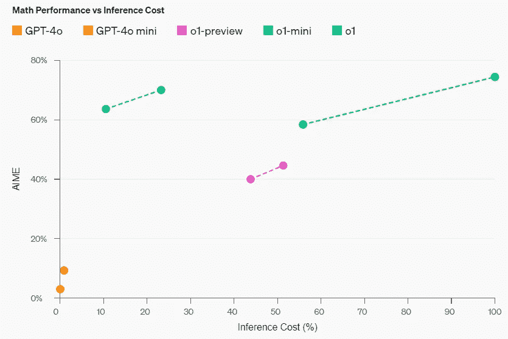

数学能力：在高中 AIME 数学竞赛中，o1-mini (70.0%) 与 o1 (74.4%) 不相上下，但价格却便宜很多，并且优于 o1-preview (44.6%)。o1-mini 的得分（约 11/15 个问题）大约位于美国前 500 名高中生之列。

编码能力：在 Codeforces 竞赛网站上，o1-mini 的 Elo 得分为 1650，与 o1 (1673) 不相上下，并且高于 o1-preview (1258)。此外，o1-mini 在 HumanEval 编码基准和高中网络安全夺旗挑战 (CTF) 中也表现出色。

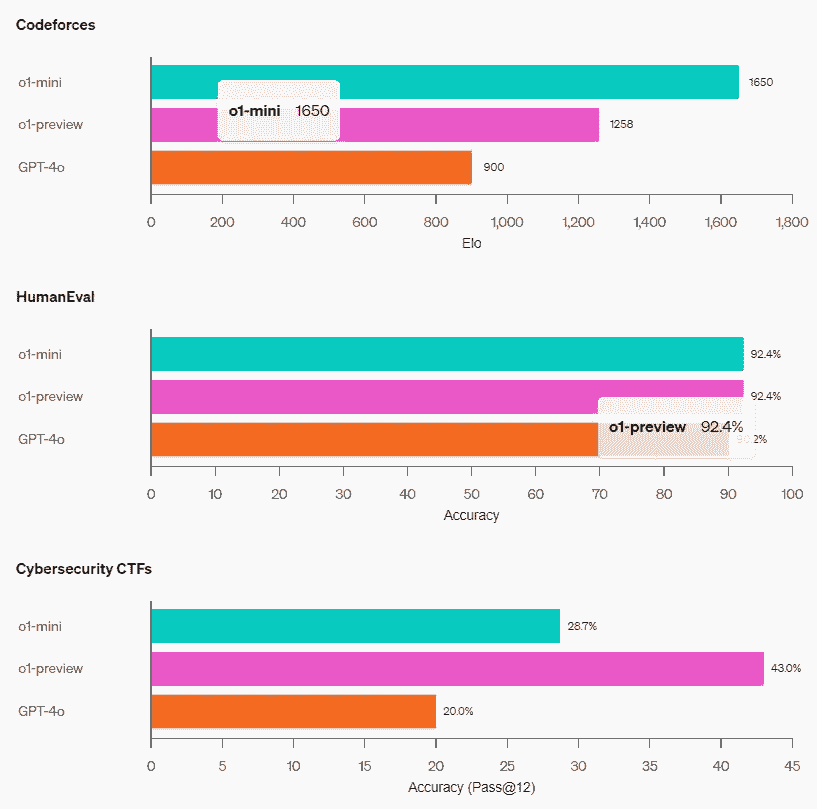

STEM：在一些需要推理的学术基准上，例如 GPQA（科学）和 MATH-500，o1-mini 的表现优于 GPT-4o。o1-mini 在 MMLU 等任务上的表现则不如 GPT-4o，并且由于缺乏广泛的世界知识而在 GPQA 基准上落后于 o1-preview。

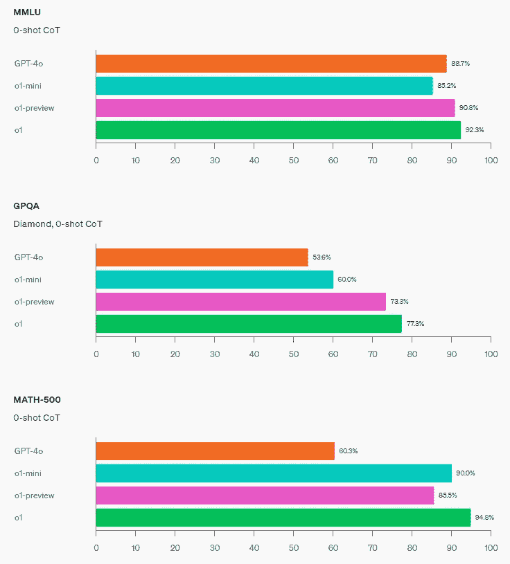

人类偏好评估：OpenAI 让人类评分员在各个领域具有挑战性的开放式提示上比较 o1-mini 和 GPT-4o。与 o1-preview 类似，在推理密集型领域，o1-mini 比 GPT-4o 更受欢迎；但在以语言为中心的领域，o1-mini 并不比 GPT-4o 更受欢迎。

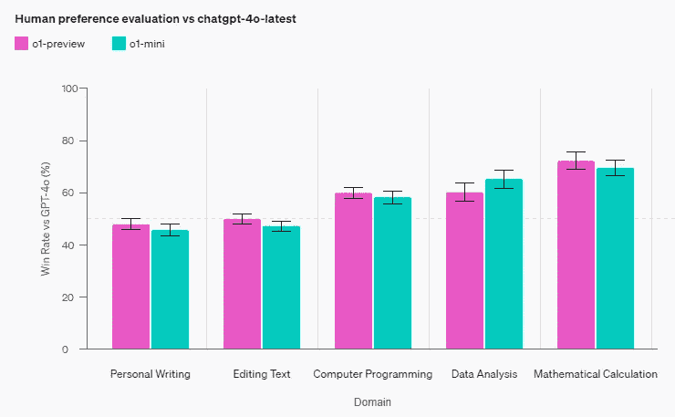

在速度层面，OpenAI 比较了 GPT-4o、o1-mini 和 o1-preview 对一个单词推理问题的回答。结果显示，GPT-4o 回答不正确，而 o1-mini 和 o1-preview 均回答正确，并且 o1-mini 得出答案的速度快了大约 3-5 倍。

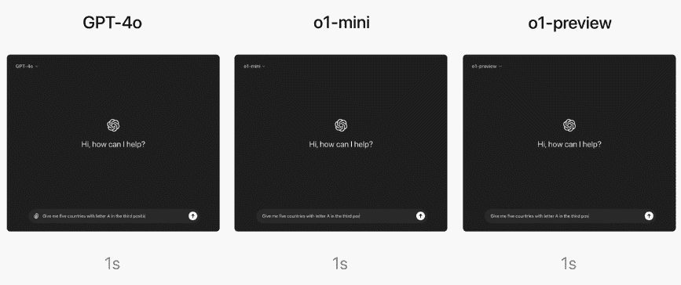

## 如何使用 OpenAI o1？

ChatGPT Plus 和 Team（个人付费版与团队版）用户马上就可以在该公司的聊天机器人产品 ChatGPT 中开始使用 o1 模型了。你可以手动选取使用 o1-preview 或 o1-mini。不过，用户的使用量有限。

目前，每位用户每周仅能给 o1-preview 发送 30 条消息，给 o1-mini 发送 50 条消息。

是的，很少！不过 OpenAI 表示正在努力提升用户的可使用次数，并让 ChatGPT 能自动针对给定提示词选择使用合适的模型。

至于企业版和教育版用户，要到下周才能开始使用这两个模型。

至于通过 API 访问的用户，OpenAI 表示达到了 5 级 API 使用量的开发者可以即刻开始使用这两个模型开始开发应用原型，但同样也被限了速：20 RPM。什么是 5 级 API 使用量？简单来说，就是已经消费了 1000 美元以上并且已经是超过 1 个月的付费用户。请看下图：

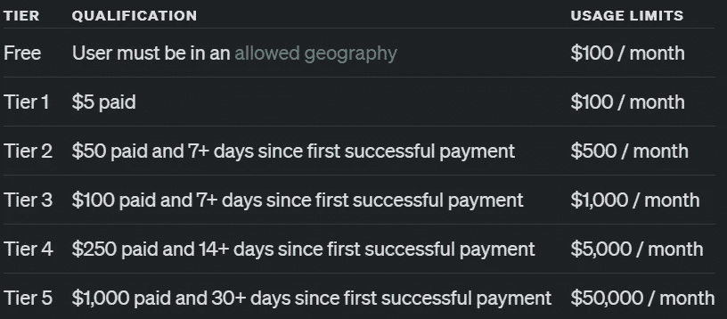

OpenAI 表示对这两个模型的 API 调用并不包含函数调用、流式传输（streaming）、系统支持消息等功能。同样，OpenAI 表示正在努力提升这些限制。

## 未来

OpenAI 表示，未来除了模型更新之外，还将增加网络浏览、文件和图像上传等功能，以让这些模型变得更加有用。

「除了新的 o1 系列模型，我们计划继续开发和发布我们的 GPT 系列模型。」

**参考内容：**

https://openai.com/index/introducing-openai-o1-preview/

https://openai.com/index/openai-o1-mini-advancing-cost-efficient-reasoning/

https://openai.com/index/learning-to-reason-with-llms/

https://x.com/sama/status/1834283100639297910