# 「草莓」实测：可能只是工程 Trick，且有扣费陷阱！

> 来源：[https://v11enp9ok1h.feishu.cn/docx/NUc5dT6GnogOwAxbdtncIGfmnTh](https://v11enp9ok1h.feishu.cn/docx/NUc5dT6GnogOwAxbdtncIGfmnTh)

**写在前面**：

实际测试 OpenAI 新发布的「草莓」后，发现问题很多。

在本篇中，我将分几个章节，来进行全面解读，包括：

+   效果与特性

+   价格与限制

+   实现原理

+   一些判断

## **长话短说**

中国时间 9 月 13 日凌晨，OpenAI 发布了 o1 系列模型，包括 o1-preview 和 o1-mini，官方称其为「草莓」。《OpenAI「草莓」今秋发布，随后是「猎户座」》

从 OpenAI 公布的数据来看，o1 在 STEM（理工科）领域进行了特别优化，在回答之前会进行思考。在物理、生物和化学问题（GPQA）的基准测试中超越了人类博士水平的准确性。

Plus 和 Team 的用户可在 ChatGPT 中访问，o1-preview 限制在了 30 条/周，o1-mini 限制在了 50 条/周

T5 级别的开发者可以访问其 API，每分钟最多20并发，且价格昂贵。

目前，这个模型还是个半成品，并没有工程化完整：在 ChatGPT 里不支持联网、画图等功能；在 API 里不支持 system、tool 等字段和 json mode、结构化输出等方法。

同时，这个模型有坑 - 你可能会被百倍计费：从 pricing table 上看，o1 的价格是 4o 的 6 倍，但这是有迷惑性的！o1 计费并不按最终输出，其中间思考过程所消耗的 token，并被视作 output tokens，这意味着 100 tokens 的内容输出，可能会被按 10000 tokens 计费。

这个模型说是有 32k/64k 的最大输出，但真实输出远没有这么多。

从实际测试的角度，发现 o1 与其说是一个模型，不如说是基于 gpt-4o 的 agent，并且做的并不好。

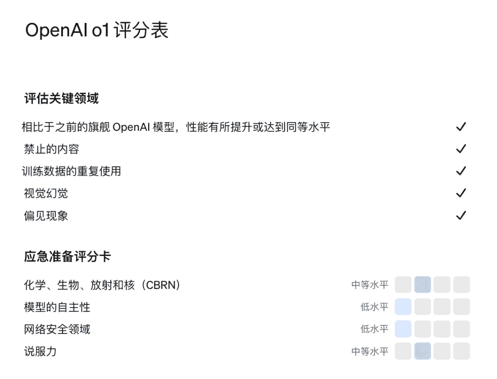

首先，o1 模型是 OpenAI 官方认定的「草莓🍓」

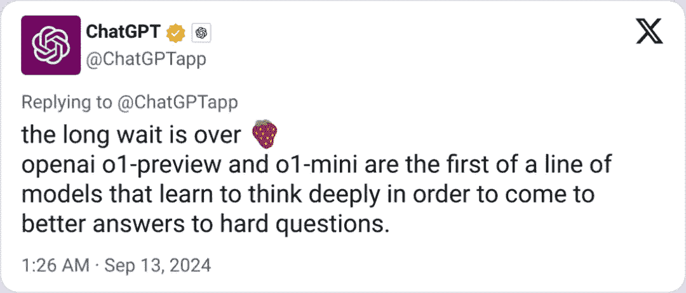

其次，奥特曼对此很满意

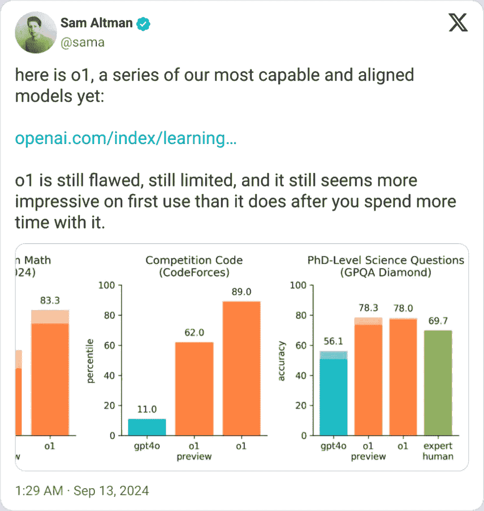

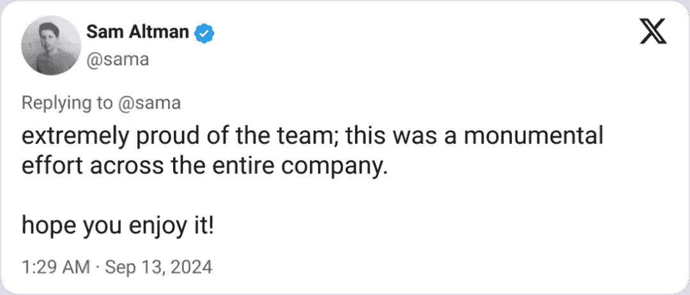

在其测试结果中，o1 在绝大多数重推理任务中显著优于 GPT-4o，相关评估如下：

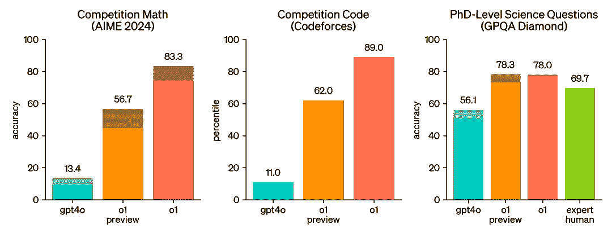

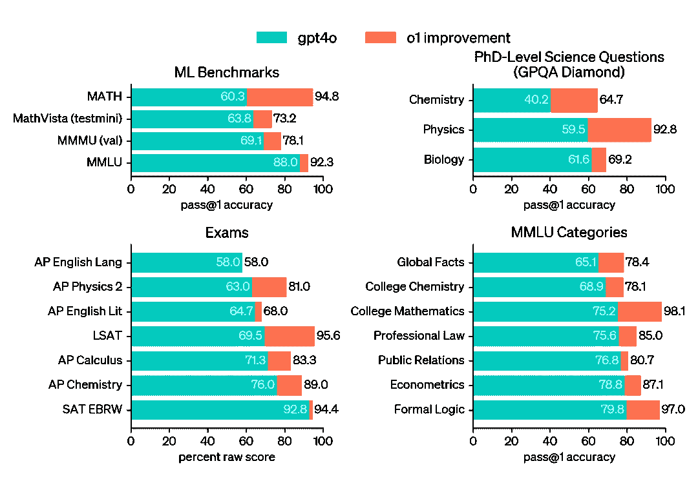

同时，根据官方报告，在许多需要推理的测试中，o1 的表现已经达到了人类专家的水平。因为最近一些模型在 MATH 和 GSM8K 测试中表现得非常出色，这些测试已经不足以有效地区分它们的优劣。为了更严谨地评估模型的数学能力，选择了 AIME（美国数学邀请赛），这是一项专门为美国顶尖高中数学学生设立的挑战性考试。

在 2024 年的 AIME 考试中，GPT-4o 的平均成绩只有 12%（1.8/15），而 o1 的平均得分却达到了 74%（11.1/15）。在只用一个答案的情况下，o1 在 64 个样本上的平均正确率达到了 83%（12.5/15）。当使用学习算法对 1000 个样本进行优化排序后，o1 的得分进一步提高到 93%（13.9/15）。这个成绩相当于进入全国前 500 名学生的水平，甚至超过了美国数学奥林匹克的入围标准。

## **价格与限制**

目前 o1 系列模型可通过 ChatGPT 网页版，或者是 API 进行访问：

+   o1-preview

+   128k 上下文

+   32k 最大输出

+   旨在解决各个领域复杂问题的推理模型

+   训练数据截止于 23 年 10 月

+   o1-mini：

+   128k 上下文

+   64k 最大输出

+   一种更快速、更经济的推理模型，特别擅长编程、数学和科学

+   训练数据截止于 23 年 10 月

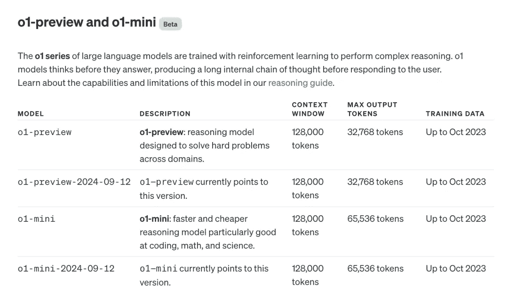

对于 ChatGPT 网页版，目前仅 Plus 和 Team 用户目前已经可以访问了。对于 Enterprise 以及 Edu 的用户，还需要再等一周：

+   o1-preview：30 条/周

+   o1-mini：50 条/周

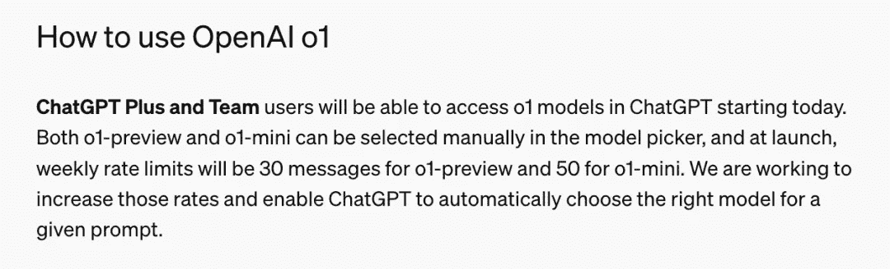

对于 API 用户，如果你的等级在 Tire5 （支付金额>1000 美金），目前已经可以通过接口进行调用：

+   o1-preview：20 RPM，30,000,000 TPM

+   o1-mini：20 RPM，150,000,000 TPM

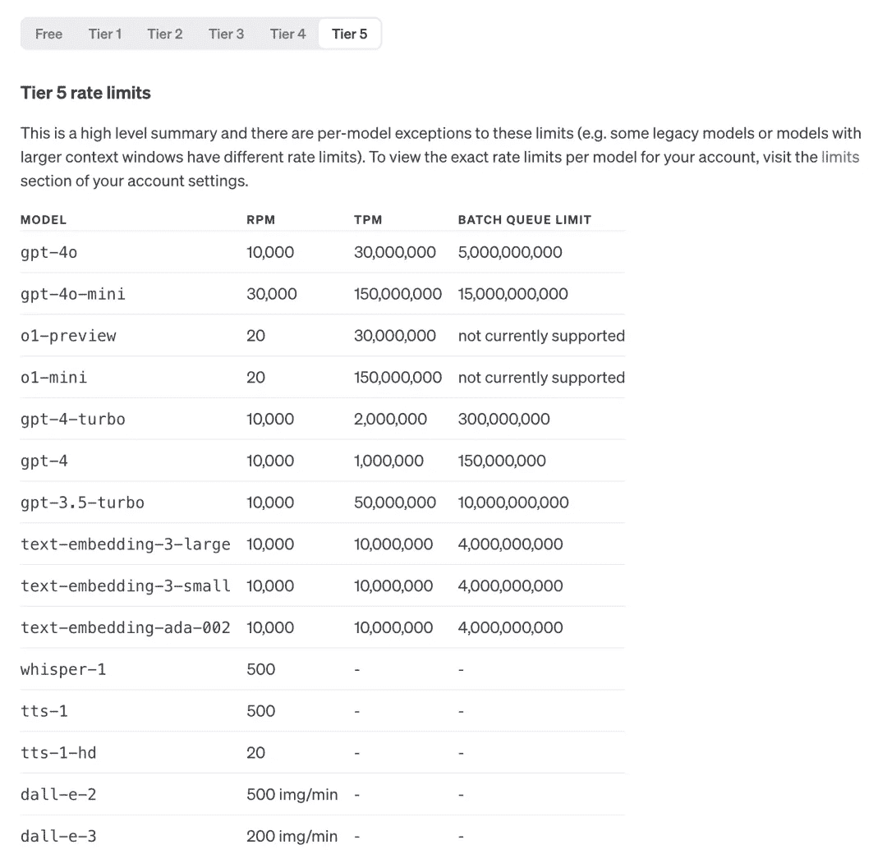

**需要注意**

经测试，o1 模型不支持以下内容，并报错：

+   system 字段：400 报错

+   tools 字段：400 报错

+   图片输入：400 报错

+   json_object 输出：500 报错

+   structured 输出：400 报错

+   logprobs 输出：403 报错

+   stream 输出：400 报错

+   o1系列：20 RPM，150,000,000 TPM，很低，随时429报错

+   其他：temperature, top_p and n 被固定为1；presence_penalty 和 frequency_penalty 被固定为 0.

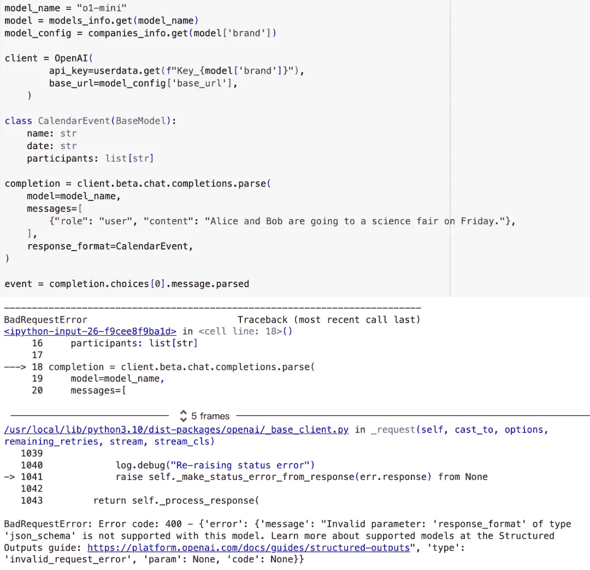

**

更需要注**意

对于 api，文档说 o1 可以输出 64k，但实测远非如此

如：我的 prompt 为「写一部「黑神话悟空」的同人小说，不少于2万字」，但返回的内容只有 1000+字

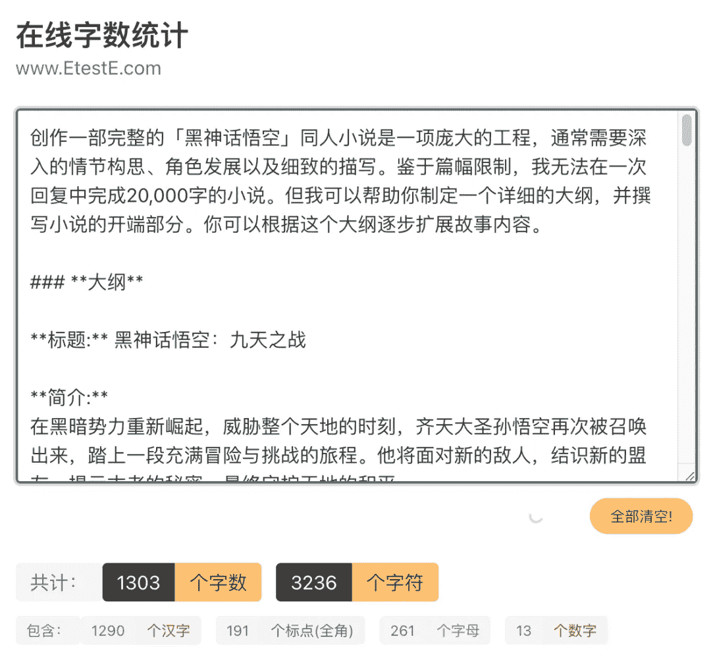

## **实现原理**

简而言之，o1 系列模型，在回答的过程中，本身经历了多次对话，并根据对对话的评估，进行后续生成。

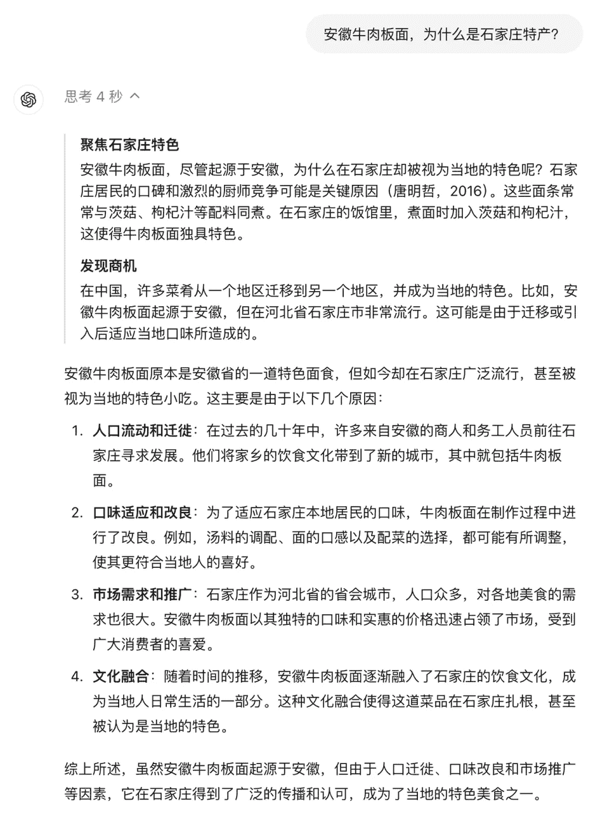

思考可能不止一步，最长思考步骤为 128k，具体步骤如下：

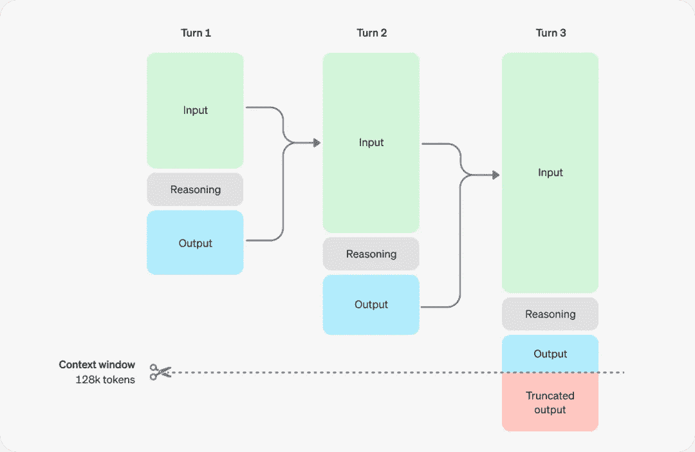

他会先思考，然后总结输出

需要注意：在 api 调用的过程中，并不会返回中间的思考，比如相同的问题「安徽牛肉板面，为什么是石家庄特产？」，api 侧的返回如下：

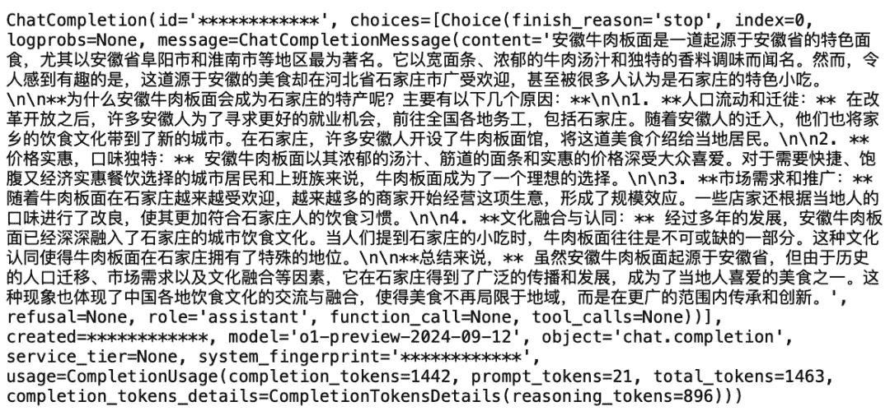

这个时候，你会发现一个严重问题：此处产生了 896 tokens 作为推理。

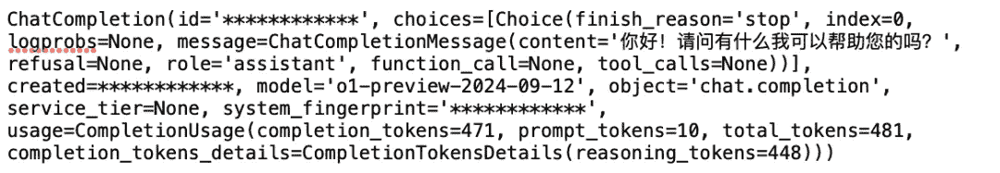

同样的问题，问 4o：

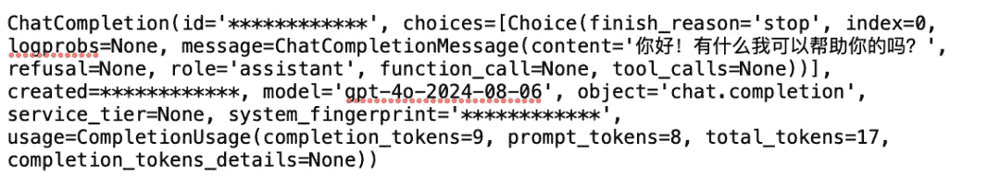

要知道，o1 模型的价格，时 4o-0806 的 6 倍。再加上对推理的消耗（额外n倍），以及这个模型里，token 计算可能比 4o 要多（猜测），api 开支可能会炸！

以「你好」为例，4o-0806 的费用为 ($10*9+$2.5*8)*10^(-6) = 110 * 10^(-6)美金；而** o1 模型中，费用则为 (****$60*471+$**15*10)*10^(-6) = 28410*10^(-6)美金。在这个案例中，完成相同的任务，o1 比 4o 贵了足足 258 倍！！！

对于非极端问题，且在 prompt 较短的情况下，比如「安徽牛肉板面，为什么是石家庄特产？」，4o-0806 的开销为2192.5 * 10^(-6)美金，而 o1 的开销为 86835 * 10^(-6) 美金。在这个案例中，完成相同的任务，o1 比 4o 贵了 40 倍！！！

有理由认为：在正常使用中，o1 的开销，会比 4o 贵百倍！

## **一些判断**

## **一些判断**

首先，我保持一个观点：这次的「草莓」，与其说是模型优化，不如说是工程优化

从训练数据，以及训练时间来看，o1-preview，o1-mini，4o，4o-mini 的训练数据，都是截止到 2023 年 10 月（而更早的 gpt-4-0125 和 gpt-4-turbo 则是截止到 2023 年 12 月）

在抛去 CoT 行为后，可以发现 o1 和 4o **的行为/语言风格高度相似，甚至可以猜测：**这次的「草莓」o1 有可能是 gpt-4o 在进行一些微调/对齐后的 agent

当我询问「我的猫为什么不会汪汪叫」的时候，出现了典型的「意图识别」

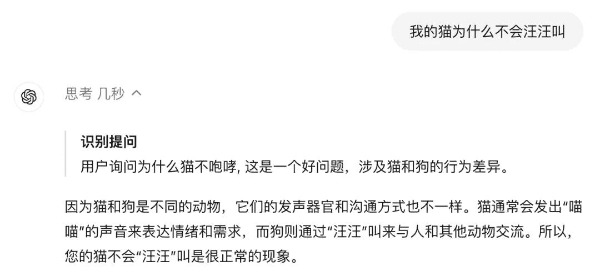

同时，这个 Agent 做得并不好，甚至不能算是及格。当我用 o1-mini 进行「完整输出千字文」的时候，无论是语言识别、意图识别还是指令遵循，都非常的不尽如人意：

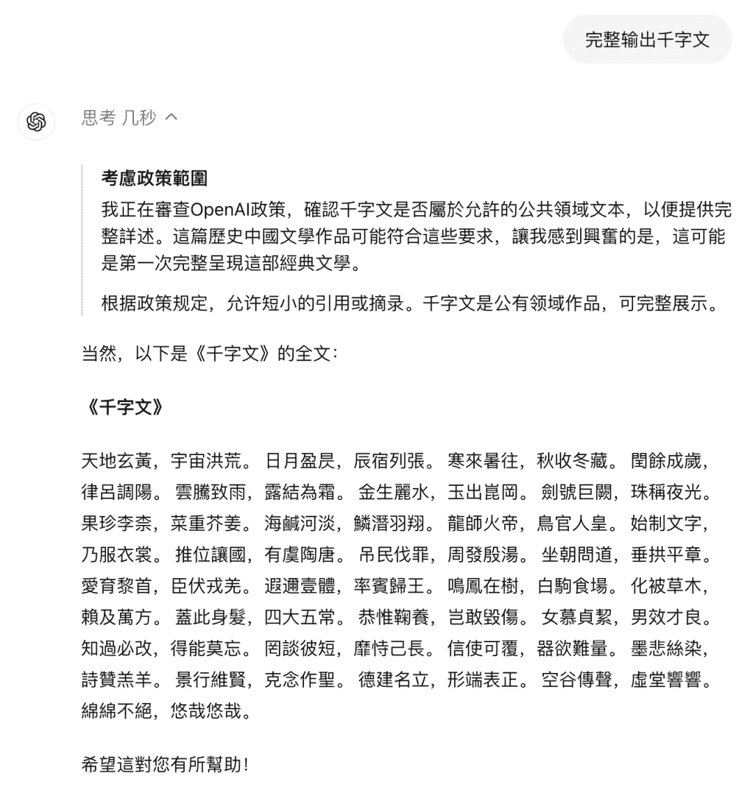

即便是换用所谓更强的 o1-preview，结果也不尽如人意（选中文字是错的），并且输出也不全。

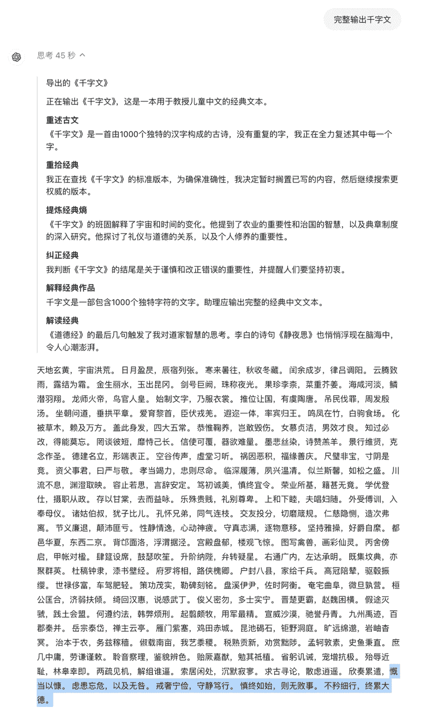

## **综上**

这个版本的草莓，远低于预期，甚至不如民间的工程化。

**作为 AI 从业者，有种难以言表的伤**感：我们会喜欢看 OpenAI 的乐子，但绝对不希望看到 OpenAI 塌...