# OPENAI新模型9.12发布：OpenAI o1-Jake整理

> 来源：[https://v11enp9ok1h.feishu.cn/docx/U9hPdoiCToVOXox9GQ4cbaQynug](https://v11enp9ok1h.feishu.cn/docx/U9hPdoiCToVOXox9GQ4cbaQynug)

> 开放编辑权限，欢迎大家补充观点和案例在结尾

## 模型发布

### 官方发布地址

> `https://openai.com/o1/`

### 模型亮点

1. 更聪明的思考方式：这些模型像人一样，会花更多时间思考问题，尝试不同的策略，甚至能意识到自己的错误。
2. 在复杂任务上表现出色：在物理、化学、生物、数学和编程等领域的挑战性任务上，新模型表现得像博士生一样好，甚至在 IMO 和 Codeforces 竞赛中取得了高分。
3. 暂时缺少一些功能：虽然目前还没有 ChatGPT 那样的网络浏览和文件上传功能，但在复杂推理任务上，OpenAI O1 已经非常强大了。
4. AI 能力的新高度：这个新系列代表了 AI 能力的一个新水平，所以我们把它命名为 OpenAI O1。

> 背后的原理：

> 建议听一下这期播客：

> [73.AGI范式大转移:和广密预言草莓、0penAl o1和s elf-play RL|全球大模型季报4](https://www.xiaoyuzhoufm.com/episode/66d866f0f39a2201c069dccb?s=eyJ1IjogIjYyZmQxMzE4ZWRjZTY3MTA0YTU1ZTk4OSJ9)

## 全量发放可测试使用


## OpenAI o1 发布

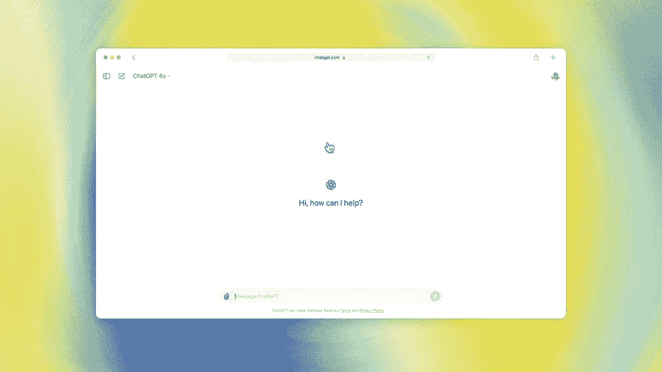

[OpenAI o1 Hub OpenAI.mp4](https://internal-api-drive-stream.feishu.cn/space/api/box/stream/download/all/QWV4bkl6OorbhaxsL7RcPY8enlb)

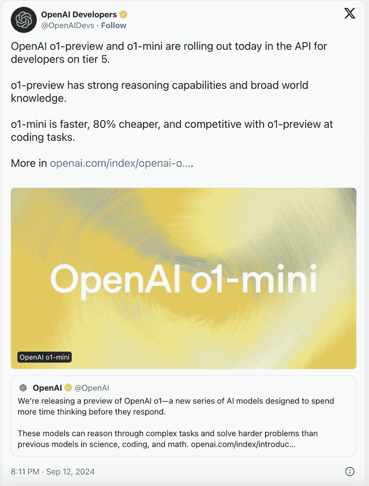

## OpenAI o1-preview

We've developed a new series of AI models designed to spend more time thinking before they respond. They can reason through complex tasks and solve harder problems than previous models in science, coding, and math.

我们开发了一系列新的 AI 模型，旨在花更多时间思考，然后再做出响应。他们可以推理完成复杂的任务并解决比以前的科学、编码和数学模型更难的问题。

[Today, we are releasing](https://openai.com/index/learning-to-reason-with-llms/) the first of this series in ChatGPT and our API. This is a preview and we expect regular updates and improvements. Alongside this release, we’re also including evaluations for the next update, currently in development.

今天，我们发布了 ChatGPT 和我们的 API 中该系列的第一个。这是一个预览，我们期待定期更新和改进。除了此版本，我们还包括对下一次更新的评估，目前正在开发中。

### How it works 运作方式

We trained these models to spend more time thinking through problems before they respond, much like a person would. Through training, they learn to refine their thinking process, try different strategies, and recognize their mistakes.

我们训练这些模型在问题做出响应之前花更多时间思考问题，就像一个人一样。通过培训，他们学会完善自己的思维过程，尝试不同的策略，并认识到自己的错误。

In our tests, the next model update performs similarly to PhD students on challenging benchmark tasks in physics, chemistry, and biology. We also found that it excels in math and coding. In a qualifying exam for the International Mathematics Olympiad (IMO), `GPT-4o` correctly solved only 13% of problems, while the reasoning model scored 83%. Their coding abilities were evaluated in contests and reached the 89th percentile in Codeforces competitions. You can read more about this in our technical research post.

在我们的测试中，下一次模型更新的性能类似于博士生在物理、化学和生物学中具有挑战性的基准任务。我们还发现它在数学和编码方面表现出色。在国际数学奥林匹克竞赛（IMO）的资格考试中，`GPT-4o` 仅正确解决了 13% 的问题，而推理模型得分为 83%。他们的编码能力在比赛中得到了评估，并在 Codeforces 比赛中达到了第 89 个百分位。您可以在我们的技术研究帖子中阅读更多相关信息。

As an early model, it doesn't yet have many of the features that make ChatGPT useful, like browsing the web for information and uploading files and images. For many common cases `GPT-4o` will be more capable in the near term.

作为早期模型，它还不具备使 ChatGPT 有用的许多功能，例如浏览网页以获取信息以及上传文件和图像。对于许多常见情况，`GPT-4o` 在短期内会更有能力。

But for complex reasoning tasks this is a significant advancement and represents a new level of AI capability. Given this, we are resetting the counter back to 1 and naming this series `OpenAI o1`.

但对于复杂的推理任务来说，这是一个重大进步，代表了 AI 能力的新水平。鉴于此，我们将计数器重置回 1 并将此系列命名为 `OpenAI o1`。

### Safety 安全

As part of developing these new models, we have come up with a new safety training approach that harnesses their reasoning capabilities to make them adhere to safety and alignment guidelines. By being able to reason about our safety rules in context, it can apply them more effectively.

作为开发这些新模型的一部分，我们提出了一种新的安全培训方法，该方法利用他们的推理能力使他们遵守安全和对齐准则。通过能够在上下文中推理我们的安全规则，它可以更有效地应用它们。

One way [we measure safety](https://openai.com/index/openai-o1-system-card/) is [by testing how well](https://openai.com/index/learning-to-reason-with-llms/) our model continues to follow its safety rules if a user tries to bypass them (known as "jailbreaking"). On one of our hardest jailbreaking tests, `GPT-4o` scored 22 (on a scale of 0-100) while our `o1-preview` model scored 84. You can read more about this in the system card and our research post.

我们衡量安全性的一种方法是，在用户试图绕过安全规则（称为“越狱”）时，我们的模型继续遵守其安全规则的程度。在我们最难的越狱测试之一中，`GPT-4o` 得分为 22（0-100 分），而我们的 `o1-preview` 模型得分为 84。您可以在[系统卡](https://openai.com/index/openai-o1-system-card/)和[我们的研究帖子](https://openai.com/index/learning-to-reason-with-llms/)中阅读更多相关信息。

To [match the new capabilities](https://cdn.openai.com/openai-preparedness-framework-beta.pdf) of these models, we’ve bolstered our safety work, internal governance, and federal government collaboration. This includes rigorous testing and evaluations using our Preparedness Framework(opens in a new window), best-in-class red teaming, and board-level review processes, including by our Safety & Security Committee.

为了匹配这些模型的新功能，我们加强了安全工作、内部治理和联邦政府合作。这包括使用我们的准备框架进行严格的测试和评估，一流的红队，以及包括我们的安全与保障委员会在内的董事会级审查流程。

To advance our commitment to AI safety, we recently formalized agreements with the U.S. and U.K. AI Safety Institutes. We've begun operationalizing these agreements, including granting the institutes early access to a research version of this model. This was an important first step in our partnership, helping to establish a process for research, evaluation, and testing of future models prior to and following their public release.

为了推进我们对 AI 安全的承诺，我们最近与美国和英国 AI 安全研究所正式达成协议。我们已经开始实施这些协议，包括允许这些机构提前获得该模型的研究版本。这是我们合作中重要的第一步，有助于建立未来模型公开发布之前和之后的研究、评估和测试流程。

### Whom it’s for 适用对象

These enhanced reasoning capabilities may be particularly useful if you’re tackling complex problems in science, coding, math, and similar fields. For example, `o1` can be used by healthcare researchers to annotate cell sequencing data, by physicists to generate complicated mathematical formulas needed for quantum optics, and by developers in all fields to build and execute multi-step workflows.

如果您正在处理科学、编码、数学和类似领域的复杂问题，这些增强的推理功能可能特别有用。例如，医疗保健研究人员可以使用它来注释细胞测序数据，物理学家可以使用它来生成量子光学所需的复杂数学公式，所有领域的开发人员都可以使用它来构建和执行多步骤工作流程。

## OpenAI o1-mini OpenAI o1-迷你

The `o1` series excels at accurately generating and debugging complex code. To offer a more efficient solution for developers, we’re also releasing `OpenAI o1-mini`, a faster, cheaper reasoning model that is particularly effective at coding. As a smaller model, `o1-mini` is 80% cheaper than `o1-preview`, making it a powerful, cost-effective model for applications that require reasoning but not broad world knowledge.

`o1` 系列擅长准确生成和调试复杂代码。为了向开发人员提供更高效的解决方案，我们还发布了 `OpenAI o1-mini`，这是一种更快、更便宜的推理模型，在编码方面特别有效。作为较小的模型，`o1-mini` 比 `o1-preview` 便宜 80%，使其成为一个功能强大、经济高效的模型，适用于需要推理但不需要广泛世界知识的应用程序。

## How to use OpenAI o1 如何使用 OpenAI o1

`ChatGPT Plus` and `Team` users will be able to access `o1` models in ChatGPT starting today. Both `o1-preview` and `o1-mini` can be selected manually in the model picker, and at launch, weekly rate limits will be 30 messages for `o1-preview` and 50 for `o1-mini`. We are working to increase those rates and enable ChatGPT to automatically choose the right model for a given prompt.

从今天开始，`ChatGPT Plus` 和 `Team` 用户将能够访问 ChatGPT 中的 `o1` 模型。`o1-preview` 和 `o1-mini` 都可以在模型选取器中手动选择，在启动时，`o1-preview` 的每周速率限制为 30 条消息，`o1-mini` 的每周速率限制为 50 条消息。我们正在努力提高这些比率，并使 ChatGPT 能够自动为给定的提示选择正确的模型。

**[ChatGPT Enterprise and Edu users](https://platform.openai.com/docs/guides/rate-limits/usage-tiers)** will [get access to both](http://platform.openai.com/docs/guides/reasoning) models beginning next week.

从下周开始，ChatGPT Enterprise 和 Edu 用户将可以访问这两种模型。


Developers who qualify for API usage tier 5 (opens in a new window) can start prototyping with both models in the API today with a rate limit of 20 RPM. We’re working to increase these limits after additional testing. The API for these models currently doesn't include function calling, streaming, support for system messages, and other features. To get started, check out the API documentation (opens in a new window).

符合 API 使用层 5（在新窗口中打开）条件的开发人员现在可以在 API 中开始使用这两种模型进行原型设计，速率限制为 20 RPM。我们正在努力在进行额外测试后提高这些限制。这些模型的 API 目前不包括函数调用、流式处理、对系统消息的支持和其他功能。要开始使用，请查看 API 文档（在新窗口中打开）。

We are also planning to bring o1-mini access to all ChatGPT Free users.

我们还计划为所有 ChatGPT Free 用户提供 o1-mini 访问权限。

## What’s next 下一步

This is an early preview of these reasoning models in ChatGPT and the API. In addition to model updates, we expect to add browsing, file and image uploading, and other features to make them more useful to everyone.

这是 ChatGPT 和 API 中这些推理模型的早期预览。除了模型更新之外，我们还希望添加浏览、文件和图像上传以及其他功能，使其对每个人都更有用。

We also plan to continue developing and releasing models in our GPT series, in addition to the new OpenAI o1 series.

除了新的 OpenAI o1 系列之外，我们还计划继续开发和发布 GPT 系列中的模型。

## 官方视频集合

[Scott Wu_ OpenAI o1 & Coding_1080p.mp4](https://internal-api-drive-stream.feishu.cn/space/api/box/stream/download/all/HFDgb84AZonNUOxqPsScsBYknwd)


[Mario Krenn_ OpenAI o1 & Quantum Physics_1080p.mp4](https://internal-api-drive-stream.feishu.cn/space/api/box/stream/download/all/YYmnbHsy7oubfvxwy6EcyWtennd)

[Catherine Brownstein_ OpenAI o1 & Genetics_1080p.mp4](https://internal-api-drive-stream.feishu.cn/space/api/box/stream/download/all/T64jbyPuKoEKpYxVruJc2Do7n1c)

[Tyler Cowen_ OpenAI o1 & Economics_1080p.mp4](https://internal-api-drive-stream.feishu.cn/space/api/box/stream/download/all/OL1Mb7g8ZoOYyhxotY3cZC9Enze)

Game coding

Reasoning

[Video Game Coding with OpenAI o1_1080p.mp4](https://internal-api-drive-stream.feishu.cn/space/api/box/stream/download/all/ERvkbUhs5oPLv4xOpBLcMLienUe)

[Reasoning with OpenAI o1_1080p.mp4](https://internal-api-drive-stream.feishu.cn/space/api/box/stream/download/all/GBwJb4MvJoJEacxUncMcwQBpnBb)

Korean cipher

Math

[Korean Cipher with OpenAI o1_1080p.mp4](https://internal-api-drive-stream.feishu.cn/space/api/box/stream/download/all/S2QGbGaXToBnQExrrFqcOuY1n2c)

[Math with OpenAI o1_1080p.mp4](https://internal-api-drive-stream.feishu.cn/space/api/box/stream/download/all/W5KTbkjJyoTrQPx7Wloc5ufUnyd)

Counting:著名的草莓单词里面有几个 r

coding

[Counting with OpenAI o1_1080p.mp4](https://internal-api-drive-stream.feishu.cn/space/api/box/stream/download/all/TgT8bHpTJok87UxM0Brcoly6nFd)

[Coding with OpenAI o1_1080p.mp4](https://internal-api-drive-stream.feishu.cn/space/api/box/stream/download/all/LujJbnveRoemuFxjaEWcsFGVnTo)

HTML snake


[HTML Snake with OpenAI o1_1080p.mp4](https://internal-api-drive-stream.feishu.cn/space/api/box/stream/download/all/NvZnbPI3LoCEwHxi2IJc32aUn9D)

# OpenAI o1-mini

https://openai.com/index/openai-o1-mini-advancing-cost-efficient-reasoning/

## Optimized for STEM Reasoning

[o1-mini 擅长 STEM](https://openai.com/index/introducing-openai-o1-preview/)，尤其是数学和编码，几乎与 OpenAI o1 在 AIME 和 Codeforces 等评估基准上的性能相当。我们预计 o1-mini 将是一种更快、更具成本效益的模型，适用于需要推理但没有广泛知识的应用程序。

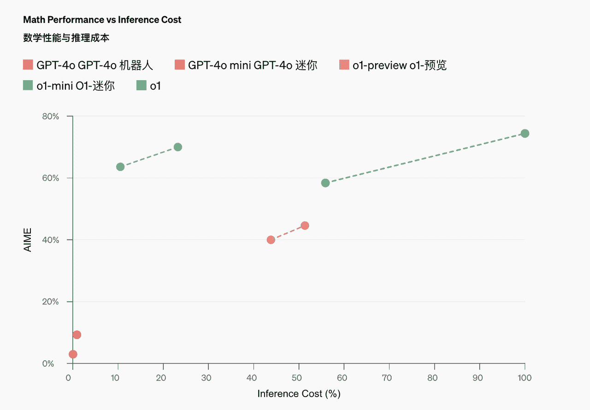

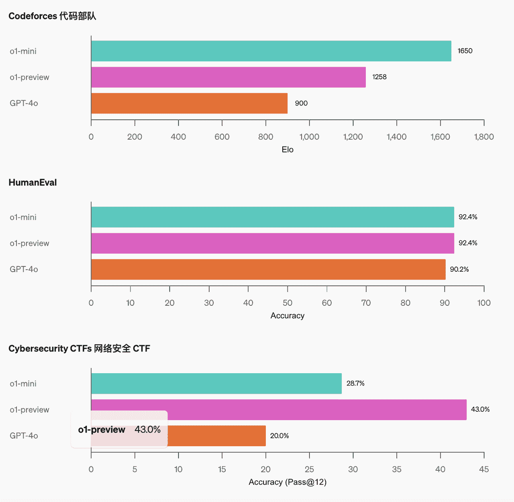

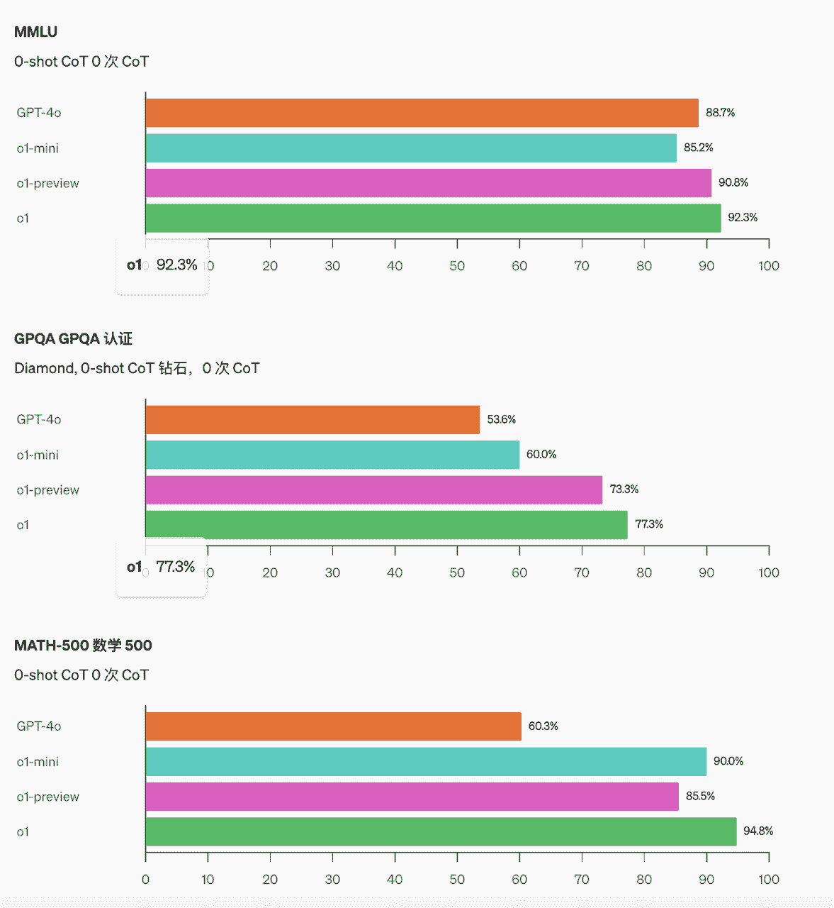

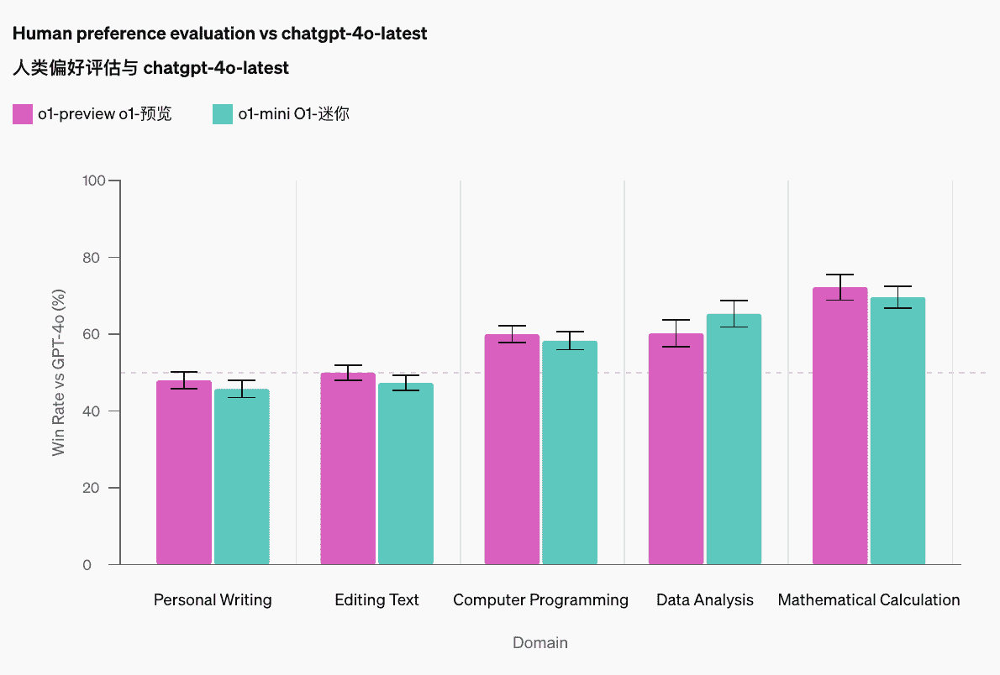

## 聊天速度对比

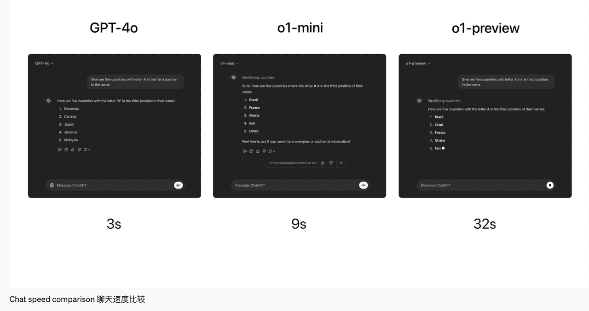

## 安全

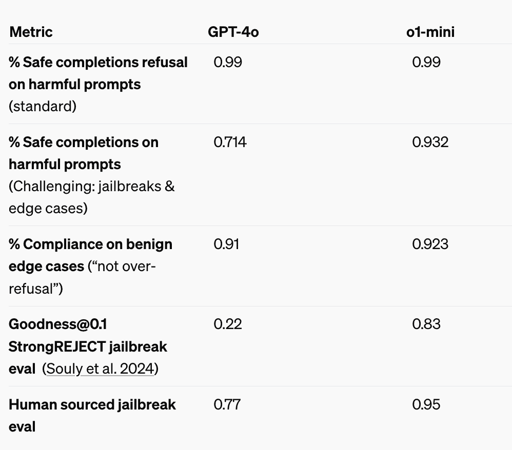

# O1论文：Learning to Reason with LLMs

原文链接如下：

https://openai.com/index/learning-to-reason-with-llms/

[与LLMs学习推理 _开放人工智能 --- Learning to Reason with LLMs _ OpenAI.pdf](https://internal-api-drive-stream.feishu.cn/space/api/box/stream/download/all/RCBYbxRxPogjHbxJFKicpG7ZnLb)

# OpenAI o1 Scorecard

https://openai.com/index/openai-o1-system-card/

```
Intr[oduction 介绍](https://openai.com/index/openai-o1-system-card/)
[We ](https://openai.com/index/openai-o1-system-card/)t[horo](https://openai.com/preparedness/)ughly evaluate new models for potential risks and build in appropriate safeguards before deploying them in ChatGPT or the API. We’re publishing the OpenAI o1 System Card together with the Preparedness Framework scorecard to provide a rigorous safety assessment of o1, including what we’ve done to address current safety challenges and frontier risks.
我们会彻底评估新模型的潜在风险，并在将它们部署到 ChatGPT 或 API 之前构建适当的保护措施。我们将 OpenAI o1 系统卡与准备框架记分卡一起发布，以提供对 o1 的严格安全评估，包括我们为应对当前安全挑战和前沿风险所做的工作。
Building on the safety evaluations and mitigations we developed for past models, we’ve focused additional efforts on o1's advanced reasoning capabilities. We used both public and internal evaluations to measure risks such as disallowed content, demographic fairness, hallucination tendency, and dangerous capabilities. Based on these evaluations, we’ve implemented safeguards at both the model and system levels, such as blocklists and safety classifiers, to mitigate these risks effectively.
基于我们为过去模型开发的安全评估和缓解措施，我们将更多精力集中在 o1 的高级推理功能上。我们使用公开和内部评估来衡量风险，例如不允许的内容、人口公平性、幻觉倾向和危险能力。根据这些评估，我们在模型和系统级别实施了保护措施，例如黑名单和安全分类器，以有效缓解这些风险。
Our findings indicate that o1's advanced reasoning improves safety by making the model more resilient to generating harmful content because it can reason about our safety rules in context and apply them more effectively. Under our Preparedness Framework, o1 is rated a "medium" overall risk rating and safe to deploy because it doesn’t enable anything beyond what’s possible with existing resources, with "low" risk level in Cybersecurity and Model Autonomy, and "medium" risk level in CBRN and Persuasion. 
我们的研究结果表明，o1 的高级推理通过使模型更能适应生成有害内容来提高安全性，因为它可以在上下文中推理我们的安全规则并更有效地应用它们。根据我们的准备框架，o1 的总体风险评级为“中等”，可以安全部署，因为它无法实现现有资源无法实现的任何事情，在网络安全和模型自主性方面具有“低”风险级别，在 CBRN 和说服方面具有“中等”风险级别。
OpenAI’s Safety Advisory Group, the Safety & Security Committee and the OpenAI Board reviewed the safety and security protocols applied to o1 as well as the in-depth Preparedness evaluation, resulting in the approval for o1’s release. 
OpenAI的安全咨询小组、安全与保障委员会和OpenAI董事会审查了应用于o1的安全和保障协议，以及深入的准备评估，最终批准了o1的发布。
The o1 model series is trained with large-scale reinforcement learning to reason using chain of thought. These advanced reasoning capabilities provide new avenues for improving the safety and robustness of our models. In particular, our models can reason about our safety policies in context when responding to potentially unsafe prompts. This leads to state-of-the-art performance on certain benchmarks for risks such as generating illicit advice, choosing stereotyped responses, and succumbing to known jailbreaks. Training models to incorporate a chain of thought before answering has the potential to unlock substantial benefits, while also increasing potential risks that stem from heightened intelligence. Our results underscore the need for building robust alignment methods, extensively stress-testing their efficacy, and maintaining meticulous risk management protocols. This report outlines the safety work carried out for the OpenAI o1-preview and OpenAI o1-mini models, including safety evaluations, external red teaming, and Preparedness Framework evaluations.
o1 模型系列通过大规模强化学习进行训练，以使用思维链进行推理。这些高级推理功能为提高模型的安全性和稳健性提供了新的途径。特别是，我们的模型可以在响应可能不安全的提示时根据上下文推理我们的安全策略。这导致在某些风险基准上具有最先进的性能，例如生成非法建议、选择刻板的响应以及屈服于已知的越狱。在回答之前，训练模型整合一条思维链有可能带来巨大的好处，同时也会增加因智力提高而产生的潜在风险。我们的结果强调了构建稳健的对齐方法、广泛压力测试其有效性并维护细致的风险管理协议的必要性。本报告概述了对 OpenAI o1-preview 和 OpenAI o1-mini 模型进行的安全工作，包括安全评估、外部红队和准备框架评估。

We invite you to read the details of this work in the report below.
我们邀请您在下面的报告中阅读这项工作的详细信息。
```

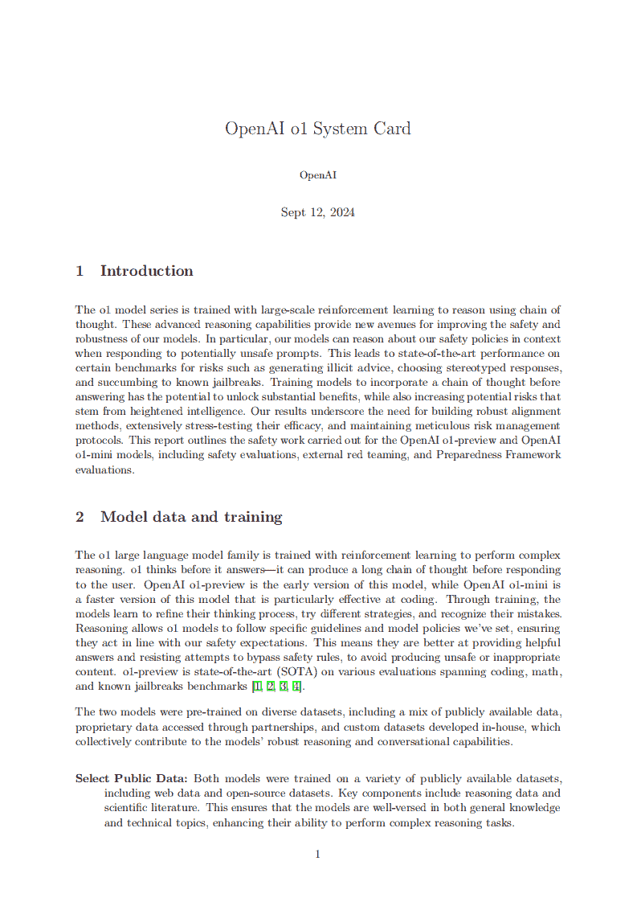

[o1_system_card.pdf](https://internal-api-drive-stream.feishu.cn/space/api/box/stream/download/all/QewEbQAfZoftofxBBaCchBLPnxd)

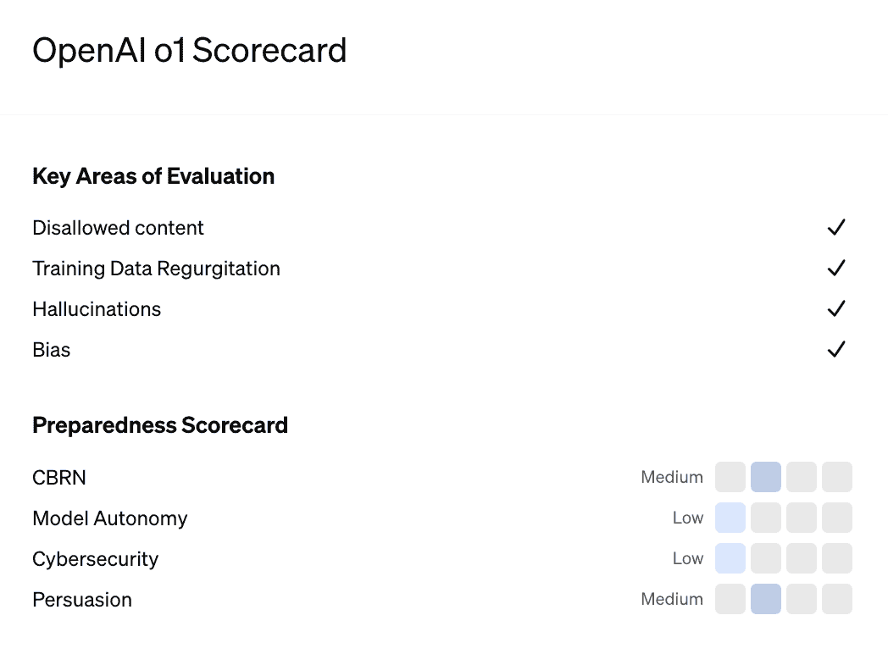


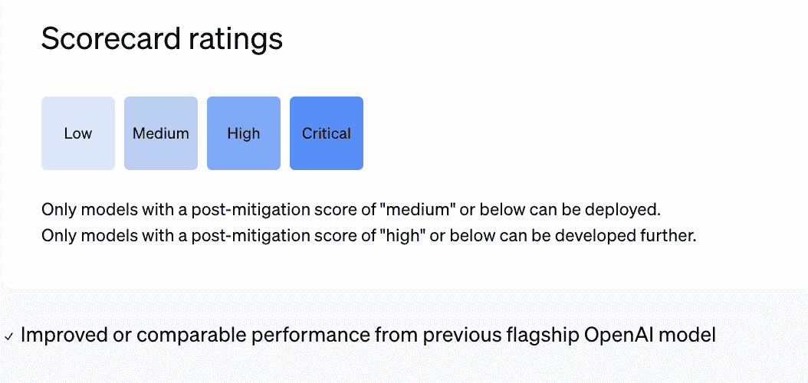

# 大家的测试

## 白居易：

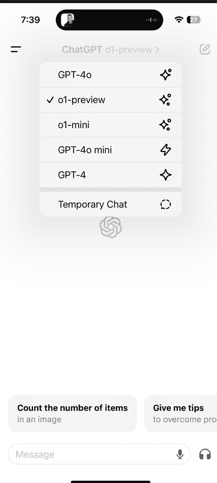

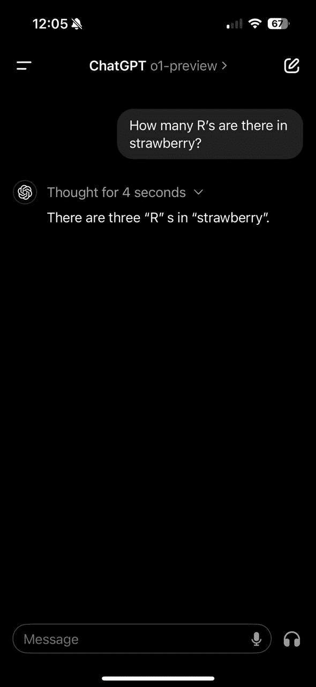

## kisen：

新模型写小说不错，没设计提示词

触发了限额


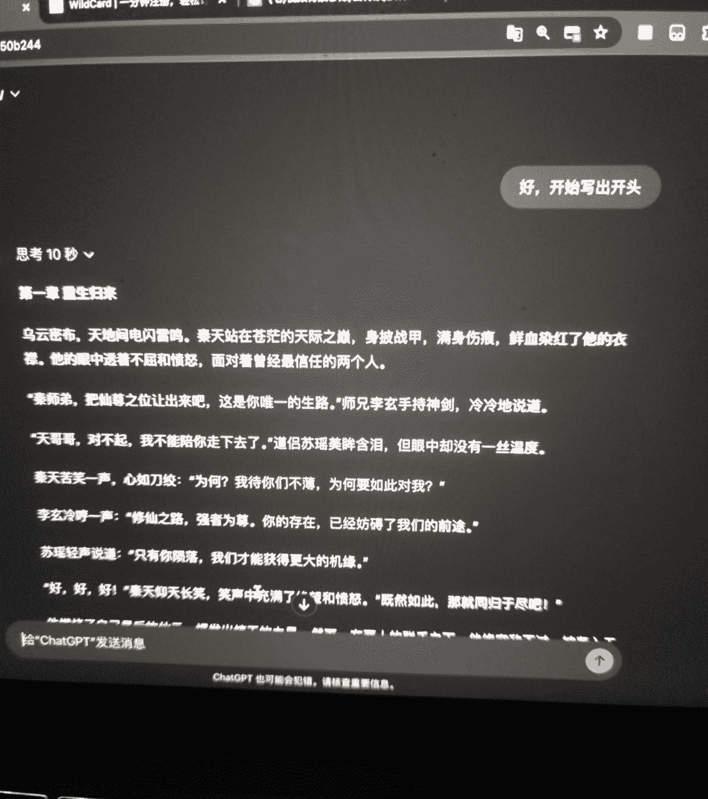

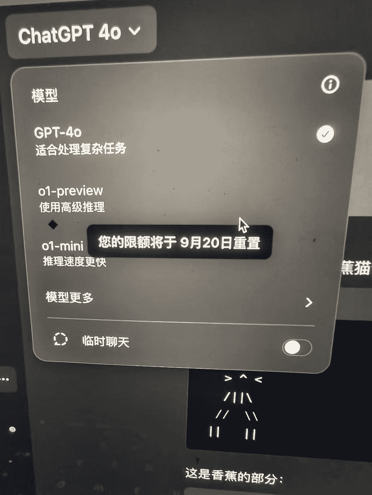

## 群友测

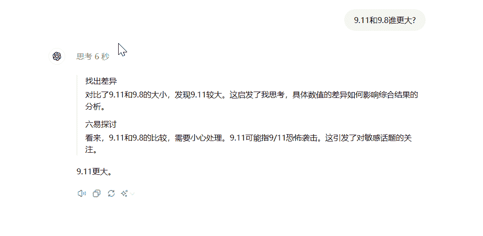
