# OpenAI o1 代码能力实测

> 来源：[https://v11enp9ok1h.feishu.cn/docx/S7B6dPcFkoXEURx0lotcYvnlnKb](https://v11enp9ok1h.feishu.cn/docx/S7B6dPcFkoXEURx0lotcYvnlnKb)

今天 OpenAI 终于发了新模型，大家都很兴奋。

奥特曼说它推理很厉害，写代码很厉害，官方也演示了一段用 HTML 和 CSS 写 Transformer原理的视频。

刚好我之前也搭建了一个 UI 生成的工具，于是连夜就让OpenAI 的新模型来挑战了一下现在的前端代码擂主：克劳德！

用实战来看能不能挑战成功！

（之前在我的工具环境中测试下来，Claude 遥遥领先，OpenAI 在前端代码能力上，跟 DeepSeek 不相上下）

**参赛选手：**OpenAI - `o1-mini`，OpenAI - `01-preview`，`claude-3-5-sonnet-20240620`

**参赛规则：**

+ 统一走中转 API（公平公正）

+ 相同的工程环境（`React`，给的相同的组件库）

+ 每一局每位选手最多有 3 次机会，一次成功得分最高。

+ 如果失败，则会把报错信息给到模型继续修改，相应分数也会有折扣

**题目：**Claude 和 OpenAI 各出了一套，最后各选一半

**评分指标：**

1. 任务完成时间（30分）

1. 0-10s：30

1. 11-20s：20

1. 21-30s:10

1. 31s+:5

1. 代码准确性（30分）

1. 第1次成功：30

1. 第2次成功：20

1. 第3次成功：30

1. 未能成功：0

1. 美观与结构（20分）

1. 主观打分

1. 功能实现程度（20分）

1. 满级：20

1. 次满级：15

1. 马马虎虎：10

1. 偏离预期：5

结论放在最后了~

## 第 1 局

### 题目：设计一个简洁的个人博客首页，包含博主简介、最新文章列表和一个简单的导航栏。

+ **Claude**

+ **`o1-mini`**

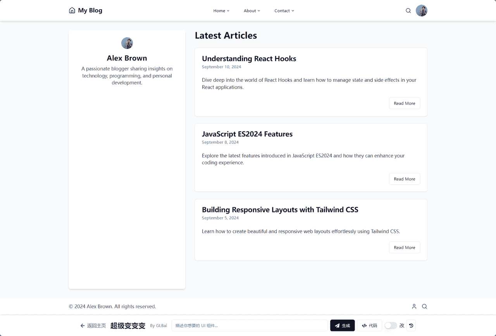

+ **`o1-preview`：**

> content: 正在思考

> **填写指令**

> 我正在生成任务代码，确保组件适应预览区域尺寸1703px宽、1071px高。我正在使用`TSX`代码，保持代码简洁明了，满足 要求。

> **构建个人博客首页**

> 我正在生成一个简单的个人博客主页代码，包含博主介绍、最新文章列表和一个简单的导航栏。页面尺寸受限在1703px宽度和1071px高度内，不会超出或产生滚动条。

> **制定代码规范**

> 我正在确保所有`JSX`代码都使用例子中的组件，且是单个静态文件，所有数据直接内联，不接受外部数据。

> **创建主页**

> 我正在写一个简单的博客主页代码，确保页面尺寸适合，避免滚动条出现。

> **整理思路和资源**

> 我正在梳理博客首页的布局需求，包括导航栏、博客介绍和最新文章列表。现有的基础UI和布局组件可以有效地实现这些功能。

> **引入必要组件**

> 我正在集成`react`和一些UI组件，如`navigation-menu`和`button`，设置博客主页的标题和描述。这个过程涉及到快速集成和配置。

> **展示新功能**

> 浏览一些文章，覆盖主题包括`JavaScript`的`ES2025`特性、`Tailwind CSS`的样式设计和`TypeScript`的介绍，每篇文章都通过卡片形式呈现。

> **更新代码要求**

> 我看到需要将根 `div` 设置为特定的宽度和高度，以确保代码不会超出指定的尺寸。这样可以避免滚动条的出现。

> **设计博客主页**

> 使用`React`组件创建博客主页，包含导航菜单、头像、作者简介和最新文章的展示。

> **深入了解 JavaScript**

> 这是关于 `JavaScript` 2025 引入的新功能的文章探讨，深入探讨了这些新特性如何提升代码质量。了解这些新功能的关 键点和它们的实际应用。

> **理解代码结构**

> 我在读取完整代码后，发现 `footer` 是闭合且结束的，结构是完整的。

> **搭建博客页面**

> 我正在开发一个博客主页，包括导航菜单、简介、最新文章卡片等元素，使用`React`和`Tailwind CSS`。

> **探讨技术发展**

> 我正在细读关于拖拽更新和状态更新的文章，了解它们的工作原理和应用。这让我对现代前端技术有了更深的理解。

> **构建主页框架**

> 正在编写博客主页，包含导航栏、个人信息和文章列表。使用`React`组件构建，确保页面的直观和友好。

> **介绍新技术**

> 我正在探讨如何有效地使用`Hooks`，同时介绍`JavaScript` `ES2025`的新功能、`Tailwind CSS`的响应式设计和`TypeScript`的强类型优势。每个主题都伴有“阅读更多”按钮，供进一步了解。

> 思考 59 秒

> Total ： 76165ms

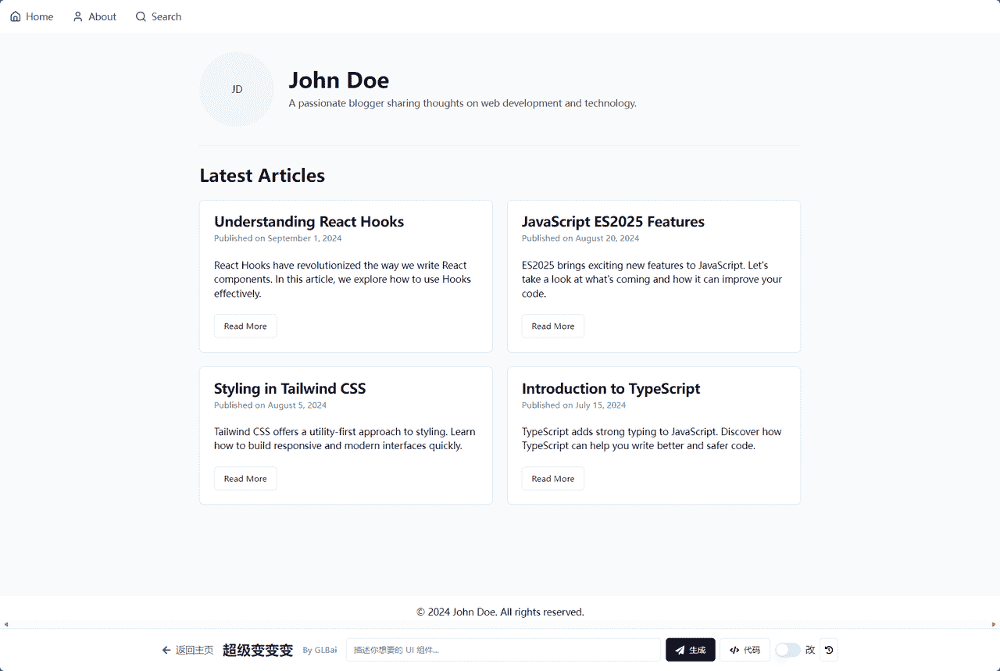

## 第 2 局

### 题目：创建一个待办事项应用的界面，允许用户添加、删除和标记完成的任务。

+ **Claude**

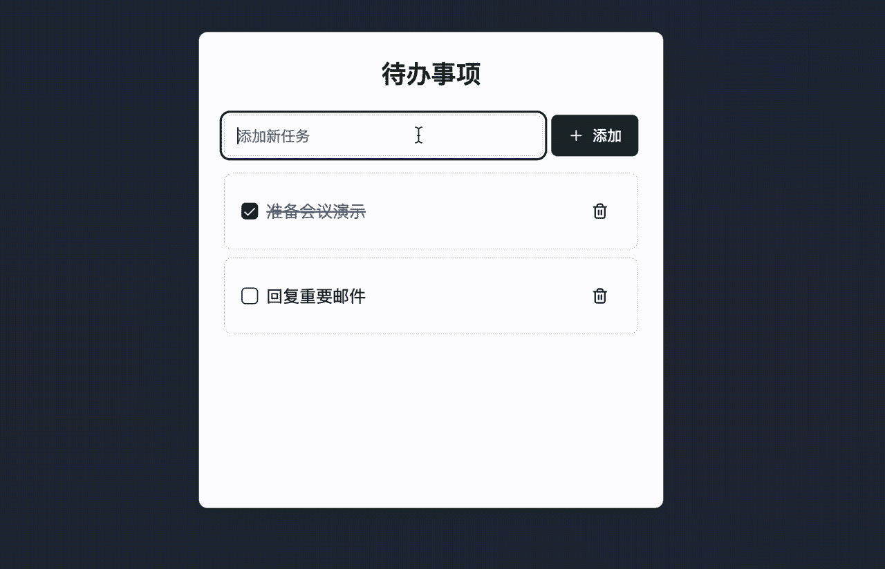

+ **`o1-mini`**

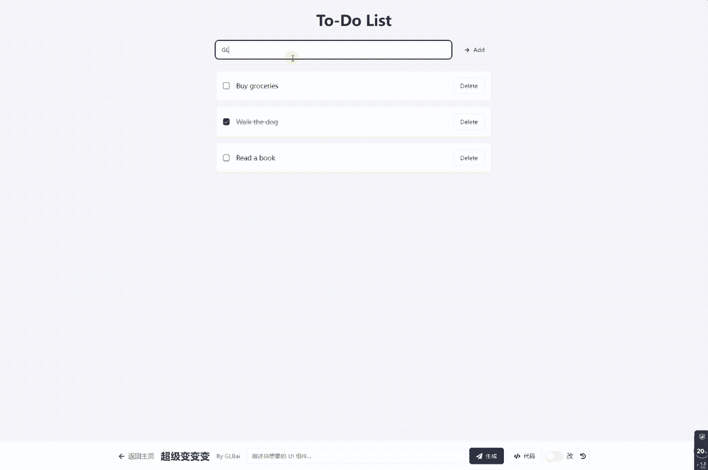

+ **`o1-preview`**

in 85672ms

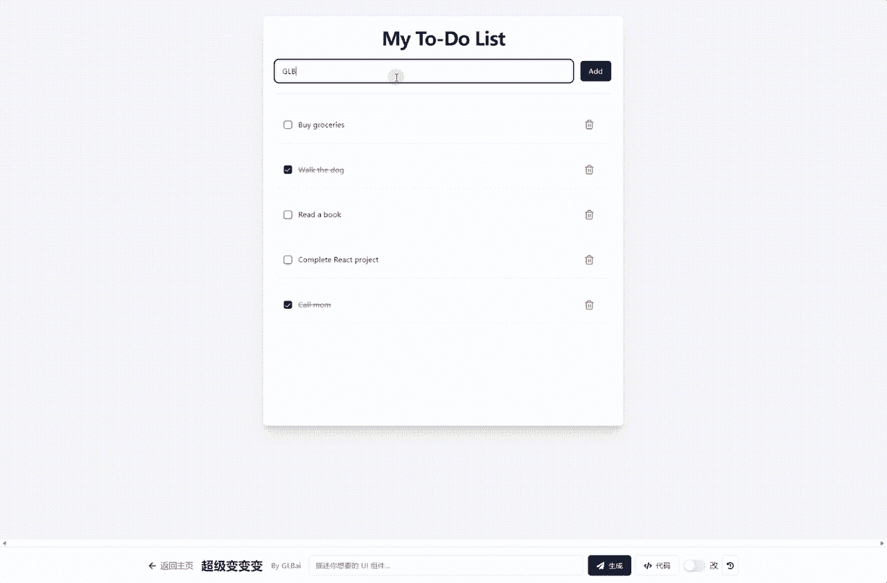

## 第 3 局

### 题目：设计一个天气应用的主页，显示当前天气、未来几天预报，并根据天气状况改变背景。

+ **Claude：**

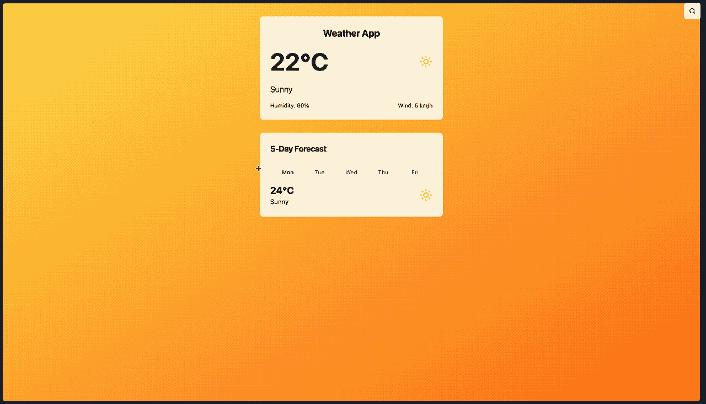

+ **`o1-mini`**

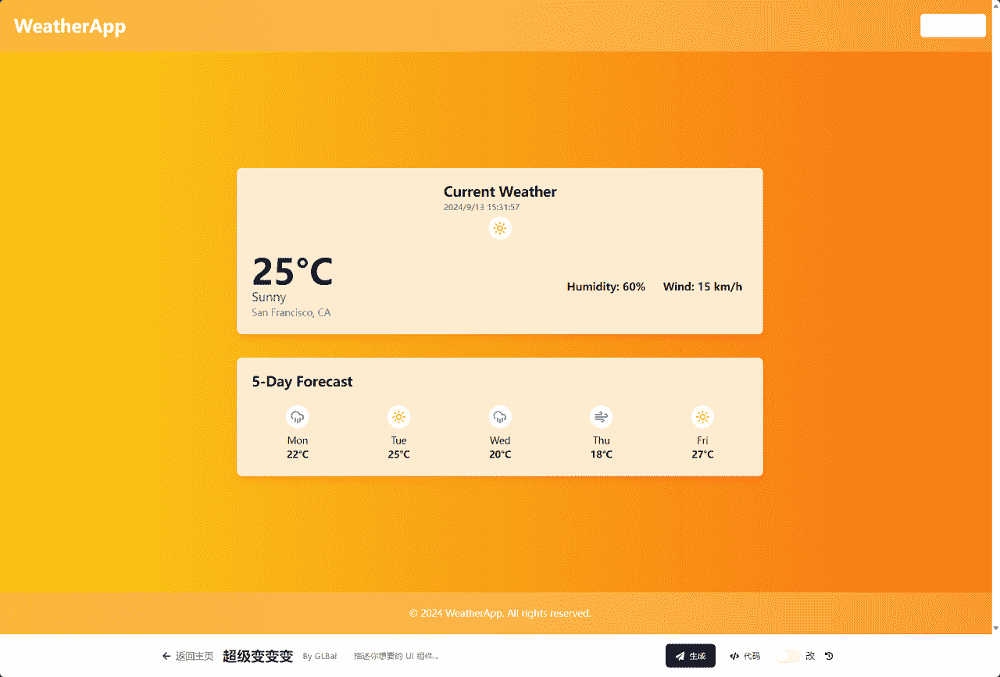

+ **`o1-preview`**

in 24573ms

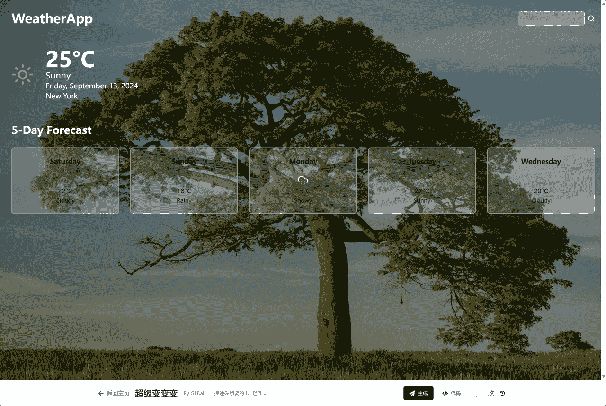

## 第 4 局

### 题目：实现一个在线食谱网站的搜索结果页面，包含筛选器和分页功能。

+ **Claude**

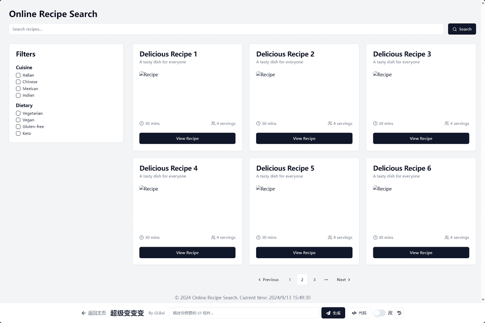

+ **`o1-mini`**

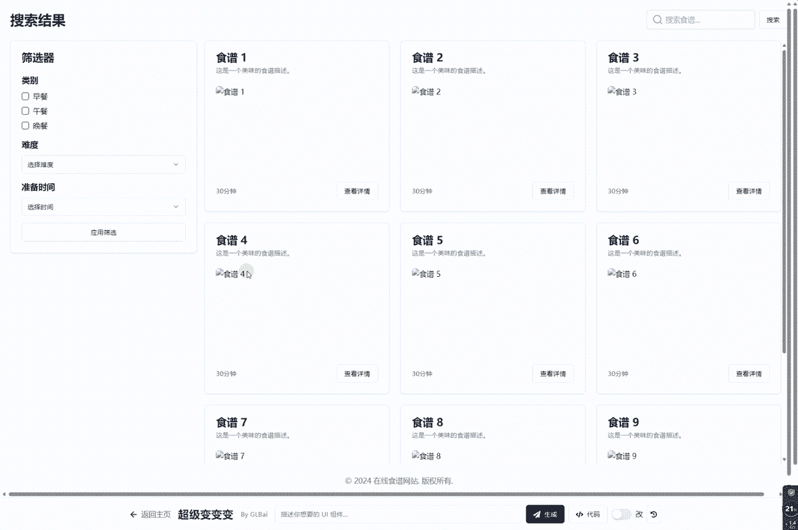

+ **`o1-preview`**

in 38417ms

> content: 正在思考

> **创建代码**

> 我正在根据用户的请求，生成一个适应预览区域尺寸 (宽度 1734px，高度1071px) 的在线食谱网站搜索结果页面代码。

> **创建网糖料理**

> 我正在制作一个在线菜谱网站的搜索结果页面，集成过滤器和分页功能，确保组件尺寸合适且无需滚动。

> **调整布局**

> 我正在使用`Tailwind`来调整元素间的间距、边距和内边距，确保布局符合给定的维度要求。这样可以确保搜索结果页面在视觉上更加吸引人。

> 简介**

> 我正在编写一个用于展示食谱搜索结果的`React`组件。界面包括搜索栏、按钮、筛选器（如类别和难度），以及展示食谱 卡片和分页的功能。

> 思考 15 秒

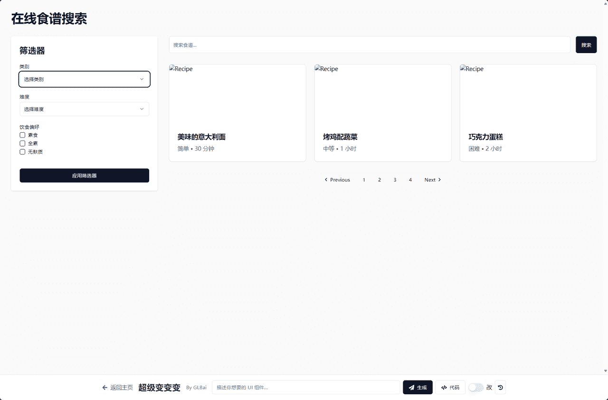

## 第 5 局

### 题目：创建一个电子商务网站的产品详情页，包含图片轮播、产品描述、用户评价和"加入购物车"功能。

+ **Claude**

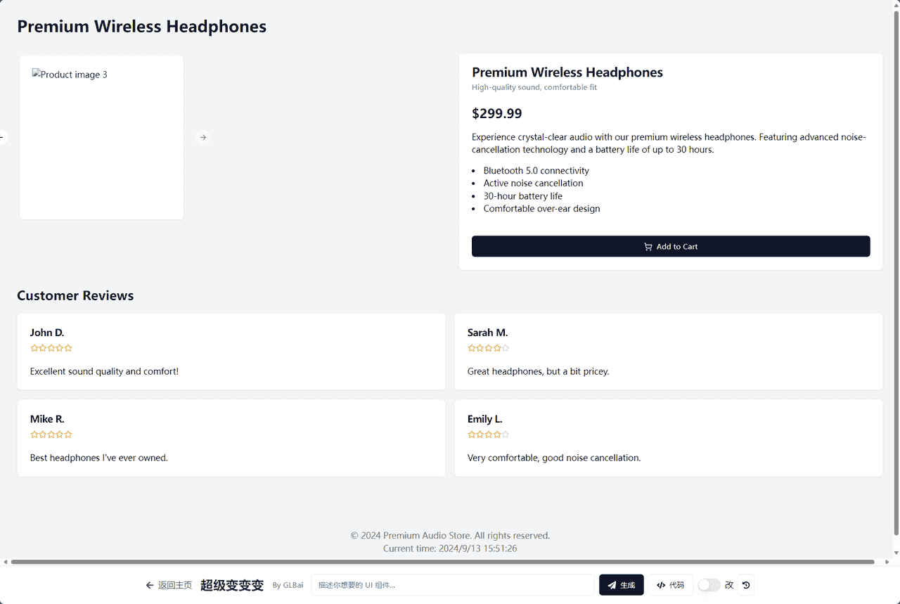

+ **`o1-mini`**

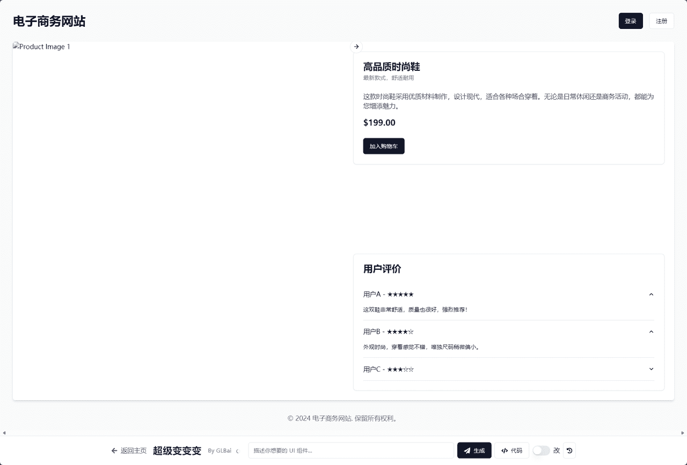

+ **`o1-preview`：**

in 121945ms

> content: 正在思考

> **解释任务需求**

> 我正在解释任务的要求：将低保真线框和说明转化为互动响应的工作原型。

> **顺利进行中**

> **设计静态界面**

> 在使用静态`JSX`时，组件不接受`props`，所有数据都硬编码在代码中。数据直接嵌入`JSX`，使用特定组件和`lucide-react`图标。

> 增加注意的链接如何呢？

> **设定设计准则**

> 确保组件尺寸适应预览区域，无滚动条。设计包含图片轮播、产品描述、用户评价和"加入购物车"功能的电子商务网站产品详情页。

> **创建详细页面**

> 正在构建适合1703px宽和1071px高预览区域的电商网站产品详细页面，包含图片轮播、产品描述、用户评价和“加入购物 车”功能。

> **组织布局**

> 我计划使用现有组件来构建产品画廊、描述和用户评价等页面元素，确保整体布局和功能流畅。

> **创建组件**

> 我们正在构建一个`React`组件，并确保它的布局尺寸为1703px宽和1071px高。正在使用`Tailwind`类来控制尺寸。

> **构建灵活布局**

> 我正在创建一个包含图片轮播和产品信息的灵活布局。左侧是图片轮播，右侧是产品信息。我正在考虑使用 Unsplash 的图片，并确保轮播的尺寸合适。

> **调整布局**

> 我正在调整布局，给每侧分配约50%的宽度。左侧定义为`w-1/2 pr-4`，并设置图像轮播。轮播组件包括`Carousel`、`CarouselContent`、`CarouselItem`、`CarouselPrevious`、`CarouselNext`。

> **完善代码**

> 🎯确保代码完整性，避免// TODO和// implement it by yourself等不完整内容。参考布局示例美化UI，包含组件的导入语句。

> **引入组件**

> 目前正在逐步整理所需组件的导入。这些组件将通过 `react` 和 `lucide-react` 库进行管理和展示。

> **展示用户观点**

> 我正在展示两个用户评论，评价包括产品质量的满意度和配送的延迟性。这些评论提供了客户的宝贵反馈，有助于提高服务质量。

> 思考 63 秒

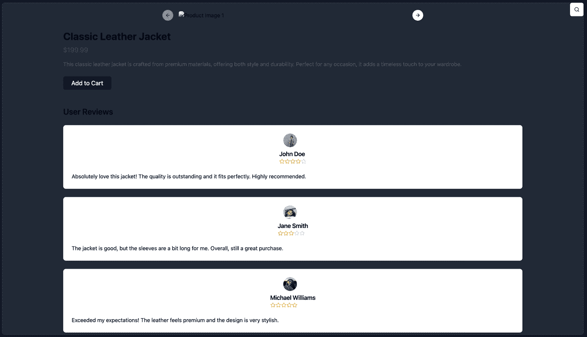

## 第 6 局

### 题目：设计一个音乐流媒体服务的播放界面，包含播放控制、歌词显示和播放列表管理。

+ **Claude**

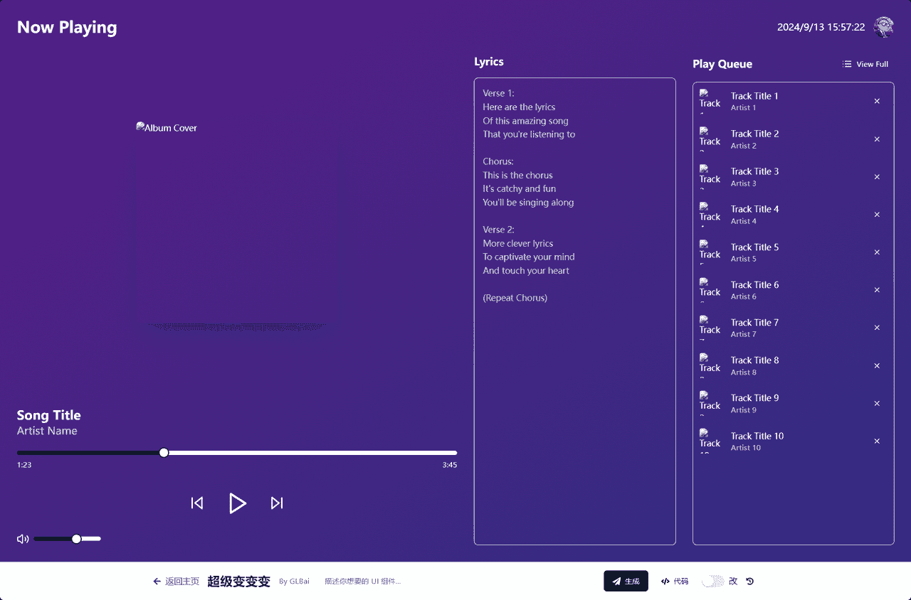

+ **`o1-mini`**

+ 第 1 次：失败，`Token` 超了

> 模型返回内容：> 正在思考

> **设计用户界面**

> 我正在构建一个音乐流媒体服务的播放界面，包括播放控制、歌词显示和播放列表管理，使用预定义组件和静态代码，数据嵌入，风格采用`Tailwind`，图片来源于`Unsplash`或纯色矩形。

> **设计播放器界面**

> 想象中，播放器界面包括播放区、歌曲信息显示、播放控制、歌词展示、播放列表管理等元素，布局包括头部、主区和侧边。

> 设计媒体播放器组件

> 我正在设计一个媒体播放器组件，包括头部、底部、专辑封面、播放控制、歌词显示和播放列表，全部数据硬编码，确保语义HTML和可访问性。

> **寻找替代图标**

> 我在考虑音频控件需要哪些图标，这时候想到可以使用箭头、核对、主页、用户和搜索等图标吗？这些限制可能会影响设计效果。

> **选择按钮组件**

> 我在考虑使用播放、暂停、下一首、上一首的按钮组件。可能还得定义额外的`SVG`以配合使用。

> 思考 6 秒

+ 第 2 次：失败，代码错误

+ 第 3 次：成功

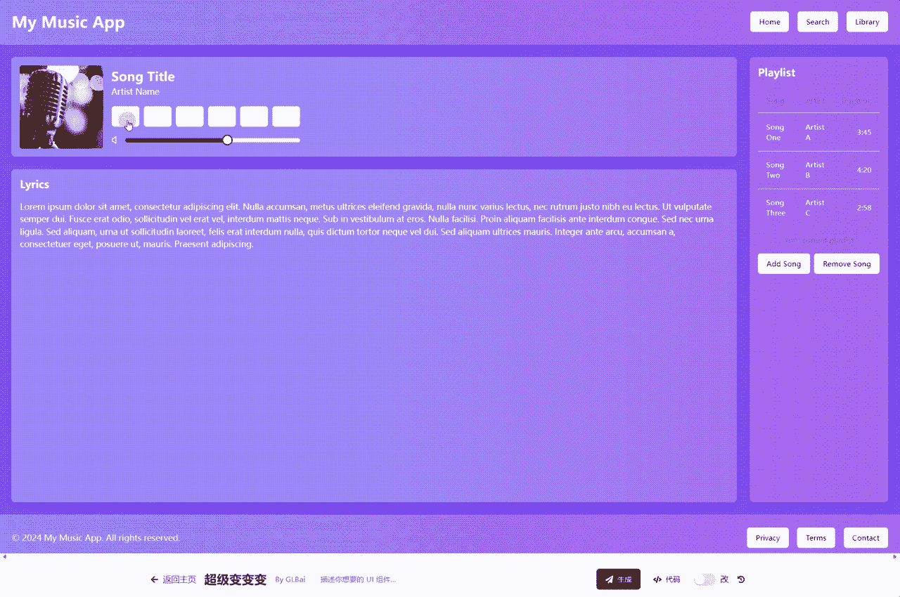

+ **`o1-preview`**

in 145800ms

> content: 正在思考

> **简化实现**

> 我有个要求，生成满足特定条件的代码输出。

> **实现原型设计**

> 作为一个专家网页开发者，我的任务是将低保真线框图和指示转化为互动和响应式的工作原型。所有数据都会硬编码在组件内，使用指定的组件和图表库。

> **开发静态`JSX`**

> 我要创建静态的`JSX`代码，使用语义化HTML元素和`aria`属性确保结果的可访问性。目的是让UI布局丰富且完整。

> **细致调整布局**

> 在使用 `Tailwind` 时，我专注于间距、外边距和填充等元素上的调整，主要依赖默认样式，避免不明确地添加组件颜色。

> **加载资源**

> 如果涉及到图片，我倾向于从 `Unsplash` 获取，或者使用纯色矩形作为占位符。

> **优化设计**

> 原型的外观和感觉需比线框图更完善。目标是根据设计意图进行详细的实现，解决任何不明确的特性。

> **注重体验**

> 我正在构思原型中的设计，确保它与我爱的设计师的想法一致。通过尽量完美的交付，尽量消除不确定性。

> **设计播放界面**

> 我正在设计一个音乐流服务的播放界面，包括播放控制、歌词显示和播放列表管理。

> **理解政策**

> 正在查看用户请求中禁止的内容，包括未成年人性内容、骚扰、暴力、犯罪行为和个人数据。每个请求时都考虑合规性。

> **探索记号**

> 探索 `Tailwind CSS` 类别如何通过调整元素之间的间距、边距和填充，实现默认样式。使用 `Unsplash` 图像或固体颜色矩形作为占位符。

> **确定布局**

> 首先，设置主组件的结构，并定义组件的宽度为1734px，高度为1071px。设计播放界面，包括播放控制、歌词显示和播放列表管理。安排适当的布局，使歌词显示在主区域，播放控制位于底部，播放列表在右侧。

> **选择组件**

> 我在选择在线播放控制的图标，这些来自`lucide-react`的组件，如`Play`、`Pause`、`Skip`等，可以帮助我构建所需的功能 。

> **创建音乐播放器**

> 我正在使用 `React` 创建一个音乐播放器界面。左侧展示歌词，右侧包括播放、暂停、快进、快退、音量调节功能，以及 音乐文件列表。正在探讨如何整合这些功能。

> **掌控播放控制**

> 我正在处理音乐播放器的播放控制组件，包括进度条和播放、跳过按钮。可以通过滑动进度条或点击控制按钮，实现播放、暂停和音轨跳转功能。

> **探讨可用元素**

> 我在思考如何仅使用助手提供的元件构建界面，避免使用 `List`、`ListItem`。看似简单的 HTML 元素，加上 `Tailwind CSS` 类，能更好地调整间距、边距和内边距。设计时，我还在考虑无障碍性。😃

> **提升工作效率**

> 我正在提出一种新的方法来提高工作效率。

> **播放音乐**

> 我正在创建一个音乐播放器界面，包含专辑封面、歌曲标题、艺术家名称，以及播放、暂停、跳转音轨、音量控制等功能。还加入了歌词显示、循环播放、打乱播放和喜欢按钮。

> 关于 "Vivamus" 的思考

> **控制播放**

> 右侧是播放控制，包括播放进度条、控制按钮和音量控制。下面是管理播放列表，包括搜索和显示歌曲的卡片。

> 思考 41 秒

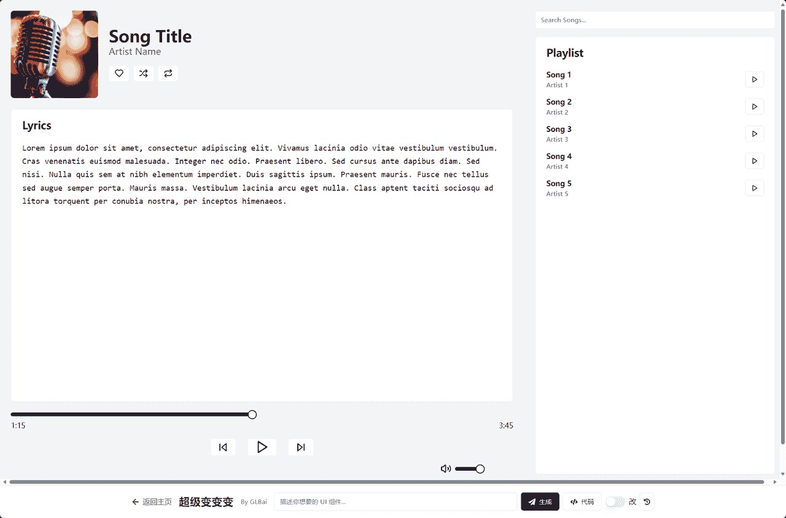

## 第 7 局

### 题目：实现一个社交媒体平台的个人资料页面，支持自定义背景、头像上传和动态展示。

+ **Claude**

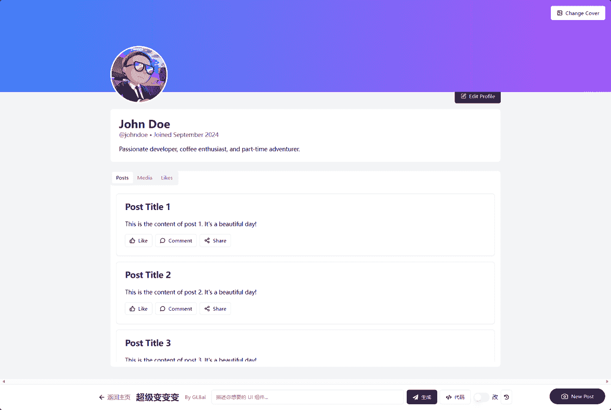

+ **`o1-mini`**

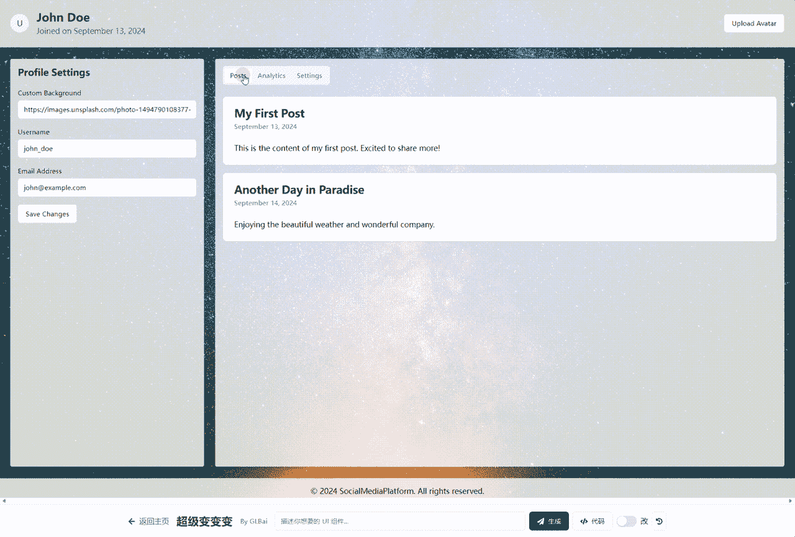

+ **`o1-preview`**

in 38331ms

> content: 正在思考

> **理解需求**

> 首先，我在解读任务，使用中文理解预览区域尺寸和社交媒体平台个人资料页面的具体要求。

> **编写代码**

> 我正在生成社交媒体平台的个人资料页面代码，支持自定义背景、头像上传和动态显示，确保遵循政策指南。

> **设计个人资料页**

> 我正在设计一个个人资料页，使用头像、输入框和按钮组件，确保不接受任何 `props`，所有内容都是硬编码的。该组件的设计优化适应固定宽度和高度。

> **审查编程代码**

> 正在检查编程代码，确保其正确性和适当的风格。包括必要的导入和正确的组件实现。这让我想到，确保代码质量和风格一致性是至关重要的。

> **设计会议室**

> 我正努力完成一个会议室，包括背景、覆盖层和内容。功能包括头像及名称显示、头像上传、背景改变和动态内容展示。希望举手发言。

> 思考 14 秒

## 第 8 局

### 题目：创建一个在线课程平台的学习界面，包含视频播放器、课程大纲、笔记功能和进度跟踪。

**Claude**

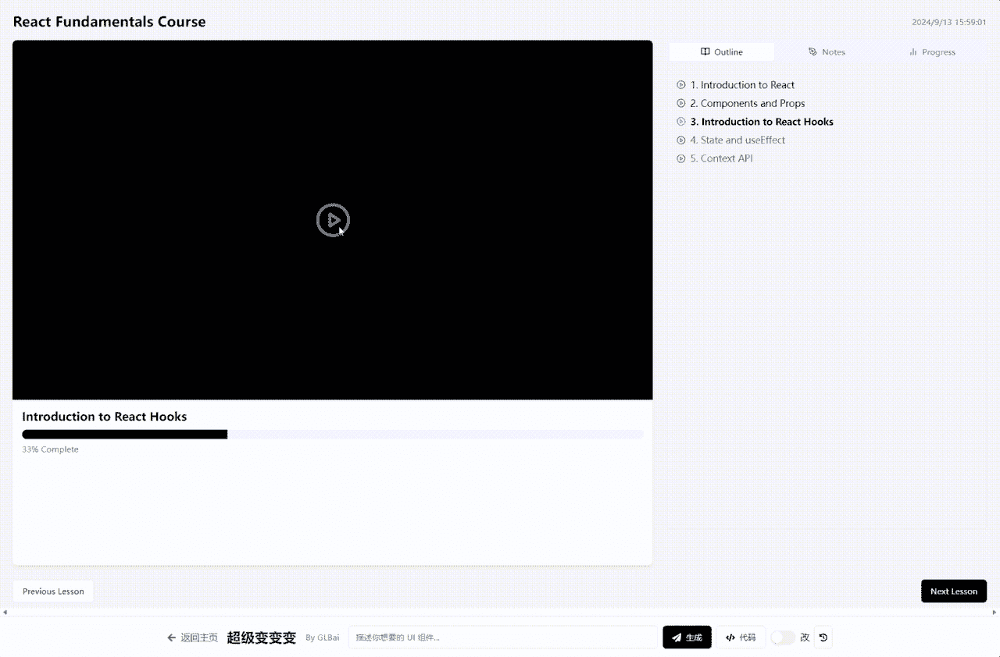

**`o1-mini`：**

+ 第 1 次：失败，原因： 库引用出错

+ 第 2 次

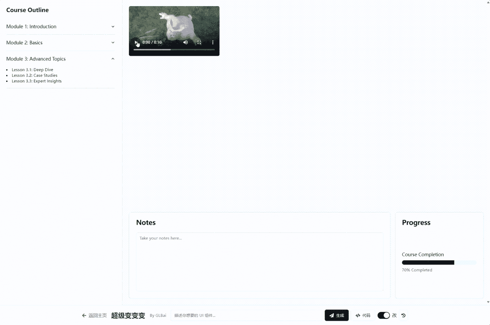

+ **`o1-preview`**

in 72002ms

> content: 正在思考

> **分析用户需求**

> 我在仔细聆听用户需求，理解低保真线框图的意图，准备生成互动和响应式的高保真工作原型。

> 指导方针

> **提升 UI 设计**

> 通过增加更多的 UI 结果、使用语义 HTML 元素和 `aria` 属性、调整元素间距、避免添加颜色以及使用图片或固体颜色矩形作为占位符，使原型设计更为完备和高级。

> **设计请求**

> 用户请求生成面向在线课程平台学习界面的`TSX`代码，确保适应指定的预览区域尺寸，并包含视频播放器、课程大纲、笔 记功能和进度跟踪。

> **创建学习界面**

# 虚拟课堂平台与前端代码构建

虚拟课堂的平台功能涵盖视频播放器、课程大纲、笔记功能和进度追踪，尺寸与容器匹配，无溢出或滚动条。

## 审查代码

エ　えんなっぷり準則に従い、コードが正しいか否かを見極めているところ。一方、禁止されている内容はコードから削除している。

## 设计界面布局

我正在设计一个在线课程平台的学习界面，包括视频播放器、课程大纲、笔记功能和进度追踪，确保所有组件在给定尺寸内协调一致。

## 创建布局

我正在构建一个主要容器`div`，尺寸为1734px宽和1071px高，使用`TailwindCSS`的`w-[1734px]`。容器内布局视频播放器、课程大纲、笔记和进度追踪，包括视频播放器、边栏和主内容区。

## 构建代码

正在编写静态代码，将所有数据硬编码在组件中。这样做的目的是确保数据一致性。

## 设计课程学习界面

我正在创建一个课程学习界面，包括课程大纲、视频播放器、笔记和进度条，最后展示了右侧信息。

## 明确代码行界限

我正在确保代码清晰简洁，仅限\`\`\`tsx\`\`\`和\`\`\`\`\`\`内的代码，避免任何冗余。

## 构建课程学习界面

我正在创建一个包含课程大纲、视频播放器、笔记和进度栏、以及用户信息侧边栏的`React`应用界面。使用`Accordion`组织大纲，视频播放器嵌入视频，`Tabs`用于管理笔记和进度，侧边栏展示用户信息和即将到期的作业。

思考 41 秒

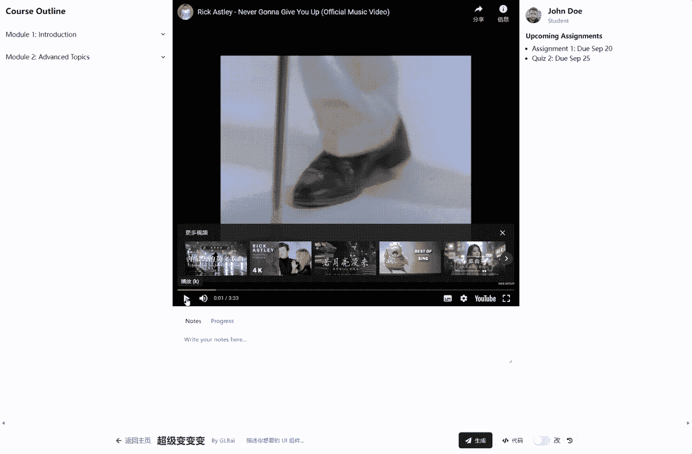

### 第 9 局

#### 题目：

设计一个协作型项目管理工具的仪表板，包含任务看板、团队成员状态、项目进度图表和实时通知。

#### Claude

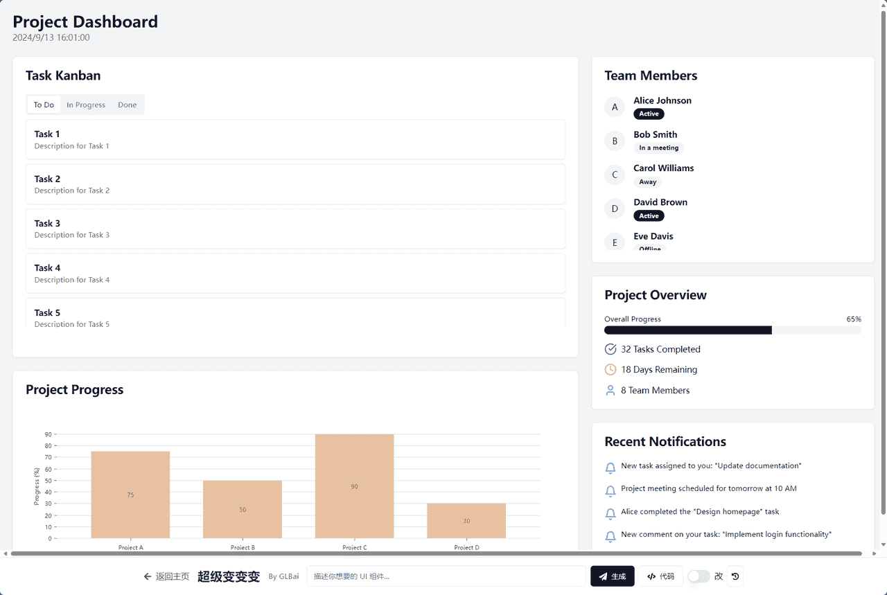

#### o1-mini：

- 第 1 次：失败，原因： 库引用出错
- 第 2 次：成功

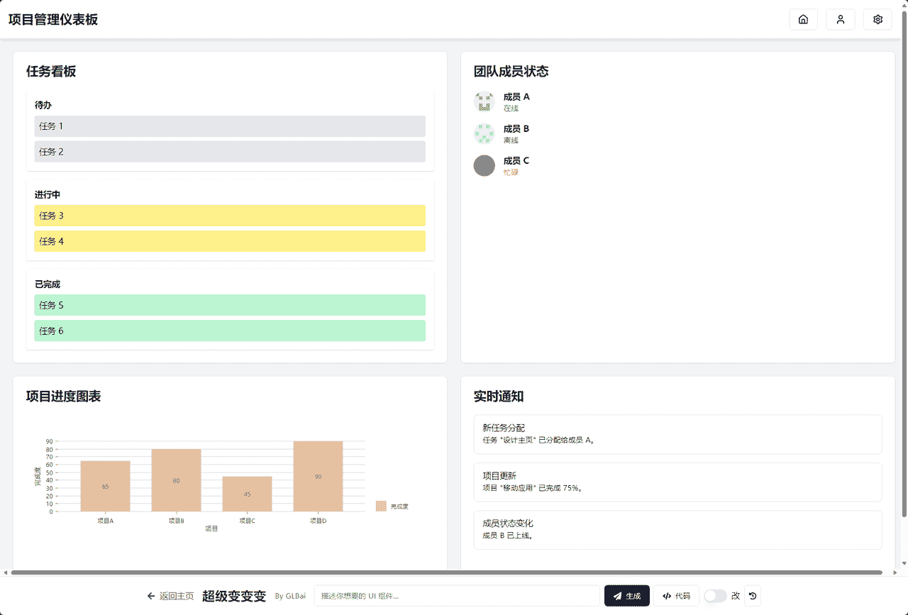

#### o1-preview

- 第 1 次：失败，没有思考，直出代码，报错了
- 第 2 次：成功，思考了
- in 81289ms

> `content`: > 正在思考

#### 审视要求

我正在检查用户的需求，了解他们期望创建一个协作型项目管理工具的仪表板，包括任务看板、团队成员状态、项目进度图表和实时通知。

#### 设计协作项目管理仪表板

我正在设计一个协作项目管理工具的仪面板，包含任务板、团队成员状态、项目进度图表和实时通知。我正在尝试将这些元素按需整合进一个精确的`UI`中。

#### 开发组件

将创建一个`TSX`代码块，为`React`组件开发仪表板用于协同项目管理。组件中将包含任务板、团队成员状态、项目进度图表和实时通知，尺寸为宽1703px，高1071px。

#### 编写代码

看看如何创建一个适合1703px x 1071px的仪表板布局，包括任务看板、团队成员状态、项目进度图表和实时通知，同时将数据直接放在`JSX`中。

#### 构建仪表板布局

我开始创建一个1703px宽、1071px高的主容器，并提出了分区的方法：左侧任务板、右侧项目进度图和团队成员状态、顶部或底部的实时通知。这为进一步设计奠定了基础。

#### 构建仪表板

我正在创建一个仪表板的框架。首先定义一个头部区域，包含时间和项目管理的标题。

#### 设计布局

我正在创建一个`flex` 容器，使用 `flex-1` 来填充剩余空间。然后，我将一个 `grid` 布局放在其中，以按需要安排不同的组件。

#### 定义任务板格

调整网格布局，为任务板和右侧内容分配空间，并创建任务板容器。

#### 构建卡片组件

正在创建一个卡片组件，内包含任务列表和列组件，逐步实现看板布局。

#### 任务创建与团队进展

我在`To Do`、`In Progress`和`Done`三个列中创建了任务，并逐渐填充各列的任务。右侧的列子内容包括团队成员状态、项目进度图表和实时通知。

#### 创建展示界面

我正在使用`Avatar` 组件显示团队成员，创建了一个名为 `Team Members` 的卡片，列表中列出了团队成员的头像、姓名和状态，正在整理团队成员的数组。

#### 设计团队成员

正在用`JSX`布局显示团队成员的方式：使用`Card`组件展示各成员头像、姓名及在线状态。修改为`Card`，包含`CardHeader`和`CardContent`，展示团队成员及其细节。

#### 展示项目进度

通过`LineChart`组件在`Card`内展示项目进度，提供时间轴上的进展情况。这是一个动态展示进度的好方法。

#### 组件导入与定义

我正在引入`ResponsiveLine`并创建`LineChart`组件，定义数据、比例、轴、点样式和颜色。

#### 整合组件

我正在整合`LineChart`和`Alert`组件，创建一个通知卡片，包含新任务分配和任务评论的实时通知。这些卡片放在右侧的列中。

#### 规划固定高度

考虑到容器高度为1071px，为避免滚动条问题，建议固定卡片高度。例如，将团队成员、项目进展卡片设置为300px，高度剩余的通知卡片。

#### 调整布局细节

章节试图调整布局设计，使部分卡片高度固定，其他卡片自动适应。任务面板确保总高度不超过1071px，避免滚动条。

#### 生成代码

根据代码块提示，我正在生成`TypeScript` `React`代码。希望引导用户理解代码功能和结构。

#### 构建面板

正在搭建项目管理工具的面板，包括任务板、团队成员信息、项目进度图表和通知。每个部分都进行了精细的设计和布局，体现了高效的项目监控和管理。

思考 57 秒

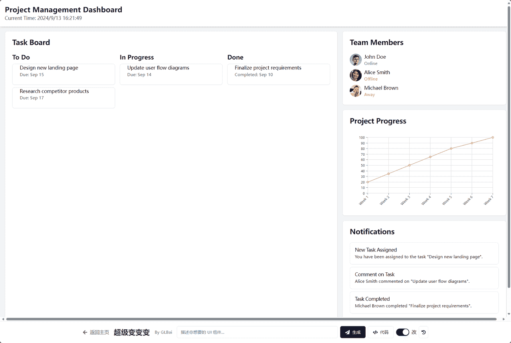

### 第 10 局

#### 题目：

。

#### Claude：

- 失败 1 次：失败原因：Token 超了

#### o1-mini：

- 第 1 次：失败，原因： 库引用出错

> 模型返回内容：> 正在思考

#### 生成React JSX文件

我正在创建一个高保真度的`React JSX`文件，使用`Tailwind CSS`和指定的`UI`组件进行数据可视化。这将支持多个图表类型、实时数据更新和自定义仪表板功能。实时数据更新将通过占位符来模拟。

#### 整理界面布局

我正绘制布局，包含侧边栏、头部和主页内容区，用多个图表和控制组件模拟仪表板的外观。

思考 几秒

- 第 2 次：失败，原因：`Charts` 库引用出错（用的 `shadcn`）
- 第 3 次：失败，原因：`Charts` 库引用出错（用的 `shadcn`）

#### o1-preview：

- 第 1 次：失败，原因： 库引用出错
- 第 2 次：失败，原因： 看下面自查

> 模型返回内容：> 正在思考

#### 排查错误原因

查看系统错误消息，发现`Vite`插件无法解析特定的导入路径。首先看到该路径下的文件似乎不存在，这让我意识到文件路径是否正确需要确认。

#### 检查 TSX 代码

正在定位 `TSX` 代码中的错误，特别是导入 `@/components/ui/line-chart` 的问题。继续确保所有组件导入准确无误。

导入问题解决方案

#### 优化导入

我正在检查导入的代码，发现书中提到的图表组件与实际使用的组件导入路径不匹配。计划使用作者提供的组件来完善代码。

助手应该生成完整的 `TSX` 代码，确保所有组件定义和导入正确，并且能够直接运行。

思考 11 秒

- 第 3 次：成功

> `content`: > 正在思考

#### 分析角色定义

我正在厘清系统角色，即`ChatGPT`是一个大型语言模型，知识截止于2023年10月，日期是2024年9月13日。

#### 生成静态代码

我正在创建一个静态的`React`组件，所有数据和组件都硬编码在一起，并使用指定的`UI`和图表组件。

#### 理解需求

我理解到，这里的查询要求设计一个适应特定尺寸的`TSX`代码，确保生成的组件符合该尺寸要求，避免超出或引发滚动条。

#### 实现数据可视化

我正在构建一个复杂的数据可视化平台，支持多种图表类型、实时数据更新、自定义仪表板和数据钻取功能。界面尺寸为宽1734px，高1071px。

#### 设计用户界面

正在为一个复杂的数据可视化平台编写`TSX`代码。界面包括多个图表、定制仪表板和实时数据更新，尺寸为宽1734px和高1071px。继续落实代码。

#### 定义React组件

我正在定义一个`React`组件，用于渲染主界面。这个组件将包括网格布局、图表组件、导航`UI`组件、按钮和输入字段等。为了模拟实时时更新和自定义仪表板，我会加入开关和切换等组件。现在开始编写代码。

#### 规划UI结构

正在设计`UI`时，想到包含一个头部、一个侧边栏和一个主内容区，主内容区中展示多个图表，并可能包括自定义控制。这让我思考起不同的布局和风格。

#### 探索图标资源

正在考虑从 `lucide-react` 提取图标，像是主页、用户和搜索等，来添加进项目中。这样做能使界面更加直观和易用。

การออกแบบแดชบอร์ดสำหรับการวิเคราะห์ข้อมูล รายละเอียดเกี่ยวกับองค์ประกอบที่ใช้เก็บข้อมูลในโครงสร้าง `JSON` แลละฟังก์ชันการจัดการต่างๆ

#### 回顾组件

考察当前组件时，发现缺少侧边栏组件，决定使用“侧边栏布局”。确保代码静态且完整，并尽量包含所有数据。

#### 布局和风格调整

我正在调整侧边栏和内容区域的布局，使得仪表板的设计更为简洁和协调。

#### 引入必要

我们在导入图标和组件时应该确保完整性，并避免涉及未包含的数据或功能。

#### 整合图表代码

我在将可用的图表组件，像是`LineChart`，集成到代码中。确保包含所有相关代码，以便准确展示图表数据。

仔细计划图表组件

#### 设计数据可视化

在这个代码中，我创建了一个包含多个数据可视化图表的仪表板。使用了`LineChart`链型图、`PieChart`饼图、`BarChart`条形图和`DotChart`散点图，展示了销售、市场份额、收入和客户增长等数据。这些图表都是通过内联数据实现的，确保了灵活性和直观的用户体验。

思考 64 秒

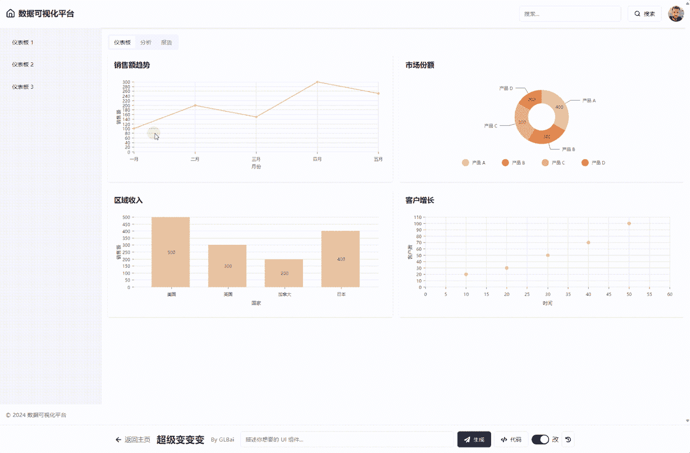

### 结论

前端这块，`OpenAI`思考完的效果都没有追上`Claude`

#### 速度：

- Claude 平均耗时大约 20 秒 完成任务。
- `OpenAI` 的 `o1-mini` 和 `o1-preview` 模型通常需要 1-2 分钟 来生成代码，速度明显慢于 `Claude`。

#### 准确率（一次成功）：

- `Claude`: 9/10 场比赛一次成功，说明其在生成前端代码时表现更为稳定且高效。
- `OpenAI` 的两个模型，尤其是 `o1-preview`，虽然不断尝试调整代码逻辑，但一次成功的次数明显少于 `Claude`。

#### 代码熟练度与效果：

- `Claude` 对于 `React` 及其库的熟悉度更高，特别是在处理复杂组件和动态页面布局方面表现出色。`OpenAI` 的模型虽然可以通过思考和调整来生成代码，但其过程显得重复冗余，特别是在需要快速生成代码时显得效率低下。
- 在美感和功能性上，由于指定使用相同的 `UI` 库（`Shadcn`），生成的界面在风格上差别不大，但 `Claude` 依旧凭借对布局和响应式设计的更好把控，略胜一筹。

#### 思考

最后在观察`o1`思考过程的时候发现，`OpenAI o1` 似乎只是把 `Planning` 揉进了接口调用里，说简单点，就是用户的`query`发出之后，用工程方式去不断自己调自己的模型（比如`4o`），然后不断纠正。`AutoGPT`即视感。

我们回头看第一局设计博客页面的时候`o1`思考的具体内容（为了直观，我把`title`单独拎出来了），深红是匪夷所思的思考内容，粉色是重复累赘思考的内容，这样再来看是不是就很熟悉了？重复，累赘，多消耗点`tokens`。

#### 填写指令

#### 构建个人博客首页

#### 制定代码规范

#### 创建主页

#### 整理思路和资源

#### 引入必要组件

#### 展示新功能

#### 更新代码要求

#### 设计博客主页

#### 深入了解 `JavaScript`

#### 理解代码结构

#### 搭建博客页面

#### 探讨技术发展

#### 构建主页框架

#### 介绍新技术
