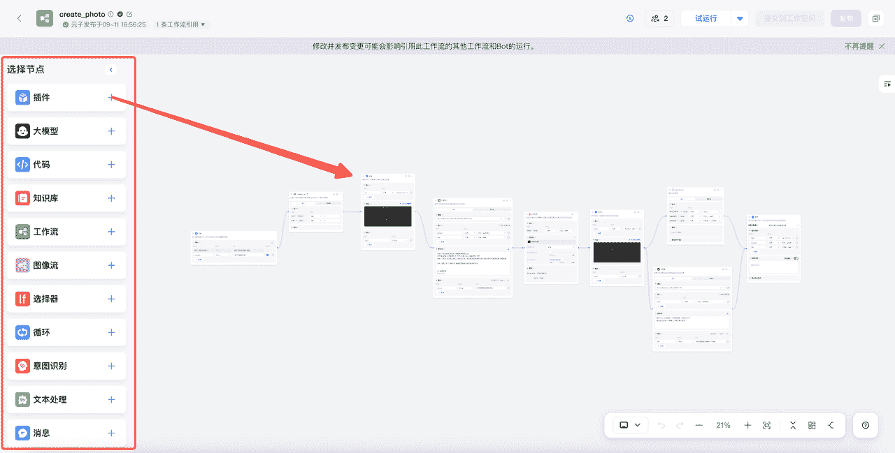
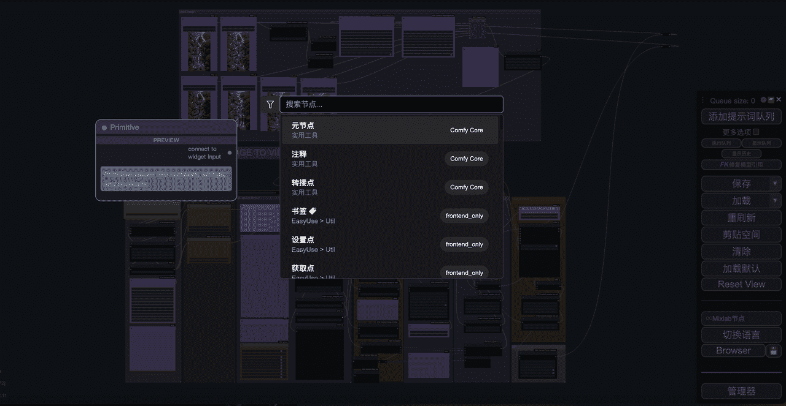
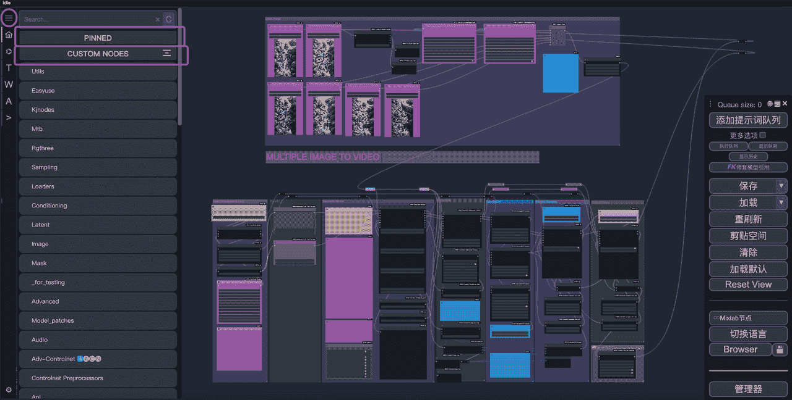
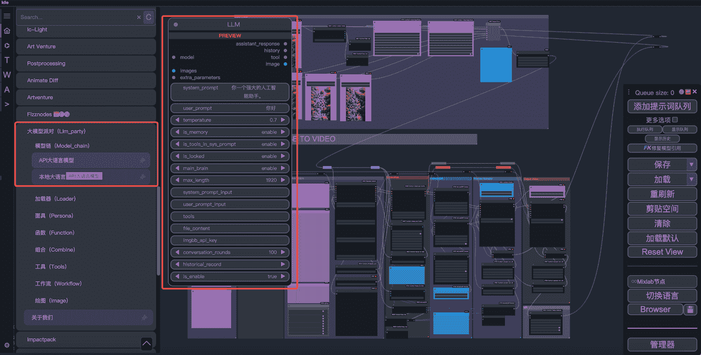
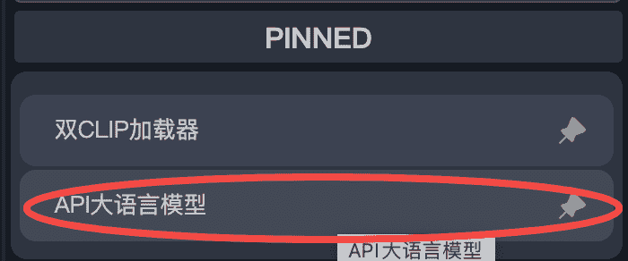
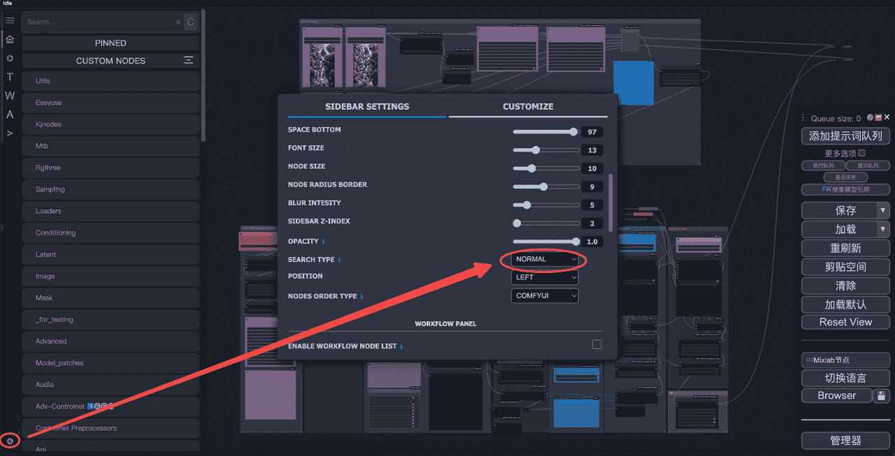
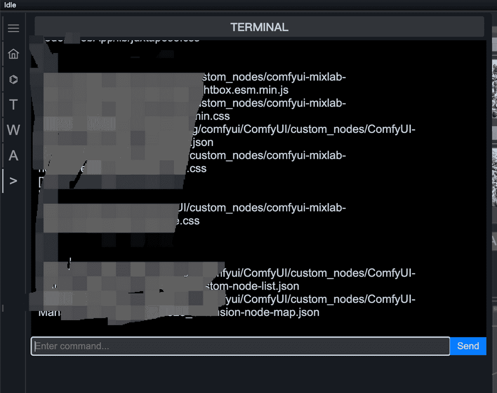
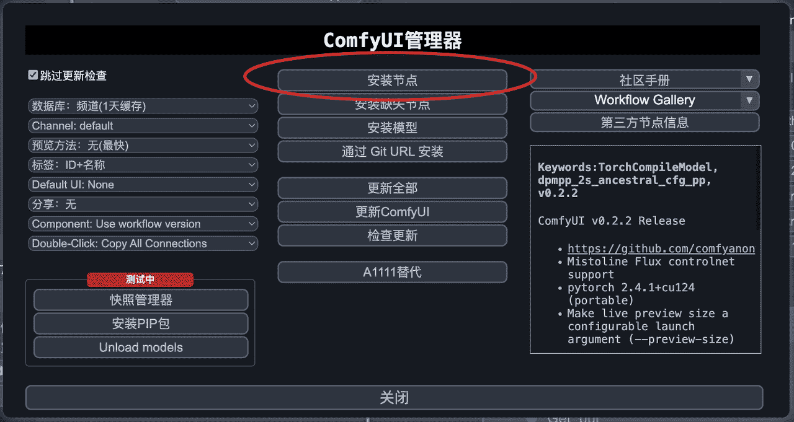

# 像Coze一样拖拉拽搭建comfyui工作流 -- 支持中文搜索节点, 超实用Comfyui小技巧

> 来源：[https://v11enp9ok1h.feishu.cn/docx/SfS7dODiYogOEwx2UBrcfiJinWc](https://v11enp9ok1h.feishu.cn/docx/SfS7dODiYogOEwx2UBrcfiJinWc)

> 对于才从Coze/Dify这类Agent工作流入坑Comfyui图像流的同学们来说, 使用习惯是其中一个很大的门槛, 尤其是节点的搜索, 节点的连线. “comfyui小技巧”系列文章, 旨在分享一些个人学习经验, 帮助大家快速转型, 跨过comfyui使用习惯门槛, 也能像大佬一样顺溜的搭建comfyui工作流.

# 使用对比

字节的Coze等市场上同类产品, 大多把节点罗列在左边栏 -- 这样罗列的好处很明显, 有什么节点, 能提供什么功能, 一目了然, 用户可以通过节点名称快速定位自己需要的节点.

同时, 用户可以通过“拖拉拽” 把节点放到右边的画布上 -- 个人感觉这样的操作方式非常舒服.

相比之下, comyfyui的使用方式就完全不同:

+   界面上主要是画布和大量的功能按键.

+   找节点需要靠“背”, 你用过哪些节点, 记得哪些节点, 用节点名称(还必须得是英文)来搜索.

> 可能大佬们有更好的方式, 但至少对于作为新入门, 从小还最怕背诵的我非常难受.

> 机缘巧合之下, 我发现了一个插件, “左边栏罗列, 拖拉拽, 支持中文搜索”, 全都完美解决.

# N-Sidebar

## 分组清晰

装好后 (安装方式见文末), 就多了一条左边栏, 点击“三”按钮, 就能看到所有你安装好的节点, 按照它的来源分组罗列, 一级一级点开可以很清晰的看到这个分组内有哪些节点(功能). 通过“拖拉拽”就能拉到画布上使用.

同样, 新版UI的节点预览在上面同样适用, 一目了然.

除此之外, 仔细观察会发现, 上面还多了一个“PINNED”大组, 可以认为是收藏夹, 用于常用节点的收藏. 点击节点右边的“📌”, 在PINNED分类里就会增加这个节点.

# 中文搜索

默认这个插件装好是不支持中文搜索的, 但是只要简单的修改, 就能支持.

在左边栏的左下角, 找到设置按钮, 找到图中的设置键, 改成“NORMAL”.

然后就支持中文搜索了! -- 非常好用!

# 其他功能

熟悉linux的同学可能会非常喜欢这个功能, 这里它还提供了一个终端, 可以不用ssh就能用一些常用linux命令. 比如快速看当前日志等.

# 关于安装

安装方式不复杂, 和其他插件一样, 在comfyui管理器里找到“安装节点”, 搜索N-sidebar就能找到安装. 安装后重启即可生效.

