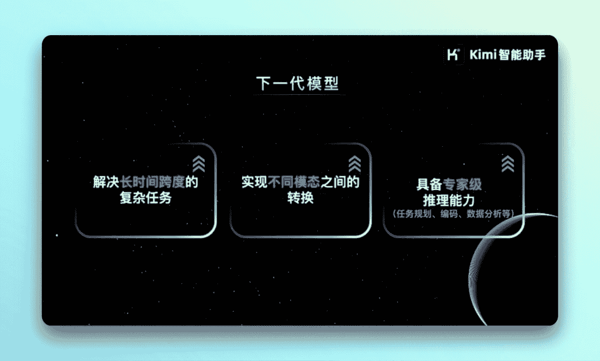
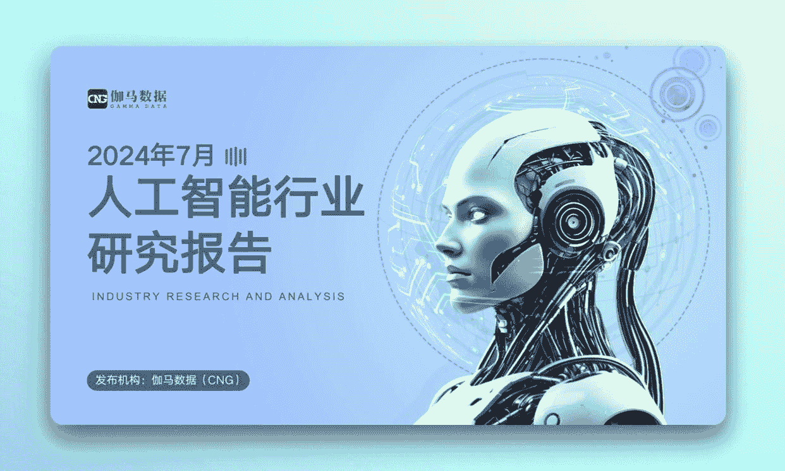

# 9🈷️17日

> 来源：[https://v11enp9ok1h.feishu.cn/docx/UwJzdgn4YowcE8xn8MccHKaJnIe](https://v11enp9ok1h.feishu.cn/docx/UwJzdgn4YowcE8xn8MccHKaJnIe)

+   《Kimi创始人杨植麟最新分享：关于OpenAI o1新范式的深度思考》

① 规模定律之后，大模型发展的下一个范式是强化学习。

②  OpenAI o1模型的发布，通过强化学习尝试突破数据墙，并看到计算更多向推理侧增加的趋势。

③ 决定这一代AI技术的上限，核心是文本模型能力的上限。

④ AI产品的能力由模型能力的决定，这和互联网时代有本质不同，模型能力不强，产品体验就不会好。

⑤ AI时代的超级应用，大概率会是一个AI助理。

+   《伽马数据：2024年人工智能行业研究报告》短短一年多，人工智能（AI）行业，产业层面上，基础层、技术 层、应用层全方位爆发，在场景上，AI技术广泛应用于医疗、金 融、制造、自动驾驶等行业，飞速的发展，带来了巨大的机会， 同时也伴随着各种不确定。本报告研究范围：我们从宏观环境、中观行业、微观应 用三个不同角度进行分析。宏观上，政策动向、市场动态、竞争局面；中观上，用户需求、垂直行业数据、流量情况；微观上，产品动态、应用情况。

[AI行业报告](https://v11enp9ok1h.feishu.cn/wiki/QuT3ws0gBiuXPjkTrkKc7yZsng7?from=from_copylink)它一些报告发布在行业报告板块|

+   《德勤：2024生成式人工智能应用现状前沿洞察报告-立足当下谋定未来》

+   《德勤：2024重塑正当时：人工智能引领银行业变革启航》

+   《甲子光年：以量子人工智能重新定义智库》

+   《伽马数据：2024年人工智能行业研究报告》

+   《人工智能与数据要素竞赛白皮书2024》

+   《上海人工智能研究院：2024智能算力产业发展白皮书》

+   《汤森路透：2024专业人士前景报告：人工智能技术与塑造职业工作的力量》

+   《[头豹：2024年中国人工智能药物发](https://v11enp9ok1h.feishu.cn/wiki/QuT3ws0gBiuXPjkTrkKc7yZsng7?fromScene=spaceOverview&table=tblf0Ijt7AQVEpbP&view=vewdOfpCxV)现与开发行业概览-从“制药”走向“智药”》

+   《微软：生成式人工智能、心理健康和安全技术》