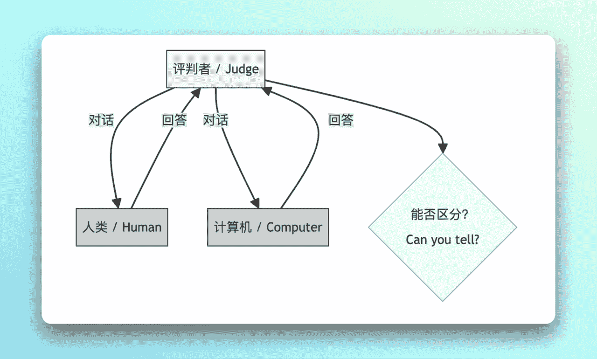

# 9🈷️18日

> 来源：[https://v11enp9ok1h.feishu.cn/docx/PTirdu81po5KHxxEkUYc2vyMnnf](https://v11enp9ok1h.feishu.cn/docx/PTirdu81po5KHxxEkUYc2vyMnnf)

**《**[**北大国发院&智联招聘：AI大模型对我**](https://v11enp9ok1h.feishu.cn/wiki/QuT3ws0gBiuXPjkTrkKc7yZsng7?from=from_copylink)**国**劳动力市场潜在影响研究报告（2024）》探讨了AI技术，尤其是大模型技术对劳动力市场的影响。报告指出，AI技术的发展推动了对AI人才的需求增长，特别是自然语言处理和深度学习岗位。大模型相关岗位的招聘薪资上涨，对学历和经验的要求提高。技术应用对企业招聘产生影响，编辑/翻译工作最易受影响，而研发岗位招聘更快做出调整。地域分析显示，一线城市和省会城市的AI产业发展水平更高，中西部省会城市的劳动力市场结构更易受大模型技术影响。

+   **《**[AI决策背后的黑箱：企业如何避免陷入智能陷阱，重塑决策流程](https://v11enp9ok1h.feishu.cn/wiki/NsagwJzJBiPaPfkLPbMcpSwTnoc?from=from_copylink)**》**这是大雨老师在组织参与「谁是人类」活动之后写下他的观察和思考，本文探讨了 AI 在企业决策中的潜力与风险，强调了 AI 的 “黑箱” 效应，提醒企业领导者保持批判性思维，避免盲目信任 AI。文章分析了数据偏见与认知扭曲对决策的影响，并提出建立 AI 决策审核流程的重要性。

