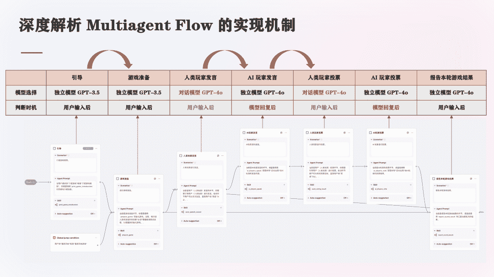
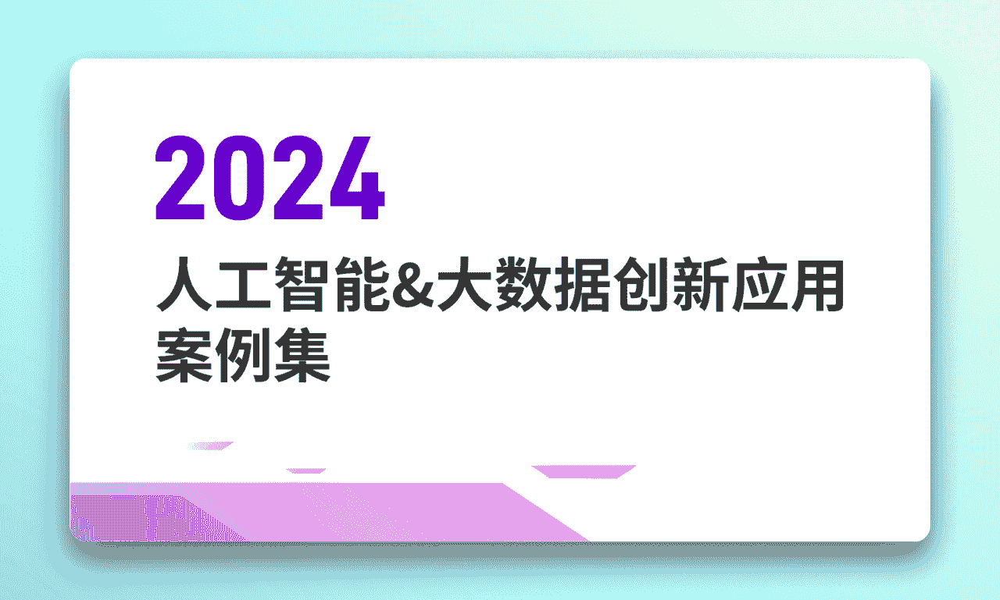

# 9🈷️19日

> 来源：[https://v11enp9ok1h.feishu.cn/docx/TG3jdY86NoOj8YxVY1ecYudLnef](https://v11enp9ok1h.feishu.cn/docx/TG3jdY86NoOj8YxVY1ecYudLnef)

+   **《**[长文深度解析 Coze 的多 Agent 模式的实现机制](https://v11enp9ok1h.feishu.cn/wiki/BpcdwOCQfioQC6kVj5occE6Gn0e?from=from_copylink)**》**

以《谁是卧底》为例，它的标准流程是：【引导】→【游戏准备】→【人类玩家发言】→【AI 玩家发言】→【人类玩家投票】→【AI 玩家投票】→【报告本轮游戏结果】。

+   《数字产业创新研究中心：2024人工智能大数据创新应用案例集》本案例集旨在汇集近年来人工智能与大数据在各个领域中的创新应用与实践成果，展现科技如何深度 融入社会生活的方方面面，推动各行各业的转型升级。 案例集收录的人工智能 & 大数据创新应用典范案例， 基于面向各行业企事业单位、数字原生企业、各类数 字化服务厂商征集精选而出。通过精选的案例，我们 希望能够为读者提供一个全面了解人工智能与大数据 应用现状与发展趋势的窗口，激发更多的创新思维与 实践探索

[2.3AI行业报告](https://v11enp9ok1h.feishu.cn/wiki/QuT3ws0gBiuXPjkTrkKc7yZsng7?from=from_copylink)它一些报告发布在行业报告板块|

+   [《亿欧智库：2024人工智能开启汽车](https://v11enp9ok1h.feishu.cn/wiki/QuT3ws0gBiuXPjkTrkKc7yZsng7?from=from_copylink)产业智能化新时代-AIEV产业研究报告》

+   《依隆大学：2024人工智能与政治》

+   《德勤：2024释放人工智能潜能报告-衡量医药创新回报》

+   [《工业和信息化部：国家人工智能产](https://v11enp9ok1h.feishu.cn/wiki/QuT3ws0gBiuXPjkTrkKc7yZsng7?from=from_copylink)业综合标准化体系建设指南（2024版）》

+   [《IBM：2024利用生成式AI增强竞争优势洞](https://v11enp9ok1h.feishu.cn/wiki/QuT3ws0gBiuXPjkTrkKc7yZsng7?from=from_copylink)察报告-整合产品开发、供应链和可持续性》

+   [《GEP&Everest Group](https://v11enp9ok1h.feishu.cn/wiki/QuT3ws0gBiuXPjkTrkKc7yZsng7?from=from_copylink)：2024生成式AI时代的采购转型报告》

+   《CIC灼识咨询：中国人工智能教育蓝皮书》

+   《2024交互型多模态大模型研究进展、应用前景以及商业模式分析报告》