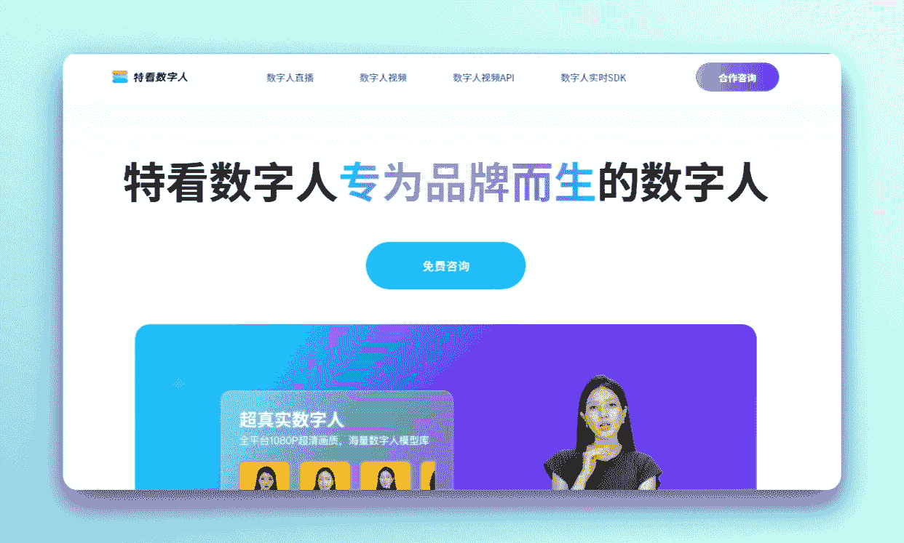
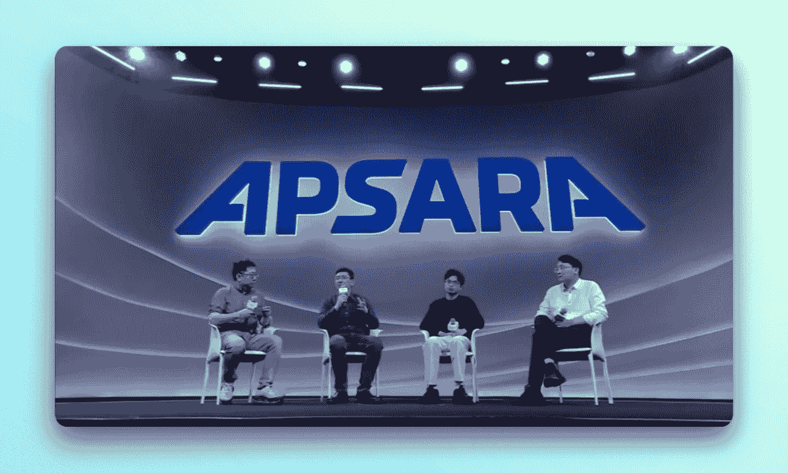

# 9🈷️20日

> 来源：[https://v11enp9ok1h.feishu.cn/docx/B0srdpGyjoKNmhxV4gAcLeZnnLe](https://v11enp9ok1h.feishu.cn/docx/B0srdpGyjoKNmhxV4gAcLeZnnLe)

+   **特看科技**-[最近招聘信息-持续更新中](https://v11enp9ok1h.feishu.cn/wiki/IAd5wWc0Ri5jVMkdnD8cQNoRnGK?from=from_copylink)I产品经理                查看详情 →

+   【岗位要求】

+   -负责AI视频工具方向产品工作，对生成式AI产品有一定研究，熟悉Transformer和Diffusion模型的优先。

+   -英文好，有海外产品经验优先，有内容工具或SaaS产品经验优先

+   -2年以上产品岗位经验，职级根据经验能力制定，对标阿里P6-P8区间

+   特看科技专注于AI视频和直播应用，将视频和直播领域的AIGC技术，结合海量短视频商业数据，应用在广告和营销的短视频和直播场景。特看科技在国内市场目前已服务欧莱雅、宝洁、雅诗兰黛等头部品牌集团，海外市场服务了安克创新、Posee，Y.O.U等头部出海品牌。特看也是TikTok 官方广告创意合作伙伴。

+   《[o1发布后，信息量最大的圆桌对话：杨植麟、姜大昕、朱军探讨大模型技术路径](https://v11enp9ok1h.feishu.cn/wiki/AARVw3doXioGCrk7Z0lcOoCCn2g?from=from_copylink)》在云栖大会的圆桌对话中，杨植麟、姜大昕和朱军探讨了 AI 技术的快速发展，特别是 OpenAI 的新模型 o1 的意义。与会者认为 AI 在数量和质量上都在加速进步，o1 首次展示了语言模型具有人脑的慢思考能力，标志着强化学习新范式的应用。整体来看，AI 技术和应用的发展路径将更加明确，未来 18 个月仍将持续快速演进。

