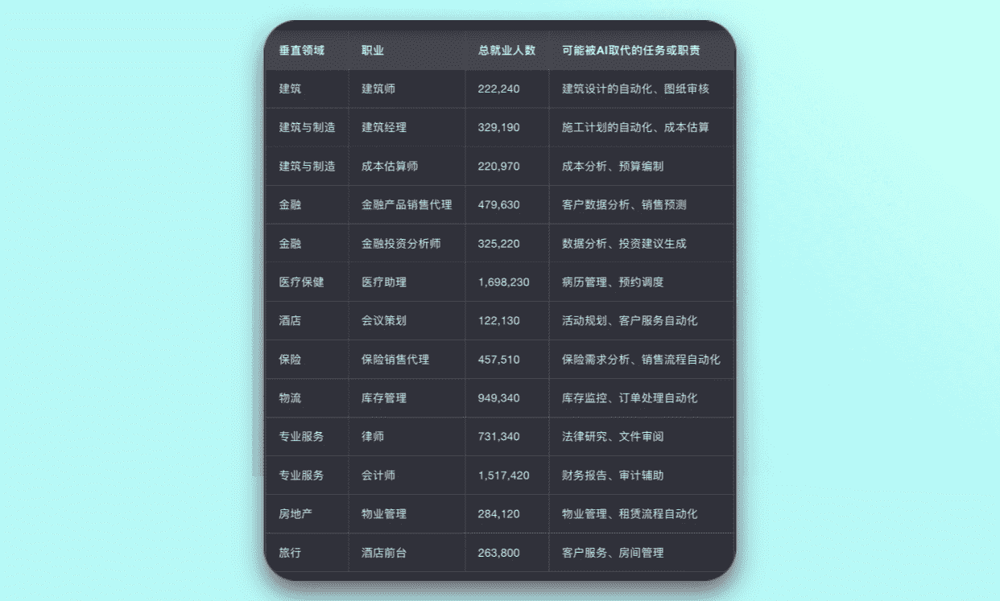

# 9🈷️21日

> 来源：[https://v11enp9ok1h.feishu.cn/docx/DZ3udUBUxoZBdbx86ZDcfF4mnQc](https://v11enp9ok1h.feishu.cn/docx/DZ3udUBUxoZBdbx86ZDcfF4mnQc)

+   《[节点间太远够不着, 连线麻烦? -- 超实用Comfyui小技巧](https://v11enp9ok1h.feishu.cn/wiki/X7CswLGeliKp0zkpT4ucg3pvnNb?from=from_copylink)》本文介绍了在 ComfyUI 中处理节点连接的实用技巧。当节点间距离过远时，可以通过 “转接节点” 来简化连线，像网线连接一样方便。此外，采用 “Wifi 连接” 方式，分为广播和定向发送，提升连接效率。缩小画面以寻找节点并拉线也是一种有效的方法。使用这些技巧，可以使工作流更加清晰和便捷。

+   《[a16z硅谷预判｜每个白领岗位都会有一个Copilot，直到被Agent取代](https://v11enp9ok1h.feishu.cn/wiki/ROWGwyGcUisQ46knHw6cMa2WnVf?from=from_copylink)》来自 FrankGPT，根据 a16z 的研究，约 15% 的美国工人任务可以通过大型语言模型（LLM）更高效地完成，且这一比例在结合垂直 SaaS 后可达 47%-56%。文中列举了 50 个最易被 AI 自动化的职位，并指出初创公司可以通过优化数据收集和繁琐工作流程等方式进入市场，创造机会。

