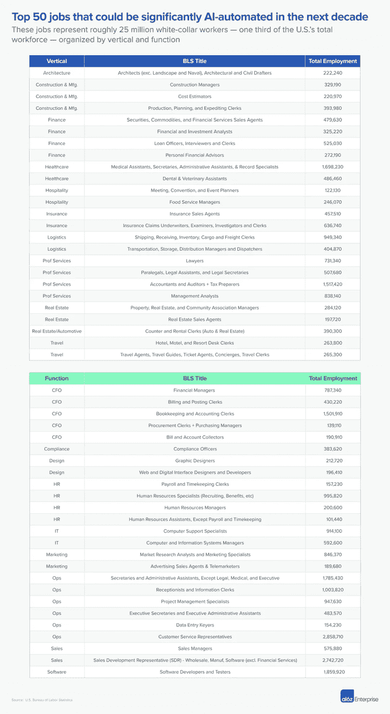
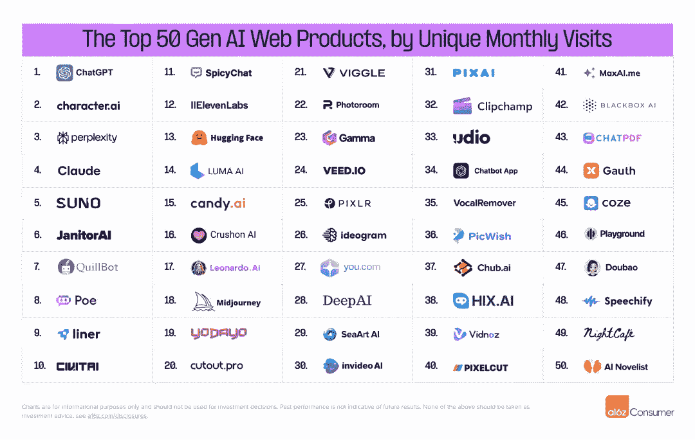
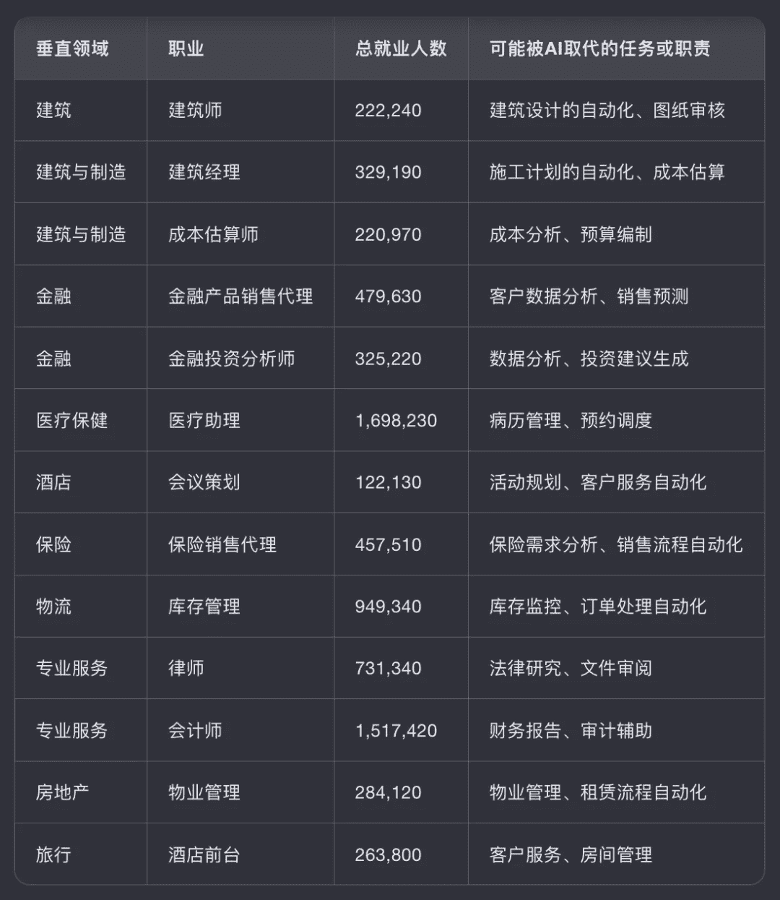
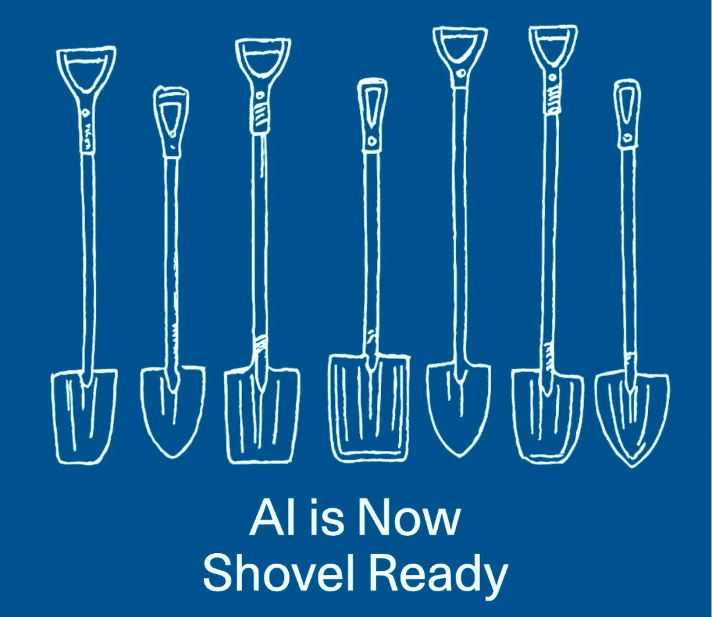

# a16z硅谷预判｜每个白领岗位都会有一个Copilot，直到被Agent取代

> 来源：[https://v11enp9ok1h.feishu.cn/docx/Le9Ed2r12oMvgUxKkQDcm6zln8f](https://v11enp9ok1h.feishu.cn/docx/Le9Ed2r12oMvgUxKkQDcm6zln8f)

我一直相信，每个白领岗位都会有一位人工智能副驾驶（AI Copilot）。其中有些岗位，更将通过人工智能代理（AI Agent）实现完全自动化。

虽然传统企业通常对技术变化反应迟缓，然而，很多Copilot和Agent最自然的应用，仍在传统行业、传统岗位的工作流或记录系统里（例如 Salesforce 推出的销售代理）。

记录系统 (SOR) 是数据代理需要完成专业任务的地方，也是任何新用户界面驻留的自然启动板（例如，提示代理）。

那么如果一家初创公司想要打造一家大型Copilot或Agent公司，它该如何胜过现有企业和现有员工的天然优势呢？

1.  **在数据收集阶段插入上游**

贷款或保险单的数据，仍然经常通过电子邮件和 PDF 收集。初创公司可以“AI 化”此工作流程，并在数据到达现任 SOR之前拥有这些数据。

比如，虚拟贷款员或保险代理人（如Cascading AI 的“Sarah”）可以负责最初的来回客户文件收集和预约安排。

同样，像11x.ai这样的虚拟销售开发代表 (SDR)可以收集有关潜在客户的所有信息，并在现任 SOR 中创建记录之前拥有初始通信。

2. 将繁琐的工作流程“人工智能化”，在现有工作流程之外完成

**银行业**中，没有什么比“了解您的业务” (KYB) 入职流程更繁琐的了，该流程涉及文件检查、互联网搜索以及企业和金融机构之间的来回通信。

**Parcha.com** 等公司将自动解析上传的每份文档，提取所需信息，并跟进客户缺失的信息。

**医疗保健**是另一个拥有大量繁琐工作流程的行业。Tennr将接收传真机上的每份医疗文件，提取患者和诊断详细信息，甚至进行保险预审，以简化患者就诊流程。

通过解决痛苦的工作流程，初创公司可以成为数据存储库并获得进一步自动化工作流程的权利。

1.  整合不同的数据源，创建“新的多模式”记录系统

与现有 SOR 中保存的数据相比，现在存在的数据与要完成的工作相关得多。

比如，销售数据不仅存在于 Salesforce 或 Hubspot 中：还有电子邮件和 Slack 消息、销售支持材料、产品使用数据、客户支持记录、新闻和财务报告等。

通过整合这些数据源，新公司可以获取比现有公司更全面的数据。

比如，Pylon等公司旨在通过提供客户问题的单一视图，成为快速增长的 B2B 公司的客户 SOR。

借助 LLM，初创公司可以构建完全非结构化和多模式的新型 SOR，不断获取文本、图像、语音和视频数据以创建最新的上下文。

# 许多行业，都有Copilot和Agent的机会

OpenAI 和宾夕法尼亚大学最近的一项研究发现，如果借助LLM，美国大约 15% 的工人任务，可以在同等质量水平下以更快的速度完成。

如果将基于LLM构建的软件和工具（即垂直 SaaS）纳入其中，这一比例将上升至所有任务的 47% 至 56% 之间。

受这项研究的启发，我们从美国劳工统计局提取了 2023 年的就业数据，并确定了 50 个最热门的职位，其中 50% 或更多的任务可以由人工智能完成。

话虽如此，今天未能谈及的包括很多长尾工作、繁琐的日常事务，对AI Copilot和Agent的需求潜力同样大，甚至更大——其中包括该国的 48,000 名经纪文员、44,000 名接线员、37,000 名文字处理员、25,000 名保险精算师和 52,000 名医疗转录员，仅举几例。

** **从文章一开始呈现的《Top 50最容易被AI自动化的工作》表格里，希望给大家多带来一点启发！建议收藏～

虽然这个表格算不上详尽无遗，但也许是一个思考的路径，或者目录。

**就像我的一个朋友天放，曾在图书馆里，自己盘点ChatGPT可以应用的效率工具，列出了所有**常用的办公软件，发现“思维导图”还没人做，于是就有了他的ChatMind产品……

想将某个岗位、某个职能转变为AI应用？也许这就是属于你的机会！

参考阅读：

https://a16z.com/ai-copilot-ai-agent-white-collar-roles/

https://a16z.com/100-gen-ai-apps-3/

