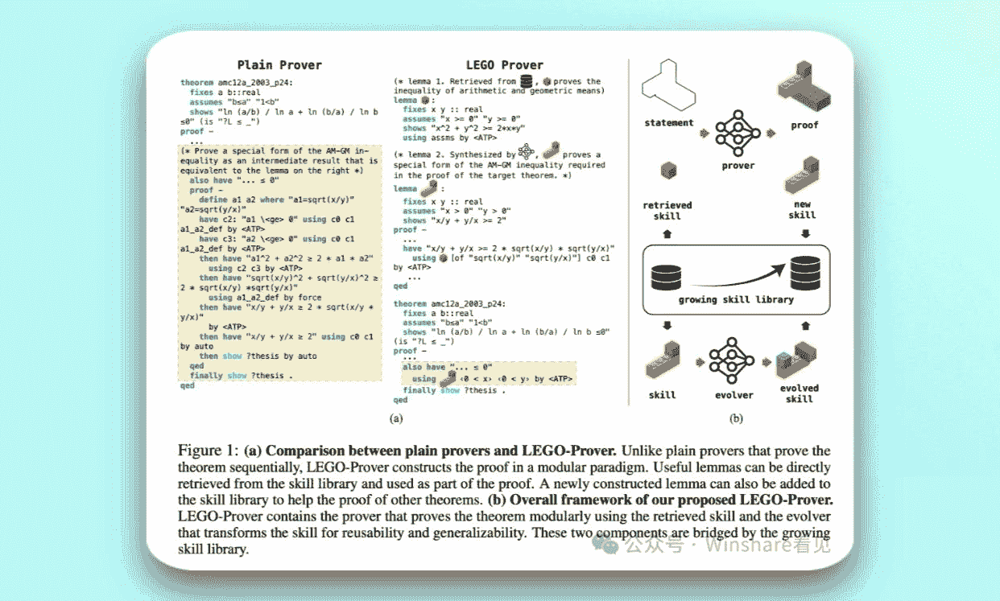

# 9🈷️22日

> 来源：[https://v11enp9ok1h.feishu.cn/docx/FFX7dPgGKoa9fSxlYvpcgAiPnUg](https://v11enp9ok1h.feishu.cn/docx/FFX7dPgGKoa9fSxlYvpcgAiPnUg)

+   《[LLM应用路在何方？](https://mp.weixin.qq.com/s/Wo3z_U0GeuVdDoJ0UvxTyw)》作者Winshare，自 ChatGPT 引发的大模型变革以来，LLM 的应用面临诸多，包括对 NVIDIA 等上游企业的依赖、商业化路径不清晰及资金不足。这导致低价值场景泛滥和用户流失，形成恶性循环。大模型的应用应关注高价值需求，而非基本需求，避免低层次市场的竞争。

